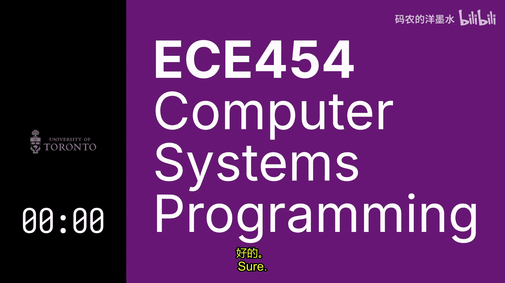

# 【全集】多伦多大学 C语言高性能系统编程实战 中英字幕 1080P p19 Lecture 19 - 最终复习 -BV1oDrZBZEG2_p19-

🎼Yeah。🎼是。

Alrighty， welcome back to 4，5，4。 So， yeah， the course pretty much done。

 So we'll be doing some quick final review of everything that you need for the final。

 And then pass that。 We can do fun stuff at the end， slash。😊，I mean， whatever we want。But yeah。

 Monday。Always a bit late。Let's get into how your final will work。

 So it will cover all the material from the course。 It is on the 19th， so。Remember。

 it's quite a fair bit away。 Remember since I canceled。Friday's lecture。

 I'll do a review session closer to that date when you actually pay attention to the stuff。

 but this is mostly so you have the recording， you actually know what to expect on the final and everything like that so。

It will be cumulative， there'll be CPU architecture， compiler optimizations。

 performance optimizations， not to the same degree as your midterm， since that was all your midterm。

Then stuff we did after cash performance。Little bit of dynamic memory and modern allocators。

 Then we moved on to thread synchronization， which was mostly review。Parallel architectures。

 performance， better locking methods and avoiding locking through using the atomics themselves。

 Then we got into a bit of map reduced and everything will be done like the final content will be based on the lecture in the labs。

 probably less so the labs。So let's go through it quickly。 So what did we learn。

 So started off sequential program optimization， talked about CPU architecture profiling。

 which was optional from lab 1 on。 Hopefully you used it。 I guess some of you did not。😊，嗯。

Some compiler optimization， the memory hierarchy， cache optimization。

 talked about coherency and consistency， dynamic memory， then threads， synchronization。

 parallel architecture's performance， and again locking and avoiding locking。

So review from the beginning of the course is start off brief。

Review well or brief introduction to some of you CPU architecture。

 so some things that make a CPU fast pipelining， filling up every stage in our CPU all at one time。

 we had branch prediction and then to make things fast。

 real CPUs do out of order execution might have some instruction level parallelism where a single instruction issues multiple operations at the same time。

 and then some simultaneous multithreading or SMT so。If we focus on Intel。

 this is basically how it looked like through history。 So 71。No pipelining。

 you just had how many cycles the instruction took is the cycles per instruction。

 then once we added pipelining and branch predictions we got closer to one and with branch predictions we got even closer to one。

 so just one cycle per instruction。After that we tried to do things in parallelism。

 so one is the best we can get without any parallelism。

 moved on to superscalear that was just having like multiple ad units on our CPU that can all run in parallel or multiply units GPUs and tensor units of course。

 take that to the n degree， but that's the idea on a CPU。

 then we add out of order execution to fill keep that pipeline filled up and then simultaneous multithreading which just essentially stole instructions from multiple threads in order to keep that pipeline all filled up。

So did some profiling use GProf GCV， which isn't really profiling。

 it's just a coverage tool to make sure that some lines are executing。UX time Command。

 which was just wall clock， which is currently what your users see and what's being evaluated on Lab 5 and then Perf to get a whole bunch of other details about what's going on。

 you can see cash misses and actually hardware events from your CPU so the rationale behind profiling before you start optimizing things。

 premature optimization， root of all evil， and we of course had AMDL's law。

 which basically gave us a cap on our speedup， so it was old so our speedup was old time divide by new time。

And our。Speed up is kind of limited by AmdL's law if we can only speed up 50% of our code。

 even if we make it take zero time while our overall speed up is still only two times。

 so that would be our implication of that law。Alright， then we got into compiler optimizations。

 We found out that some compilers are better at other than others at certain things， so。Most CPUs。

Like if you do GCC or clang and you use01， you get simple things like constant propagation folding。

 subexpression elimination， copy propagation， dead code elimination， loop andvari code motion。

 just moving stuff and function in lining。 So it only in line stuff that nose is profitable。

 So really， really small functions like getters or setters or something like that。

 if you're doing it in C plus plus land。 And then well we had02 and 03 that might do slightly different things。

 it will try and do some smarter instruction scheduling。

 maybe do some loop unrolling that you might have to do manually。

 might try to do some vectorization while it should try and do vectorization As we saw clang was a lot better at this than GCC GCC was kind of bad at it and then。

Found out that， hey， we should probably just look at our outputs。

 make sure that our compilers are doing the right thing。 otherwise we might need to help them。

 especially with loop unrolling on some CPUs。So your role as a programmer。🤢。

Don't want to prematurely optimization， we don't want to smash it into oblivion。

P make everything hard to read， just make everything a giant array and pointers everywhere。

 you want it to be easy to read and only optimize it if you absolutely have to。

 so some things to do before you start smashing it to bits select a good algorithm first because without that you can't do very much。

Write some code that's readable and that someone else can read and hopefully maintain。

 write functions， maybe use recursion， although some of you still don't like recursion， maybe。So。

Or you can use other functional stuff or different languages that hopefully prevent you from doing silly things。

Might have to eliminate some optimization blockers again。

 you're kind of helping the compiler do its job。You can。

The easiest thing to do that we showed was very successful is enabling link time optimization probably should do that it unless you have a reason not to do that。

Can slow down your compile times if you have a gigantic program， but for the most part。

 you're good to just leave that as a same default。And of course， if we have really， really。

 really loop codes， you want to focus on the inner loops。Those are the hotspots in the code。

 do your optimizations there because while that's going to be executed the most number of times。

 and that's where you should start your focus。So then we got into cash performance。嗯。We first off。

 we fiddled around with like L1， L2， figuring out how those caches work。

 came back to it later once we talked about parallellyization。

 but we talked about how to exploit this， basically keeping things on cache lines which are basically 64 bytes。

 and then later we talked about you know。You have to do some well with virtual memory。

 you have to translate it to pages， and we might also have to do some performance optimizations to keep things on certain pages which we saw with some of the dynamic memory allocation then we didn't really talk about disks or anything like that。

 not sure why that wasn't included something else to put in the course having。

If you do do this in practice， you might want to look into things like non blocking I O and things like that。

 So you can actually do some useful work while you're waiting on these slow。

Rights to disk or things like that nature， especially if you have a distributed file system or something like that。

 that could be quite slow。And why Cas work is， well， I mean。

 our programs tend to reuse the same memory over and over again or something close or something next to it。

Two major types of locality， we temporal locality， so we'll just reuse the same memory locations over and over again。

It's very likely whenever we write programs and then spatial locality will we'll probably access the next element。

 and well our caches and prefeting try to take advantage of this， which we can of course。

 help the compiler out if we。Somehow know our memory accesses better than the compiler。

 The only example where that actually worked was that binary search example where it looks to the hardware that you're accessing memory almost randomly and the prefetcher doesn't work。

 but for the most part， if you add your own prefeting。

You're probably going to do worse than the actual hardware prefecher。So。

You want to write code that has locality， generally we will be doing this。But in case you have very。

 very large data structures。You might need to change how your data structures are in memory so you can take advantage of both these。

 so you want to access things contiguously。Link list were generally really， really bad for this。

 Try to lay them out as much as possible。 If you're using keys and values and you're always checking the value with the key。

 you probably want to store them together as opposed to maybe a separate array of keys in a separate array of values and then T。

 make sure if you're trying to modify the data you just do it all at once。

 you don't keep going back to it So this might have to do with choosing a good algorithm or doing loop transformations。

 we saw that tiling example when we had a giant matrix multiply where well for going one direction it was good for the caches for going the other direction it was not good for the caches。

 So we just made sure we reused things that were brought into cache。

So then we got anti dynamic memory management。Talked about implicit list， explicit list。

 So implicit list。 remember， we were just treating the whole block of memory。

 putting a size tag on it and then using the space in the middle for the allocation， putting a。

Tag also at the end so we can traverse it forwards and backwards and then for the implicit list to do any allocations we have to search through all the free and allocated blocks which might be really slow for the explicit list we have the same structure but we also added a linked list of free pages so that doing an allocation we don't have to search through already allocated blocks which is a waste of time and then we had segregated free lists which just kept track of different lists of different sizes so。

We might also figure out you know how we pick a block to use for allocation if many might fit。

 there's like the worst fit， best fit， first fit， that kind of thing。

 then when we reinsert a free block where that was we had to merge it with the one beside it so we coalesce things together so we actually kept track of the largest free hole in memory and then we briefly went over how PRK malloc and JE Maloc work trying to take advantage of well multiple processors trying to keep allocations local to a thread for JE Maloc and for。

PHK malloc that was trying to use pages effectively and。

Instead of just assuming the heap is just one giant block of memory in that virtual memory does not exist。

Alright， then we got into multi threading， which seemed like a lot of review to me。

 So we figured out how to share data。 Well， how to share data across different threads。

 It's all shared by default and。If we do that， while we have to keep track of communication synchronization。

 we might have data races。Data races， again， this kind of feels like review from 344 to concurrent accesses to the same location with at least one being a right。

 in which case you might get some still value if you allow a data race to happen to prevent it。

We need things like Mu Texas that ensure mutual exclusion。 only one thread writes at a time， but。

If we just have one mutex， our program is going to be slow because we're essentially making it ce with the overhead of a lock。

 which might introduce contention。 And while it takes a few。

CPU cycles to even acquire and release the lock。 So if wed go to more fine grain approaches where we try to have multiple locks covering smaller areas。

 we might lead ourselves to a deadlock。 So we should know how to use the P thread library。

 You might use C plus plus threads。 They're going use the P thread library。Just a better。

 possibly a nicer way of doing it。 and then like I said。

 coarse grain and fine grain locks because we will care about performance。

So we might have to parallelze some code that looks like this where we have some dependencies。

 so we want to make sure we always write to the value before we read from that value and if we just try to naively paraze this。

We might be reading old values because， well， we don't know what other threads are at。

 So each iteration actually depends on the previous。

 So we have to do some synchronization between the these。 so we could use。

Centator for is barriers or what have you？So then we've got into parallel architectures because we know at least at L1。

 each cache is private to a core。Typically， L1 and L2 are private to a core and L3 is shared。

 so because of this。We have to ensure some consistency between the different cores that are all changing memory。

 so this is where we got into the difference between coherency and consistency。

 which is where all of the fun things happen so。Any wonder coherency is？Versus consistency。Yeah。

 is coherency。反。玩四哥。He's a memory love。Yeah， yeah， so coherency is the same memory location。

 the view of the same memory location across multiple cores。

 consistency is the ordering between reads and writes between multiple cores。

 so consistency or sorry， coherency， same memory location， consistency， different memory locations。

So for coherency， that same memory location， there was this Mezzi protocol to actually make sure that the cache value was consistent across multiple caches here we started off with just MSI without this exclusive bit and that caused invalidation on every single core no matter what even if a core was the only one to hold this memory value so we need to add this exclusive state so that we could actually do a local update without causing invalidation to every single other core。

And then we had false sharing， anyone remember what false sharing was？Yeah。啊。Acssing。

Different pieces of memory， but they rely on the same。Yeah。

 when we access when two cores access different independent pieces of memory。

 but they happen to be on the same cache line， so according to this protocol， they're shared。

 even though that specific value might not be shared so if we have that that will cause invalidation all over the place and cause all the cores to go really。

 really slow and then we figured out， hey we probably want to add extra padding or things like that so that well we don't get this false sharing problem。

 we don't destroy our caches or performance through cache and。

So some other implications of this parallel architecture that cache coherency was expensive。

 It's also more than you thought。 If you have false sharing， your performance。

 will'll tank by probably like 10 x or something like that。 It will be bad。

 So atomic operations are also somewhat expensive。 So for implementing better locks。

 we might want to avoid unnecessary co coherence updates and things like that。

If we get a large server， unfortunately for us we did not have access to a large server with multiple sockets。

 but if you happen to get access to one of those crossing sockets， if you have like two CPU sockets。

Crossing that communication barrier is a large killer because now we're not even doing these coherence protocols on the same chip to cross different chips。

 yeah。Are there tools at all？Help us to type false sharing easily。

Perf would help you because you'd have so many more like cash misses。

So yeah Perf definitely help you there， it won't explicitly say hey。

 you're doing a false sharing or anything like that。

 but you'll see your cache miss just skyrocket and you can narrow it down to figure out where that's happening and then you can probably get a good idea of doing that。

So like with most things， knowing is half the battle。 whoops， I just wrote a line across that。

All right。So。If you cross sockets or things like that。

 while it can be slower than running the same program on a single core。

If you need to mess with the scheduling， there's affinity。

 So affinity mass is like the odds of that thread to stay on the same core。

 So if you have multiple or different communication between threads or something like that。

 you can make sure that， hey， they're all scheduled to be running on cores that are physically close to each other。

 So you don't have the same problem。 And this is becoming more of an issue now。

 if you have like the big new AMD chips， they have like a chipt design。

 Each chipt within a chipt it's really， really fast across chipts， it's much slower。

 even on consumer。CPs， I think there's like two triplets， at least。

 So might even be a thing for you nowadays， even with a， well， with a high end desktop。

So then we got into memory consistency。We already talked about the difference between。

coherence and consistency， and then sequential consistency。

 which was making sure that reads and writes appear in some order as if they actually executed on a single CPU core。

It was really expensive to implement though。 Anyone remember why that was really。

 really expensive to implement sequential consistency。Yeah。Yeah， you can't reorder anymore。

 that's one of them。Any other ones？Cash insist you had to do it well in order to make sure it was consistent。

 we had to stall the CPU too， right， had to stall， wait for a read to appear on all cores。

 That's also really slow。 And also wouldn't be able to use like they have a store buffer on the cores。

 if you're doing that。 Well you have to flush the store buffer in which case。

Access if it's not even there in terms of performance。

So all those processor optimizations violate sequential consistency。

 especially the store buffer is a big one out of order， another big one。

 so we can use things like memory barriers if we really， really need a set order。

 so there was read barriers， write barriers and then full barriers。

And a read barrier will make sure all the reads before it happened before any reads after the barrier。

 so we might need to do that in order to implement synchronization primitives and things like that。

If you use P thread lock， don't worry about， they put barriers in it for you so that it performs as you would expect。

 but if you are writing something that communicates across different cores。

 you might have to think about memory ordering because。Your compiler also might reorder instructions。

 so just because you wrote them in some order in your program does not mean your compiler is going to output them in the same order and also does not mean your CPU is going to execute them in the same order。

 which is fun。So then we got into better locks， so how locks are implemented。Mostly， I mean。

With atomic instructions， so there's compare and swapwab， test and set。

 and what the hell is the other one。Fetchion increment or fetch an ad or something like that。

 So those were all of our synchronization primitives， all of our atomic。

Operations that are supported on the hardware。It's expensive because while mostly has to deal with the cash reasons all of those things are slow。

 especially if something are spinning on the same memory location。

 you have to make sure all the all the caches are consistent and all of that so started off talking about spin locks because they are the easiest thing to implement and the fastest one as long as we don't care about the busy weight problem。

Then。We started with a test and set spin lock and then went to a test end test endet spin lock。

 Anyone remember one what the hell a test end test end set spin lock was and why we did that。Yeah。

Like when we。We did our thing without actually checking with the Mu Texas just to see if it somehow would work。

We checked it with the new text。Not quite。 So our test and set spinlock River。

 it was like a wall loops of while it tried to test and set and why while it could not set。

It from false to true， just kept on retrying again over and over to set that value。

Test and set it tries to every time。Has been said this。Yeah。The testest Test set is just reading so。

Exist as sherian。Yeah， so the difference between it is test and set always invalids all the caches because it tries to write the test and test and set would constantly loop just only reading that value。

 reading it over and over again until it is zero or false and then and only then would it try to do that atomic operation that would invalidate all the caches。

 So that was trying to keep it in that sharing state as long as possible and only trying to do the right when it knows it might possibly succeed。

 won't be guaranteed succeed but it might have to then ticket lock Anyone remember what the hell ticket lock was。

Yeah， remember someone posted they went to Service Ontario， they got a ticket， yeah。

It of keep on checking to see。Yeah， so you just have another。Baically。

 where you atomically increment that， you the number， the original number is your number。

 and then you get the muttex in that order。 So you start spinning on that。

 The major benefit of ticket locks as opposed to the test and set ones is that they're more fair。

 you actually get things in the order that you request them in more or less， I mean。

The hardware has to break the ties， but you'll get them in some order they are a lot more fair than the other types of spin locks。

 and then we got into queuing locks like what was it called the MCS1， I remember queuing locks。

A link list， something about a linked list。 that was basically the one where。Yeah。

 it was a linked list and you took the lock and then you got your own local copy of it and then you only spun on your local copy of it and if something else added themselves to a list。

 you would let them spin and this way if queuing lock or sorry， yeah。

 the queuing locks played a much better with the caches because you only spun on your local variable。

And the only global update you did was to add an element to that link list， which is not that bad。

The whole idea was just spin on your own local variable。

 of course we'd have to make sure we didn't do any false sharing or anything like that。

 we'd have to make sure it was all on our cash lines。

Just talked about how they were implemented and their things。 So then we got into avoiding locks。

 and that was basically one of the last things we did。So challenges with locking。I mean。

 they can be slow even with the lock and unlock。Those take time to run if we have a lot of contention。

 things are going to be slow。Instead， we could have some non-blocking synchronization and how it's implemented is while just using those atomic instructions。

 try and do a simple update， most of the time it's done by just updating things locally and then trying to do an atomic update by pointing to the new value。

 thats most of the time how these lock free things are done。

 but we might get into the ABA problem where。On one thread。

 you might assume that if you read the same value twice， that nothing has changed， right。

 So if I read an A and then I modify and then。I write to it and it's still an A。 it hasn't changed。

 So every the state of the world is the exact same as when I left off。

 but the ABA problem is between your two reads of A， something might have come come between that。

 changed it in such the way。That it looks like nothing has changed。

 but another thread actually changed a whole bunch of things。

 So we had an example with that too for trying to do this with a stack。So then we saw RCU。

 so that read of。Oh， I forget what the C stands for， read something update。Read， copy， update。

 There we go。 It's either copy or create。 So read copy， update that was。Basically。

 if we're doing an update。Well， we。If we used like a read write lock right。

 we could have one writer and then no readers， it would block all the other readers。

 the whole idea of the write copy update was even if we are writing a value we want to still have everything reading from it even if it is an oldt value as long as it's consistent。

 we don't really care and what this does is it will actually do an atomic write to it。

Other threads might get an old value， but if you wait long enough。

 then that writer can go ahead and remove that old value because it's guaranteed that all of the readers have already。

Are already done with that old still value。 So that's one way we can actually update things so that we might get an old。

Old。Consistent state。 But if we don't care about that， this will cause。Things to be a lot faster。

 and it's really good， massively parallel systems where rights are fairly uncommon。

So that's pretty much it。 So what we learn lots of stuff so sequential program optimization。

 then parallel， then parallel programming on distributed system。

 So some things we didn't get to slash removed because it's in your distributed computing course if you've took that so we only talked about mapre that was by intention because I don't think the other section probably won't get to that anyways。

 so I'm not going to talk about it。So。We did get to map reduced。 Why do we need map reduce。

 and what is it， so。For the most part， it's a programming Model4 big data analytics where the programmer has a simple task of just writing two functions。

 a map and a reduce and then the system takes care of the rest。

 takes care of all the nitty gritty details， which is mostly what system programmers have to do。

 balancing all of the processing across multiple machines。Making sure that in the event of a failure。

 things can still progress and recover and you as a programmer do not have to worry about it。

 but a lot of this is more like in a distributed computing course。So。Technology is always changing。

 always have better tools， so。Moore's law on a single core。

 I mean we are just getting more and more cores， again。

 heat laws or whatever we can't push frequency of cores much harder than we can now。

 and then we have to rely on parallelism， mostly we focused with parallelism on a single machine。

 but of course you can have parallelism across multiple machines in a distributed setting。

Our focus was mostly just running on a single system。

So what have we learned that's still gonna be useful。 Well， it's going to change。

 So some techniques might not be relevant， some。Things may change。 The answer I always like giving。

 that was always true was it depends so。This is what it is like now。

 the whole purpose of course is to know that， hey， you should probably know what you're programming for and some hardware details。

 which is a good thing you are in ECE and you actually know how some of this stuff works。

We have to make sure that things are correct， easy program， scalability。

 energy consumption becoming more of a thing now as well。Better programming tools。

 try I'll start to introduce Ru on Friday。Which is a newer language that you will。

Probably not be tasked with writing immediately， but it will help you because it unlike C and C++ is actually built to deal with helping you program with multiple threads and making sure your program is correct。

 which C++ with all of its warts absolutely does not do even the newest standards with move semantics and all that。

We'll show examples on Friday and stuff basically。If you are doing any serious systems programming。

 you should seriously consider starting writing in rust again， we'll see it。

 but the key ideas we'll still hold， there's really nothing new。

Always going to have to optimize for the bottleneck。We'll always have caches。There'll be CPU caches。

 memory caches。As you go on， you might discover caches at different levels like MEMCache D。

 so that's like a web cacheache， basically just caches API calls， CDNs， caches， web content， again。

 this is more for web stuff， parallelization will always be a thing because while we can't just make things go faster on single core and。

The other thing I like saying is the quickest thing to do is to do nothing。

 So that will always be true， no matter what。 So remember those。Two things。

 fastest thing to do is nothing， and then it depends， and then you're good。So。

The more important part is to think about the why and not the how for each technique。

 we tried to focus more on the why does this happen， So why does。Cash coherency impact performance。

How its just a natural consequence of understanding why you should always be able to answer the question why。

 if something bad happens， otherwise you will probably fall into the exact same mistake again。

 always have some skepticism and some curiosity， do we really need this thing， is it helping me。

 what is actually going on under the hood？So that is the end of the content for at least on the exam。

 so you survived， for the most part， you still have to do La five， I guess， but we're almost done。

 so congratulations you survived。Hopefully you found it worth while， good luck on the exam again。

 we'll have more fun times on Friday and Monday we can do a little bit of rest。

 but as far as the course content is concerned， we are free。Joy， so。If you haven't done it yet。

 please submit your course evaluations。 The big crux of this was introducing that compend dot G G stuff and making that a lot easier and。

Hopefully that was good to submit your assignments to as opposed to some servers that may or may not crash so if you and again。

 this is the first time me doing this course。And I had to coordinate with another section。

 so I couldn't just randomly change things。Hopefully want to do that in the future well I will do that in the future。

 so please fill that out those evaluation forms keep me employed。

 so if you would like me to still remain here and have a job please fill them out with hopefully nice things or at least things constructive things。

😊，But yeah， we were。I didn't want to change too much this semester again because two sections。

 first time teaching it。I't want to rock the boat too much。 so already have some ideas。

 but I'm glad to hear more。 So with that we can wrap up again。 I'll be here the next two lectures。

 but not learning anything。 Well， we'll learn something new but nothing testable so just。😊。

