# 【全集】多伦多大学 C语言高性能系统编程实战 中英字幕 1080P p20 Lecture 20 - Rust -BV1oDrZBZEG2_p20-

🎼Okay。Yeah。Oh， whoops， that's the wrong camera。 All right， welcome back to 4，5，4。

 This will be a special edition lecture， where。😊，We play with rust。 So I might learn something。

 You might learn something。We have no one that actually knows rest here， right？Okay。

 so I won't learn anything， but hopefully we'll play around with it。

 see what it is and why it is good。

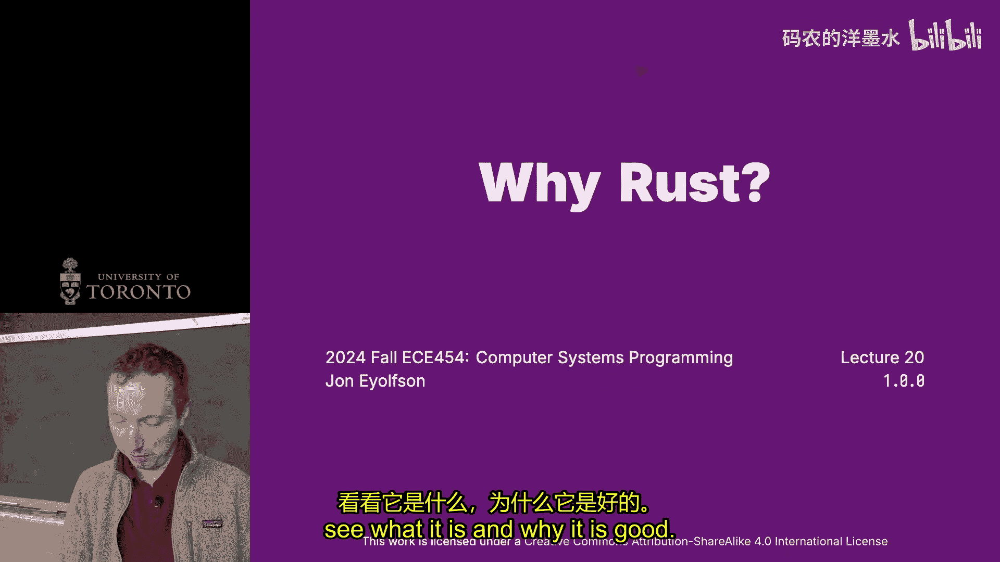

It is a next gen systems programming language。It's basically。

Trying to be a better C plus plus the whole idea behind it is we only compile correct programs。

 So this compiler has a lot of checks to ensure your program is correct。

 The three main benefits of using rust。And the three main things the compiler checks for us is ownership。

 so it prevents memory issues without GC。 it makes sure that objects are owned by only one single thing at a time and the compiler enforces that there's also a bor checker that prevents concurrency issues so data races so you are only allowed to have a single mutable reference。

 so you can only only one thread can write at a single time can have as many readers as you want。

 but only one writer。If you break that， the compiler starts yelling at you。

 and then we have lifetimes， which ensures that references are valid。So。Hello world and rust looks。

I mean， quite simple except except for the print LN with the exclamation mark。

Prit L N and rust is technically a macro。 macros always end with an exclamation mark。

 and unlike to see preprocessor macros that are literally just text replacement。

 the rest macros work with the compilers， so you will actually get meaningful error messages and it can do a whole bunch of fancy things and also not do any bad substitution since。

😊，doesnn't work on just text。So。Rust like C or C++ is statically type， however。

 this compiler is smart and does a lot of type inference for you by default so you can emit types and let the compiler figure it out。

Kind of like immediately having an auto and C plus plus， except you don't have to type auto。

 That's just the default。 The only thing types are required for are function arguments。

 other than that。It's fairly straightforward， primitive types and rest are everything has a size。

 it's quite obvious you don't have to remember how big a short is， how big an int is。

 how big a whatever the hell is。You've signed integers which start with I and then the number of bits for their size。

 so there's an I8， I 16， I 32， I64， I128， and then I size， which is the size of a pointer。

 that's the only size that varies based off your architecture。

 so it is 32 bits for 32 bit architecture， 64 for 64 bit。There's also unsed integers。

 They just start with the U， then floating point。 They start with an F， and then。

Chars are not like C， so char is a unit code scalar value。That takes up four bytes。

 so it always defines it as four bytes， and then it allows any encoding for strings you want by default。

 it uses UTF 8 encoding for all strings， but if you iterate over characters。

 they're going to be a4 byte value and this would include crap like the poop emoji and all that stuff So they are unpoint characters。

 they would be covered under this char because there's more than just American。American characters。

 then there's a bull that's true or false。And then the unit type。

Which is just the parentheses or the brackets， and its only possible value is an empty tuple。

Basically avoid void type。Th of a void type。If you want a literal to have a certain type。

 you can suffix it。 So by default numbers are I 32s。

 So if you wanted to write a literal 5 and you wanted to make sure his type was U 16。

 you could just do five U 16， save you some type playing with types or trying to cast it。

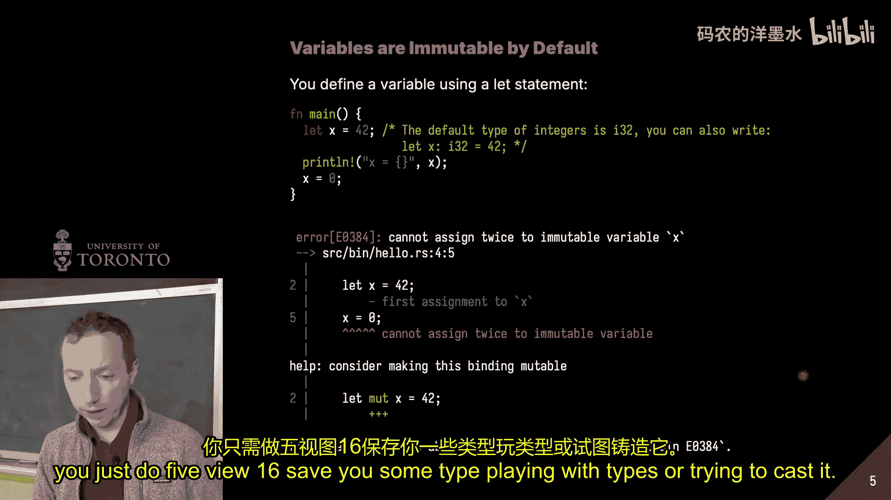

So。Cool thing about rust is let's go here to the VM。Is that variables are immutable by default。

 So in rest to define a variable， you， it's a let statement。

 So you can do something like let X equals。 I don't know，42。

And then we can see by default numbers get an I32 type， so this colon。The type。

 that's the type that the compiler inferred and then。Well。

 if I try to modify it now and say x equals0 or something like that in c and C plus plus。

 this is perfectly valid in rest， it is absolutely not valid run what I call demo。So by default。

 everything is immutable， so as soon as you declare it and assigned to it you are not allowed to change it again。

 so that might make it easier to debug， of course restst lets you do things if you want to if I want to change it。

 I have to explicitly say this variable can change so I have to do something like let mute so I have to say x is now mutable。

 that means I can assign to it and change it。So that's the first one。

Other cool thing about it is often you don't have to use mute。

Because you can just redefine the exact same variable or change its type or whatever。

 so I could just say after this I could say let x equals0 and then let's say we print x。

X equals the who。Taping standing up is apparently harder。So。Unlike C or C++。

 I can just shadow an old declaration， so I can just overwrite an X， say it's a new X。

 and then I'll be eight whoops， not that example， then I'll be able to use it again。Oops。

So now it's going to complain that my other one's unused so I can just print it like this。

So this might seem silly or unusful。 but how many of you have like。Got an X。

 and then you're going to use it as a different type and then you try and come up with a name for it and you call it like x_ string or something like that。

Probably happens a lot to you。If I want in rust， this is an actual useful feature because I can actually just change the type of it。

 so I could just say。X dot 2 string or something like that。

So I can do something like that now from this point board。

 I can use X as a string and I can basically change the type of a variable， which is kind of cool。

 saves you from having to try and rename stuff and often you never use the old type again。

 so you can just shadow it in the same namespace， which is kind of a nice quality of life feature。

Other fun things you can do。 So functions。Oally rush is an expression based language。

 so if I do like gi Val and then in to say the return type is just an arrow and then the return type。

So， in。In C+ plus， if I wanted to return 42， I'd have to write something like。You know， return 42。

 right？It's probably how you would write and C rust is an expression based language so it will actually return the last expression there so I can simplify this and simply just return 42 that will do the exact same thing。

It might seem a bit silly initially， but。Once you get used to it。

 it actually makes writing functions a lot easier and see I don't have to specify types or anything。

Do the same thing again， still works as before。看 of neat哈。I like rust。All right。

 so other cool things they can do。So let's see here， you can define astruct， oops。

 actually let's go back to the demo。So like C and C++， you can define a struct。

 so I could saystruct point。Whoops。Give it an X and a Y。Syntax is slightly different。

 but it's not that surprising。And then if I want to implement functions for this。

 you might see that it looks kind of like。A C structure， not a C plus plus thing。

 if it was C plus plus， it'd be like class point， then I'd have to declare things。

 all of its functions in it。 and rest， if you want to declare technically associated functions。

 you do that in something called an Iple block。 So I say Iple， this is the implementation for point。

 and then these are all the functions associated with it so I could do something like distance。

And then。In rust， the ampersand is a reference， so self is basically just a reference to self is the same thing as a pointer to this and C plus plus so I can say I operate on myself。

 I'll say I have a distance function。Actually， let's make these floats。So I can say。

 let's compute a distance function， and I can simply just， if I want to return， I don't know。

 the square root of like the hypotenuse thing， I could do self dot X。 So that's X。 and then。

Do that to the power of two plus self dot y。To the power of two。And then everything's an expression。

 I can just do square root of that， and then that's my whole distance function。

 I don't need a return or anything like that because that's the final result that's all I need to do。

 That's all I have to write， which is kind of neat。So if I want to declare a point。

 I could do something like let point equals point and then whoops。And then。If I want to construct 1。

 I can just do this syntax with the curly brackets。 say x is equal to， I don't know，3。

 Y is equal to 4。0， oops 4。0。And I can just define it like that。

So then I could call my function on it just like can see。

Or C++ so I could do distance and then the format specifiers are a lot like Pythons。

 so I could do something like this。And then if I run this now hey。

 I get the distance is5 cool also if you want me to do anything or play with rest。

 feel free some of you might know more rest than I do so we can break things but the compiler gets it's really nice for some stuff。

 kind of annoying for other things。So。That's cool， so I can just use it like that kind of still looks like C++ now。

Usual you do not do this， so like constructing this。

Typically you hide the fields of obstruct and you don't let anything make it explicitly unless they public fields。

 there's visibility rules I won't really go into， but the normal rust way to do it is to create an associated function called like new。

So I could say new。And then this， no matter what would have default to the fields and then here。

By convention， it constructs a self， so self is its own type here， so it would be point。

 so I'm returning a point and then here I could just do essentially just move this code here。

So move this up here。So this is x， this is y， and again I don't have to have a return anything because the last expression is a point itself。

 that's what I return， so the normal restway of doing it is instead of just doing point with that we call new on it and then this new would be like three。

4。0。 And that's it。 So that's the normal way you'd construct objects and stuff and rest。要走。What I do。

You can drop the colon X。But the point you， is it all right？Calling that like I can just do this。

All right， I can do this， I can make it even shorter。Hey， that that looks even better。 Alright。

 I learned something new today。 Cool。 So could do that。 that would。😊，Probably make it more readable。

Oh， yeah。Pro。えま。You can give them can make the deal。Like curly braces。そこは。

And then you could just get rid of it。I can get rid of X and Y in thestruct you specify it as。Oh。

 so you just make it a tuple。Yeah。Yeah。Yeah， it's basically just like renaming the type and stuff。

 right， So let's assume this and itll be something more complicated。 But yeah。

 you can rename types and reimplement types。 We'll see a little bit of that。All right。

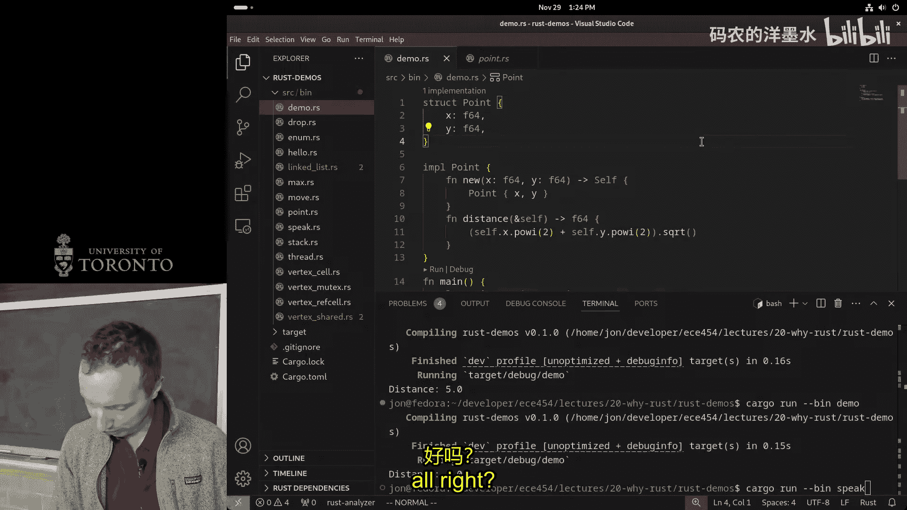

So fun rules I guess， so the references are technically brows。

 so in that distance function that Ampersan itself， it's an immutable borrow。

 so that means I can have as many immutable borrows as you'd like。

 the compiler enforces no data races by default， or I could have one mutable burrow at a time。🤢。

Borrow at a time， again， it enforces no data races。Droops。So。Oh， yeah， fun other things we can do。

If I don't use references， whoops， that's the wrong。 So if I don't use references say。

 I wanted to write a function called， I dont know， let's say it's called foo。 And we print line。呃。

Point is。X。我。So let's say we did something like this。If I wrote something like this。Again。

 stop running that one。So if I run something like this， it'll compile。

 it'll just warn me that fo is never used， but some weird things are going to happen。

 which might be your first roadblock using this， so if I do point dot fo。Nothing bad will happen。

 I can run it。 It says this point is x and Y。 but if I try to call Fo again。

 I'm going to get my first fun compiler message， which is why most。People probably give up。

 so it starts yelling at me and it gives me a very。

 very large error because it says use of mood value point。 So if you just do self like this。

That essentially takes ownership of it。 So now this function owns that point。

 as soon as it goes out of scope， it is now done， it would get rid of it。

 So it doesn't actually exist because we passed ownership to it。

 So that's this is what it's trying to say。By default， it will try to move values in there unless。

Unless you really tell it not to and we'll see that a bit because this says move occurs because point has a type point which does not implement the copy trait。

 so by default， you could have a type that if it implements the copy trait will go into what traits are that since it own something it can own a new copy of it and then we don't have any issues with ownership or anything like that。

 the original one can still own its original value and this function would own a new object。

But that's basically what that says， that point got moved during the first call。

 and then we tried to use it after move， so we are not allowed to do that。Which is good because。

 well that if it actually takes the ownership， we shouldn't be allowed to use it， right。

 doesn't exist。Anymore， we don't own it。 So by default， when it goes out of scope， like here。

 when that object goes out of scope， it's dropped。Basically， it runs its deor if it was C++ land。

What happens I comp。Yep， this is all compile time。 So the whole。

 the primary goal for rust is that don't compile programs that have bugs in them。

So it tries to catch the most amount of things it can at compile time。So by default here。

 object is moved in when it's copied so that is fun， so then you might be like well。

What the hell is this trait thing， so it said。Move here occurs because it has point trait which does not implement the copy trait。

 What in the hell is a trait。

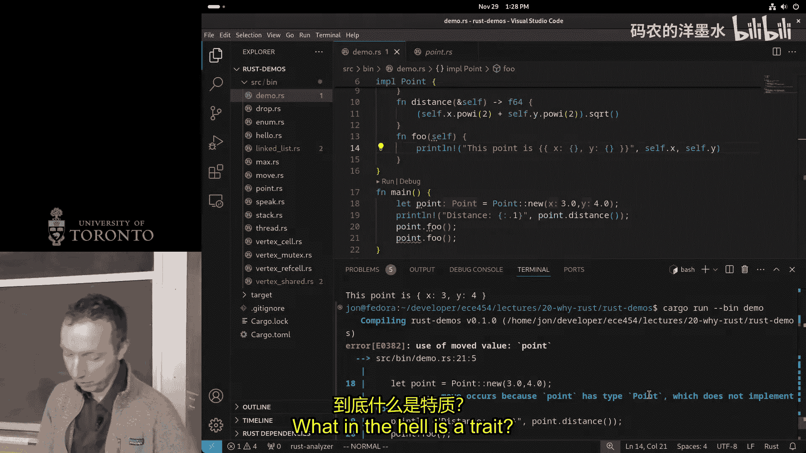

Well， a trait is basically a more flexible interface， so unlike interfaces。

 different traits can overlap with the same function names and Pyr will figure out which one you want based off what trait it is so if I try to actually let's say I want to implement the copy trait and I don't want to use any shortcuts yet for the people that know rust so if I want to implement the copy trait it requires a clone trait so I must have to be able to make a clone of this if I wanted to do it manually。

 the syntax for that is why we have an niple block， you could do Iple。

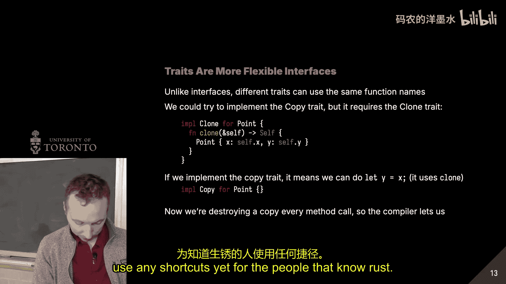

So the implementation for the clone trait for the point type。So I could do something like this。

 and then well， we can just see what our compiler tells us。So here。

If we scroll up for the first error， it says not all trait items implemented missing clone。

 So it requires a clone function， and it tells us exactly here what our clone function signature is。

 So I have to implement something called clone。That takes a reference to self and then returns a self。

So this。Very much looks like I'm just creating an exact clone of it。

 so I'm returning a new object that's the exact same as the current self。

 So for that for a point I could just return point。Self dot X， self dot Y。And apparently， I can't。

Okay， so apparently I can't do that。Fancy shortcut that syntax sugar， I have to say x and Y。

YeahThey have to have the same name。 Okay， they have to have the same name and be in the same scope。

 I guess， yeah， all right， so I can do that now。 So now I have implemented a I've implemented a clone trait。

 So now。It knows how to make a clone of itself， but still says here。

 move cannot happen because this doesn't implement the copy trait， so。

I could now call dot clone on it if I wanted to make an exact copy of it。

 so that would be an explicit copy so I could do something like here like point dot cloneF。

 so this would callF on a new object and it would go out of scope be fine I could call it again because I still maintain the ownership of the original fo。

But the copy trait doesn't actually have any implementation if I just do Iple copy for point and don't give it a body。

It just works。 So that trait is basically an opt in for implicit copying。

 So I the compiler will immediatelylicitly copy it for us。 So now if I run this。

It will work no matter what， so even if I callF twice in a row。

 now I have some implicit copying going on every time I callF。

 it implicitly makes a new copy every time I call it。And then by the time that true function is done。

 it's dead。You might be like， well， this type is simple。

 Why the hell did I have to write all of this crap？ Well。

 the rust compiler will actually write a whole bunch of stuff for us so。

If we wanted to have those traits on ourstruct and we don't want to write them。

 we could do we could do something like this so we could do a compile so in rust compiler directives are like hashtag and then a thing so we could say derive and we could say just come up with the clone and the copy traits implementations for us and then boom。

 it suddenly works these are simple objects so it will figure it out for us and just do it for us。

 which is kind of cool。Other useful little traits。We could use， we could use something。

 we could use like a debug trait。So debug trait will essentially just define a nice print F for so we can use。

Something like a。There's a debug macro， so you can just give it an object。

 and it will tell you all about it。 So without writing anything， just deriving the debug trait。

 I can now run it and it will just dump out the line and all the information about that object。

 And I didn't have to write a damn thing。Kind of nice，hu？All right， what else。So。

C plus plus everyone loves templates， right？So， okay， probably not。

Rust has does not have templates because they're literally insane。

 but they have something nicer called generics， which I mean。

 you might be used for if you are using Java or something like that。 So let's go back to the demo。

So let's just axe all this stuff。So。This exists in a standard library。

 but let's just try and write it。 So say were writing a function called Max to write a generic。

 it's just oops。It's just。And bracket， the type， and then it'll be generic over that type。

 So if I was writing a max function， some easy， some easy way to implement it is I need two values。

 Let's say we have like an A。That's of some type， a B， that's of the same type。

 and then we could just check if A is greater than B， then return A else。

 return B could look like that。 We go to compile this。It will say， oh， a whole bunch of things。

So the most important part is hey， the binary operation greater than cannot be applied to type T because it doesn't know what function to call for it。

 so what you can do is you can restrict the type parameter and basically say what traits that type has to implement so there is a trait in the standard library called partial order that will force that type to implement a greater then yeah。

Yeah， this is like。Yeah， C++ tried to do concepts。Go away from their template mistake。

 So kind of like that。 So this is a bit of a cleaner system， too。

 but I could just implement or say that this has to partial or。

All objects of type have to implement that trait and now no matter what， they'll have a greater then。

 so I can now compile it， oops， apparently I can't compile it。Oh， because I don't have a return type。

 so I have to return a T to， there we go。So now I can compile it， just says Max is never used。

 but now I can try it and say like， hey。Print。Max equals the max of I don't know， three and4。

And I can do different types， right， these are integer types。Then just make sure that it works。

 So now， yay， it works。 Joy， wasnn't that fun to write or。Generics over templates。

So how this will work behind the scene is。Much like C++ templates。

Whatever types we use to call that we'll get a different version of that function。

 so there'll be one specialized for ints in this case， one specialized for floats。So。You could also。

 if you wanted to， create your own traits if you want。So other fun things I could do is let's say。

Yeah， you might be like， oh， well。So rest doesn't support polymorphism or extending or anything like that。

 So why not because traits are powerful enough so which is pretty much all you need So I could have a trait called speakeak So let's say in C+ plus land you know you'd have like a base class called an animal and then you'd have like a cat and a dog that both implement it and then they have a speak method and a dog sayswo the cat says meow and that's like the ideal polymorphism case right It's like well。

 how would we represent that in rust well you take all the common behavior and put it in a trait so let's say I create a trait called Speak and anyone that implements this trait has to have a method。

Called speak。That just takes a reference to self。 So now I can create a struct called a cat。

And in rest， if I just do strucca and then a semicolon。

 it's a zero size type at compile time or sorry at runtime， it takes up zero space， nothing at all。

 it is completely free。So。Here I could say， let's implement the speak trait for the cat。

And then my speak fortune。We just do， let's say we printline， yeah， something like that。And then。

 say。We have a dog。So now we have an implementation for a dog and it goes wolf。

So now let's say we create dog， a cat。Ohoops。Then we can create a dog。Again。

This is pretty much only exists at compile time， these types have zero size whatsoever。

 so it will get rid of them so I can now do like cat dot speak and because it implements that trait it's going to know to use that function。

 I could do dog dot speak。And they will both work。 Wow， amazing。

 So what about if I wanted to use them in a。Function， and I wanted to like， you know。

 express that polymorphism in a function。 Well， I could write， like I did before with the maxing。

 I could just have a generic type， and then。Just say I need a type that implement speakak。

 and then I can call， speakak on it。There's also a shortcut then specifying the generics and everything。

So I could create a method called call speakak， and then I'll explain what the static means in a second。

 but I could just do something like this。So I can just say， hey， I just need a why is it complaining？

Oh， no name，ops。So I could just say hey， I need something that implements a speak trait and if I do a reference to I。

 what that will do is basically create， do what we did before， it will make it generic。

 and then we'll have different versions of this function depending on if the call is a cat or the caller is a dog and I could just do S dot speak and everything will work。

So I could do call speak static and then give it the cat。Give it the dog。Oh， I have to borrow。To。

 to do。So I could give it the cat， give it the dog， and then yaea， it works。So。C plus plus。

Wouldn't do this by default， right， Anyone know what C plus what would C plus plus do。So。

So if I just in C++， let's just say I created a function that took an animal。And then compiled it。

 how does that work at runtime？The dynamicact doesn it be to。Yeah， it'd be dynamic， right。

 need a V table and all that stuff， which is why， and also it needs runtime type information。

 which is even worse。So。Sorry templates you can totally still do this with。

I want to take something that has to speak。Yeah， yeah， you can do it with concepts and stuff。

Like by default， if you just have a method that has virtual things， it will use the V table。

 and it'll be really， really slow because it essentially has two pointers well。Here I have multiple。

 I'll have multiple copies of this callpe function based off different colorsers。

 Maybe that's a good thing because it's faster。 Maybe it's a bad thing。 Rs is like， hey。

 you have to opt in if you want something slow。 So if I wanted to do the same thing。 C plus plus did。

 which is callpe dynamic， I can just take a reference by dyingine speak and that's just short for dynamic。

 So if I do that， it will actually use what's called a fat pointer。

 which will have a V table along with it。 So they'll only be one copy of this call speakak dynamic function。

 it will be a bit slower because it will have a V table and we'll have to look up the function to call in the V table。

But in some cases， you might want that。Rus has you optt into that， so now I could do that， oops。

That was two dogs。So now I could do that and my dynamic one also works the same。Yay。

 so don't really need polymorphism， generics are all we need。Let's see other fun things we can do。

So Eums are not as stupid as in C and C++。Let's say。I create an enum。

Called owned just because I don't have a different name。 So let's say we want to represent， you know。

We had a valid string or we had some invalid input。

 One rusty way to do that because there's no concept ofnller or anything stupid like that is we could have an enum with a valid that takes a string so if it's valid it has a string otherwise the enum value is invalid so maybe we think that's a good idea so we could do something like let x equals owned and then。

We get access to the enum variance， so I could say valid and then。String from， so string capital S。

In rust is an own string so it's。Going to be a。Basically string from C， it's a pointer。

 it'll be on the heap， so I could do something like this， save success message。

And then maybe you could imagine somewhere else in my program。

 well maybe it returns an invalid value and then you might be like oh how do I actually access these values in my struct。

 there's a special thing you could do like an if let so this is a conditional let that will only match in certain cases so I could do a conditional let saying that only if it's valid then。

I'll get a variable called S， which is a string， and I basically unpack it from the X。

So in this case， in here， I know that the variant of O is valid and then I'll have access to that string as S。

 so they could just say like x is valid。And then， print。Something like that。

So now it says x is valid success。 And then maybe I do the exact same thing with Y。

 and I want to see whether or not y is valid， but of course。In this program y is equal to invalid。

 so it's just going to print X success， and this is so standard in rust and such a good idea。

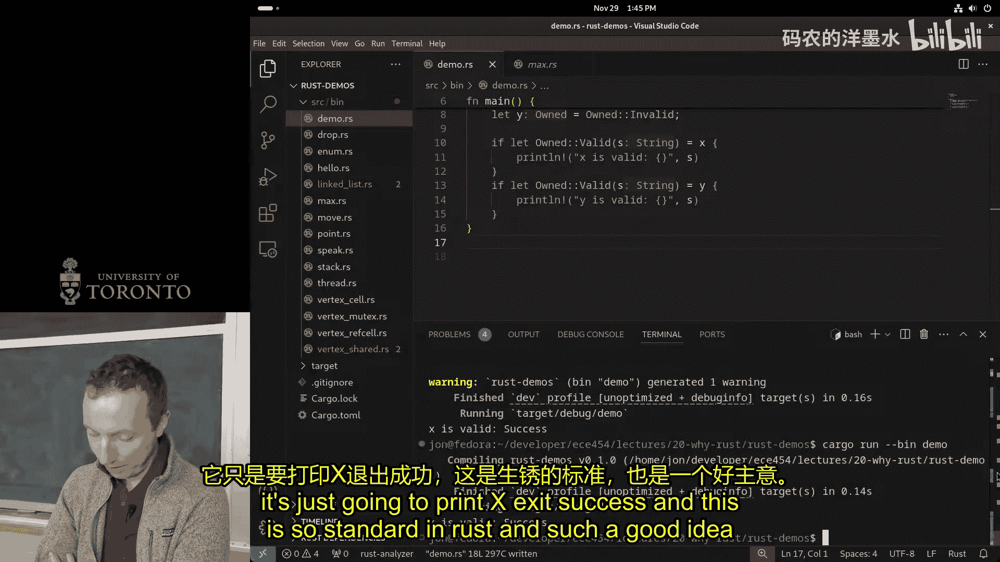

But。They're in the standard library。 So that whole idea of having maybe a valid output or some actual value in rust it is called an option。

 So option is either none or some value。 So if something might fail。

 you generally wrap it in an option type。 you'll see it's generic。 So it can take any type。

 So it's either some， some value or just none。 So there's no。Rust or sorry。

 there's no null or anything like that。 And if you're worried about， hey， isn't this efficient。

 I can just say a pointer is k null or not。I forget what the hell they call it。

 but basically the the compiler will do that under the hood and use some sentinel values for stuff。

 So it doesn't actually take up any extra space。I forget what they call it， something fancy。

Some packed something or other， I don't know。And then they had it such a good idea that there's also a type called result that will either say okay。

 so return an expected type or an error with some error type like some exception。

 So there's no exceptions and rest because exception and exception unwinding in all that is terrible so it's。

Rus kind of forces you to handle your errors because anything that will fail。

 it will return a result which forces you to match on OK or error， which。Yeah， there is unwinding。

 but you can also disable it if you want。No， just pick behavioror。Yeah， and。All right， yeah。

You might find this is annoying too， because， well， you want to get the value all the time。

If I just want my code to panic and just crash if the value is none instead of trying to。

Trying to do that if letter anything to get the value out of it， I could just do option do unrap。

 which will return that type if it's some， if it's none it just panics and crashes your program so you'll see unrap all over the place so functions that may fail usually return a result。

If your functions use something that returns a result and also returns a result。

 there's some syntax sugar like question， you can put a question mark after function calls and what that will do is return if there's an error case so you don't have to handle it kind of like monadtic。

Pascal， I don't really remember how Monads work anymore though，helps you a lot。All right。

So another thing you can do， there's also a match expression， so you can just match on an enum。

 and then you can do something。 So there's little arms for each of the options。So let's say。

I match on it if it's none， just return。The unit value， which is nothing or some value。

 so I have some value I could just print LN the value I got。

 so it will either do nothing or print the valid value and the compiler will always make sure you check every variant unlike stupid C and C+ plus so if I want to ignore something I can just use underscore as a wild card if I want。

All right， more fun things， so B is a unique pointer from C++ land， so let's go back to the example。

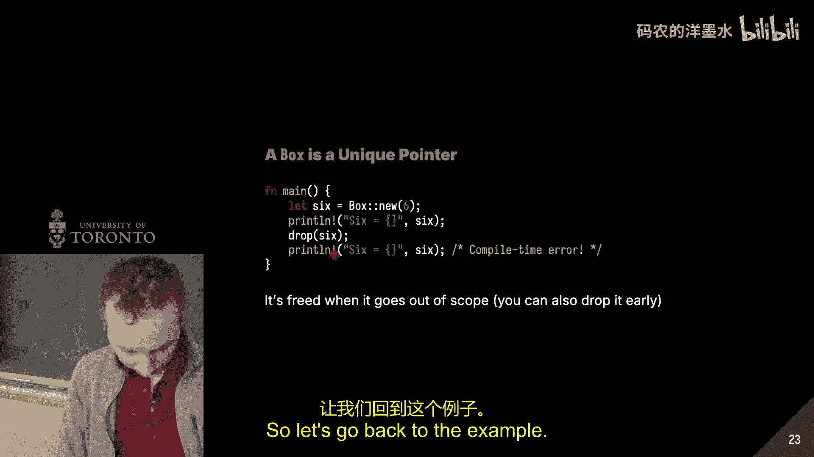

So。If I wanted to。I could do something like know let6 equals box new 6。

 so this will basically create a unique pointer called6， right？So。W， it' I called a bow box。

So if I do something like this。Six equals whatever the value of6 is。

It should just kind of compile and work right and just give me six。

If I wanted to explicitly free this unique pointer and C plus plus。

 whenever it goes out of scope proof it's thestruct's called， it's gone， right。

 So same thing in rust， but I can explicitly do drop。

So if I do drop what drop will mean is like it is now I force it to go out of of scope at that line。

 so if I just called the de on C plus plus and then tried to use it。

 it would be like yeah cool go ahead but in rust if I do this it will actually save me so it will say that here this value is moved so it's moved by calling drop so drop takes ownership and then destroys it and then in here it says。

 oh well you used it after you dropped it basically this prevents a use after free right It's like hey it doesn't exist anymore what the hell are you doing and this is all at compile time。

嗯。And对 the the the。Oh， yeah。So this might be a simple lure example。

 but I could also like transfer ownership if I wanted to， so if I wrote a function called。F。

That took a box。And then let's say we used it。If I do something like this， right？Oops。

It will also not work because food takes ownership of it right and then uses it and all that stuff。

 So this is essentially in C++ land a move。Foo gets ownership of it。 And it's all good。

 So let's compare that to what C plus plus gives us。 So if we write that whole thing in C plus plus。

 we'd have a unique pointer。 Let's call it 6。 We'd have to do this make unique thing。

C++ looks especially ugly now to me after rest so here if I wanted to transfer ownership。

 I could use STD move so I could move6 to that it's a unique pointer essentially test claims ownership of it and then after I move it I can try and use it and I can try and dereence it and get the value if I'm C++。

Oops， I don't care if you do that， right？2。Sure， go for it。Then if I run it。

 probably bad things will happen， right， oops。So rust catches this at compile time。

 C plus plus dies with a fun。😊，Unexplainable error message。Const expression type name。

 add L value reference， blah， blah， blah， blah， blah， blah， blah， blah， blah， assertion。

 a's actually。wasn the sex。Yeah， so this one I guess they improved it slightly where it didn't just seg fault and it gives this nonsensical runtime assertion。

 but it gets aborted， the core is dumped， doesn't help us， so C++ doesn't give you any safety yet。すは。

Ison it's true。Yeah， Rus wouldn't have to assert this because you literally cannot compile this。Yeah。

 yeah， you get rid of all that release。Still， it's better to not allow us to write something so stupid。

 especially I'm learning， starting to learn the third years are getting bad at this， so。

So that will transfer ownership。Maybe it's not a big deal for this example。

 but maybe I want to use it for a thread or something like that。 So to use a thread。

What I could do is let's just get， oh wait， this is C++ooh gross， give me a here。

So maybe instead of this， maybe I want to use that in a thread。In C or C++， well。

 I guess it's a bit nicer in C++， but C to give a value， to move a value to the thread。

 kind of a pain in the butt。For this。All I have to do is I could just say let T equals and then create a new thread。

 So in rest it's just thread spawn， and then it needs a closure。

 I won't go into the details of a closure， but basically it will capture any variables you use within here and this is what the thread will run。

 So let's say in here in the thread I just write out whatever the value of the variable is。

 So in this case6。And then。Now， if I try and use it again here。

 I will get another error message because I gave ownership of the。Box to the thread。

 So I did something like that。 I gave a compiler message that say， hey， I moved it into the thread。

 The thread now owns it。 So after you created the thread， you no longer own it。

 So I would have to do something like this。 Oh， and also。

I could do thread dot join to make sure I join it， and it also returns， what's it return。

So you can see here it returns a result。 So joining could fail for very。For several reasons。

 so I can actually。Instead of adding manual error checking， I can just unwrap it。

 and if it has an error boom， it'll tell me if something has gone wrong， but I can now compile this。

 run it。Here， I'm allowed to print it because the main thread still the owner of it。

 After I create the thread， I transfer ownership into it。 So now it can use it， no problems。

 no race conditions。 It is the one now responsible for freeing it。 I won't have to worry about。

 you know， making sure that。My thread's free in particular cases or whatever it just happens for free。

 so it gets all cleaned up， I don't have any memory issues and then I join it and it's fine if I tried to use it after I gave it to the thread compiler will tell me compiler will not let me compile it again。

 whole goal for rust is not to compile things that will break。All right。Fun lifetime example。

So I am very bad about lifetime things， but I can。Basically try and hack something got it。

 So C or C plus plus， this is a very stupid thing to do， right。

 if I write a function called that returns a pointer and I declare a variable called X。

 and then I return the pointer to X and then try to dereence it。 Well， newer ones。

This should print one in most cases， but new compilers take advantage of the fact that that is undefined behavior。

 So if I run this， I just get a seg fault。C++ did not help me at all。 It just lets me die。

If I try and write this in rust。Then I have to worry about lifetimes because rest guarantees that a reference will outlive or will last as long as the variable does。

 so let's go to the example if I have to write that same thing in rest。

 this is how I have to write it so if I just create a value called x equal to 42 or something like that and return a reference to it。

The compiler will give me all sorts of grief about it。

 It will say you need life to specify lifetimes and blah， blah， blah， and then tell you what to add。

 Basically， this is what tells you to add。 So generic lifetime parameters need。

Whatever the hell of that symbol is a quote a， so this basically says that the reference I get back。

 it has a lifetime and it should last as long as this function lasts。

 if it doesn't outlive the function， then that reference is not valid。

 so if I tried to do the exact same thing as I did in C+ plus I call it stack。

I get a whole lot of it just at compile time。 it just doesn't let me do that。

 cannot return a reference to local variable X because it returns a reference to data owned by the current function。

 basically it will not live long enough， it will not live past the function so it knows， hey。

 invalid reference， I cannot give you an invalid reference。

 I will generate a compile time error instead of just giving that to instead of just making it sg fault。

So。That's cool。 Rust is helpful。嗯。All right， any questions about that， that sounds fun。All right。

 so let's have a more complicated example。So So let's start with this function。

 So let's say I have a vertex。 So we're gonna try and write a thread safe version of this。 So first。

 let's start off with a vertex that has a value， some number and then edges like an adjacency list。

 So in rust vector is just a vector。 So it's just a dynamic array。

 And let's say we have an array of references。 So I have to specify a lifetime that says， hey。

 all my references have to live as long as I do。 Otherwise I get some error messages。

 and then let's just derive debugs so we can print off some things。

 and then let's just declare a few vertees。 So we have a B C， where B points to A and C points to A。

 So if we do this。And what's it called vertex？So if we do this。

 we'll see that everything kind of works as we expect。We can see C here has a value of  three。

 has an edges， and these are all the references， so it's a vertex that is a with a value 1， no edges。

 same thing， same thing。 So what we might want to do is like hey。

 let's write a function that I don't know， increments all the values。So。

This is where rust might get somewhat frustrating because it might feel like you have to fight with the compiler。

 but it's all for good reasons。 so let's say we create a function called implement all that takes a vertex by reference。

 So we get a reference to a vertex and then let's say we try to do vertex do value equals vertex do value plus1。

And then。4 edge。 And we'll have references to all the edges。That's it。

And then we'll call it increment all with the edge。So if we do something like this。

What's immediately going to happen is， hey， the compiler is going to yell at us and be like， hey。

 you cannot do that because。You got the vertex in。Behind a read only reference。

 you can't mutate anything。 So what the hell are you trying to do。 This is not something you can do。

 So your first thought might be like， oh， okay， well， let's change it to mute。So whoops。So。

If we change it to mute， that's also not going to work and we'll get a fun new compiler message that is slightly less readable。

 so this one will say mismatch types because we keep on calling it and each vertex has only references to a read only node because they're all shared。

 I couldn't have them。I couldn't have A and B or sorry。

 B and C have a reference to both have a reference to a mutable node， otherwise I would break the。

I potentially have a data race， so I'm not allowed to do that。

 so I can't just make it mutable and have it work because I couldn't iterate over mutable references。

 So what we need is some type of interior mutability。

 so we need to be able to modify that value modify that value of the vertex so there's a few tools to actually get interior mutability。

 that means we can actually change it something through immutable reference。

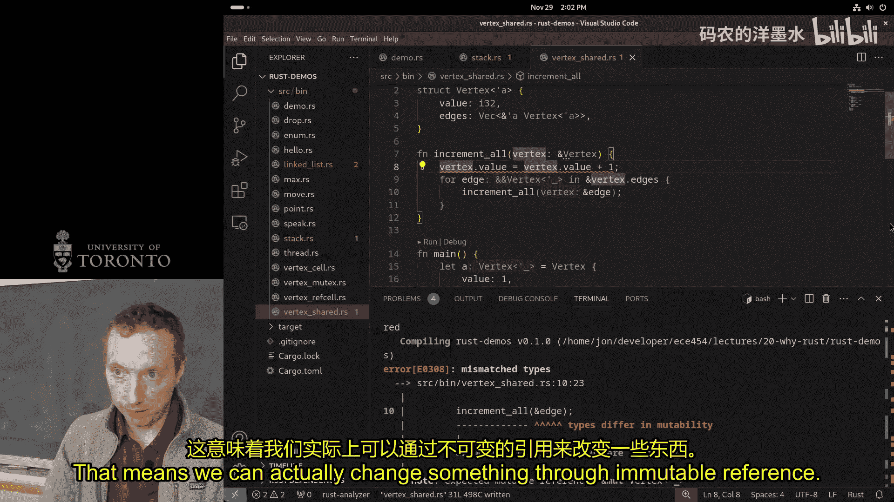

And。Your four main options are something called a cell， a ref cell， a mutex。

 which should look familiar and a read write lock， which should also look familiar。

 But the first ones。

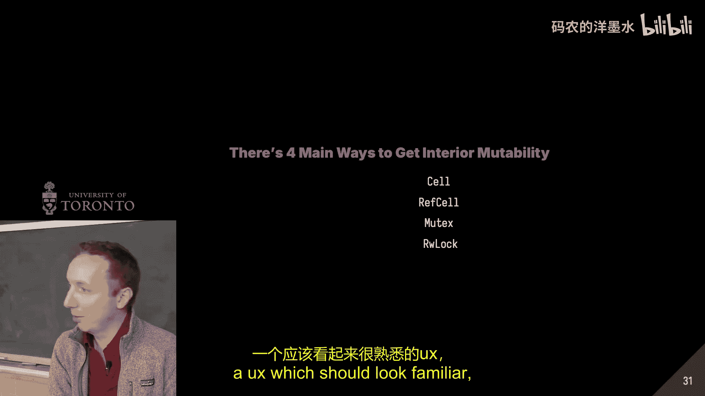

Are just for single threaded things。So a cell， basically what a cell will do is allow you to either get the value or set that value。

 And when you get it， you get a copy of it。 So if I want to try to mutate value。

 I can wrap it in a cell。So I can wrap it in a cell。And then here， when I try it。 So now I have to。

The values are wrapped in a cell， so I need to do cell new for each of them。The new。

So now I have to do something like that。And then I also have to import。

So let's just compileile it and let's tell us what so I need to use。I need to use the cell type。

 so it's in the standard library。In the cell module called cell。So I can do that。Here。

I'm trying now value is a cell， so I can't just add one to a cell is basically what this is telling me。

 So what I can do is， well， I can let。Value， so using the cell， I can do vertex dot value do git。

 So that will get me a copy of the data。 and then I could do vertex dot value。Thought set。

 and that will go ahead and do the one right so I could change it to v plus1。So this way。

 you're always guaranteed to have consistent data， you'll either get a copy of it back or you will mutate it back so you can only do one of the two things。

 so it's guaranteed that since you get a copy back。

 it won't be staed because that's the value it was when you called it。 So if I do this。And run it。Oh。

 I didn't actually call that function so now I can actually modify that value and let's say we can call increment all on node。

B， so if I call increment all on node， actually it's called on node C。So if I call it on node C。

 it should increment its own value， so three should go to4。

 and then it should also increment all of its edges， so it should increment node a。

 go from1 to2 so if I run that I can see that hey it seem to do that C is now the value is equal to4 which is also in a cell and then for a the value is2 which is also in a cell so that's how you actually do it in rust and then you might be likem well I don't really like the fact that I'm copying things。

Like。I know。I know I could probably modify this， it's safe to modify it。

 I don't need to modify an old copy of it and also you might just be like hey。

 well what about the value is something more difficult like say it's an own string so if it's an own string。

 we can't use a cell on it。Because if we compile it。Well， first I need to make the value strings。

 so sorry， let me make the value strings。So all those call this one A。て要は。Oh， you can。Yeah。

 instead of this， you could do a dot what into。I seeな。And it probably looks better。All right。

 so I could do string from， give it a literal or。Just literal dot2 string， I guess either works。

So if I run this now， it will complain that， hey。Let's scroll up。It's basically saying a cell， well。

 whatever is inside of it needs to implement the copy trait。

 string does not implement the copy trait because well。

 you wouldn't do that because it would probably be very costly to copy a string all the time。

 especially if it happened under the hood and you don't expect it。So if you do this， it says， okay。

 well the gi exists but。It doesn't satisfy the copy trait。

 and that's probably good because you don't want it to copy。

 So the other type of cell we can have is something called a ref cell。

So what a rough cell will do is basically。It will all of the borough checking rules。

 it will do them all at runtime instead of compile time。

So if you break the rules and have two more mutable borrows at a time。

 it is going to panic and then stop you from running the rest of your program， but I could。

 if I wanted to actually modify that value， I could just access it through the ref cell and get a mutable reference to it so I could do。

Vertex dot value dobrow mute， so I could borrow it as mutable。

 and then I essentially shift all of the Borough checking calls to runtime instead of compile time。🤢。

So now I could do something like Valdot， let's say if we just add a plus。

So we could just add a plus onto it。Something like that， so now this， oops。

Will work after I change all of these calls to create a ref cell instead of a cell。

So now I do that and it seems to work。I add C on to it。add a plus onto C。

 and then it goes through all its edges， adds a plus onto a， and just to make sure it works。

 and I don't have any thread issues or anything like that or any potential concurrency issues。

I can also do increment all for B as well as a， so if I do that now a gets two pluses because it gets visited from both of them and I don't panic or anything。

 all of my code is safe and that is all fantastic。So。Some other important things is like， hey。

What the hell happens if I add threads to this。So if I add threads to this。

 let's say I move these calls to individual threads， so let's create thread1。

So this is where it might get somewhat frustrating。 So move into thread1。

So let's say I just moved this call here。Then create thread two。And do something like this。

So you can see the compiler is already getting mad at me， so that is not good。 So what it says is。

To do。So， it's。Basically goes to the first error。 It says a ref cell cannot be shared between threads safely。

 so it's trying to stop me from having any data race issues。 So ref cells。

 their proper behavior depends on a single threaded application。 they are absolutely not thread safe。

 So it says that anything you move into a thread must be be able to be shared by thread safely。

 and in order to mark that it has to have the trait sync。

 So sync that sync trait means you can actually that object is thread safe。

 There's also another trait called Sen。 that means it's safe to transfer ownership between threads。

 So this is all expressed with the trait system。

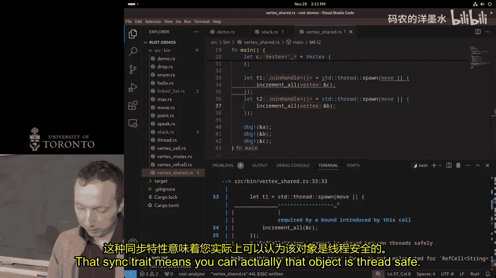

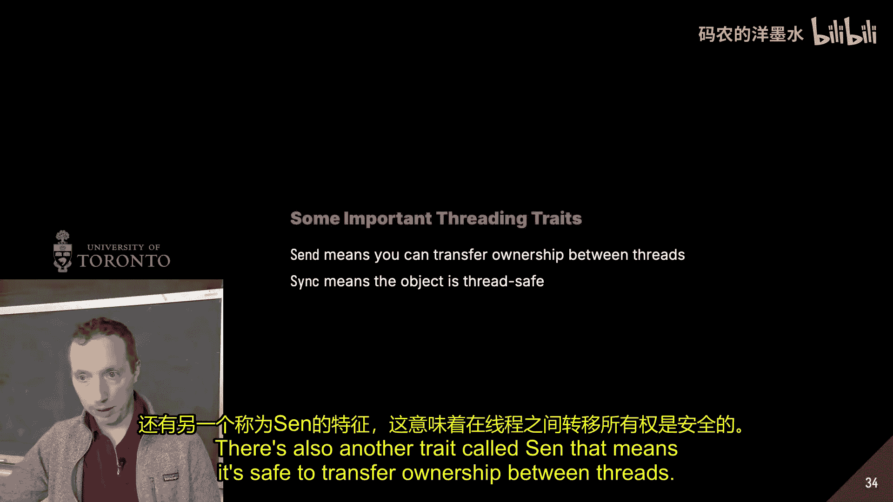

So。If I wanted to have something that is safe to share between threads， well。

 then I would probably have to do something like。We've all been doing in this course， right。

 I should just use a mutex。So。To use a mut text， you just wrap it around the type。

 So now we have a mut text protecting the string。If I go to compile that I need to import it。

 so it is called standard S Mutex。And then I need to change all of these ref cells to now be a mutex whoops。

Gras sell Ut。Whoops。Allright， so now I change all these ref cells to be a mutex。

 So now I have to fight with the compiler even more。 so now I get a whole long list of bad things。So。

Now this says there's no method name Boro Muute， okay， well。

 of course I have to delete that now because we have to do something different here。

 so we'll get to that in a little bit， but let's just say we don't even have this right now。

So if I compile it now。It gives me a lot， a lot of essentially lifetime issues。 So it's saying， well。

 one， I don't check。The thread one or thread2 or try and join them or anything like that。

 but it says a does not live long enough。 So I have a reference to a from the main thread and it's concerned now that since I am essentially transferring ownership to the thread for B or for a。

 It's like， well， all the borrowed values might not live long enough because I don't know when the thread will end。

 so this is absolutely not safe， it's preventing more。

Memory errors for us so it's preventing any more use after freeze or anything like that so in order to solve this in C++ I probably have to use like a smart pointer or something that keeps track so I can actually keep track of the number of references to something。

In rust， I can do that。Their version of a smart pointer。

 the threadsafe version of one is called an arc， an atomic reference counted pointer。

 so instead of having a vector of references， I can have a vector of arcs to vertices。So。Now。

 I don't need this lifetime parameter thankfully， because while the arc is keeping track of how long it lives and whenever there's no more references to it。

 the arc will go ahead and drop it。 So I don't have to worry about lifetimes myself anymore。

 So the only change I have to do is in the VC now， instead of what I had before。Now， each of these。

Vex soups。So each of these vertices。Our arcs。To， to do。So。Now when I create the vertices。

 I could create them under an arc。So now I initially have a whole bunch of arcs。

That now have ownership of that vertex。Ark new。And then instead of all these。

If I want to give it a reference of it， I just make a clone of the arc。

 That means it's a clone of that pointer。 So here I just do a dot clone and。A dot clone。

And now it would actually count the number of references to everything， and then everything is safe。

So here。Now it's complain again because I'm trying to take a reference to it。

 Well I need to create a new copy of the a new clone of that pointer and give it to the thread。

 So what I should do is let's say I'd create thread1 C， and I could do C dot clone。

So that creates a copy of it， and then in here I can just immediately use threadread1 C。

Then here I could create threat。Thread2's version of B。And I could just do B dot clone。

 and then in the closure， I can just use thread to B。Or I should be able to use it。

 why is it complaining at me？Ark。Unknown。Oh， did I mess up my be。Oh， whoops。New vertex。There we go。

So。Now I do this and well I didn't have any of the modifications anymore it just compiles now。

How I would actually use the Muex is， well， a lot like you would use the mutex in C。

 you're just forced to use the mutex and you don't have to explicitly unlock it。

 So in order to get the value here。All you have to do is you can get a mutable reference to the value。

 so vertex dot value is a mutex， a mutex has a lock function， exactly like in C or C++。

So we could do lock， but this lock returns a result because locking could fail for whatever reason。

 shouldn't， but I can just unwrap it， make sure that everything is all good。

 and then I have a mutable reference to that value so now I can just do value dot push。

And I don't have to worry about data races because I've now acquired that lock。And then， whoops。

And then as soon as it goes out of scope，s that lock is dropped for you。 It's immediately unlocked。

 So you don't have to worry about not forgetting to unlock it or anything like that。 So now。

 if I run this right now。It should work。 So oops。So I can see that。Wops be。Oh。

 I didn't join my thread。 So I should also join the threads to make sure they finish so I could do thread1。

 dot join， dot unwrap。And thread two join unwrap。So now when I run this。

 I created a thread save program。The compiler actually helped me。

 It kind of looked like I was battling with it the whole time。

 but it was all for good reasons it stopped me from doing anything silly。 So you can see here。

 no data races。It's guaranteed from how I written it since it's all safe code and then a is plus plus so one came from one thread。

 one came from the other， I have no data races， no matter what it's going to be the exact same time whenever I run this program。

 so it did feel like we were fighting with it a little bit but it was all for good reasons。

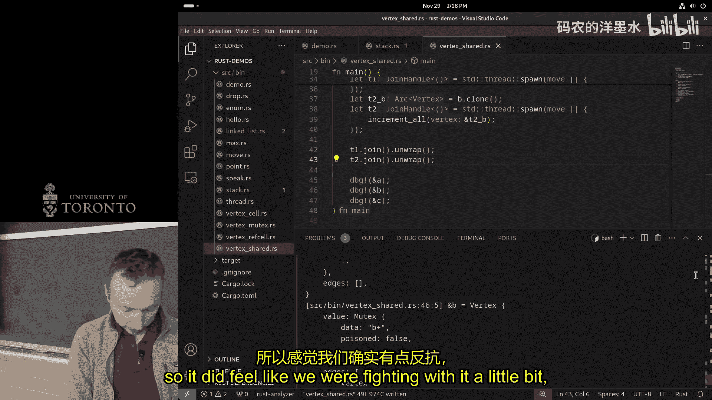

The main thing about rest that's really annoying is how to get some interior mututability so how to change something through a immutable reference。

 we saw four there's four ways。 we saw three of them。

 we saw cell that has get and set type must be copyable if you don't want to copy or do that。

 You can use a ref cell that will basically do dynamic burrow checking panic if there's two mutable burrows that live at the same time。

 Mutex， same as P thread Mutex， safe to use with threads。

Breast will just automatically unlock it for you。 and then there's a read write lock if we wanted to。

Could lock it for writing， so only one have it or have multiple readers for performance reasons。

So summary rest ensures your program is memory safe。

 so the slightly annoying things about it coming from C+ plus is the analysis isn't complete。

 it can't prove that every valid memory safefe program is actually a valid rest program only a certain subset of them。

 this might really be initially frustrating because C doesn't check anything even if you have a memory safefe program。

The compiler， you may or may not。But you have， in order to have a memory safe program in C and C++。

 there is a ton of underlying assumptions， the order of everything really， really matters。

And as your code evolves， as you maintain it， as you move things around。

Those assumptions might get broken， and then you have to debug and you will have fun debug in in Rus。

 if you think you know better the compiler， you can use the unsafe keyword and that will essentially the compiler will be like。

 yeah， sure， whatever you know what you're doing。 I won't get in your way， but。Of course。

 since it doesn't actually check that。It will probably be a source of your bugs。

 But the good news is in order to debug your rest program， likely。

 you just have to focus on the unsafe code。 and then you're good to go。

 So that was the whole rust demo。 Hopefully， it helped you。😊。

Helped you understand more memory safe programs kind of reiterated that whole thing。

 And it's actually， you should probably consider it as a language to use。

 especially since we know how difficult writing threads safefe programs are。 So with that。

 I will stick around for a bit and have any questions。 but just run another point。

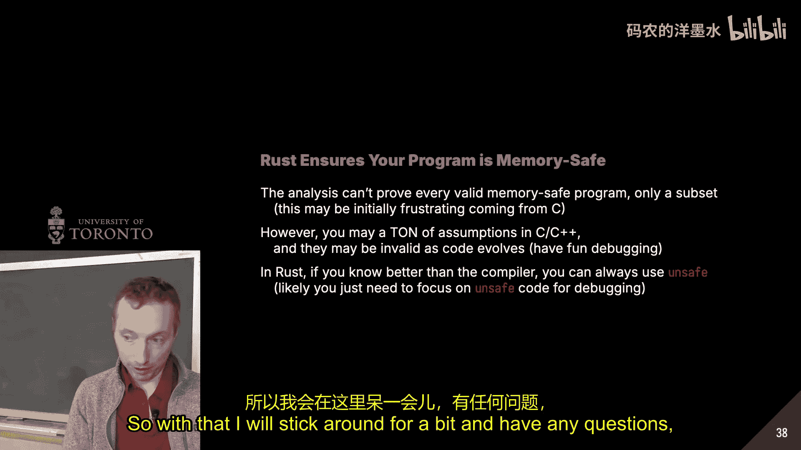