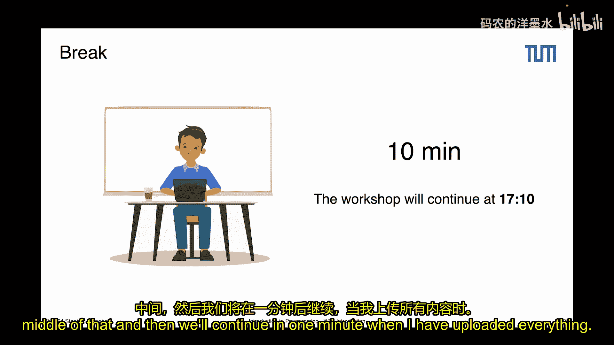

# 006：基本类型及其运算 🧮


在本节课中，我们将要学习Java中的基本数据类型及其相关运算。我们将了解有哪些基本类型、它们如何存储数据、以及可以对它们执行哪些操作。

---

## 基本数据类型概述

上一节我们介绍了变量和属性的概念，本节中我们来看看Java为它们提供了哪些基本的数据类型。

Java中的基本数据类型允许我们定义具有一组可能值和一组可能操作的变量。所有变量和属性都必须有类型，Java提供了八种基本数据类型，我们也可以定义自己的数据类型（类）。

以下是Java的八种基本数据类型：

*   **byte**：占用8位（1字节）内存，取值范围为 **-128 到 127**。
*   **short**：占用16位（2字节）内存。
*   **int**：占用32位（4字节）内存，是常用的整数类型。
*   **long**：占用64位（8字节）内存，用于存储非常大的整数。
*   **float**：单精度浮点数，占用32位内存，用于存储小数，但精度有限。
*   **double**：双精度浮点数，占用64位内存，用于存储高精度的小数。
*   **boolean**：布尔类型，只有1位，表示 **true**（真）或 **false**（假）值。
*   **char**：字符类型，占用16位，用于存储单个Unicode字符（如字母、汉字等）。

使用较小的类型（如`byte`）可以节省空间，但在大多数程序中，通常直接使用`int`或`long`。请注意，这些类型可能会发生溢出和下溢。例如，一个值为127的`byte`变量加1后，会自动变为-128，而Java不会对此发出警告。

```java
int x = 2147483647; // int的最大值
x = x + 1; // 发生溢出
System.out.println(x); // 输出将是int的最小值
```

浮点数`float`和`double`是近似类型，并非绝对精确，它们只能精确到一定位数。如果需要完全精确，需要使用其他数据类型。在代码中，需要在数字后附加字母`F`表示`float`，附加`D`表示`double`，例如`3.14F`或`3.1D`。

字符串`String`本质上是由多个`char`字符连接而成的序列。

---

## 相等性与同一性

在编程中，复制值和引用值有一个重要的区别：**相等性**和**同一性**。

两个不同的对象可以是相等的（例如，3/4等于6/8），但它们可能不是同一个对象（不具有同一性）。对于基本数据类型，使用双等号运算符`==`来检查相等性。对于引用类型，`==`比较的是引用（即身份）是否相同，而不是对象的内容是否相等。

```java
// 基本类型比较
int i1 = 5;
int i2 = 6;
int i3 = 5;
boolean result1 = (i1 == i2); // false， 5不等于6
boolean result2 = (i1 == i3); // true， 5等于5

// 引用类型比较（假设Point是一个类）
Point p1 = new Point(1, 2);
Point p2 = new Point(1, 2); // 内容与p1相同
Point p3 = p1; // p3是p1的别名，指向同一个对象

boolean result3 = (p1 == p2); // false， 不同对象（身份不同）
boolean result4 = (p1 == p3); // true， 指向同一个对象（身份相同）
```

请确保理解相等性（内容相同）和同一性（是同一个对象）之间的区别。

---

## 基本运算

接下来我们看看可以对基本类型执行哪些运算。

### 算术运算

以下是基本的算术运算符：

*   **加法**：`+`
*   **减法**：`-`
*   **乘法**：`*`
*   **除法**：`/`
*   **取模**：`%` （返回除法的余数）

整数除法会丢弃小数部分。例如，`5 / 3`的结果是`1`，而不是`1.666...`。取模运算`5 % 3`的结果是`2`（余数）。

当运算涉及两种不同的数据类型时，较具体的类型会被隐式转换为较通用的类型。类型通用性从高到低大致为：`double` > `float` > `long` > `int` > `short` > `byte`。运算结果总是得到更通用的那种类型。

```java
short x = 1;
int y = 7;
int result = x + y; // short + int -> int

float a = 3.14F;
int b = 9;
float result2 = a * b; // float * int -> float
```

### 比较与逻辑运算

除了算术运算，我们还可以进行比较和逻辑运算。

以下是常用的比较和逻辑运算符：

*   **大于**：`>`
*   **小于**：`<`
*   **大于等于**：`>=`
*   **小于等于**：`<=`
*   **等于**：`==`
*   **不等于**：`!=`
*   **逻辑非**：`!` （例如 `!true` 等于 `false`）
*   **逻辑与**：`&&` （两个条件都为真时结果为真）
*   **逻辑或**：`||` （至少一个条件为真时结果为真）

### 运算符优先级

运算符具有优先级，优先级高的先执行。如果不使用括号，乘法的优先级高于加法。优先级数字越小，优先级越高。

```java
int result = 5 + 5 * 5; // 先算5*5=25，再算5+25=30
int result2 = (5 + 5) * 5; // 先算括号内5+5=10，再算10*5=50
```

我们可以通过使用圆括号`()`来覆盖默认的优先级。

---

## 字符串连接

对于字符串，加号`+`运算符用于连接（拼接）字符串，而不是数学加法。

```java
String greeting = "Hello" + " " + "World"; // 结果是 "Hello World"
System.out.println(greeting);
```

注意，当在`System.out.println`中混合使用字符串和数字时，数字会被自动转换为字符串进行拼接，这可能有时会产生令人困惑的结果。

```java
double x = 5.5e12;
System.out.println("Value: " + x); // 输出 "Value: 5.5E12"
```

---

## 练习与总结

让我们通过两个小练习来巩固理解。

**练习1：**
```java
int x = 2;
int y = 5;
int result1 = x * y / 2; // 结果是多少？
int result2 = x * (y / 2); // 结果是多少？
```
**答案：** `result1`是`5`（`2*5=10`，`10/2=5`）。`result2`是`4`（`5/2=2`（整数除法），`2*2=4`）。

**练习2：**
```java
int a = 10;
int b = 5;
System.out.println(a / b + a / b); // 输出？
System.out.println(a * b / b + a * b / b); // 输出？
```
**答案：** 第一行输出`4`（`10/5=2`，`2+2=4`）。第二行输出`20`（`10*5=50`，`50/5=10`，`10+10=20`）。

---



本节课中我们一起学习了Java的八种基本数据类型、如何区分相等性与同一性、以及各种基本运算（算术、比较、逻辑）和运算符优先级。我们还了解了字符串连接的特殊性。这些是构建更复杂程序的基础，请在接下来的练习中多加运用。