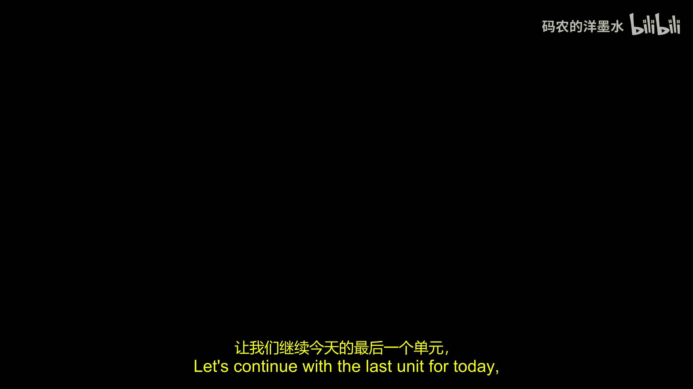
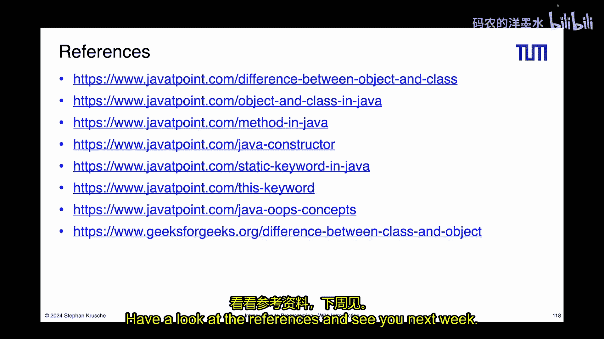

# 008：UML类图 📊

在本节课中，我们将要学习UML类图。这是一种用于可视化程序结构的图形化工具，它能帮助我们理解类、属性、方法以及类之间的关系，而无需直接阅读复杂的代码。

---

上一节我们介绍了面向对象编程的基本概念，本节中我们来看看如何用UML类图来直观地表示这些概念。

UML类图本质上是程序的图形化表示。例如，下图展示了一个我们之前讨论过的有理数类（Rationale class）的可视化表示。

图中显示了类的名称、其属性（如分子 `numerator` 和分母 `denominator`）以及一些方法。对于方法，我们还可以定义其签名，包括名称、输入参数和返回类型。

---

当程序中存在多个相互关联的类时，UML类图的威力才能真正显现。通过视觉化表示，我们可以更容易地理解代码的结构，这比直接阅读整个代码要简单得多。

软件开发者使用UML类图来沟通程序的功能和结构。虽然对于单个类来说，这可能不是必需的，但对于理解多个类如何交互则非常有意义。

UML并非专为Java设计，它适用于多种编程语言。这就是它的强大之处——你可以在任何编程语言中使用UML来定义程序的主要结构或动态行为。UML包含的图表类型远不止类图，但目前我们专注于使用类图来表示代码在类、属性、方法及类间关系方面的结构。

---

以下是UML类图的一个具体例子，它描述了我们之前创建的一个程序：

*   **`Line` 类**：拥有两个属性 `p1` 和 `p2`，它们通过关联关系指向 `Point` 类的对象。它还有一个 `shift` 方法。
*   **`Point` 类**：拥有 `x` 和 `y` 属性，以及自己的 `shift` 方法。我们还可以为其添加另一个方法，例如 `rotate`。

只要理解了UML的语法，通过观察这样一个小型的UML图，我就能立即理解程序是关于什么的，而无需查看代码。这基本上就是UML类图的核心思想。

---

关于UML类图的内容就介绍到这里。我们将在后续的实践课程中更频繁地使用它们，并展示更多示例。

---

在完成了本次课程介绍部分的初次接触后，接下来的步骤是什么？

以下是课程后续安排与要求：

*   **教程小组练习**：我们将发布教程小组练习，请你们作为小组的一部分完成这些练习。
*   **开发环境设置**：我们恳请你们在第一次教程小组活动前，完成你们首选集成开发环境（IDE）的设置，确保能够使用它。
*   **Artemis平台使用**：我们将展示如何在Artemis平台上参与这些练习，以及在遇到困难或不理解时，如何使用该平台获取AI帮助。
*   **家庭作业**：你们会收到一些家庭作业练习，如果不知道如何开始，可以着手进行。
*   **寻求帮助**：你们也可以使用Artemis平台与同学和助教交流，他们可以提供帮助。
*   **阅读材料**：我们恳请你们阅读两篇关于编程基础、面向对象编程和方法的文章。我只能在讲座中向你们解释一次，但无法整合所有不同的视角。因此，阅读在线教程非常重要，这也是许多程序员在学习更高级概念时的做法，同样适用于初学者。所以，请务必在下周之前阅读这些文章。

所有练习（教程小组练习、家庭作业）和阅读材料都需在下周**10月23日星期三下午1点**前完成。请记住，**下午2点我们将有一个小测验**。

---

**本节课总结**：今天我们讨论了面向对象编程、基本数据类型、方法和UML类图——这些都是入门所需的基础知识。我知道信息量很大，但请坚持下去，你们很快就会理解的。感谢聆听，请查看参考资料，我们下周见。