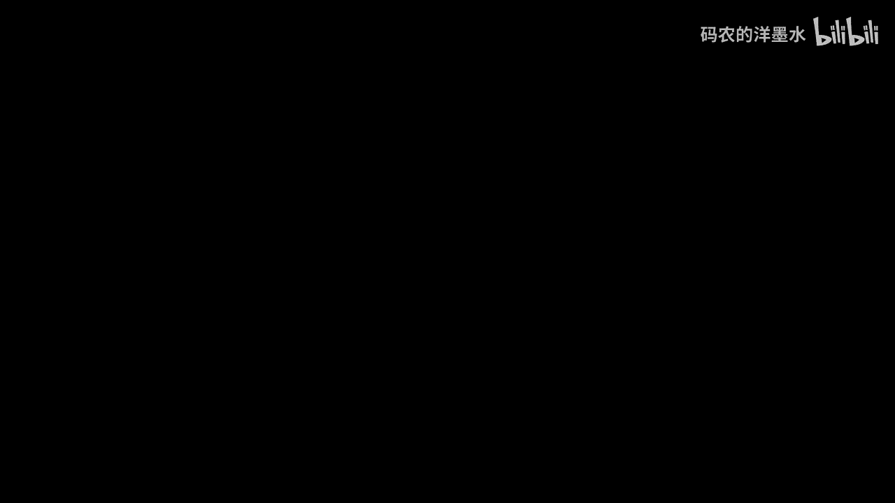
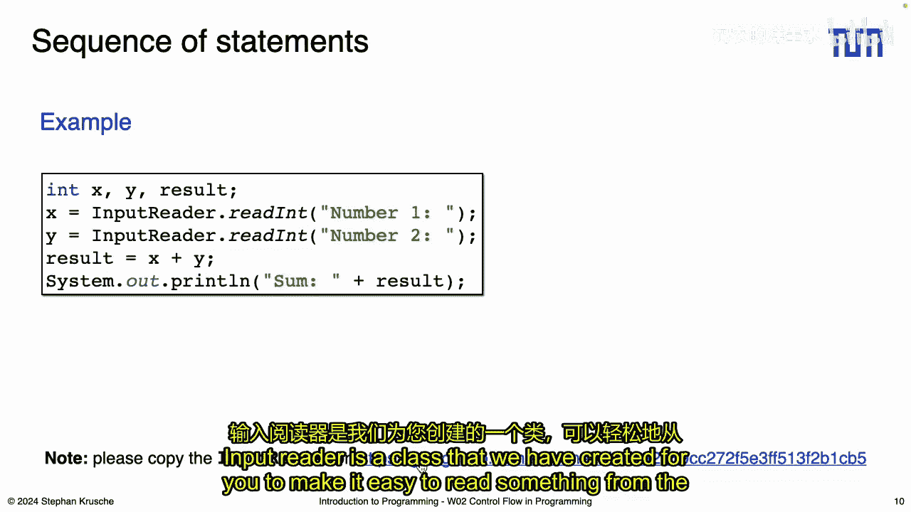
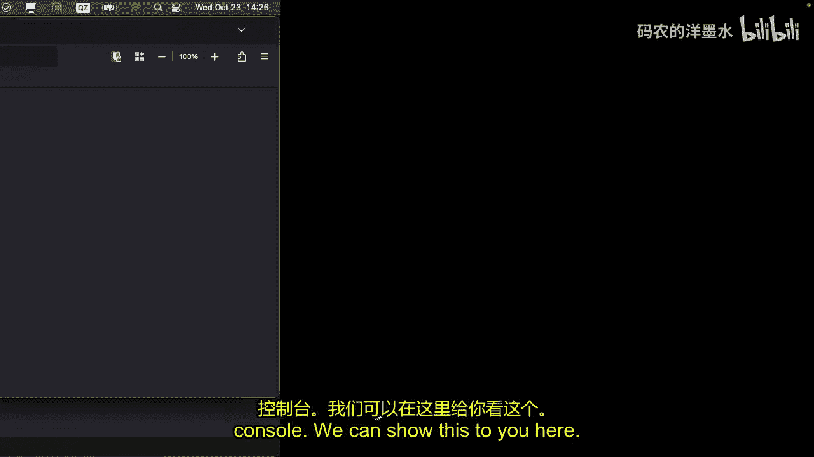
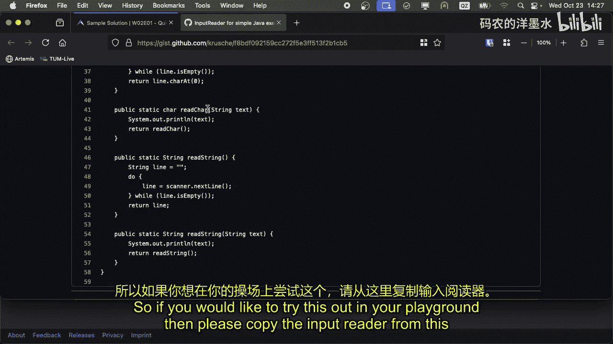
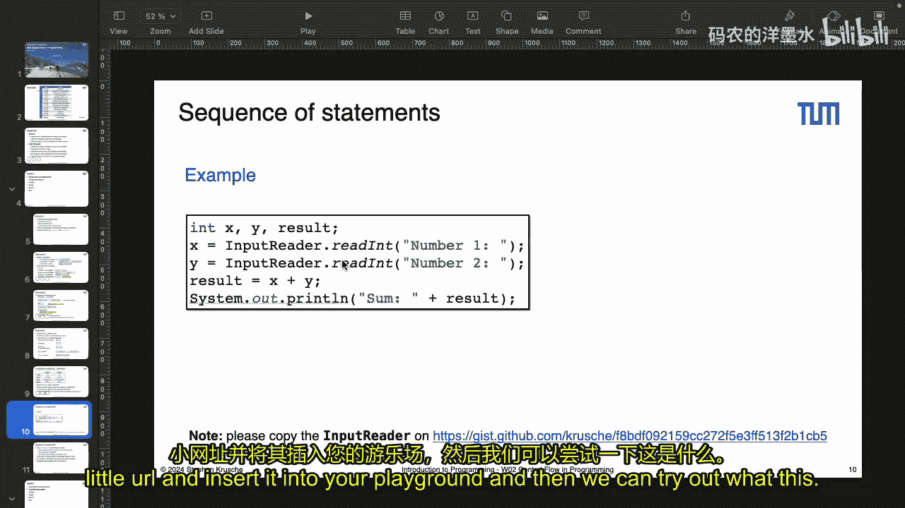
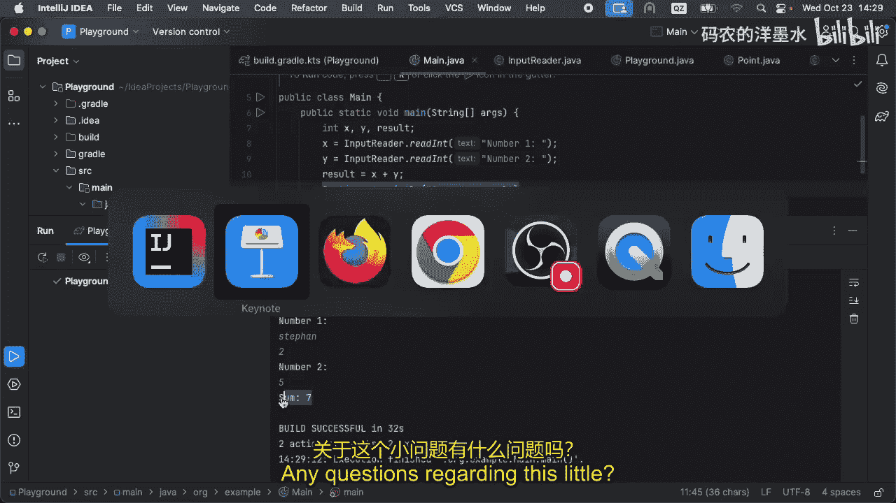
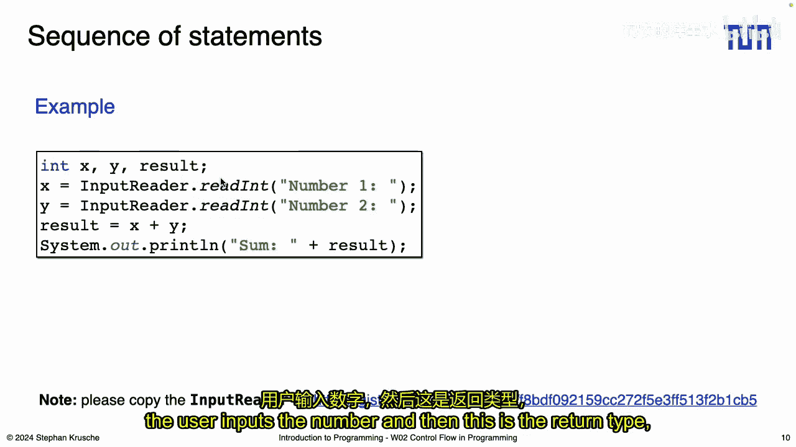
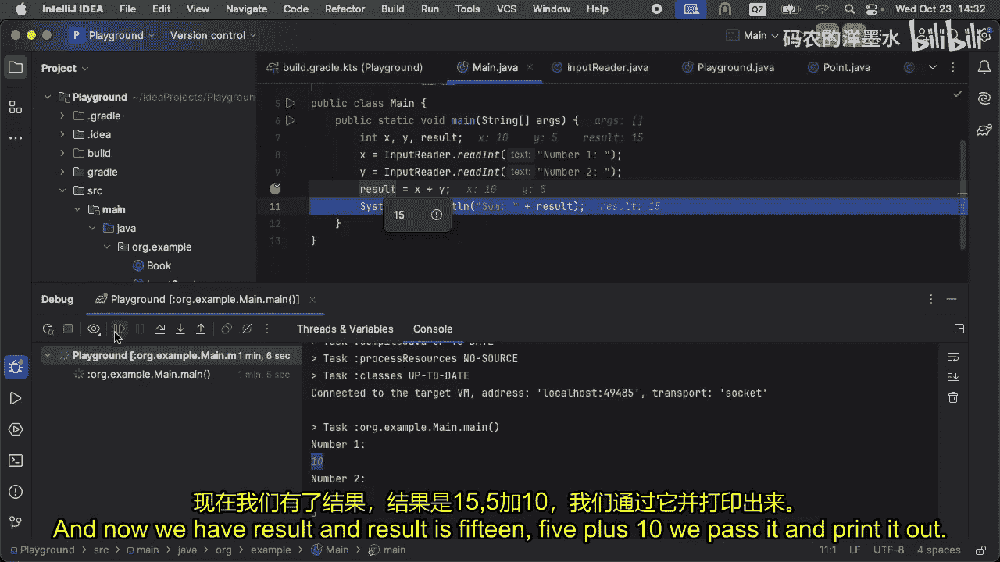
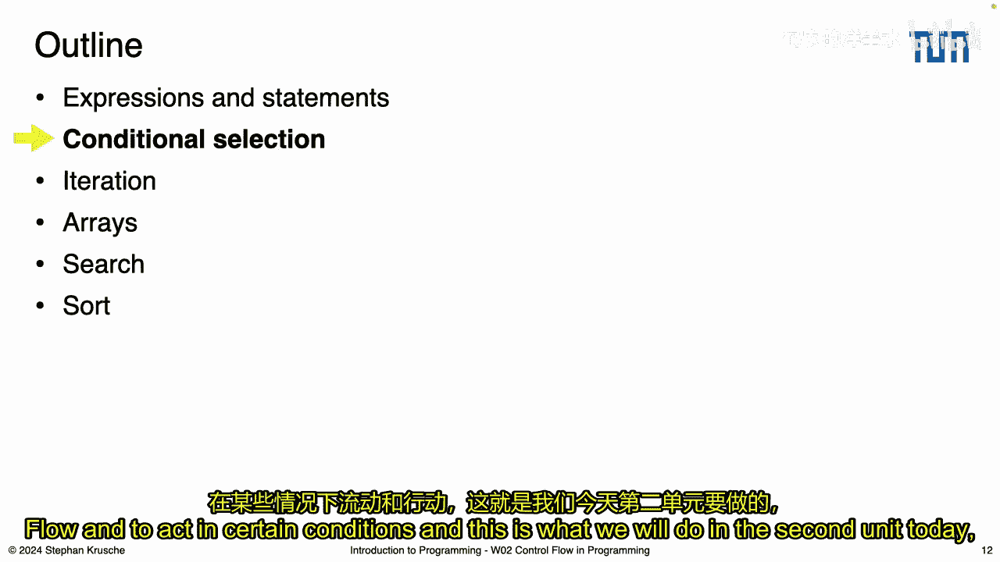

# 009：表达式与语句



在本节课中，我们将学习编程中的两个核心概念：表达式与语句。理解它们的区别是掌握后续控制流结构（如条件判断和循环）的基础。

## 表达式与语句的区别

上一节我们介绍了编程语言的基本构成。本节中，我们来看看如何通过表达式和语句来操作数据和改变程序状态。

### 什么是表达式？

表达式是代码中用于**计算并产生一个值**的部分。每个表达式都有一个**类型**。

以下是表达式的几个例子：

*   **赋值右侧**：`int x = 2 + 2;` 中的 `2 + 2` 是一个表达式，其结果为 `4`。
*   **方法参数**：`someMethod(2 + 2, 3 + 3);` 中的 `2 + 2` 和 `3 + 3` 都是表达式。
*   **返回值**：`return a * b;` 中的 `a * b` 是一个表达式。

表达式可以由以下元素构成：

*   变量或属性
*   方法调用
*   `new` 操作符（如 `new Point()`）
*   二元运算符（如 `+`, `-`, `*`, `/`）
*   一元运算符（如 `-x`）

**核心概念示例**：
*   `(3.0 + y) * 4.0` 是一个 `double` 类型的表达式。
*   `"Hello " + "World" + 123` 是一个 `String` 类型的表达式。
*   `x == 2` 是一个 `boolean` 类型的表达式。

### 什么是语句？

语句是执行一个**操作**的完整代码单元，通常以分号 `;` 结束。语句的主要目的是**改变程序的状态**，它本身没有类型。

以下是语句的几个例子：

*   **变量声明**：`int x;` 是一个语句。
*   **赋值**：`x = y + 5;` 是一个语句（其中 `y + 5` 是表达式）。
*   **方法调用（返回`void`）**：`System.out.println("Hello");` 是一个语句。
*   **代码块**：由 `{}` 包裹的一系列语句。
*   **返回语句**：`return result;` 是一个语句（其中 `result` 是表达式）。

**核心概念**：语句可以包含表达式，但表达式不能单独作为语句（除非是特殊的“表达式语句”，如 `i++;`）。

### 一个简单的程序示例

以下是一个包含多个语句的简单程序，它演示了如何从控制台读取用户输入：





```java
// 语句1: 声明变量
int x;
int y;
int result;





// 语句2 & 3: 使用InputReader读取输入（表达式‘InputReader.readInt(...)’的结果被赋值给变量）
x = InputReader.readInt("Please enter number one: ");
y = InputReader.readInt("Please enter number two: ");

// 语句4: 计算总和（表达式‘x + y’的结果被赋值给result）
result = x + y;

// 语句5: 输出结果
System.out.println("Sum: " + result);
```



**关于`InputReader`**：这是一个工具类，封装了从控制台读取输入（如整数、字符串）的复杂逻辑。你可以将其视为一个“黑盒”，只需调用它的静态方法（如 `readInt`）并传入提示信息即可。

### 顺序执行



目前，我们的程序是**顺序执行**的：
1.  每个操作（语句）依次执行一次。
2.  执行顺序完全由代码书写顺序决定。
3.  程序在执行完最后一个语句后结束。

这种线性的执行方式缺乏灵活性。例如，我们无法根据不同的条件执行不同的代码，也无法重复执行某段代码。为了构建更强大的程序，我们需要引入**控制流**结构。



## 总结

本节课中我们一起学习了表达式与语句的核心概念：
*   **表达式**用于计算并产生一个具有类型的值。
*   **语句**用于执行操作、改变程序状态，并以分号结束。
*   语句可以包含表达式，程序默认按顺序执行语句。



理解了这些基础后，在接下来的课程中，我们将学习如何使用**条件判断**（if/else, switch）和**循环**（for, while）来控制程序的执行流程，从而编写出能够应对不同情况和处理重复任务的程序。