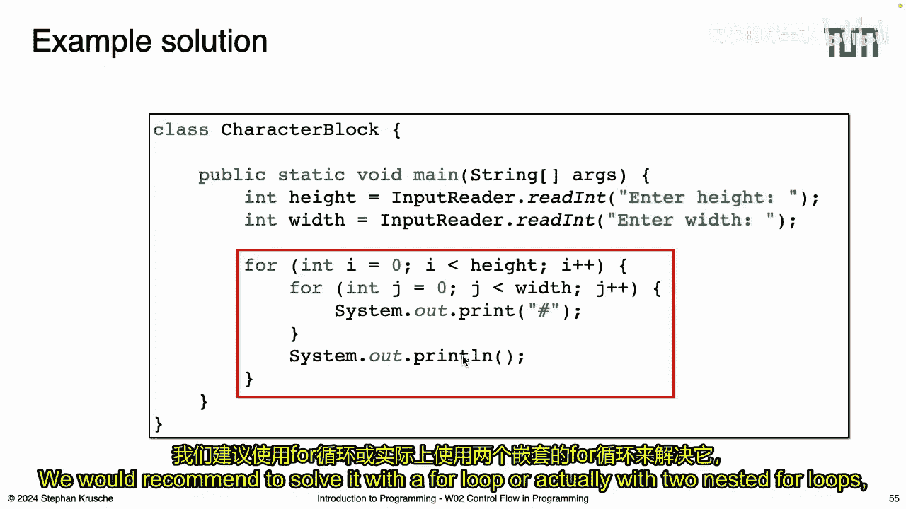

# 012：数组

## 概述
在本节课中，我们将要学习数组。数组是一种用于存储多个相同类型值的数据结构。我们将了解为什么需要数组、如何声明和初始化数组、如何访问数组元素，以及如何使用循环（特别是`for`循环）来遍历和操作数组。

---

## 为什么需要数组？🤔
我们之所以需要数组，是因为我们经常希望将许多相同类型的值存储在同一个数据结构中。这样，我们就不只是拥有一个整数、一个浮点数或一个双精度数，而是拥有多个这样的值。有时，我们甚至可能不知道具体有多少个值。数组的概念是将这些值连续地存储在一个所谓的数组中。数组有多个值，在创建数组时需要定义希望使用多少个值。然后，每个元素都位于一个特定的索引上。

## 数组索引从0开始
计算机科学家从零开始计数，而不是从一。第一个元素存储在索引0，第二个元素存储在索引1。这对于刚接触这个领域、没有经验的人来说可能有点反直觉，但事实就是如此。这有点像德国的建筑，第一层被称为“Erdgeschoss”或零层，第二层才是数字一。在美国，第一层通常被称为“一楼”。同样的混淆也发生在数组和索引上。请确保理解第一个元素总是在索引0，最后一个元素在数组长度减1的位置。

## 数组长度和访问
数组的长度是6，因为我们有六个元素。最后一个索引是长度减1，即5。因此，每当你想访问数组中的一个元素时，请确保在使用长度时进行减1操作，否则你可能会遇到所谓的“索引越界异常”，你的程序可能会终止。

## 声明数组
数组可以像这里看到的那样声明。你总是先指定类型，然后是方括号，最后是名称。还有一种替代表示法，即先指定类型和名称，然后是方括号，但我们通常使用方括号紧跟在类型后面的表示法，因为这更容易理解。注意，我们使用了`new`关键字，这应该已经告诉你我们这里有一个引用类型。

## 数组是引用类型
这意味着，如果我们使用等号运算符复制数组，我们实际上并没有复制数组本身，而只是复制了引用。就像对象类型一样，数组不是简单类型，即使它是一个整数数组。因此，我们不是复制所有值，而是创建另一个引用。我们仍然在内存区域中有唯一的值，这个引用指向这些值。同样，这些值从索引0开始连续编号。

## 访问数组元素和长度
第i个元素通过`name[i]`访问。长度可以通过`name.length`访问，但前提是数组已经初始化。索引范围是从0到`length - 1`。如果你使用负索引或大于`length - 1`的索引，你将得到数组索引越界异常。我们将在后面更详细地介绍异常。请记住，异常是一种错误，如果错误非常严重，你的程序将崩溃，无法继续运行。

## 数组的实用示例：多边形
在我们的点世界中，我们可以使用数组。还记得我们上一个工作坊中的`Point`类吗？一个多边形由多个点组成。然而，我们不知道具体有多少个点。多边形可以有五个点，也可以有六个、七个、八个甚至一百万个点。这是不确定的，是任意的。这是一个非常好的使用数组的案例。我们可以有一个`Point`数组。你可以看到，我们也可以使用类类型、复杂数据类型作为数组，而不仅仅是基本类型如整数。

## 创建数组
我们像处理普通属性一样操作。我们有一个带有一个输入参数的构造函数，我们传递点给它。我们通过`new Point[5]`来创建数组，并指定长度。在创建新数组时，你必须指定长度。Java需要知道需要预留多少内存。有一些其他数据结构看起来没有定义长度，但它们内部有一些机制来在某个时间点增加或减少数组长度。

## 填充数组
我们创建了几个点，并使用索引将它们存储在数组中。如果我们想将其存储在索引0，我们使用`[0]`，依此类推。记住，`points[5]`是不可能的，因为那将超出我们的数组长度。然后，我们可以简单地将这些点传递到我们的多边形中。

## 另一种创建数组的方式
我们也可以先创建所有点作为局部变量`p1`、`p2`、`p3`、`p4`、`p5`，然后将它们分配给一个数组，而不指定长度，而是通过在大括号中指定所有内容。这样，Java可以自动推断长度，因为如果我们传递五个逗号分隔的点，长度就是五；如果我们传递三个逗号分隔的点，长度就是三，依此类推。

## 使用循环填充数组
我们可以使用`while`循环来填充数组。当我们像这里这样声明一个数组时，我们还没有指定长度，我们根据用户输入指定长度。然后，我们可以用一个`while`循环来填充它。当`i`小于`n`时，我们将用户输入的下一个数字添加到特定位置的索引中。然后，我们将`i`加1，以确保移动到下一个索引。

## 迭代模式
这是一个非常常见的模式，称为迭代模式。它是遍历数组的一种典型形式。我们初始化所谓的运行索引，通常缩写为`i`。然后，我们有一个带有进入条件的`while`循环，然后在循环体结束时修改运行索引。这是一个非常常见的模式。

## 寻找数组最小值
为了确定数组的最小值，我们基本上遍历所有元素。如果元素小于当前最小值，我们将其存储为结果；否则，我们继续。这是一个非常典型的模式。我们初始化运行索引，将其放在`while`循环的条件中，并在循环结束时修改它。通过这样做，我们一步一步地进行。

## 为什么从索引1开始？
我们以1作为初始值，而不是0，因为我们想减少冗余或提高性能。因为我们已经有了索引0的元素，我们不需要将其与自身比较，这不会给我们带来新信息。这就是为什么我们通常从1开始。然而，如果你遍历一个数组，你通常会从索引0开始，这并不重要。

## `for`循环
因为这种迭代模式非常常见，人们发明了另一种循环，称为`for`循环。`for`循环的工作原理类似，但在其定义中内置了这种迭代模式和三段式规则。我们总是在`for`循环中初始化运行索引，将运行索引与数组长度进行比较，然后修改值。因此，我们不是将初始化放在循环之前、条件放在循环开始、修改放在循环结束，而是将所有内容写在开头并提前定义，然后我们就不必在之后处理它了。

## `for`循环的执行顺序
然而，`i++`增量仍然只在循环结束时执行。因为我们将其写在开头，并不意味着它在循环开始时执行。它总是在结束时执行。初始化在循环开始前执行一次。条件总是在开始时评估，修改总是在结束时执行。因此，我们将初始化和修改写入`for`循环的声明中。

## `for`循环的语义
`for`循环的语义是：我们初始化某些东西（分号），我们有一个条件（分号），我们修改某些东西，然后我们有语句。这与`while`循环一样强大。因此，你可以选择你更喜欢哪一个。如果你更喜欢`while`循环，就用`while`循环；如果你更喜欢`for`循环，就用`for`循环。但在任何情况下，你都需要学习两者，因为两者在实践中都被使用。

## 增量和减量操作
我们经常写`i++`作为快捷方式，或者也可以是`i--`，因为你也可以从数组的右侧开始并向下移动索引。`i++`等同于`i = i + 1`。如果你遍历数组，我们强烈建议使用`for`循环，或者稍后使用更现代的`for-each`循环，因为它们通常更容易理解。

## 循环比较
如果我们比较今天学到的所有三种循环，我们有`for`循环、`while`循环和`do-while`循环。我们还展示了无限循环的语法，这是你应该避免的，因为无限循环在正常程序行为中通常非常糟糕。有些情况下我们需要无限循环，但通常不是这样。这是我们今天关于循环学到的主要内容。

## 增量和减量操作的陷阱
这些增量和减量操作有点棘手。我建议谨慎使用它们，并且只在完全理解它们的情况下使用。你需要理解的是，前缀增量和后缀增量之间是有区别的。前缀增量或减量在确定表达式值之前执行增量或减量，而后缀则在之后执行。这可能会非常令人困惑。在这个特定例子中，你将7分配给索引`x`，然后`x`递增。如果`x`当前是0，7就在数组的第一个位置，然后`x`变成1。而如果使用前缀，意味着首先执行`x = x + 1`，然后将7分配给索引1。在这个特定例子中，我建议完全不要使用前缀，因为它非常令人困惑。我也建议只在完全清楚的情况下使用后缀增量，但要避免像这里这样做。在我看来，这是非常糟糕的代码，你不应该这样做，因为人们会感到困惑。人们不会记住这个，因为他们不经常使用它。我总是更喜欢在这里写两个语句。

## 赋值与条件
还要确保你理解赋值（一个等号运算符）和条件（两个等号运算符）之间的区别。编译器会警告你，但这里的这个语句，即使我们将`x`赋值为`false`，也总是会评估为`true`，因为它首先将`x`赋值为`true`，然后使用`x`的值进行`if`语句。在赋值之后，它总是会被执行。这是初学者有时会遇到的困难。确保你永远不要在`if`条件中进行赋值，这也是不好的做法。总是在前面进行赋值。在条件中，只使用双等号运算符，而不是单等号运算符。有了这个经验法则，你可以避免一些非常难以发现的讨厌问题。

## 使用`for`循环填充数组
这是另一个使用`for`循环填充数组的例子。我们已经用`while`循环做过了。我们想在这个函数中，根据最终用户指定的数字读取一个数组。我们确定希望读取多少个元素到数组中，然后我们根据给定的数字（例如5）创建数组并用`new`运算符初始化它。然后，我们有了这个非常典型的迭代模式：`for (int i = 0; i < number; i++)`，然后我们说`result[i] = inputReader.readInt()`。如果你将这个复制粘贴到你的playground中并运行它，你将看到你可以读取值，并且不会得到数组越界异常。如果你像这样正确定义它，如果你改变它，如果你说`i <= number`，或者如果你从这里开始不同，你可能最终会得到索引越界异常。所以，请确保你理解这里非常典型的模式。

## 复制数组
有一些额外的帮助语句，以防你不太理解代码。我们也可以复制数组。实际上，有一个复制函数可以使用，如果你不想自己动手的话。但你也可以自己动手。如果我们给你一个浮点数数组作为输入，我们可以创建一个副本。记住，副本一开始是空的，然后我们遍历它，并将原始数组索引`i`处的元素分配给副本索引`i`处的元素。我们对所有元素都这样做。所以，如果我们有1000个元素，这个循环将被执行1000次，然后我们就有了数组的完整副本。

## 数组副本与别名
同样，数组使用引用语义，你不能简单地将其分配给一个副本，那样你只复制了引用。如果你想复制内容，你必须使用循环，你可以使用`for`或`while`循环。这里有一个如何使用这个的例子。我们可以创建一个副本，但我们也可以创建一个别名。现在，如果我们改变副本，原始值不会改变。而如果我们改变别名，原始值会改变。这是这里的巨大区别。如果你创建一个副本并改变值，原始数组不会受到影响。如果你创建一个别名并改变值，原始数组会受到影响，因此这个输出1.0，即使我改变了别名数组而不是直接改变原始数组。

## 字符数组和字符串
我们也可以有字符数组，其中我们有多个字符一个接一个，这基本上就是字符串。注意，字符串内部表示就是一些字符数组，并且字符串总是不可变的。所以，如果你给字符串赋一个新值，Java实际上在内部为你创建一个新字符串，你只需要在这里使用`new`运算符，这使得它更容易。

## 字符串的便利方法
有一些便利方法，例如，你可以获取字符串的长度，你可以使用与`for`循环中相同的想法获取某个索引处的字符，只是这里的表示法不同。你还可以检查字符串是否包含某些字符，你还可以获取某些字符的第一个索引。更多信息请参阅文档。这只是让你意识到，字符串不过是字符数组。

---

## 总结
在本节课中，我们一起学习了数组的基本概念、声明和初始化方法、如何访问和修改数组元素，以及如何使用`for`循环和`while`循环遍历数组。我们还了解了数组的引用特性、如何复制数组以及字符串与字符数组的关系。掌握这些知识将帮助你更有效地处理多个数据值，并为后续学习更复杂的数据结构打下基础。