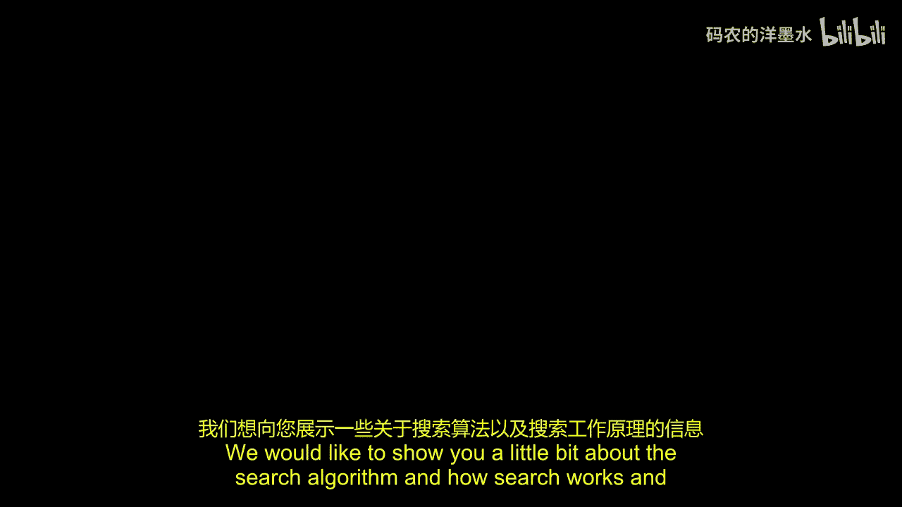
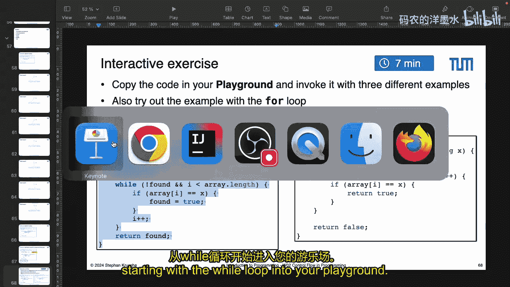
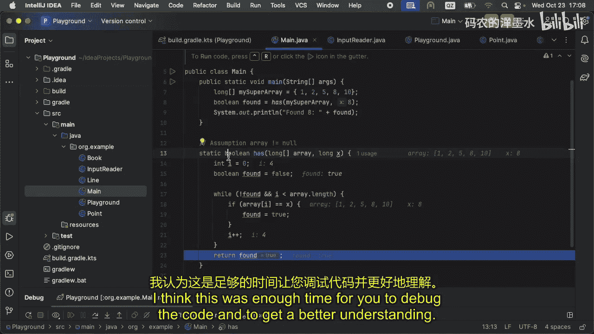
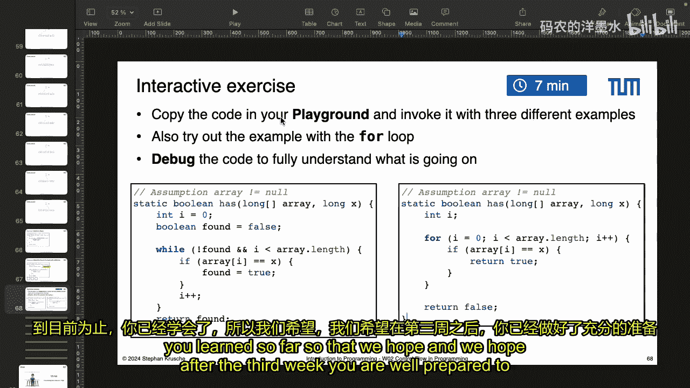
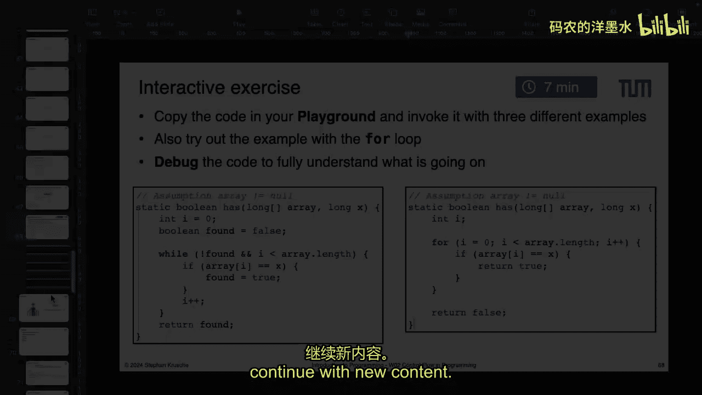

# 013：搜索算法 🧐

在本节课中，我们将学习搜索算法，了解其工作原理。我们将通过一个具体的例子来练习`while`循环、`for`循环以及`if-else`条件语句的使用。搜索算法是理解条件选择和循环迭代的绝佳案例。

## 数组中的简单搜索

上一节我们介绍了循环和条件语句，本节中我们来看看如何利用它们在一个数组中搜索特定元素。

我们有一个非常简单的例子，演示如何在数组中搜索。具体做法是，我们可以创建一个名为`has`的静态方法或函数。该方法用于检查一个长整型数组`array`中是否包含元素`x`。

以下是实现方法：我们使用刚刚学过的`for`循环遍历整个数组。然后，如果数组在当前索引`i`处的值等于我们要搜索的值`x`，我们就返回`true`，这会立即中断并退出循环。如果我们遍历完整个数组后仍未找到该元素，则返回`false`。这是在数组中搜索元素的一种非常简单的方法。

关于这个小例子，同样涉及循环迭代。我们遍历数组，并使用带有条件的`if`语句来检查是否能找到该元素。

我们可以通过幻灯片来可视化这个过程。假设我们有元素`7`，并希望在数组中搜索它。我们将其与索引`0`处的第一个数组元素进行比较，如果不相同，则导航到下一个元素，依此类推，直到找到它，然后算法结束。我们不会继续搜索更多元素。元素可能出现两次，数组不保证元素只出现一次，但这对我们来说无关紧要，我们只想知道数组是否包含这个元素。

## 算法性能分析

现在，这个算法在性能方面是否非常好？或者你能想出一个更好的算法吗？你怎么看？如果你处理的是无序数组，并且有时无法真正改变顺序，那么这是你能做的最快的事情。对于无序数组，为了找到某个元素或确认其不存在，你可能需要查找每一个元素。

但是，如果你需要非常频繁地进行搜索，这种方法的性能会非常低且缓慢。如果你经常搜索，最好有一个排序后的数组版本。你可以对数组本身进行一次排序（这比普通搜索耗时更长），但之后的搜索会更快。或者，如果你因为元素顺序具有特定含义而无法对原始数组进行排序，那么你可以创建一个所谓的“第二版本”数组，其中的元素是排序好的，这样搜索的实现速度会快得多。

像谷歌这样的大型搜索公司投入了大量时间来研究如何使搜索尽可能快，因为这是他们的主要业务。如果他们能比其他公司快10%，就能节省10%的计算资源，也能为最终用户节省10%的搜索时间。因此，研究这些算法对他们来说确实非常重要。

## 使用While循环的替代实现

我们也可以使用`for`循环，但实现方式略有不同。我们看到，在这里我们基本上两次访问数组：首先检查数组长度作为条件，然后再次检查索引处的值是否相同。有些人认为在这里有两个条件并不好。我们可以使用`while`循环来实现一种替代搜索方法，将两个元素放入同一个条件中。具体做法是，在循环条件中加入一个额外的条件，以确保在找到元素时循环提前结束。

这只是一种替代方式。我们再次设置索引`i = 0`。我们有一个临时的布尔变量`found`，初始值为`false`，表示我们最初没有找到任何东西。当`found`不为真且`i`小于数组长度时，我们检查这个条件并将`found`设置为`true`。然后，如果我们没有找到元素（`found`仍然为`false`），我们就继续循环。如果我们执行到这个特定的语句，我们会再做一次递增，最后一次，然后我们也退出循环。

那么问题来了，让我们回到这张幻灯片，如果一个数组有两个相同的元素会发生什么？什么也不会发生。这是数组的预期用途。数组可以始终包含相同的数字。如果你有一个包含一百万个零的数组，那完全没问题。数组不应该对元素的顺序或唯一性有任何假设。我们唯一的假设是数组有特定的长度，并且我们可以随时访问和覆盖元素。

第二个版本的算法中，`!found`与`found == false`相同，对于从未见过这种写法的人来说，这是一种缩写形式。

## 动手练习：代码调试

现在，我们想和你做一个互动练习。为此，我也会上传幻灯片。我们要求你将两个不同版本的搜索算法复制到你的编程环境中，然后在你自己的环境中尝试它们，进行一些调试以理解发生了什么，并更好地理解你的操作。我们可以一起做这个练习。

我们基本上错过了幻灯片的这一部分。好的，幻灯片现在应该更新了，如果你重新加载页面，可以找到它们。然后，请首先将代码（从`while`循环版本开始）复制并粘贴到你的编程环境中。

我将把它们放入这个字符块练习中，而不是另一个。现在先去掉所有其他代码。然后，我们就有了它。

为了稍微练习一下，我们首先当然需要创建一个数组。例如，我们可以说`long[] mySuperArray = {1, 2, 5, 8, 10};`。然后，我们想检查数组是否包含或拥有值`8`。现在，我们像这样操作，然后我们可以执行`System.out.println`来输出是否找到。

像这样。如果我们在这里设置一个断点，我们可以启动应用程序，调试它，看看这里发生了什么。例如，我们有数组`{1, 2, 5, 8, 10}`，我们有`x`，即`8`。现在，如果我们单步执行，我们会看到：我们第一次进入`while`循环。然后我们检查索引`0`处的元素（即`1`）是否等于`8`（这里双等号运算符非常重要）。情况并非如此，所以我们将其增加`1`。再次执行。现在我们将`2`与`8`比较，不是。现在我们将`5`与`8`比较，不是。现在我们将`8`与`8`比较，是的。所以，我们数组中索引`3`处的值是`8`，我们比较它，然后进入`found = true`，我们再做最后一次递增，但之后我们不再进入循环。

请你自己用一个小例子尝试这个，并且也用`for`循环的第二个版本替换方法，做同样的事情。也试试看它是如何工作的。这对于你来说是一项非常重要的技能：对于每一个给定的程序，你都需要能够理解它。如果你通过阅读无法理解，你可以使用调试器，这是一项非常基本的技能，我再怎么强调也不为过。调试器真的是你检查程序运行情况的朋友。我有时也难以理解代码，你在这方面并不孤单。然后我也会使用调试器。所以，这真的非常重要，每个程序员都使用调试器来更好地理解代码。所以请你自己尝试一下，复制粘贴代码并让自己熟悉它。我们再给你五分钟时间来做这个，然后我们将继续讲座。

## 总结与后续安排

好的，我想这给了你足够的时间来调试代码并获得更好的理解。关于这两种在数组中搜索的方法，还有什么未解决的问题或不清楚的地方吗？

也许需要一点反馈：你们中有谁感觉很好地理解了这些方法？谁仍然感到非常困难？谁不知道自己是否感到困难？好的，所以如果你感到困难，请之后花时间练习。我们接下来将有一整周的时间，你可以练习`while`、`for`、`if-else`等等，并且如果你不理解某些内容，也可以使用调试器。我们也有导师和助教的强大支持。所以，请抓住机会练习这个，练习、练习、再练习真的很重要。好消息是，下周的研讨会上我们不会添加任何新内容，而是会有一个复习周，我们将再次深入讲解到目前为止学到的概念，我们希望并且也希望在第三周之后，你已经为继续学习新内容做好了充分准备。

本节课中我们一起学习了搜索算法的基本原理，包括使用`for`循环和`while`循环在数组中查找元素的两种方法。我们讨论了算法性能，并强调了使用调试器来理解代码流程的重要性。通过动手练习，我们实践了代码调试，为后续更复杂的学习打下了基础。