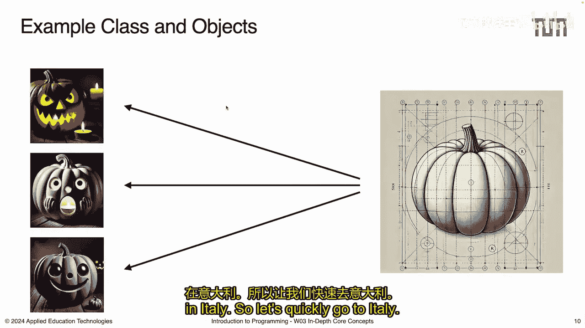
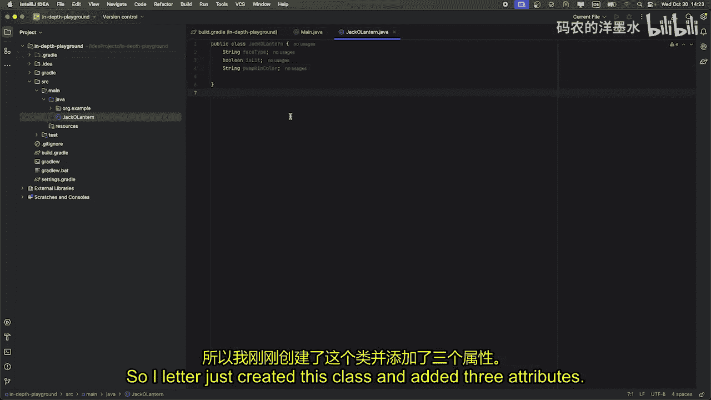
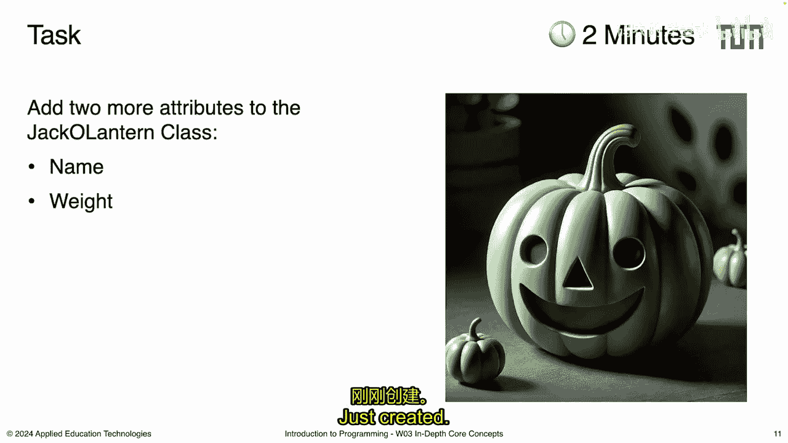
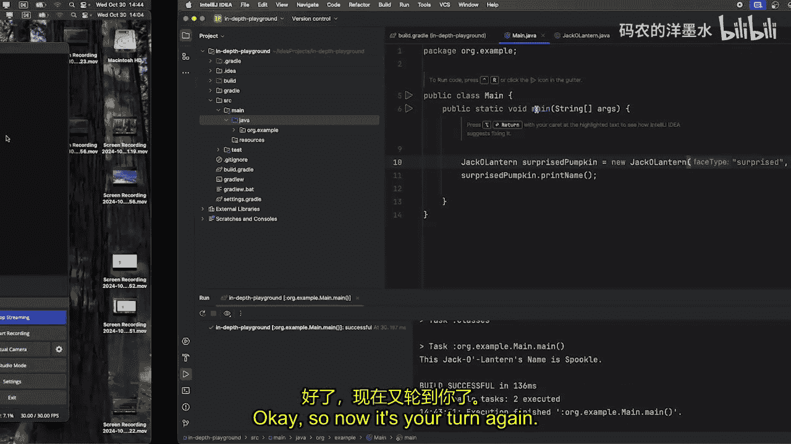
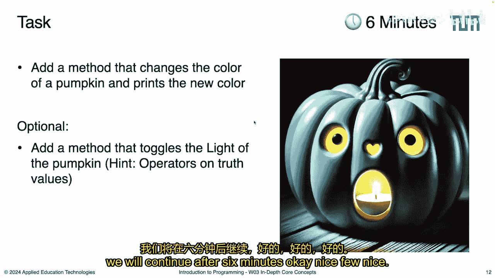
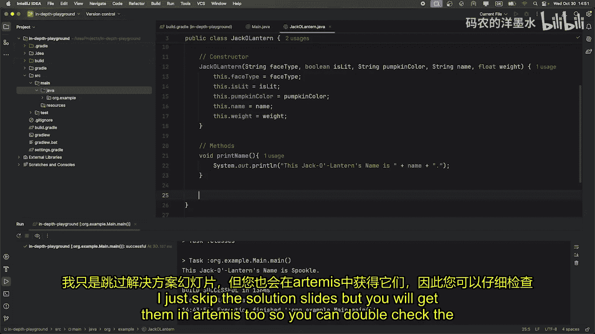
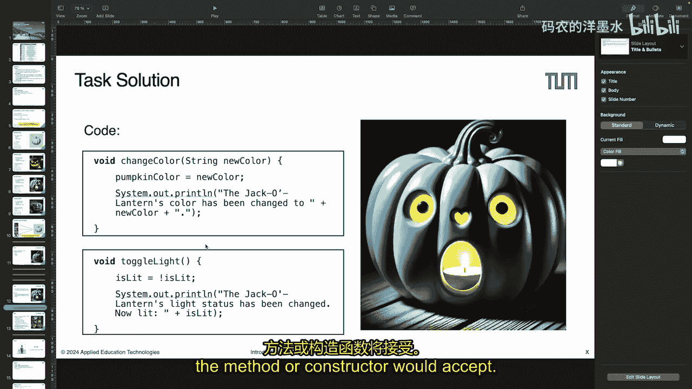
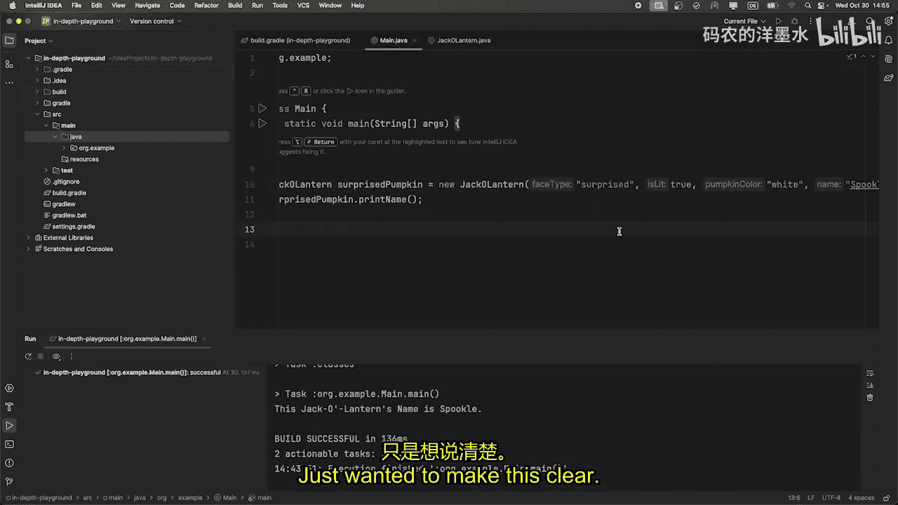
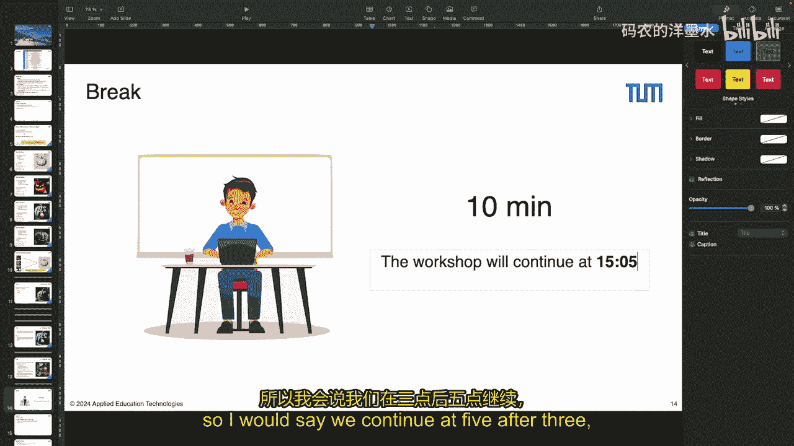

# 015：类 🎃


在本节课中，我们将深入学习类的核心概念。我们将从理解什么是类和对象开始，然后通过一个具体的例子——创建一个“杰克南瓜灯”类——来实践如何定义类、添加属性和方法，并实例化对象。

上一节我们介绍了课程的整体目标，本节中我们来看看如何创建和使用单个类。

## 什么是类和对象？

类是一个模板或蓝图。它定义了对象的形式。例如，一个“杰克南瓜灯”类可以定义所有南瓜灯共有的特征。

对象是类的一个具体实例。它是根据类的蓝图创建出来的一个具体事物。例如，根据“杰克南瓜灯”类，我们可以创建出许多个外观各不相同的具体南瓜灯对象。

## 创建“杰克南瓜灯”类

让我们在 IntelliJ IDEA 中开始实践。首先，创建一个新项目，然后为“杰克南瓜灯”类创建一个新的 Java 文件。

以下是类的初始结构，包含一些基本属性：



```java
public class JackOLantern {
    // 属性
    String faceType; // 面部表情类型
    boolean isLit;   // 蜡烛是否点亮
    String pumpkinColor; // 南瓜颜色
    String name;     // 南瓜灯的名字
    float weight;    // 南瓜灯的重量
}
```

我们为 `JackOLantern` 类定义了五个属性。`faceType` 和 `pumpkinColor` 使用 `String` 类型存储文本信息，`isLit` 使用 `boolean` 类型表示真假，`name` 也是 `String` 类型，而 `weight` 使用 `float` 类型以保留小数精度。





## 为类添加方法

类不仅包含数据（属性），还包含行为（方法）。让我们为南瓜灯添加一个介绍自己的方法。

以下是添加 `printName` 方法的代码：

```java
public class JackOLantern {
    // ... 属性定义同上 ...

    // 方法
    public void printName() {
        System.out.println("This Jack-O-Lantern's name is " + name + ".");
    }
}
```
`printName` 方法用于打印南瓜灯的名字。注意，我们使用了 `this.name` 来访问当前对象的 `name` 属性，确保引用的是实例变量而非局部变量。

## 使用构造函数初始化对象

目前，如果我们创建一个对象，其属性值将是默认值（如 `null` 或 `false`）。为了在创建对象时就赋予其特定的属性值，我们需要使用构造函数。

以下是包含构造函数的完整类定义：

```java
public class JackOLantern {
    // 属性
    String faceType;
    boolean isLit;
    String pumpkinColor;
    String name;
    float weight;

    // 构造函数
    public JackOLantern(String faceType, boolean isLit, String pumpkinColor, String name, float weight) {
        this.faceType = faceType;
        this.isLit = isLit;
        this.pumpkinColor = pumpkinColor;
        this.name = name;
        this.weight = weight;
    }

    // 方法
    public void printName() {
        System.out.println("This Jack-O-Lantern's name is " + name + ".");
    }
}
```
构造函数在创建新对象时被调用。它接收参数（`faceType`, `isLit` 等）并将它们赋值给新对象的对应属性。关键字 `this` 指代当前正在创建的对象本身。

## 实例化对象并调用方法

现在，我们可以在 `main` 方法中创建 `JackOLantern` 对象并调用其方法。

以下是在主程序中实例化对象并调用方法的示例：

```java
public class Main {
    public static void main(String[] args) {
        // 实例化一个 JackOLantern 对象
        JackOLantern spookyPumpkin = new JackOLantern("Scary", true, "Orange", "Spookley", 1.7f);

        // 调用对象的方法
        spookyPumpkin.printName(); // 输出：This Jack-O-Lantern's name is Spookley.
    }
}
```
我们使用 `new` 关键字和构造函数创建了一个名为 `spookyPumpkin` 的对象。然后，通过对象名加 `.` 运算符调用了 `printName` 方法。

## 添加更多方法

为了让类更有用，我们可以添加更多方法来改变对象的状态。

以下是两个新增方法的示例：一个用于改变颜色，另一个用于切换灯的开关状态。





```java
public class JackOLantern {
    // ... 属性和构造函数同上 ...

    // 改变颜色的方法
    public void changeColor(String newColor) {
        pumpkinColor = newColor;
        System.out.println(name + "'s color has been changed to " + newColor + ".");
    }

    // 切换灯光状态的方法
    public void toggleLight() {
        isLit = !isLit; // 使用逻辑非运算符进行切换
        System.out.println(name + "'s light is now " + (isLit ? "on" : "off") + ".");
    }
}
```
`changeColor` 方法接收一个 `newColor` 参数，并更新 `pumpkinColor` 属性。`toggleLight` 方法使用逻辑非运算符 `!` 来反转 `isLit` 的布尔值，实现开关切换。



## 参数与参数

在编程中，我们经常听到“参数”和“参数”这两个词，它们容易混淆。
*   **参数** 是定义在方法或构造函数括号内的变量，用于接收外部传入的值。
*   **参数** 是在调用方法或构造函数时，实际传入括号内的具体值。

在 `changeColor(String newColor)` 中，`newColor` 是一个**参数**。
在 `spookyPumpkin.changeColor("Purple");` 中，`"Purple"` 是一个**参数**。

## 总结





本节课中我们一起学习了面向对象编程的基础——类与对象。
*   我们理解了**类**是定义对象属性和行为的蓝图，而**对象**是类的具体实例。
*   我们实践了如何定义一个类，包括添加不同类型的**属性**（如 `String`, `boolean`, `float`）。
*   我们学习了如何编写**构造函数**来初始化新对象。
*   我们为类添加了**方法**来定义对象的行为，并学会了如何调用它们。
*   最后，我们辨析了**参数**与**参数**的区别。



通过创建“杰克南瓜灯”这个有趣的例子，你应该已经掌握了创建和使用单个类的基本步骤。建议你课后尝试创建自己的类，添加不同的属性和方法，以巩固所学知识。