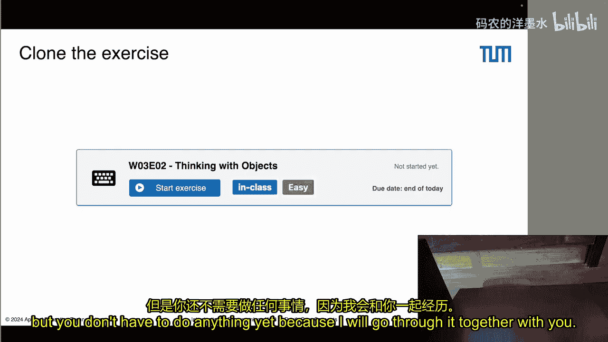
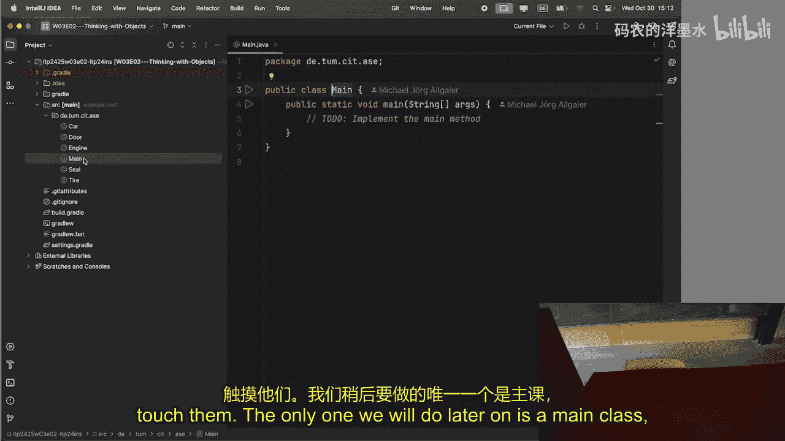
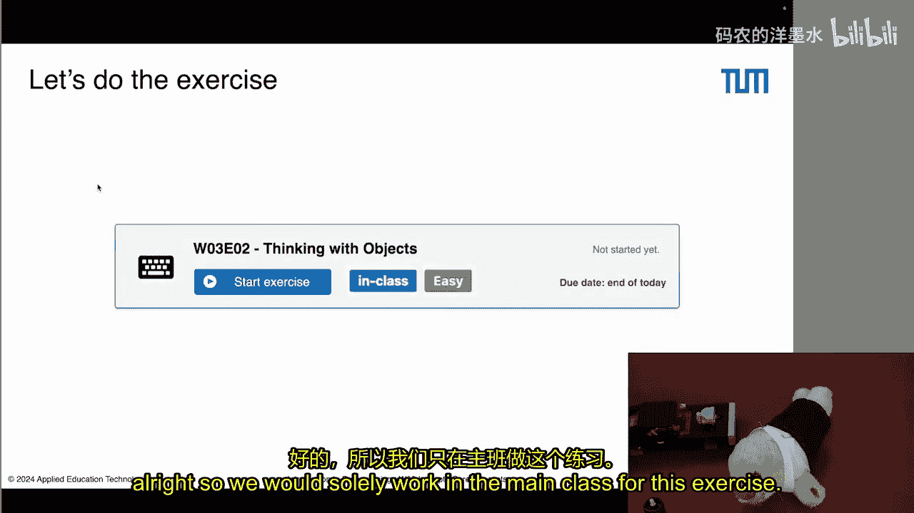
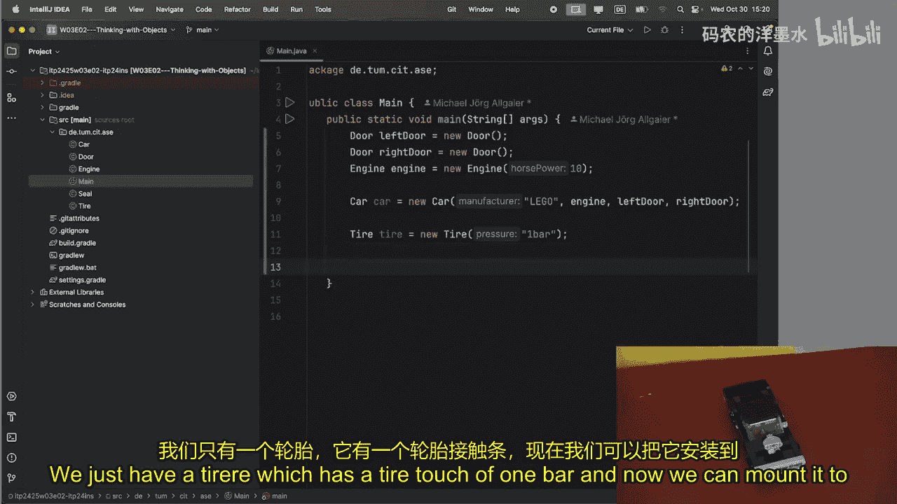
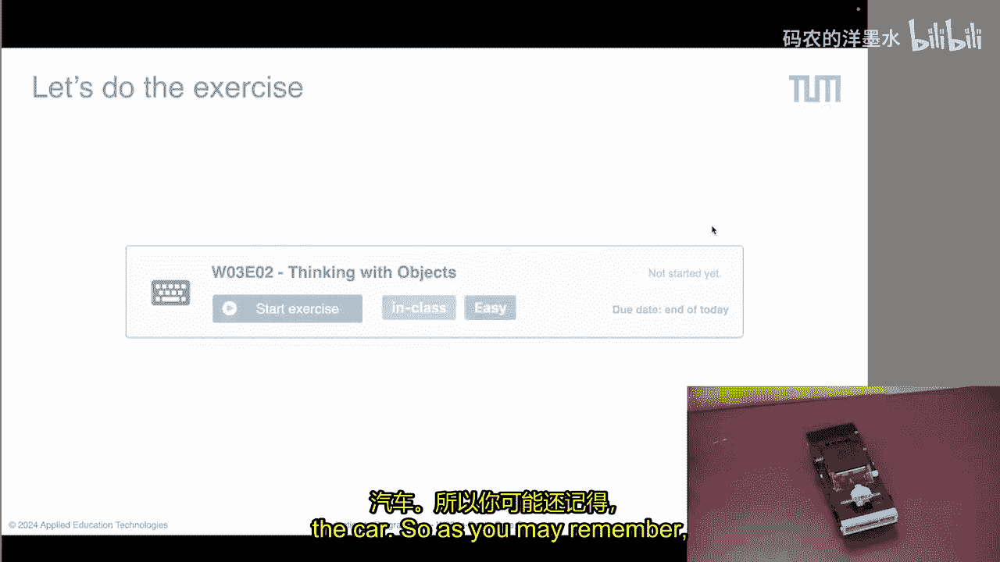
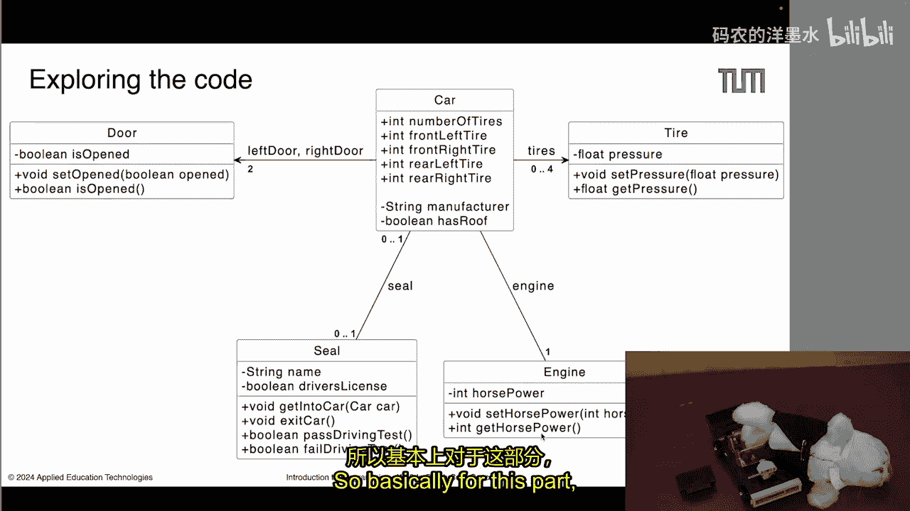

# 016：多个类与数组 🚗


在本节课中，我们将学习如何在Java程序中同时使用多个类，并结合数组来管理对象。我们将通过一个具体的汽车模型示例，理解如何将现实世界中的对象关系映射到代码中。

---

## 数组回顾 📚

上一节我们介绍了单个类的使用，本节中我们来看看如何管理一组对象。数组是存储多个同类型对象的有效工具。

以下是使用数组的三个关键步骤：

1.  **声明数组**
    声明数组的语法与声明其他变量类似，但在类型后需要加上方括号 `[]`。
    ```java
    private Seal[] seals;
    ```



2.  **初始化数组**
    声明后，数组是空的。需要使用 `new` 关键字并指定大小来初始化。
    ```java
    seals = new Seal[10];
    ```
    数组的大小是固定的。你也可以在初始化时直接填入值：
    ```java
    String[] texts = {"Hello", "World"};
    ```

3.  **使用数组元素**
    通过数组变量名和索引（从0开始）来访问或修改特定位置的元素。
    ```java
    // 访问第一个元素
    Seal firstSeal = seals[0];
    // 为第一个位置赋值
    seals[0] = new Seal("Conrad");
    ```
    对于一个大小为10的数组，有效索引范围是0到9。



---

## 类结构解析 🧩

现在，让我们进入练习部分。首先，我们需要理解提供的类之间的关系。

以下是本练习中涉及的类及其关系：

*   **Car（汽车）**：核心类。一辆汽车拥有：
    *   静态公共属性：轮胎数量（`NUMBER_OF_TIRES`）和各轮胎位置索引（如 `FRONT_LEFT_TIRE`）。
    *   私有非静态属性：制造商（`manufacturer`）、是否有车顶（`hasRoof`）。
    *   关联关系：一辆汽车**有**两个车门（`Door`）、一个引擎（`Engine`）和一个轮胎数组（`Tire[]`）。汽车还可以**有**一个驾驶员（`Seal`）。

*   **Door（车门）**：汽车的一部分。车门可以打开或关闭。



*   **Engine（引擎）**：汽车的一部分。拥有马力属性。

*   **Tire（轮胎）**：汽车的一部分。轮胎可以被安装或拆卸。

*   **Seal（海豹/驾驶员）**：这是一个独立的实体。与汽车存在**双向关系**：海豹可以进入汽车，汽车也可以载有海豹。海豹还可以拥有驾照。

---

## 实践：构建汽车 🛠️

我们将主要在 `Main` 类中编写代码。首先，我们需要创建一辆汽车。





创建汽车需要引擎和两个车门作为构造参数。因此，我们必须先创建这些对象。

```java
// 1. 创建所需部件
Door leftDoor = new Door();
Door rightDoor = new Door();
Engine engine = new Engine(10); // 10马力

// 2. 创建汽车
Car car = new Car("Lego", engine, leftDoor, rightDoor);
```

现在，我们拥有了一辆没有轮胎的汽车。接下来需要创建并安装轮胎。

一辆汽车有四个轮胎位置。我们需要创建四个独立的轮胎对象，并将它们安装到正确的位置。

```java
// 创建四个轮胎对象
Tire tire1 = new Tire(1.0); // 胎压1.0巴
Tire tire2 = new Tire(1.0);
Tire tire3 = new Tire(1.0);
Tire tire4 = new Tire(1.0);

// 将轮胎安装到汽车的指定位置
car.setTire(Car.FRONT_LEFT_TIRE, tire1);
car.setTire(Car.FRONT_RIGHT_TIRE, tire2);
car.setTire(Car.REAR_LEFT_TIRE, tire3);
car.setTire(Car.REAR_RIGHT_TIRE, tire4);
```

**重要提示**：不能将同一个轮胎对象安装到多个位置。虽然代码可能允许，但这不符合现实逻辑。每个轮胎位置需要一个独立的物理对象，因此在代码中也需要独立的`Tire`对象实例。

---


## 添加驾驶员 🦭



汽车准备好了，现在需要一位驾驶员。

```java
// 创建海豹驾驶员Conrad
Seal driver = new Seal("Conrad");

// Conrad需要通过驾照考试
driver.passDrivingTest();

// Conrad需要进入汽车。但车顶可能妨碍，我们先移除车顶。
car.setHasRoof(false);

// 现在Conrad可以进入汽车了
driver.getIntoCar(car);
```

注意，`getIntoCar` 是 `Seal` 类的方法。这是因为在现实世界中，是“海豹”这个主体执行“进入汽车”的动作，而不是汽车本身去“装载”海豹。这种设计体现了对现实关系的建模。

---

## 总结 🎯


本节课中我们一起学习了：
1.  **数组的使用**：包括声明、初始化和访问，记住索引从0开始。
2.  **多类协作**：如何创建多个类的对象，并通过方法调用让它们相互作用。
3.  **现实建模**：编写代码时，思考对象关系在现实中是否合理至关重要（例如，“汽车拥有引擎”是合理的，而“引擎拥有汽车”则不合理）。
4.  **对象独立性**：每个物理对象对应代码中的一个独立对象实例，不能随意共享（如一个轮胎不能同时装在四个位置）。


核心在于，Java代码应反映现实世界的逻辑。在设计和编写类、属性及方法时，多思考“这在现实中是如何工作的”，能帮助你构建出更清晰、更健壮的程序。