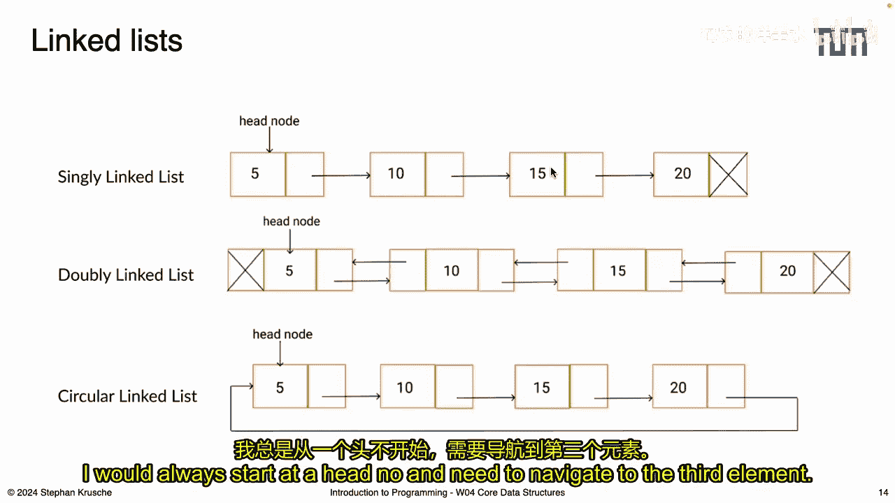

# 019：核心数据结构 - 列表（第一部分）


在本节课中，我们将要学习编程中的核心数据结构。在介绍了面向对象编程、控制流和循环的基础概念后，今天我们将重点探讨列表、栈和队列这三种重要的数据结构。课程结束时，你将能够解释栈和队列的工作原理，区分列表与数组，并使用Java集合框架中的基本数据类型。

## 概述：抽象数据类型与信息隐藏

上一节我们回顾了面向对象编程和控制流的基础。本节中，我们来看看抽象数据类型（ADT）及其重要性。

抽象数据类型在计算机科学中至关重要，因为它允许我们定义可在该类型上执行的操作，同时隐藏其内部实现的复杂性。这被称为**信息隐藏**。通过将内部数据结构和方法实现设为私有（`private`），我们可以防止非法访问，确保数据结构的特定属性（如栈的“后进先出”原则）不被破坏。

使用抽象数据类型的主要优势包括：
*   **解耦与维护**：允许独立开发和维护内部实现，只要公共接口不变。
*   **快速原型设计**：可以仅通过讨论API（应用程序编程接口）来交换想法，无需关心内部实现。
*   **性能与互操作性**：标准库中的实现通常经过高度优化，并且不同集合类型（如列表与集合）之间可以轻松转换。

Java提供了一个统一的**集合框架**来代表和操作一组元素。它减少了编程工作量，因为你只需要知道如何使用它们，而无需了解所有内部细节。今天我们将重点介绍其中最常用的数据类型之一：**列表**。

## 列表（List）数据类型

列表是编程中极其常见的数据类型，用于表示一组有序的元素序列。Java在`java.util`包中内置了`List`接口。

`List`是一个**泛型**接口。这意味着在创建列表时，你需要指定它将要包含的元素类型（例如`String`， `Integer`或自定义类）。这可以防止意外添加错误类型的元素。

`List`代表一个**有序序列**，每个元素都有一个索引（从0开始计数），并且元素**可以重复**。

以下是`List`接口定义的一些核心方法：

```java
boolean add(E element) // 向列表添加一个元素
void clear() // 移除列表中的所有元素
boolean contains(Object o) // 检查列表是否包含特定元素
E get(int index) // 获取指定索引位置的元素
boolean isEmpty() // 检查列表是否为空
E remove(int index) // 移除指定索引位置的元素
boolean remove(Object o) // 移除列表中首次出现的指定元素
E set(int index, E element) // 将指定索引位置的元素替换为新元素
int size() // 返回列表中的元素数量
```
（其中 `E` 代表创建列表时指定的元素类型）

### 列表使用示例

以下是如何在代码中使用`List`的示例：

```java
import java.util.*;

public class ListExample {
    public static void main(String[] args) {
        // 创建一个存储字符串的列表
        List<String> words = new ArrayList<>();

        // 向列表添加元素
        words.add("Hello");
        words.add("sentence");
        words.add(".");
        words.add("Hello"); // 元素可以重复

        // 获取索引为2的元素（第三个元素）
        String thirdWord = words.get(2); // 结果是 "."

        // 检查列表是否包含 "sentence"
        boolean hasSentence = words.contains("sentence"); // true

        // 查找 "Hello" 第一次出现的索引
        int indexOfHello = words.indexOf("Hello"); // 0
    }
}
```

### 增强型 for 循环（For-Each Loop）

当需要遍历列表（或其它集合）中的所有元素时，可以使用更简洁的**增强型for循环**（也称为for-each循环）。它无需处理索引，降低了出错风险。

```java
// 使用增强型for循环遍历列表
for (String word : words) {
    System.out.print(word + " ");
}
// 输出：Hello sentence . Hello
```
这个循环可以理解为：“对于列表`words`中的每一个`String`类型元素`word`，执行打印操作。”

### 列表与数组的对比

列表和数组有相似之处，但也有关键区别：
*   **数组**是基础、固定长度的数据结构，不是纯粹面向对象的。创建时必须指定大小。
*   **列表**是高级、动态长度的抽象数据类型。你无需预先指定大小，可以随时添加或删除元素。
*   **性能与易用性**：数组可能在某些场景下性能稍高，但列表更灵活、更不易出错（例如，通过`get(index)`访问元素时，会进行边界检查）。`ArrayList`的内部实现就是基于数组，但这被信息隐藏了。

**建议**：在大多数情况下，优先使用`List`，除非有明确的性能要求或必须使用数组的场景。

## 集合（Set）数据类型

在介绍了有序且允许重复的列表后，我们来看看另一种重要的集合类型：**Set**。

`Set`代表一个**无序**的集合，并且其中的每个元素都必须是**唯一**的。你不能对元素的顺序做任何假设，也不能通过索引访问元素。

以下是`Set`接口的核心方法（注意，所有与索引相关的方法都不存在）：

```java
boolean add(E e) // 向集合添加元素。如果元素已存在，则添加失败，返回false。
void clear()
boolean contains(Object o)
boolean isEmpty()
boolean remove(Object o)
int size()
```

### 集合使用示例

```java
import java.util.*;

public class SetExample {
    public static void main(String[] args) {
        // 创建一个存储字符串的集合
        Set<String> words = new HashSet<>();

        words.add("Hello");
        words.add("sentence");
        words.add(".");
        words.add("Hello"); // 这个添加操作会失败，因为"Hello"已存在
        words.add("word");
        words.add("word"); // 这个添加操作也会失败

        System.out.println(words.size()); // 输出：4 （不是6）

        // 遍历集合（顺序不确定）
        for (String word : words) {
            System.out.print(word + " ");
        }
        // 可能的输出：sentence Hello word . （顺序无法保证）
    }
}
```

**使用建议**：当你需要确保元素的唯一性，并且不关心它们的顺序时，使用`Set`。否则，通常使用`List`会更方便。

## 链表（Linked List）简介

除了基于数组实现的`ArrayList`，还有一种重要的列表实现叫**链表**。

链表由一系列节点组成，每个节点包含数据和指向下一个节点的引用（指针）。单向链表的结构如下图所示：

```
[Head] -> [Data | Next] -> [Data | Next] -> [Data | Next] -> null
```

链表的主要特点是：
*   **动态大小**：可以轻松地添加或删除节点。
*   **插入/删除效率**：在已知位置插入或删除元素时，可能比数组列表更高效。
*   **访问效率**：不能通过索引直接访问元素（如`get(3)`）。要找到第3个元素，必须从头节点开始，逐个遍历。

对于初学者，了解链表的存在及其基本思想即可。在大多数日常编程中，直接使用`List`接口（并由`ArrayList`实现）就足够了。

## 总结

本节课中，我们一起学习了核心数据结构的第一部分，重点是**列表**。
1.  我们理解了**抽象数据类型**和**信息隐藏**的概念及其优势。
2.  我们深入探讨了**`List`接口**：它是一个有序、可重复的泛型集合，并学习了其基本用法（`add`, `get`, `remove`等）。
3.  我们介绍了简洁的**增强型for循环**来遍历集合。
4.  我们对比了**列表与数组**的异同，并给出了使用建议。
5.  我们简要了解了**`Set`接口**，它是一个无序且元素唯一的集合。
6.  最后，我们提到了**链表**作为另一种列表实现的基本概念。



掌握这些基础数据结构是进行更复杂编程的基石。在接下来的课程中，我们将继续探讨栈（Stack）和队列（Queue）这两种遵循特定访问顺序的数据结构。