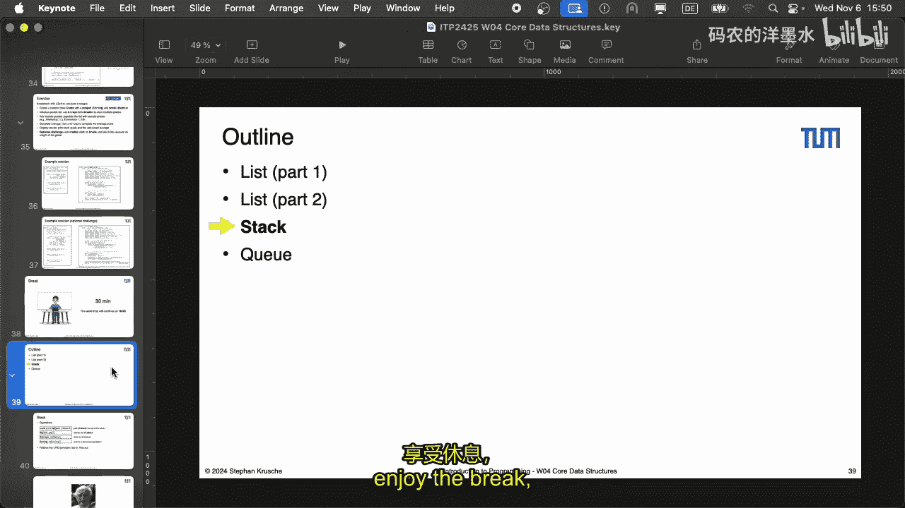

# 020：列表（第二部分）


在本节课中，我们将继续深入学习列表数据类型，探讨更多示例和细节。我们将了解泛型、包装类，以及如何将自定义类与集合一起使用。

## 泛型与包装类

上一节我们介绍了列表的基本概念。本节中，我们来看看列表如何与不同类型的数据协同工作。

列表接口代表一个有序的对象序列。然而，列表不能直接使用原始数据类型（如 `int`, `float`）。为了解决这个问题，Java 使用了泛型和包装类。

### 理解泛型

泛型是一种类基数据类型的占位符。它不能用于原始类型（如 `int`, `float`, `boolean`）。泛型让我们能够编写类型安全的代码，确保集合中只包含我们预期的类型，从而在编译时防止许多错误。

**核心概念**：泛型允许我们只实现一次列表，就能在未来与任何数据类型一起使用。

### 包装类

对于每个原始数据类型，Java 都有一个对应的包装类。例如：
*   `int` 对应 `Integer`
*   `float` 对应 `Float`
*   `boolean` 对应 `Boolean`

以下是包装类的使用方式：

```java
// 自动装箱：将 int 包装为 Integer
Integer wrappedInt = 42;

// 自动拆箱：将 Integer 解包为 int
int primitiveInt = wrappedInt;
```

包装类在需要使用集合（如 `List`, `Set`）时是必需的，因为集合只能包含类基类型。然而，它们占用更多内存，并且可能为 `null`，这需要额外的处理来避免 `NullPointerException`。

### Object 类

所有类的隐式超类都叫 `Object`。它提供了一些通用方法，如 `toString()` 和 `equals()`。即使你不显式声明，你创建的每个类都继承自 `Object`。

## 使用列表的注意事项

在使用集合时，有几个重要的点需要注意。

以下是使用集合时需要考虑的一些关键事项：

1.  **可能包含 `null` 值**：列表可以包含 `null`。在检索元素时，可能需要检查是否为 `null`。
2.  **并发修改异常**：不能在迭代集合的同时直接修改它（例如删除元素）。常见的解决方法是使用一个临时列表，或者后续将学到的流（Stream）API。
3.  **操作效率**：某些操作可能效率较低。例如，在列表开头添加元素需要移动其后所有元素，如果列表很大，这会很耗时。

## 列表使用示例

现在，让我们通过几个具体例子来看看列表的实际应用。

### 示例 1：整数列表与求和

这个例子展示了如何创建整数列表并计算其元素之和。

```java
List<Integer> numbers = new ArrayList<>();
numbers.add(0);
numbers.add(1);
numbers.add(1);
numbers.add(2);
numbers.add(3);
numbers.add(5);
numbers.add(8);
numbers.add(13);
numbers.add(21); // 斐波那契数列

int sum = 0;
for (int number : numbers) { // 自动拆箱
    sum = sum + number;
}
System.out.println("总和: " + sum);
```

**注意**：如果列表中含有 `null`，在自动拆箱时会抛出 `NullPointerException`。

### 示例 2：浮点数列表与求平均值

这个例子演示了如何处理浮点数列表并计算平均值。

```java
List<Float> temperatures = new ArrayList<>();
temperatures.add(18.5f);
temperatures.add(20.1f);
temperatures.add(22.3f);
temperatures.add(19.8f);

float sum = 0.0f;
for (float temp : temperatures) {
    sum += temp;
}
float average = sum / temperatures.size();
System.out.println("平均温度: " + average);
```

### 示例 3：自定义类与列表

我们也可以将自己定义的类用于列表。假设我们有一个表示二维点的 `Point` 类。

```java
class Point {
    private final double x;
    private final double y;
    // 构造函数、getter 等方法...
}

// 使用 Point 列表
List<Point> polygon = new ArrayList<>();
polygon.add(new Point(0, 0));
polygon.add(new Point(4, 0));
polygon.add(new Point(4, 3));

// 计算多边形的中心点（所有点的平均值）
double sumX = 0, sumY = 0;
for (Point p : polygon) {
    sumX += p.getX();
    sumY += p.getY();
}
Point center = new Point(sumX / polygon.size(), sumY / polygon.size());
```

## 练习：创建成绩簿

现在，请你在自己的编程环境中完成以下练习，以巩固所学知识。

**任务**：创建一个简单的成绩簿来计算平均分。

1.  创建一个 `Grade` 类，包含两个属性：`subject`（科目，`String` 类型）和 `score`（分数，`double` 类型）。
2.  使用 `ArrayList` 初始化一个 `Grade` 列表，并添加几个示例成绩。
3.  使用 for 循环计算所有成绩的平均分，并将结果打印到控制台。
4.  **可选挑战**：为 `Grade` 类添加一个 `credits`（学分）属性，并计算加权平均分（考虑学分的权重）。

**示例代码结构（基础部分）**：

```java
// Grade 类
class Grade {
    private final String subject;
    private final double score;
    // 构造函数和 getter 方法
}

// 主逻辑
List<Grade> grades = new ArrayList<>();
grades.add(new Grade("市场营销", 1.3));
grades.add(new Grade("经济学", 2.0));
// ... 添加更多成绩

double sum = 0.0;
for (Grade g : grades) {
    sum += g.getScore();
}
double average = sum / grades.size();
System.out.println("平均分: " + average);
```

**示例解决方案（含可选挑战）**：

对于可选挑战，需要修改 `Grade` 类，添加 `credits` 属性，并在计算平均分时使用加权和。

```java
class Grade {
    private final String subject;
    private final double score;
    private final int credits; // 新增学分属性
    // 更新构造函数和 getter
}

// 计算加权平均分
double weightedSum = 0.0;
int totalCredits = 0;
for (Grade g : grades) {
    weightedSum += g.getScore() * g.getCredits();
    totalCredits += g.getCredits();
}
double weightedAverage = weightedSum / totalCredits;
```

## 总结



本节课中我们一起学习了列表数据类型的进阶知识。我们探讨了泛型的概念及其作用，认识了包装类（如 `Integer`, `Float`）以及它们为何在与集合一起使用时必不可少。我们还了解了使用集合时的一些注意事项，例如处理 `null` 值、避免并发修改以及注意某些操作的效率。最后，我们通过多个示例和练习，实践了如何将列表用于整数、浮点数以及自定义类，并成功创建了一个可以计算（加权）平均分的成绩簿程序。