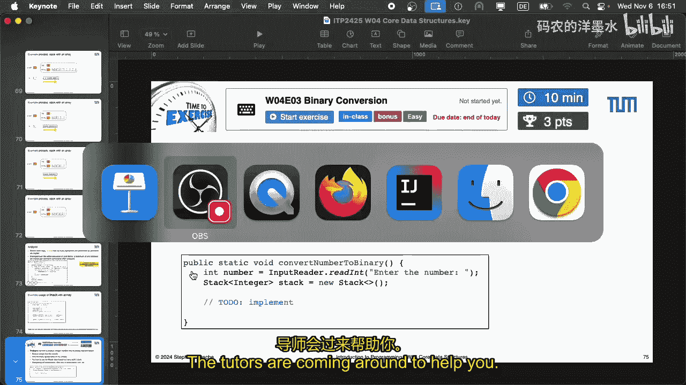
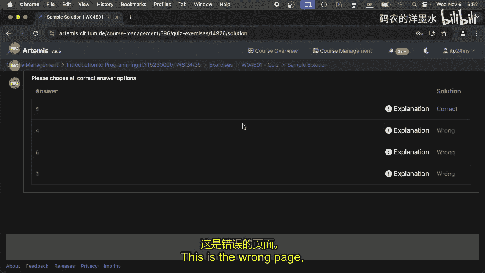
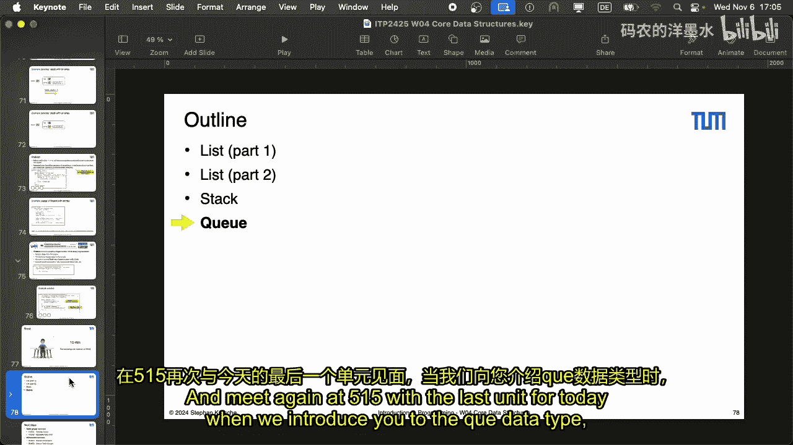

# 021：栈 📚


在本节课中，我们将要学习一种新的数据结构——栈。栈遵循“后进先出”的原则，这意味着最后添加到栈中的元素，也将是第一个被取出的元素。我们将探讨栈的基本概念、操作，并通过两种不同的方式（基于列表和基于数组）来实现它。

## 栈的基本概念与操作 🧱

上一节我们介绍了课程概述，本节中我们来看看栈的具体定义和核心操作。

栈遵循 **LIFO**（Last In, First Out，后进先出）原则。你可以把它想象成一摞盘子：你总是把新盘子放在最上面，也只能从最上面拿走盘子。

栈通常支持以下四种核心操作：
*   **`push(element)`**: 将一个元素压入栈顶。
*   **`pop()`**: 弹出并返回栈顶的元素。如果栈为空，则返回 `null`。
*   **`isEmpty()`**: 检查栈是否为空，返回布尔值。
*   **`toString()`**: 返回栈的字符串表示，便于调试。

栈的概念由慕尼黑工业大学的著名计算机科学家 **弗里德里希·路德维希·鲍尔** 提出并发展。他是历史上最早的计算机科学家之一，我们信息学大楼的主报告厅就是以他的名字命名的。

## 栈的UML类图与可视化 📊

了解了基本操作后，我们来看看如何用UML类图来建模一个栈。

一个栈的UML类图可能如下所示：
```
+-------------------+
|      Stack<E>     |
+-------------------+
| - list: List<E>   |
+-------------------+
| + push(e: E): void|
| + pop(): E        |
| + isEmpty(): boolean|
| + toString(): String|
+-------------------+
```
类图中包含栈的四个公共方法，以及一个私有的内部列表（用组合关系表示，即黑色菱形箭头）。组合关系意味着列表的生命周期与栈绑定：栈被创建时列表随之创建，栈被销毁时列表也随之销毁。

让我们可视化栈的工作过程。从一个空栈开始：
```
栈: [ ]
```
执行 `push(1)` 后：
```
栈: [1]
```
执行 `push(2)` 后：
```
栈: [1, 2]
```
执行 `push(3)` 后：
```
栈: [1, 2, 3]
```
现在，如果执行 `pop()` 操作，将返回 `3`，栈变为 `[1, 2]`。再次执行 `pop()` 将返回 `2`，栈变为 `[1]`。这就像搭积木，你总是拿走最上面的那块。

## 基于列表的栈实现（泛型）💻

上一节我们看了栈的抽象模型，本节中我们来看看如何用Java代码具体实现它。第一种方法是利用现有的 `List` 来实现一个泛型栈。

以下是使用 `List` 实现泛型栈的核心代码：
```java
import java.util.ArrayList;
import java.util.List;

public class Stack<E> {
    private final List<E> list = new ArrayList<>();

    public void push(E element) {
        // 假设我们不允许压入null值
        list.add(element);
    }

    public E pop() {
        if (list.isEmpty()) {
            return null;
        }
        // 移除并返回最后一个元素
        return list.remove(list.size() - 1);
    }

    public boolean isEmpty() {
        return list.isEmpty();
    }

    @Override
    public String toString() {
        return list.toString();
    }
}
```
**关键点**：
1.  **信息隐藏**：内部列表 `list` 是 `private` 的，栈的使用者无法直接调用 `list.add()` 或 `list.remove()`，只能通过 `push`、`pop` 等规定的方法操作栈，这保证了数据的一致性和安全性。
2.  **泛型**：使用 `<E>` 使得栈可以存储任何类型的对象。
3.  **委托**：`isEmpty()` 和 `toString()` 方法直接委托给内部列表执行。

## 栈的使用示例 🚀

我们已经实现了栈，现在来看看如何在实际代码中使用它。

以下是使用我们刚实现的泛型栈的示例：
```java
public class Main {
    public static void main(String[] args) {
        Stack<Integer> stack = new Stack<>();
        System.out.println("Pushing elements...");
        stack.push(10);
        stack.push(20);
        stack.push(30);
        System.out.println("Current stack: " + stack); // 输出: [10, 20, 30]

        System.out.println("Popping an element...");
        Integer popped = stack.pop();
        System.out.println("Popped: " + popped); // 输出: 30
        System.out.println("Current stack: " + stack); // 输出: [10, 20]
    }
}
```
当打印 `stack` 对象时，会自动调用其 `toString()` 方法。

## 基于数组的栈实现 🔧

虽然基于列表的实现简单高效，但为了深入理解栈的底层原理，我们来看看如何直接用数组实现。这需要手动处理数组的扩容问题。

以下是基于数组的栈实现的核心逻辑（简化版，非泛型）：
```java
public class Stack {
    private int top = -1; // 指向栈顶元素的索引，-1表示空栈
    private Object[] array = new Object[4]; // 初始数组大小

    public void push(Object element) {
        top++;
        if (top == array.length) { // 数组已满，需要扩容
            Object[] newArray = new Object[array.length * 2]; // 双倍扩容
            for (int i = 0; i < array.length; i++) {
                newArray[i] = array[i]; // 复制旧元素
            }
            array = newArray; // 替换旧数组
        }
        array[top] = element; // 放入新元素
    }

    public Object pop() {
        if (top < 0) {
            return null; // 或抛出异常
        }
        Object element = array[top];
        top--; // 降低栈顶指针，逻辑上“移除”元素
        return element;
    }
    // ... isEmpty() 和 toString() 方法
}
```
**关键点与挑战**：
1.  **固定大小**：数组大小固定，当栈满时需要创建更大的新数组并复制所有元素，这是一个开销较大的操作。
2.  **惰性删除**：`pop()` 操作只是将 `top` 索引减一，并未真正清空数组中原位置的数据。`toString()` 方法需要根据 `top` 索引来构建有效的字符串。
3.  **性能优化**：简单的“满则双倍扩容”策略在长期操作中平均效率较高。为了避免在容量边界频繁扩容和缩容，一种更优的策略是：**当数组已满时双倍扩容；仅当元素数量降至数组容量的 1/4 时，才将数组缩容一半**。这避免了在容量半满附近反复调整大小。

## 栈的应用练习：十进制转二进制 🔢

理论结合实践，让我们通过一个练习来巩固对栈的理解。这个练习将使用栈来帮助进行十进制数到二进制数的转换。

**任务**：将一个正整数转换为其二进制表示形式。
**思路**：
1.  将十进制数不断除以 2，记录每次的余数（0 或 1）。这正是二进制位的计算过程，但得到的顺序是反的（从低位到高位）。
2.  将每个余数 `push` 到栈中。
3.  依次从栈中 `pop` 出所有余数并打印，由于栈的 LIFO 特性，自然就得到了正确的从高位到低位的二进制序列。

以下是解决方案的核心代码：
```java
import java.util.Scanner;
import java.util.Stack; // 这里可以使用java.util.Stack或我们自己实现的Stack





public class BinaryConversion {
    public static void main(String[] args) {
        Scanner scanner = new Scanner(System.in);
        System.out.print("Enter a positive integer: ");
        int number = scanner.nextInt();

        Stack<Integer> stack = new Stack<>();

        // 计算余数并压栈
        while (number > 0) {
            int remainder = number % 2;
            stack.push(remainder);
            number = number / 2; // 整数除法
        }

        // 弹出并打印，得到正确顺序的二进制数
        System.out.print("Binary representation: ");
        while (!stack.isEmpty()) {
            System.out.print(stack.pop());
        }
        System.out.println();
    }
}
```
例如，输入 `9`，计算过程是：余数序列为 `1, 0, 0, 1`（依次入栈）。出栈打印顺序为 `1, 0, 0, 1`，即二进制 `1001`。

## 总结 📝

本节课中我们一起学习了栈这种重要的数据结构。
*   我们理解了栈的 **LIFO** 特性和它的基本操作（`push`, `pop`, `isEmpty`, `toString`）。
*   我们掌握了两种实现栈的方法：**基于 `List` 的泛型实现**（简单、实用）和**基于数组的实现**（有助于理解底层机制和动态扩容策略）。
*   我们深入了解了 **信息隐藏** 原则，即只向使用者暴露必要的接口。
*   我们通过**十进制转二进制**的练习，看到了栈在反转序列顺序方面的典型应用。



栈是计算机科学中基础且应用广泛的数据结构，从函数调用、表达式求值到浏览器历史记录，背后都有它的身影。理解栈的原理和实现，是编程学习中的重要一步。