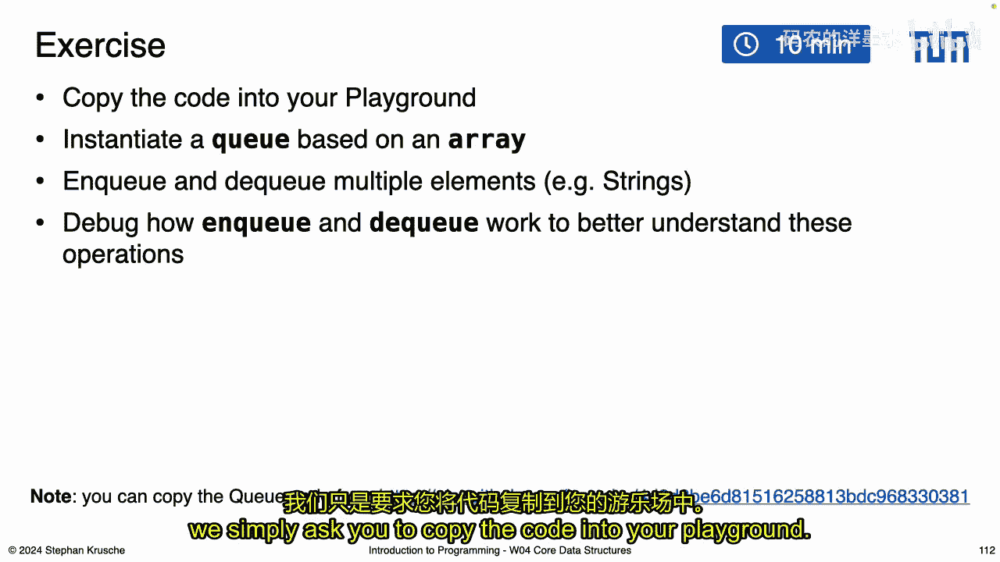
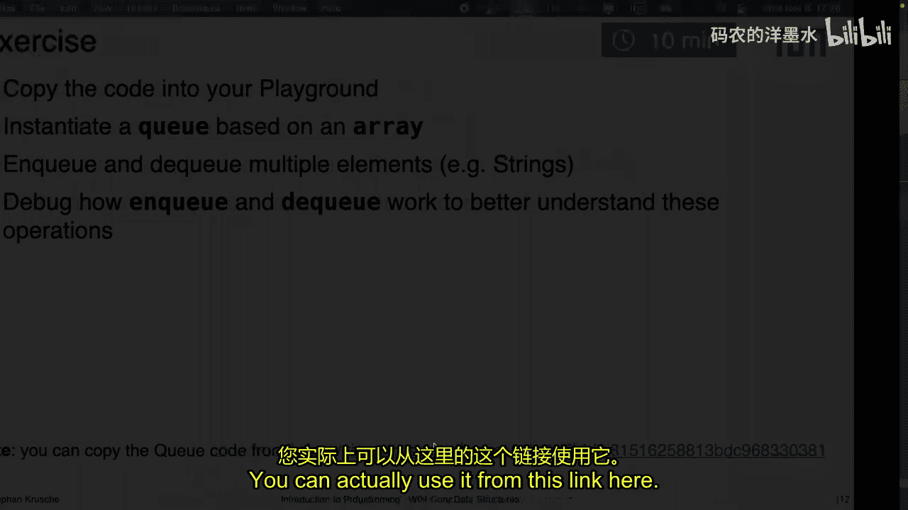
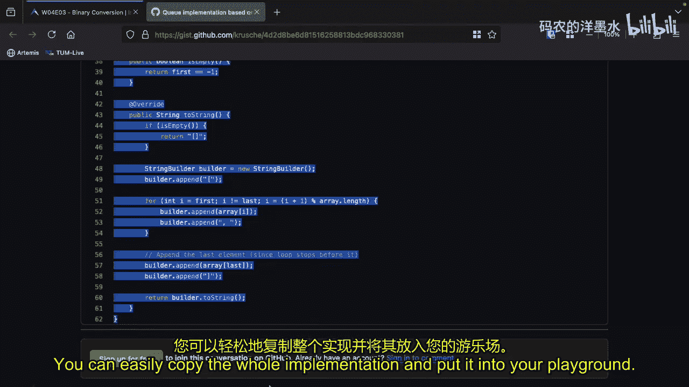
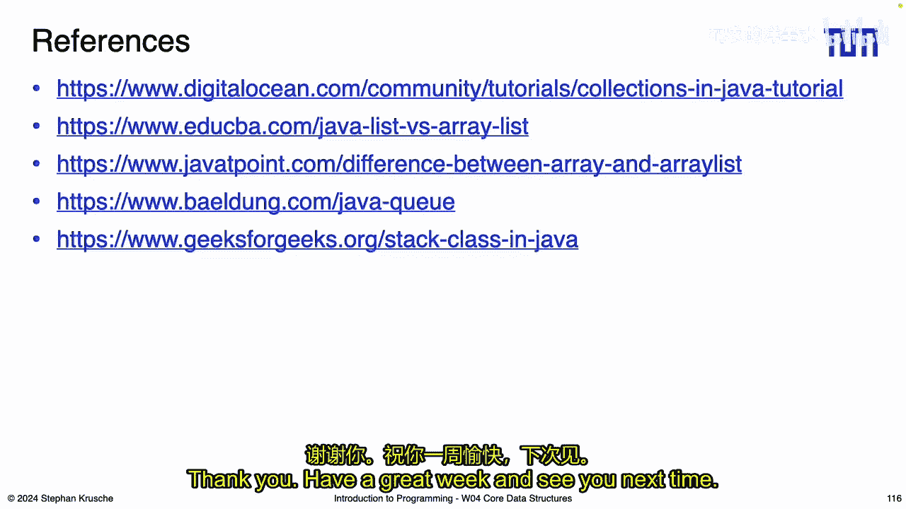

# 022：队列 🚶‍♂️🚶‍♀️

在本节课中，我们将要学习一种新的数据结构——队列。我们将了解它的工作原理、它与栈的区别，并学习如何使用列表和数组两种方式来实现它。

## 概述

上一节我们介绍了栈，它遵循“后进先出”的原则。本节中我们来看看队列，它遵循的是“先进先出”的原则。队列就像超市里的收银台队伍，第一个到达收银台的人第一个结账，排在第六位的人必须等待前面五个人都结账后才能轮到。

## 队列的基本概念

队列与栈的工作方式相似，但提供了不同的操作。栈使用 `push` 和 `pop`，而队列使用 `enqueue` 和 `dequeue`。此外，队列也包含 `isEmpty` 和 `toString` 方法。

我们可以这样定义队列的接口：
```java
interface Queue<E> {
    void enqueue(E element); // 入队
    E dequeue();             // 出队
    boolean isEmpty();       // 判断是否为空
    String toString();       // 转换为字符串
}
```

让我们可视化队列的工作过程。当我们执行 `enqueue` 操作时，元素会进入队列尾部。当我们执行 `dequeue` 操作时，会从队列头部取出元素。例如，依次入队 1, 2, 3, 4，然后执行出队操作，将依次返回 1, 2, 3, 4。

## 使用列表实现队列

我们可以像实现栈一样，使用列表来实现队列。主要区别在于，出队时我们移除列表的第一个元素，而不是最后一个元素。

以下是使用列表实现泛型队列的核心代码：
```java
public class ListQueue<E> {
    private final List<E> list = new ArrayList<>();

    public void enqueue(E element) {
        list.add(element); // 添加到列表末尾
    }

    public E dequeue() {
        if (isEmpty()) {
            return null;
        }
        return list.remove(0); // 移除并返回列表的第一个元素
    }

    public boolean isEmpty() {
        return list.isEmpty();
    }
}
```

这个实现非常简单。我们只是将栈实现中的 `list.remove(list.size() - 1)` 改为了 `list.remove(0)`，就得到了一个完全不同的数据结构。需要注意的是，从列表头部移除元素的效率不如从尾部移除，但为了简单起见，我们暂时接受这一点。

## 使用数组实现队列

接下来，让我们看看如何使用数组实现队列。与栈只用一个 `top` 索引不同，队列需要两个索引：`first` 和 `last`，分别指向队列的第一个和最后一个元素。

### 数组队列的工作原理

初始时，数组为空，`first` 和 `last` 都设为 -1。入队时，我们将元素放在 `last` 指向的位置，然后递增 `last`。出队时，我们返回 `first` 指向的元素，然后递增 `first`。

当 `last` 到达数组末尾时，我们面临一个选择：是扩展数组，还是复用数组前部的空间？为了效率，我们选择后者，形成一个“循环数组”。这意味着当索引到达数组末尾时，它会绕回到数组开头。我们通过取模运算 `(index + 1) % array.length` 来实现这一点。

### 数组队列的实现细节

以下是数组队列 `enqueue` 方法的核心逻辑：
```java
public void enqueue(E element) {
    int length = array.length;
    int newLast = (last + 1) % length; // 计算新的last位置，考虑循环

    if (newLast == first) { // 队列已满，需要扩容
        // 1. 创建新数组，大小为原数组两倍
        // 2. 将元素从first到last按顺序复制到新数组开头
        // 3. 重置first=0, last=原数组长度
        // 4. 将新元素添加到last位置
    } else {
        if (isEmpty()) { // 队列为空时的特殊处理
            first = last = 0;
        } else {
            last = newLast;
        }
        array[last] = element;
    }
}
```

`dequeue` 方法的实现则相对简单：
```java
public E dequeue() {
    if (isEmpty()) {
        return null;
    }
    E result = array[first];
    if (first == last) { // 出队后队列将为空
        first = last = -1;
    } else {
        first = (first + 1) % array.length; // first向前移动，考虑循环
    }
    return result;
}
```

### 改进的 toString 方法







由于数组中的元素可能不是从索引0开始连续存放的，直接使用 `Arrays.toString()` 会打印出不属于当前队列的旧元素。因此，我们需要一个自定义的 `toString` 方法，使用 `StringBuilder` 从 `first` 到 `last` 遍历循环数组，只拼接有效的队列元素。

```java
public String toString() {
    if (isEmpty()) {
        return “[]”;
    }
    StringBuilder builder = new StringBuilder(“[”);
    int i = first;
    while (i != last) {
        builder.append(array[i]).append(“, “);
        i = (i + 1) % array.length;
    }
    builder.append(array[last]).append(“]”); // 添加最后一个元素，避免多余逗号
    return builder.toString();
}
```

## 练习与调试

为了加深理解，建议你将课程提供的完整数组队列代码复制到编程环境中。实例化一个队列，执行一系列入队和出队操作，并使用调试器逐步执行代码。观察 `first`、`last` 索引和数组内容的变化，这能帮助你直观地理解循环数组的工作原理。

## 总结

本节课中我们一起学习了队列数据结构。我们了解到：
1.  队列遵循 **先进先出** 原则。
2.  可以使用列表简单地实现队列，但出队操作可能效率不高。
3.  更高效的实现方式是使用**循环数组**，它通过两个索引（`first` 和 `last`）和取模运算来管理元素，并能在数组满时进行扩容和重排。
4.  内置的数据结构（如 `List`, `Queue`）有助于快速开发，但理解其背后的实现原理对评估性能至关重要。



记住，信息隐藏让我们无需关心实现细节即可使用数据结构，但窥探其内部实现能让我们更好地理解其性能特征。