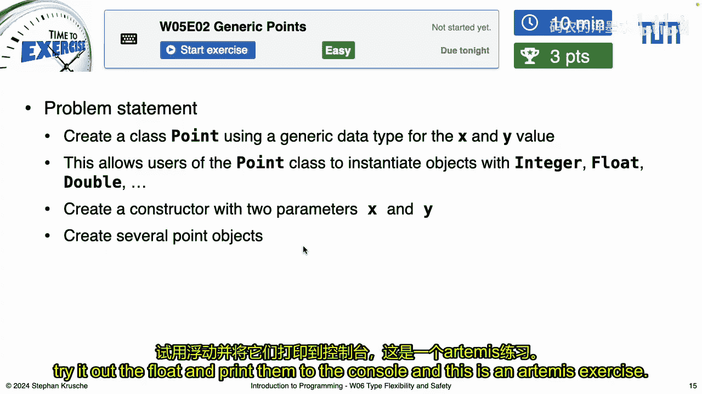
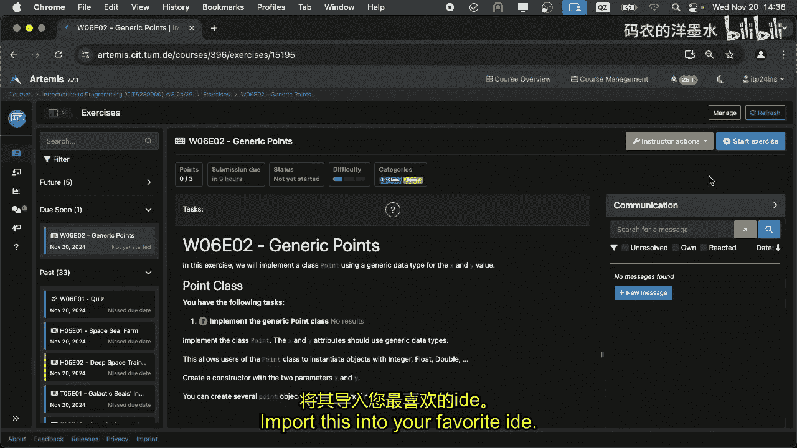
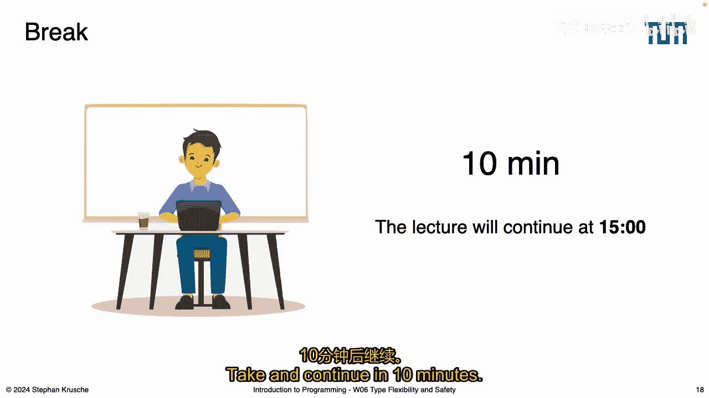

# 027：类型灵活性与安全性

在本节课中，我们将学习类型灵活性与安全性。课程已进行到中期，在接下来的深入课程之前，我们将教授更多面向对象编程概念，并复习本周及上周最重要的知识点，以帮助大家更好地参与即将在两周后进行的指导练习。

我们假设大家已经很好地理解了所有基本概念，特别是控制结构、数据类型，以及面向对象编程原则，如抽象、封装、继承和多态。我们知道多态不是最容易掌握的主题，但希望大家至少对其含义有大致了解。

今天的学习目标是：
*   进一步理解泛型背后的思想。我们已经快速介绍过如何使用内置数据类型的泛型，今天将学习如何创建自己的泛型数据类型。
*   能够创建泛型数据类型并加以使用。
*   再次学习如何将基本数据类型包装在对象中。我们已经了解过，但今天会看到更多细节。
*   介绍Java中一个常见的数据类型：**Map**。
*   在最后一节，我们将讨论如何处理异常，特别是如何抛出和捕获异常，甚至定义自己的异常。因此，异常处理或错误处理也是今天的重要主题。

这是课程大纲，我们将讨论泛型，为此有两个部分。中间有两个较长的练习，供大家尝试如何操作。在中间较长的休息之后，我们将再次讨论对象数据类型和错误处理。

让我们从一个例子开始。

## 类型转换回顾

首先，我们有一个类 `Polly`。这个类 `Polly` 只有一个 `toString` 方法，说实话，没什么特别令人兴奋的。

现在我们有一个 `PollyTest` 类，其中包含一个 `main` 函数。在这里，我们创建了一个新的 `Polly` 对象。但可以看到，左侧的编译时类型是 `Object`。这允许我们将它传递给 `addWorld` 方法，该方法实际上接受一个 `Object` 作为参数。然后，我们可以在这里调用 `toString` 方法。

首先，我们可以注意到每个类都是 `Object` 的子类，并且 `Polly` 隐式地有一个我们在此使用的空构造函数。类方法 `addWorld` 允许我们打印任何对象的 `toString` 方法加上 “world”，所以我们可以在这里传递任何对象。即使类中没有明确定义 `toString` 方法，但在这个例子中，它是有的。

这里有一个变量，它有一个特定的类类型 `A`，作为一个更通用的例子，它可以被分配给 `A` 的任何子类的对象。是的，所以在左侧，我们需要有相同的类型或超类型/超类类型。在右侧，我们需要有相同的类型或子类类型。反过来则不可能。是的，这是创建对象时的一个重要约束。我们总是有两种类型，它们可以相同，这是最简单的情况；但如果它们不同，左侧的编译时类型在继承层次结构中必须始终高于右侧的类型。

在这个例子中，输出将是 “hello world”。是的，因为我们这里有 `Polly`，我们添加了它，即使运行时类型不完全相同，我们也可以这样做。对于方法参数也是如此，你可以用子类类型调用它们，在这个特定情况下不需要强制转换。

很好，让我们稍微改变一下这个例子。假设 `Polly` 有一个 `greeting` 方法。

现在，如果我们写 `Object polly = new Polly();`，那么我们仍然有一个 `Polly` 类型的对象。运行时类型仍然是 `Polly`，但编译时类型是 `Object`。虽然我们立即看到 `polly.greeting()` 应该能工作，因为我们看这里，编译器也可以判断，但这并不保证正确，因为 `Object polly` 可能是从其他地方获取的。是的，运行时类型有时在你的代码中并不明确。是的，也可能有人将一个 `Object` 作为参数传递给方法，然后如果你只知道编译时类型是这个 `Object`，你就无法调用该方法。

你需要做什么？如何在不做太多更改的情况下使这段代码工作？我们可以更改这里的类型。是的，但假设这一行是固定的，我们只能更改这一行。是的，我们可以进行向下转型，这正是这里的解决方案。是的，为了使它工作，我们需要告诉编译器：“嘿，编译器，我相当确定或100%确定 `polly` 是 `Polly` 类型，而不仅仅是一个 `Object`，即使这里的类型是 `Object`。我覆盖你或明确告诉你进行强制转换。” 然后我只需要确保转换不会失败，否则我将在运行时得到一个 `ClassCastException`。

但如果我们不进行强制转换，我们会得到一个编译错误，编译器会说“找不到符号”。这里的符号是方法 `greeting`，位置是类型为 `Object` 的变量 `polly`。因此，在类型为 `Object`、变量名为 `polly` 的情况下，我们找不到符号 `greeting`，所以你会得到编译错误。是的，这是根本原因。再次强调，这是因为我们这里的静态类型与这里的方法不匹配，编译器需要在编译时知道它是否有效。

很好。现在，你已经告诉我解决方法是向下转型到适当的子类，理想情况下我们通过使用 `instanceof` 方法来实现，因为正如我所说，这只是一个简单的例子，但有时你并不真正知道对象来自哪里，你可能不是100%确定是否是这种情况。如果你不能更改实际类型，或者如果它是方法签名的一部分，那么最好安全起见，所以你进行 `instanceof` 检查。你之前已经看到，我们可以通过避免这里的强制转换并将其放入 `instanceof` 问题或语句中来使其更简洁。然后我们可以调用方法。否则，我们也可以处理这种情况并说“抱歉，无法转换”。

关于强制转换有什么问题吗？这是我们假设你理解的内容。是的，这并不新鲜，只是对我们所涵盖内容的总结，并将其带入不同的上下文。

是的，问题是使用 `Object` 背后的动机是什么？你将在接下来的几张幻灯片中看到一般性的动机。有时，你无法对你得到的类型做出任何假设。所以，当然，如果可能的话，总是最好做出假设，并使用最具体的类型，因为这样你在可以调用哪些方法方面有最大的自由，并且需要更少的强制转换。但有时这根本不可能，因为你无法做出任何假设。然后我们需要转向超类，甚至是 `Object`，我们无法真正避免这一点。

现在我们可以对幻灯片做一个小小的改动，向你展示这将如何工作。我们也可以在这里放入名称，并立即在这一行进行强制转换，避免这里的所有括号，然后我们也可以这样写。这将更容易理解。所以这是现代的方式。我现在就改一下。是的，然后在未来，我们会以更好的方式呈现它。不，我不改了，因为否则我需要去掉这里的注释，但我想某种程度上很清楚这就是我们需要做的。虽然有点难看，但如果我们把它放在这里会好得多，这只是一些样式上的改进，我想说。

很好，所以一些解释：我们有静态类型，我们有动态类型。每当你在左侧有某些东西，或者每当你在方法中有一个带有形式参数类型的签名时，那些就是静态类型或编译时类型。而所有在 `new` 操作符右侧的东西都是运行时类型。这在代码中有时你并不真正知道运行时类型是什么，实际上在大多数情况下你并不真正知道，因为它总可能是一个子类。所以即使你指定了一个方法，实际传递给你的实例也总可能是这个方法的子类。`instanceof` 允许我们在运行时检查类成员身份，然后我们可以进行强制转换。当然，我们需要小心。如果我们不使用 `instanceof`，如果我们做出假设并自动或不经检查地进行强制转换，那么我们可能会得到一个异常，即所谓的 `ClassCastException`，在最坏的情况下，我们的程序会崩溃。

## 泛型简介

我们已经了解到，泛型允许我们基本上定义可以处理多种其他类型的类型。因此，我们可以创建一个带有泛型类型的通用列表，使用菱形操作符，而不是只为字符串创建一个列表。然后，当我们实例化列表并使用它时，我们才决定要使用哪种类型。这样，我们基本上可以使用任何符合我们指定要求的类型。这是通过菱形操作符完成的。所以我们可以创建一个我们自己的类型 `T` 的列表，或者我们也可以创建一个字符串列表。是的，这是完全可能的。这是对之前幻灯片内容的补充，我们可以考虑进去。因此，除了静态类型和动态类型之外，我们现在还有类型参数。

或者参数类型，泛型类允许我们在许多不同情况下具有类型安全性。所谓的参数化类型是可以处理不同数据类型的类，通常包括所有简单数据类型，也包括基于类的类型和你自己的自定义类型。最大的优势是我们可以重用代码，只需要指定一次。到目前为止，我们只是使用了泛型。但今天，我们还将向你展示如何创建自己的泛型类型。

在这个工作坊中，在此之前，我们可以再次看到我们使用了列表，例如，带有参数字母 `E`，以及集合，也带有参数字母 `E`。稍后，我们还将学习如何使用 `Map`。`Map` 总是有两个类型，一个键 `K` 和一个值 `V`。所以在这里，我们不像列表中那样只有一个类型，而是有两个。所以你可以将字符串映射到整数，或者将整数映射到字符串，或者将你自己的类 `Point` 映射到你自己的类 `Student`，例如，或者你可以将 `Student` 映射到最终成绩。这就是你可以用 `Map` 做的事情。它是一个非常强大的数据结构。我们将在几分钟内看到它是如何工作的。

## 创建简单的泛型数据类型

这是一个非常简单的泛型数据类型的第一个例子。我们基本上想让我们的 `Course` 类变成泛型的。我们可以通过指定这个菱形操作符并指定一个字母来实现。如果你没有充分的理由改变它，通常使用 `T`，这是类型（type）的通用名称或泛型缩写。当我们这样做时，我们现在可以将其用作属性的类型、参数的类型以及方法中返回值的类型。只有在稍后，当我们实例化一个 `Course` 时，我们才需要指定它的实际类型。我们可以用字符串来做，也可以用整数来做，无论我们想做什么。这真的是一个非常通用的例子，不要把它当作一个有意义的例子，它只是为了让你理解这里发生了什么。

请注意，我们通常使用 `T`。这是一个约定。你已经看到 `List` 和 `Set` 使用 `E` 表示元素。你基本上可以使用任何字母，甚至多个字母。通常，它们是大写的，以区别于用于变量或属性名称的小写字母，否则你可能会感到困惑。是的，所以一个或两个大写字母，这是约定。我们这里有一个 `String` 类型的实例，这里有一个 `Integer` 类型的实例。

关于这个例子有什么问题吗？很好。

请注意，泛型只适用于引用类型。我们快速讨论一下。所以当你声明一个泛型类型的实例时，你总是需要使用引用类型。你不能使用八个基本类型。用 `char` 不行，用小写的 `float` 等等也不行，编译器会告诉你这是不可能的。主要原因是我们在处理这些类型时需要引用语义，并且我们有某些假设需要编译器检查。所以基本类型是不可能的。但幸运的是，我们有一个变通方法。我们为所有基本类型提供了包装类。所以你可以使用大写的 `Integer`、`Boolean` 等等。然后你基本上将基本数据类型包装在一个对象数据类型或类数据类型中。然后你也可以将其用于泛型。

## 包装类与类型安全

我们这里再次提供了所有包装类的概述。你可以看到 `Object` 是最高超类，然后我们有 `Boolean`、`Character` 和 `Number`，而 `Number` 首先是抽象的，然后有一些你已经知道的子类，如 `Short`、`Integer`，这些是基于整数的数字。是的，所以是没有逗号的整数，还有 `Long` 以及 `Float` 和 `Double`，它们是浮点值，可以非常精确地描述实数。

重要的是，泛型使你的代码更安全。这就是为什么本讲座也被称为类型灵活性与安全性。它使其更灵活，以便我们可以重用代码，但也使其更安全。因为你可以做出假设。是的，与其拥有一个包含 `Object` 的通用列表，我们可以使用类型参数定义一个泛型列表。然后当我们检索元素时，我们实际上可以确定它们是这种特定类型，并且不需要向下转型，对吧？所以这是泛型的一大优势。

现在，你需要理解的是，泛型是一个完全的编译时特性。所以在编译期间，编译器实际上会移除它们，并基本上用 `Object` 替换 `T`，并在必要时自动为你插入向下转型。所以在运行时，你无法检查类型是否是 `List<String>`。这是不可能的。你也不能强制转换。你不能将一个 `List<Number>` 强制转换为一个 `List<Integer>`。这是不可能的，因为类型在运行时不再可用。泛型类型真的被擦除并消失了，可以这么说。所以这些是注意事项和在 Java 中实现的小缺点。它被擦除的主要原因是出于性能考虑，因为这些类型可能会在运行时系统中导致一定的开销。如果你需要遵循其所有方面和所有复杂性，Java 背后的开发人员在某个时候决定，这在运行时开销太大，我们需要摆脱它。

问题。是的，问题是当我们使用泛型并从列表中检索对象时，例如，它会自动强制转换为你想要的类型。是的，这是正确的。是的，这就是它的工作方式。编译器为你做了这件事。是的，在某种意义上，这是一个便利功能。是的，你不必手动操作。编译器为你做这件事。这样，你就获得了一定的类型安全性。

请注意，数组也可以被传递，因为数组是引用类型，所以我们可以用 `int` 数组创建一个新的 `Course`。然而，这非常奇怪。是的，老实说，我在实践中从未见过。这只是为了让你知道它会工作，但我真的不建议这样做。另一方面，你可以嵌套泛型类型。是的，所以你可以有一个 `List<List<String>>`，这是可能的，但同样，它可能变得相当复杂，你应该仔细检查这是否真的是你需要的，或者你是否宁愿在以后的数据模型中以不同的方式建模。

## 练习：泛型 Point 类

很好，然后让我们做一个快速的第一个练习。我们基本上为你准备了一个 Artemis 练习，我们希望你在之前定义的 `Point` 类的基础上进行。记住，我们曾经有 `int x` 和 `y`，或者 `float x` 和 `y`，或者 `double x` 和 `y`，这相当繁琐，因为我们需要决定使用哪种数据类型。现在我们希望你使用泛型数据类型 `T`，而不是使用 `int`、`float` 或 `double`。这样，我们就不局限于特定的类型。然后 `x` 和 `y` 也具有这个泛型类型 `T`。然后我们要求你创建一个构造函数，将参数传递给属性，并稍后创建几个 `Point` 对象，用 `Integer` 尝试，用 `Float` 尝试，并将它们打印到控制台。

这是一个 Artemis 练习。所以请打开 Artemis，进入下一个练习，它已经在这里了。我可以点击这里开始练习。问题陈述相对较短，因为它不是一个大练习。将其导入到你喜欢的 IDE 中，开始工作，我将在10分钟左右展示一个示例解决方案。

这是一个新概念，但相对容易。是的，这真的只是8到10行代码，没什么特别的，真的是让你练习的。所以仔细检查我们是如何创建不同的 `Course` 例子的，如果你完全迷失了，看看幻灯片11，想想如何将这个例子转换成一个 `Point` 类，在这个类中，我不仅有一个属性，而是多个属性，不仅在构造函数中有一个参数，而是多个参数。如果你能做到这一点，是的，如果你能够用 `Point` 替换 `Course`，用 `x` 或 `y` 替换 `Object`，那么你几乎就完成了，这里真的不难。如果你有任何问题，请举手，我们的助教会四处走动。如果你在线观看我们，请在 Iris 或沟通渠道中提问。

时间到了，请再次听讲。我将展示一个示例解决方案，我们可以快速讨论其含义。

这是我们的示例解决方案。我们定义了一个带有泛型类型参数 `T` 的类 `Point`，你也可以使用任何其他字母，但我们在这里使用了 `T`。我们有两个类型为 `T` 的属性 `x` 和 `y`，我们有一个构造函数，在其中传递同样类型为 `T` 的 `x` 和 `y`，并简单地将其分配给属性。当然，如果你感兴趣，也可以让 IDE 生成相应的 getter 和 setter。我们现在可以使用它，例如，写 `Point<Integer> p1 = new Point<>(1, 2);` 或者 `Point<Double> p2 = new Point<>(1.5, 2.3);`。

关于这个有什么问题吗？好的，问题是，你能在这里使用不同的类型和不同的字母，甚至多个吗？理论上是的，并且可能会给你满分。但通常你会希望确保两个属性具有相同的类型。否则，可能会出现第一个是 `Integer`，第二个是 `Double` 的情况。然后以后进行计算可能会很困难，对吧？所以在这个特定情况下，我会坚持使用一种特定类型。事实上，这不是一个完美的解决方案。我们稍后会看到如何改进它，因为现在，你基本上可以使用任何东西。你可以有一个由字符串组成的 `Point`，这并没有真正的意义。虽然你可以说，嘿，这是这个类的方法和构造函数的用户的责任，要确保它有用，但也有办法限制这里将使用哪些类型。我们稍后会学习到。

问题是，如果你使用 `Object x` 而不是 `T` 会发生什么？那么，你将很难实现 `shift`、`rotate` 以及我们之前仅为 `double` 实现的所有其他方法，因为在每种情况下，你都需要检查实际类型是什么，你需要向下转型为 `Integer`、`Double` 或其他类型，因为你无法在 `Object` 上进行所有计算，如果有一个对象数据类型，你无法直接进行 `x + y` 这样的操作。

很好。到此，我们将短暂休息10分钟，然后继续。

