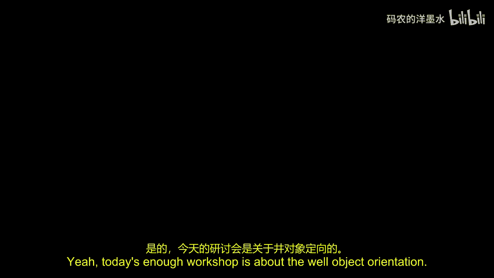
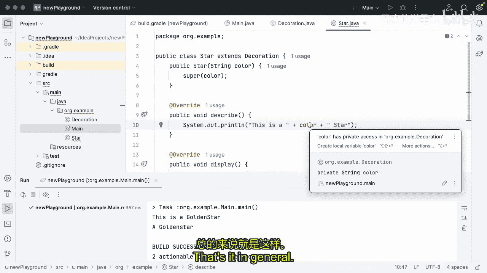

# 031：继承（第三部分）



在本节课中，我们将复习和实践面向对象编程的核心概念，特别是继承。我们将通过一个具体的编程练习来巩固对抽象类、方法重写和构造函数的理解。

---

## 课程回顾：继承

上一节我们介绍了继承的基本概念。继承是一种机制，允许子类从父类（或超类）继承功能或字段属性。

实现继承的关键字是 `extends`。在方法定义中，子类通过 `extends` 关键字来继承超类。

```java
class ChildClass extends ParentClass {
    // 类体
}
```

这种机制有助于**代码复用**。当父类和子类使用相同的参数或属性时，我们无需多次定义它们。

关于访问父类参数，访问修饰符 `public` 和 `protected` 允许子类直接访问这些字段。如果使用 `private` 修饰符，则必须通过 getter 方法等方式来访问。

我们可以在超类中为方法提供**基础实现**。如果子类需要不同的实现，它们可以**重写**该方法的内容。重写时使用 `@Override` 注解。

```java
class Animal {
    public void speak() {
        System.out.println("The animal makes a sound.");
    }
}

class Dog extends Animal {
    @Override
    public void speak() {
        System.out.println("The dog barks.");
    }
}
```

在主类中创建对象并调用方法时，将根据对象的运行时类型执行相应的方法。

```java
public class Main {
    public static void main(String[] args) {
        Animal myDog = new Dog();
        myDog.speak(); // 输出: The dog barks.
    }
}
```

---

## 练习：定义抽象类

现在，让我们通过一个练习来应用这些概念。以下是练习的具体要求。

你需要定义一个名为 `Decoration` 的抽象类。

*   它包含一个名为 `color` 的字符串属性。
*   它包含一个构造函数，用于初始化该类及 `color` 属性。
*   它包含一个具体方法 `describe`，用于输出文本（例如：“This is a decoration”）。
*   它包含一个抽象方法 `display`，该方法没有具体实现。

接着，创建一个名为 `Star` 的子类来扩展 `Decoration` 类。

*   该类需要重写（实现）`describe` 和 `display` 方法，并提供不同的输出。

---

## 练习实现步骤

以下是实现该练习的步骤。

1.  创建抽象类 `Decoration`。
2.  在 `Decoration` 类中声明 `color` 属性。
3.  为 `Decoration` 类生成构造函数。
4.  实现具体的 `describe` 方法。
5.  声明抽象的 `display` 方法。
6.  创建子类 `Star` 并 `extends Decoration`。
7.  为 `Star` 类生成构造函数，并调用父类构造函数。
8.  使用 `@Override` 注解重写 `describe` 和 `display` 方法，并提供新的实现。
9.  在主类中创建 `Star` 对象并调用其方法以查看输出。

以下是完整的代码示例：

```java
// 1. 定义抽象超类
abstract class Decoration {
    String color; // 2. 声明属性

    // 3. 构造函数
    public Decoration(String color) {
        this.color = color;
    }

    // 4. 具体方法
    public void describe() {
        System.out.println("This is a decoration.");
    }

    // 5. 抽象方法
    public abstract void display();
}

// 6. 定义子类
class Star extends Decoration {

    // 7. 子类构造函数
    public Star(String color) {
        super(color); // 调用父类构造函数
    }

    // 8. 重写 describe 方法
    @Override
    public void describe() {
        System.out.println("This is a " + color + " star.");
    }

    // 8. 重写（实现） display 方法
    @Override
    public void display() {
        System.out.println("The " + color + " star is sparkling.");
    }
}

// 主类
public class Main {
    public static void main(String[] args) {
        // 9. 创建对象并测试
        Star goldStar = new Star("golden");
        goldStar.describe(); // 输出: This is a golden star.
        goldStar.display();  // 输出: The golden star is sparkling.
    }
}
```

**关于访问修饰符的说明**：在上述代码中，`color` 属性使用了默认的包私有访问修饰符，因此子类 `Star` 可以直接访问它。如果将其改为 `private`，则子类必须通过 getter 方法来访问该属性。

---

## 总结

本节课中，我们一起复习和实践了面向对象编程中的继承概念。我们通过定义一个抽象类 `Decoration` 及其子类 `Star`，练习了以下内容：

*   使用 `extends` 关键字实现继承。
*   在抽象类中定义具体方法和抽象方法。
*   在子类中使用 `@Override` 注解重写父类方法。
*   理解构造函数链，通过 `super()` 调用父类构造函数。
*   观察运行时多态性如何根据对象实际类型执行相应的方法。



通过这个练习，你应该对如何利用继承来组织代码、实现代码复用和多态有了更清晰的认识。