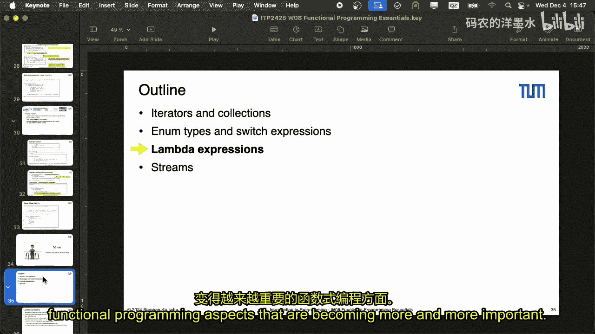

# 036：枚举类型与 switch 表达式


在本节课中，我们将要学习两种重要的Java特性：枚举类型和switch表达式。枚举类型用于定义一组固定的常量值，而switch表达式则提供了一种更现代、更安全的方式来处理多路分支逻辑。我们将通过具体的例子来理解它们的定义、用法和优势。

## 枚举类型

上一节我们介绍了数据类型的基本概念，本节中我们来看看一种特殊的数据类型——枚举。枚举是一种具有有限值范围的数据类型。与字符串可以拥有任意多个值不同，有时我们希望限制一个数据类型可以拥有的值的数量。

例如，一个披萨的状态不能是任意的，它可能是“已下单”、“已就绪”和“已送达”。虽然可能还有其他状态，但我们可以先简化处理。这就是枚举的用武之地。

以下是定义一个枚举的基本语法：
```java
public enum PizzaStatus {
    ORDERED,
    READY,
    DELIVERED
}
```
在这个最简单的例子中，我们定义了一个名为`PizzaStatus`的枚举，它只包含三个不同的值。这比使用字符串或整数更高效，并且能确保不会出现错误的值。

使用枚举非常简单，你不需要使用`new`操作符来创建实例，而是可以像使用类中的静态属性一样直接引用它。例如：
```java
PizzaStatus status = PizzaStatus.ORDERED;
```
我们故意用大写字母书写枚举值，因为它们是常量，其值不可改变。当然，变量`status`本身的值是可以改变的，你可以重新分配另一个枚举值给它。你也可以打印它。

枚举的一般模式是：`public enum`后跟枚举名称，然后是用逗号分隔的多个值列表。虽然不强制要求大写，但推荐使用大写字母来表示常量。

枚举的核心思想是拥有一组固定的常量。你可以在编译时修改这些常量，但在运行时无法更改。这在现实世界的编程中非常有用，例如定义一周的七天、指南针的四个方向，或者应用程序中需要跟踪的特定状态。

枚举类型确保在整个进程中，每个常量只存在一个实例。因此，我们可以安全地使用双等号`==`运算符来比较两个枚举变量。这也意味着枚举非常高效，它们在内部基本上是由整数支持的。因此，使用枚举比使用字符串快得多。当你需要将值的数量限制为一组已知的常量时，就可以考虑使用枚举。

如果你想给最终用户自由选择的权利，枚举就不太合适。例如，在一个用户可以输入姓名的系统中，你可能需要使用字符串，因为你无法在系统中列出所有姓名，而且未来还可能出现新的名字。所以，枚举只适用于在开发时就知道其所有可能值的场景。

枚举类型有一个`.values()`方法，可以获取所有枚举值。这在需要遍历所有值或向用户展示所有可能选项时非常有用。

以下是`.values()`方法的使用示例：
```java
for (PizzaStatus s : PizzaStatus.values()) {
    System.out.println(s);
}
```

枚举还可以定义属性、构造函数和方法，就像在普通类中一样。这是一个更高级的特性，并不常用。以下是一个示例：
```java
public enum PizzaStatus {
    ORDERED(5),
    READY(2),
    DELIVERED(0);

    private int timeToDelivery;

    PizzaStatus(int timeToDelivery) {
        this.timeToDelivery = timeToDelivery;
    }

    public int getTimeToDelivery() {
        return timeToDelivery;
    }
}
```
在定义枚举值时，你实际上是在调用其构造函数，并传入相应的参数（例如5、2、0）。这意味着当你使用`PizzaStatus.READY`时，你也可以调用其上的方法。

你甚至可以像子类一样重写方法。虽然这是一个非常高级的例子，但在实际开发中并不常用，通常只在特定场景下使用。

## Switch 语句与枚举

枚举类型特别适合与switch语句一起使用。还记得在第二个工作坊中，我们学习了控制流。如果你有多个`if-else if`条件，使用switch语句会非常方便。

以下是一个对枚举类型使用switch语句的例子：
```java
public int getDeliveryTimeInDays(PizzaStatus status) {
    switch (status) {
        case ORDERED:
            return 5;
        case READY:
            return 2;
        case DELIVERED:
            return 0;
        default:
            return -1; // 永远不会执行，但语法要求
    }
}
```
在这个例子中，我们根据`status`变量的具体枚举值进行分支处理。

然而，switch语句存在一些弱点，我们希望改进它，以提升开发体验。

首先，如果你忘记处理某个枚举值（可能是因为没有查看所有值，或者后来有人添加了新的枚举值来实现新功能，例如新增了一个`DELAYED`状态），编译器不会给出警告。代码中可能会遗漏对这个状态的处理。

其次，即使你已经覆盖了所有枚举值，你仍然需要提供一个`default`分支，尽管它实际上永远不会被执行。这显得有些冗余。如果方法返回一个对象，在`default`分支中返回`null`会使方法变得不安全。

## Switch 表达式

好消息是，我们有一个更好的替代方案——switch表达式。它从Java 14开始引入，本课程使用Java 17，所以你可以使用这个特性。switch表达式提供了更优雅的语法来解决case区分的问题。

回顾一下，在第二个工作坊中，我们区分了语句和表达式。这个概念也适用于这里：switch语句是一个纯粹的语句，而switch表达式是Java中一个真正的表达式。

在上面的switch语句例子中，我们在每个`case`中使用了`return`，返回的是整个方法的值。而switch语句本身不能返回值。但在switch表达式中，整个表达式可以返回一个值。

因此，你可以将switch表达式的结果捕获到一个变量中，或者直接返回它。它是一个真正的表达式。

switch表达式的一个优点是，它强制要求覆盖所有枚举值。如果你没有做到，编译器会报错，代码将无法编译。这意味着如果你后来修改代码，添加了一个新的枚举值`DELAYED`，编译器会在所有使用switch表达式的地方报错，提示你进行处理，从而确保你不会遗漏。

你仍然可以使用`default`分支，但对于枚举类型，这通常不是必须的，因为你会失去编译器的这项安全检查功能。

另一个重要区别是，switch语句有一个“贯穿”机制。如果你不在一个`case`末尾使用`break`或`return`，程序会继续执行下一个`case`。这对于初学者来说很难理解。而switch表达式没有这种贯穿行为，只有匹配当前条件的那个`case`会被执行。

假设我们添加了`DELAYED`，那么编译器会在这里报错：“switch表达式未覆盖所有可能的输入值”。你有两个选择：要么添加`DELAYED`分支，要么添加一个`default`分支。但添加`default`分支会失去编译器的覆盖检查功能。在这个例子中，我们添加`DELAYED`分支以使编译器满意，并确保程序没有遗漏任何实现。这在旧的switch语句中是无法实现的。

事实上，旧的switch语句应该尽量避免使用。现代IDE会提示你是否要转换为新的switch表达式语法，因为它更强大。

## Switch 表达式示例

以下是一些switch表达式的额外示例，展示在幻灯片27上。

我们也可以对字符串使用switch表达式，并且可以使用一种称为“模式匹配”的特性，用逗号组合多个`case`。

我们可以在方法块中执行不同的操作，赋值，甚至可以在每个`case`后使用花括号包含多个语句。

我们也可以直接将switch表达式的结果赋值给另一个变量。但需要确保所有不同的`case`（以及可选的`default`分支）都返回一个值。

为了避免混淆方法中的`return`语句和switch表达式内部返回的值，开发者引入了一个新的关键字`yield`。在switch表达式的代码块中，使用`yield`来返回该分支的值，这类似于`return`语句，但能明确区分它属于嵌入的switch表达式。

这是一个使用`yield`的例子：
```java
int numLetters = switch (day) {
    case MONDAY, FRIDAY, SUNDAY -> {
        System.out.println("Six");
        yield 6;
    }
    case TUESDAY -> 7;
    case THURSDAY, SATURDAY -> 8;
    case WEDNESDAY -> 9;
};
```

这里还有一个更有意义的例子。我们可以定义一个枚举`DayOfWeek`，包含周一到周日。然后，我们可以返回每个星期几的字母数量。我们可以将多个`case`合并：周一、周五、周日返回6，周二返回7，周四、周六返回8，周三返回9。然后，我们可以将这个表达式的结果捕获到一个新变量中，并打印到控制台。

## 练习

现在你需要完成一个小练习：尝试使用枚举和switch表达式。

我们有一个简单的练习：创建一个switch表达式，根据给定的月份返回该月的天数。

你需要实现方法`int daysOfMonth(int month)`。月份用整数1到12表示，一月是1，二月是2，依此类推。

或者，这是一个可选挑战：如果你觉得用整数太简单，可以创建你自己的枚举`Month`，包含所有12个值。这比用整数甚至字符串存储月份要好得多，然后使用这个枚举。

请现在开始练习，你大约有10分钟时间。

## 示例解决方案

由于时间关系，我们现在继续。请暂停练习，你可以在今晚之前完成。我快速展示一个示例解决方案。

幻灯片31的第一部分解决了问题陈述的初始部分，即使用`int`类型参数。
```java
public int daysOfMonth(int month) {
    return switch (month) {
        case 1, 3, 5, 7, 8, 10, 12 -> 31;
        case 2 -> 28; // 暂不处理闰年
        case 4, 6, 9, 11 -> 30;
        default -> throw new IllegalStateException("Invalid month: " + month);
    };
}
```
一月、三月、五月、七月、八月、十月、十二月返回31天。二月通常返回28天（我们暂不处理闰年例外）。四月、六月、九月、十一月返回30天。由于方法可能被传入负数、0或大于12的数，我们需要一个`default`分支，例如抛出一个`IllegalStateException`或其他有意义的异常。

在可选挑战中，我们实际定义了一个名为`Month`的枚举，包含一月、二月等值。这样对使用者来说更容易，因为他们不需要记住六月是6还是七月是7。虽然对于12个月来说可能容易记住，但在其他情况下，比如披萨状态，我可能记不清“已下单”和“已送达”哪个是状态1或状态2。因此，使用枚举值更容易识别。

其次，我们可以去掉`default`语句，并且仍然可以合并返回相同天数的所有`case`。

幻灯片32上有一些注释解释了这段代码。

关于这个示例解决方案还有问题吗？

## 补充说明

当我们仔细查看作为JDK一部分交付的Java框架时，会发现已经存在一个`Month`枚举。所以我们实际上不需要自己定义。我们在这个练习中定义它只是为了教学目的。以后如果你想处理月份，可以直接使用Java提供的`Month`枚举，它功能更强大，甚至能考虑闰年，在二月有29天时返回29，有28天时返回28。它还有一个`length(boolean leapYear)`方法，你可以传入参数，或者使用Java的日历类自动确定。因此，对于某些给定的元素，你可能不需要定义自己的枚举，Java内部已经提供了。



本节课中我们一起学习了枚举类型和switch表达式。枚举提供了一种类型安全的方式来定义一组固定的常量，而switch表达式则是一种更现代、更安全的多路分支处理方式，能借助编译器的力量避免常见错误。它们是编写健壮、清晰Java代码的重要工具。