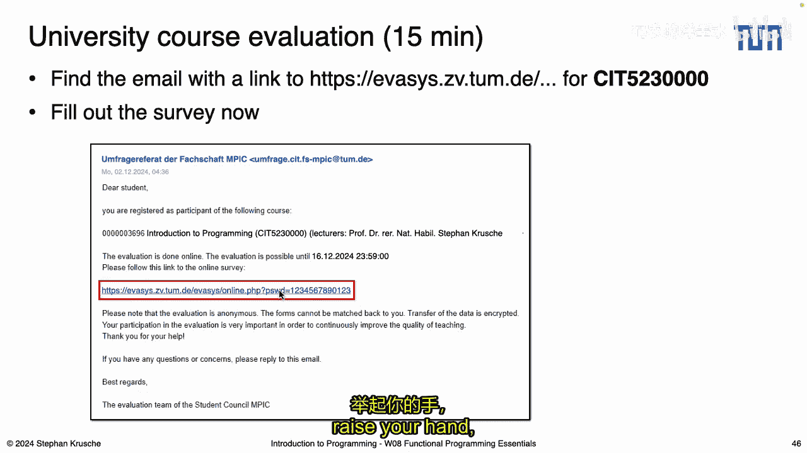

# 037：Lambda 表达式教程 🧮


在本节课中，我们将要学习 Lambda 表达式。Lambda 表达式是一种编写简洁、清晰代码的强大工具，尤其适用于数据处理操作。我们将从基本概念开始，逐步探索其语法、应用场景以及相关的最佳实践。

## 概述

Lambda 表达式为编写代码提供了一种简洁的方式。它的核心思想是：如果一个接口只有一个方法（即函数式接口），那么你可以将其实现转换为一个 Lambda 表达式。这在遍历、过滤或提取数据等操作中特别有用，可以节省大量样板代码。

## Lambda 表达式基础

上一节我们介绍了 Lambda 表达式的核心概念。本节中我们来看看它的具体语法和结构。

Lambda 表达式本质上是匿名内部类的一种快捷写法。其基本语法如下：在左侧是参数列表作为输入，中间是一个箭头 `->`，右侧是方法体。方法体可以包含表达式和语句，如果是多行，则需要用花括号 `{}` 括起来。

以下是参数列表的几种情况：
*   如果方法没有输入参数，需要写空括号 `()`。
*   如果只有一个参数，可以省略括号。
*   如果有多个参数，则需要括号并用逗号分隔列表。

请注意，在 Lambda 表达式中我们不需要写明参数类型，因为类型信息已经由函数式接口定义，这样可以避免重复的样板代码。

## 使用示例

以下是 Lambda 表达式的一些基础应用示例。

我们有一个整数列表：`[1, 2, 3, 4, 5, 6, 7, 8, 9, 10]`。

除了传统的 `for` 循环、`while` 循环和增强型 `for` 循环，现在有了第四种选择：可以调用 `forEach` 方法，该方法接受一个 Lambda 表达式作为参数。

```java
list.forEach(value -> System.out.println(value));
```

这个 Lambda 表达式有一个输入参数 `value`，代表列表中的每个元素。它遍历所有元素并打印出来。`forEach` 方法接受一个参数但不产生返回值。

## 更多 Lambda 表达式示例

上一节我们看到了一个简单的遍历示例。本节中我们来看看如何使用 Lambda 进行更复杂的操作，例如过滤和求和。

我们有一个从 1 到 9 的整数列表。

首先，我们使用 `forEach` 方法和一个 Lambda 表达式来过滤列表。这个 Lambda 表达式有一个输入参数 `n`，代表列表中的每个数字。

```java
List<Integer> filteredList = new ArrayList<>();
list.forEach(n -> {
    if (n % 3 == 0) {
        filteredList.add(n);
    }
});
```

我们使用了花括号，因为这里有一个更复杂的语句（包含 `if` 判断）。这段代码将能被 3 整除的数字添加到 `filteredList` 中，所以过滤后的列表包含 `[3, 6, 9]`。

接着，我们可以使用另一个 Lambda 表达式（这次没有方法体）来对这些值求和。

```java
int sum = 0;
filteredList.forEach(n -> sum += n);
System.out.println(sum); // 输出 18
```

需要注意的是，如果你想在 Lambda 表达式内部使用外部变量，那么这个变量必须是 **有效最终（effectively final）** 的。这意味着它的值在初始化后不能被改变。因此我们使用了一个静态的 `Integer sum`，而不是在 Lambda 内部定义的变量。这是一个限制，因为 Lambda 表达式可能会被多次调用，它们不能轻易捕获可变状态。

## 函数式接口

我们已经了解到 Lambda 表达式基于函数式接口的概念。任何只有一个单一方法的接口都是函数式接口，它的实现可以被视为一个 Lambda 表达式。

这遵循了接口隔离原则，即面向对象编程的一个重要原则。这意味着在实现一个接口时，你不应被迫实现不需要的方法。如果接口只有一个方法需要实现，就完美地遵循了这一原则。

我们可以自己定义并使用函数式接口。例如，我们定义一个名为 `Square` 的函数式接口，并用 `@FunctionalInterface` 注解它（此注解是可选的，但有助于理解）。

```java
@FunctionalInterface
interface Square {
    double area(double length);
}
```

这个接口只有一个方法 `area`，用于计算正方形的面积。由于正方形的宽和高相同，我们只需要边长作为输入。

现在，你可以使用匿名内部类来实现这个接口，也可以使用更简洁的 Lambda 表达式。

```java
Square square = length -> length * length;
```

这个 Lambda 表达式定义了 `area` 方法：输入 `length`，输出 `length * length`。然后我们可以像使用真实类的对象一样使用 `square`。

```java
double area = square.area(5);
System.out.println(area); // 输出 25.0
```

虽然这对初学者来说可能有些难以理解，但它是一种非常简洁明了的方式来定义我们想要的操作。Java 编程语言本身已经预定义了许多函数式接口供我们使用。

## 方法引用

Lambda 表达式有时会让一些开发者感到繁琐，特别是当你只是想调用另一个方法，并将输入参数传递给它时。针对这种情况，可以使用方法引用（Method Reference）来进一步简化代码。

方法引用有几种类型，可以用于静态方法、特定对象的实例方法、任意对象的特定类型实例方法，甚至是构造函数。

例如，我们有一个汽车品牌列表，想要打印它们。

使用传统的 `for` 循环：

```java
for (int i = 0; i < carBrands.size(); i++) {
    System.out.println(carBrands.get(i));
}
```

使用增强型 `for` 循环：

```java
for (String brand : carBrands) {
    System.out.println(brand);
}
```

使用 `forEach` 和 Lambda 表达式：

```java
carBrands.forEach(brand -> System.out.println(brand));
```

如果 Lambda 表达式的参数正好是传递给内部方法的参数，那么可以使用方法引用使其更简洁：

```java
carBrands.forEach(System.out::println);
```

这行代码的意思是：对于列表中的每个元素，将其传递给 `System.out.println` 方法。方法引用让代码更加紧凑。

另一个例子是对数字列表进行排序。使用 `Comparator` 接口和 Lambda 表达式：

```java
numbers.sort((a, b) -> Integer.compare(a, b));
```

使用方法引用可以写成：

```java
numbers.sort(Integer::compare);
```

方法引用 `Integer::compare` 表示将两个输入参数 `a` 和 `b` 传递给 `Integer.compare` 方法。但这种方式可能不如 Lambda 表达式直观，因为不清楚哪个参数是调用方法的对象，哪个是方法的参数。因此，是否使用方法引用取决于个人偏好和代码清晰度。

## 在自定义类型中应用

Lambda 表达式和方法引用在处理自定义数据类型时也非常有用。假设我们有一个表示二维空间点的 `Point` 类。

```java
class Point {
    private double x;
    private double y;
    // 构造函数、getter、toString 方法...
}
```

我们创建了一个 `Point` 对象列表，并希望根据它们的 X 坐标进行排序。

你可以使用 `Comparator.comparing` 方法，并指定用于排序的属性 getter 方法：

```java
points.sort(Comparator.comparing(Point::getX));
```

这将按 X 坐标升序排序。如果你想降序排序，可以调用 `reversed` 方法：

```java
points.sort(Comparator.comparing(Point::getX).reversed());
```

你也可以轻松地改为按 Y 坐标排序：

```java
points.sort(Comparator.comparing(Point::getY));
```

这种方式允许你以非常简洁的方式指定如何对自己的数据进行排序，无需实现复杂的排序算法或 `Comparator` 逻辑，从而在项目中实现快速原型开发。

## Lambda 表达式与内部类的区别

你可能会问，Lambda 表达式和内部类有什么区别？它们在作用域方面有很大不同。

内部类总是创建一个新的作用域。你可以在其中使用属性、创建额外的方法，甚至可以使用 `this` 关键字（引用内部类本身）。从这个意义上说，匿名内部类比 Lambda 表达式功能更强大。

然而，大多数时候你并不需要这些功能。Lambda 表达式在函数式编程中更简单、更强大，因为你通常可以轻松地串联操作，而不关心作用域和状态。Lambda 表达式通常不持有任何状态，这对于函数式编程很重要。

另一方面，Lambda 表达式使用所谓的 **封闭作用域（enclosing scope）**。这意味着你无法从 Lambda 表达式体内隐藏封闭作用域中的变量（这在匿名内部类中是可能的）。在 Lambda 表达式中使用 `this` 关键字时，它引用的是外部类的实例，而在匿名内部类中，`this` 总是指向内部类本身。

## 最佳实践与有效最终变量

使用 Lambda 表达式时，请遵循以下最佳实践：
*   尽量保持 Lambda 表达式简短且自解释。它们通常只有一行，很少超过三到五行。
*   如果可能，避免使用代码块，写成单行形式。
*   如果只有一个输入参数，省略括号。
*   利用类型推断自动确定类型，这意味着需要使用良好的变量名来提高代码可读性。

还有一个重要的概念需要讨论：**有效最终（effectively final）变量**。如果你想在 Lambda 表达式中使用封闭作用域中的变量，那么这些变量必须是有效最终的。

这意味着你不需要使用 `final` 关键字，但如果编译器发现变量的值在某个时刻会被更改，你可能无法在 Lambda 表达式中使用它。有效最终意味着变量只被赋值一次（无论是否使用 `final` 关键字），并且可以安全地在 Lambda 函数内部使用，因为编译器可以控制其状态。

例如，以下代码会导致编译错误：

```java
String value = "value1";
value = "value2"; // 值被改变
someMethod(() -> System.out.println(value)); // 编译错误：变量应为 final 或有效 final
```

如果需要使用值可能变化的变量，可能就不适合使用 Lambda 函数。Lambda 函数应该是线程安全的，并且不应允许任何竞态条件。这可以保护我们在多线程同时访问和修改同一值时避免简单的错误。

## 总结

本节课中我们一起学习了 Lambda 表达式。我们了解了 Lambda 表达式是一种为函数式接口提供简洁实现的语法糖，能够大幅减少样板代码。我们学习了其基本语法、参数列表的写法，并通过遍历、过滤、排序等示例看到了它的实际应用。

我们还探讨了与之紧密相关的方法引用，它可以在特定场景下让代码更加紧凑。同时，我们比较了 Lambda 表达式与匿名内部类的区别，重点是作用域和 `this` 引用的不同。最后，我们强调了使用 Lambda 表达式的最佳实践，以及必须注意的“有效最终变量”这一重要限制。



掌握 Lambda 表达式是迈向现代 Java 编程和函数式编程风格的重要一步，它将帮助你编写出更清晰、更高效的代码。