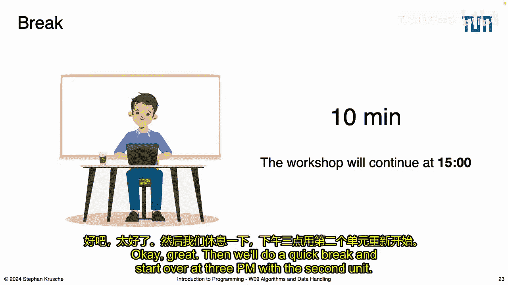

# 039：哈希

在本节课中，我们将要学习计算机科学中的一个重要概念——哈希。我们将了解哈希的基本原理、为什么它在众多场景中被广泛使用，以及如何在实际编程中应用它。此外，我们还会简要回顾字符串处理，并介绍一个名为`StringBuilder`的实用工具。

## 概述

我们已经完成了课程计划中超过一半的内容。今天，我们将探讨算法和数据处理，例如输入输出。下周将有一个关于编程语言的研讨会，之后是圣诞假期。新年过后，我们将涵盖一些更高级的主题。因此，我们即将完成基础部分，并开始深入更多样化的高级主题。

今天的内容要求你对基础知识有良好的理解，但并非所有之前学过的主题都直接相关。例如，流对于理解今天的内容并非绝对必要。当然，拥有扎实的知识基础总是有益的。

今天的学习目标是：
*   熟悉计算机科学中称为“哈希”的重要概念。
*   能够解释哈希，并说明为什么它在计算机科学的许多不同情况下被使用。
*   了解一些高级排序算法的工作原理。
*   讨论典型的输入和输出机制。你已经知道一些，例如从最终用户获取基本输入的`Scanner`，以及向控制台输出内容的`System.out.println`。但编程中的输入输出要灵活得多，我们今天将快速讨论这一点。
*   在最后一个单元，我们将宣布项目B，并说明其内容、参与方式、需要遵循的规则和指南，并回答相关问题。

但在进入有趣的部分之前，我们先从更具挑战性的部分开始：哈希。

## 什么是哈希？

哈希的基本含义是，将任意类型的输入转换为通常更小且具有固定大小的内容，我们称之为**哈希码**。

输入通常有无限多种可能性，而我们只对更小的尺寸感兴趣，因为更小的尺寸具有某些优势：可以轻松排序、轻松查找内容等。这一切都是为了高效的数据索引和数据检索。它是许多不同数据结构的基础。

其中两种数据结构你已经使用过：`HashSet`和`HashMap`。它们是Java中`Set`接口和`Map`接口的默认实现之一。

哈希基本上确保你在这些集合上执行的所有操作（如添加元素、读取元素、移除元素）都尽可能高效，从而使你的程序最终具有良好的性能。

许多现实世界的应用程序都大量使用哈希，特别是数据库和与安全相关的一切。当然，在计算和应用程序中，也有非常突出的部分，特别是在分布式计算中，当你需要缓存某些内容时。例如，当你打开智能手机上的WhatsApp时，你不希望应用程序一次又一次地下载所有消息。最新的消息已经存储在你的设备上，在某种意义上，你的设备也是一个缓存，因为真实的消息存储在相应应用程序的云数据库中，而你只拥有最新消息的特定视图。因此，如果你在线或离线，而你的WhatsApp对话中的好友编辑了一条消息，你可能仍然没有最新版本，因为你设备上的缓存可能不是最新的。

有许多不同的应用场景，这就是为什么理解基础知识很重要。

## 哈希与加密/解密的区别

区分哈希与加密和解密非常重要。

如果我们加密和解密某些内容，这是一个**双向**协议。例如，你有一个用于登录的明文密码，当密码被发送到实际进行用户管理的服务器时，密码会被加密，但服务器随后必须再次解密它，以验证密码是否与你之前存储的密码相同。这是加密和解密的一个非常典型的例子。你加密的任何内容之后都可以被解密。

另一方面，哈希是一个**单向**协议。如果你获取一个输入并对其进行哈希处理，那么最终生成哈希码或哈希文本的哈希函数，在设计上应该以无法回溯的方式实现。从哈希文本出发，不应该（事实上也必须不能）可能返回到原始文本。这对于某些应用程序来说至关重要。

这是一个你需要首先理解的重要区别：加密和解密总是双向的，而哈希只是单向的，并且之后你不应该能够检索原始信息。

## 哈希的核心概念

哈希的核心是将输入转换为固定大小的输出。大多数情况下，这个固定大小的输出是一个整数或字符串，但一般来说，在哈希中你可以使用任何数据结构。目的通常是实现快速的数据检索。

例如，如果你有非常大的数据集，理想情况下，如果你能为使用你应用程序的5亿人创建哈希码，那么你可以更容易地找到他们。你总是有一个输入、一个可以配置的哈希函数（有时由你决定），然后是一个唯一的哈希值。这样在性能和时间复杂度上检索数据会快得多。对于某些算法来说，这甚至是必不可少的，否则它们对于最终用户来说会太慢。顺便说一下，你进行的每一次谷歌搜索也涉及哈希。每次你搜索某些内容时，他们都有巨大的数据集需要查看，而之所以能这么快，正是因为他们使用了某种哈希机制。

有许多不同的哈希函数，其中一些相当知名，也用于密码学，例如SHA-256。但你基本上也可以提出自己的哈希函数。

哈希函数接受一个输入，然后以一种不可逆的方式返回输出，这很重要。有些人称输出为哈希值，有些人称其为哈希码，有些人称其为摘要，或者有些人就称之为哈希。所以当你找到这些术语时，它们基本上都指哈希函数的输出。

大多数时候，你将哈希值存储在所谓的**哈希表**中。哈希表也可以包含输入，但有时不需要存储输入，有时你只在那里存储哈希值。

理想情况下，哈希函数应该是**确定性的**，这意味着相同的输入总是产生相同的哈希码，否则你会有问题。它应该计算起来相当快，因为如果计算需要很长时间，那么以后查找数据时的性能改进就不太合理了。

理想情况下，它应该在整个可能值集合上具有**均匀分布**，这对于避免碰撞很重要。如果你有任意输入和固定大小的输出，就意味着你可能会发生碰撞。对于任何哈希函数，你都无法保证避免这种情况。因此，你总会找到两个输入导致碰撞，即它们具有相同的输出。当然，这是一个问题。解决方案不是让哈希函数变得如此复杂以至于确保它永远不会发生，而是让它变得如此不可能在实践中发生，这是基本思路。

在Java中，这很好地集成到任何你处理的对象或类中，基于`hashCode`方法。`hashCode`在`Object`类中实现。`Object`是所有其他对象或类的隐式超类，它提供了`hashCode`的默认实现。你可以随时覆盖和自定义它。

因此，理想情况下，你拥有一个具有最小碰撞、易于计算但极难逆转的确定性函数。这就是哈希的主要思想。

## 哈希函数示例

以下是一个示例，说明这可能是什么样子。假设我们有一个由多个字符组成的字符串，字符为s0，s1，依此类推。那么一个哈希函数可以是，你只取字符的整数值（记住字符串中的每个字符都有一个对应的整数值），然后对这些整数值求和。在第一个示例H0中，你只对第一个和最后一个求和。计算起来非常简单。

让我们看看它是否满足我们刚才陈述的所有其他要求。

哈希函数1，H1，取从第一个字符、第二个字符、第三个字符直到最后一个字符的所有整数值，然后求和。这稍微复杂一些，基本上你有很多次加法，和字符数量一样多。

第三个函数H2更复杂一些。最初，你将整数值乘以一个质数P，并以一种非常特定的方式对它们求和。

Java中`Object`类的`hashCode`方法，对于`String`对象的默认实现，使用了P=31的H2函数。所以这不是一个任意的例子，而是一个真实世界的例子。

让我们看看这些从非常简单到中等复杂度的不同哈希函数实际上表现如何。我们这里有一些典型的字符串，这些字符串也用于计算机科学，特别是在编译器中。表格中第一列是H0，即你能想到的最简单的哈希函数；第二列是H1，稍微复杂一点但仍然相对简单；第三列是H2，在这个例子中我们使用P=7，因为如果我使用P=31，数字会变得太大，无法在幻灯片上显示。

如果我们随机查看，会发现所有黑色的基本上都是唯一的，但所有彩色的行表示存在另一个具有相同值的哈希码，即我们发生了碰撞。例如，这两行都导致哈希码214。就碰撞而言，这不是一个很好的函数，即使它非常容易计算。我们在这里还有第二个碰撞，`diff`和`chmp`都导致哈希码218。

第二个函数H1稍微好一点。数字变得稍大一些，但`alloc`和`false`仍然发生了碰撞，所以表现仍然不是很好。对于最后一个函数，你会发现数字现在变得大得多，这很明显：字符越多，你做的乘法和加法就越多，并且总是乘以这个质因数，所以你确实会得到很大的数字。至少对于这个有限的字符串集合，我们没有看到碰撞。

所以这个已经更好了。如果我们回顾一下，会发现最后一个函数在性能上也更密集：不是只有一次加法或n次加法，如果我们有n个字符，我们就有n次乘法加上加法，而且是以一种非常特定的方式。所以这至少是H1哈希函数复杂度的两倍。然后这取决于你的CPU计算加法和乘法的速度。如今CPU在这方面非常快，所以即使这个函数也可以在纳秒内计算出来。对于大多数计算机来说，这不是问题，对于大多数计算机来说，这不是一个非常复杂的函数。

## 哈希函数的安全性

问题：如何确保哈希函数是不可逆的，如果你知道输出和哈希函数本身？

首先，更复杂的哈希函数包含特定的**密钥**，这些密钥不为外界所知。这是首先重要的。对于我们这里的例子，这是已知的，所以你基本上可以计算它，也可以相对容易地逆转它。我的意思是，这并不超级容易，因为你看这些数字也很相似，值也很相似，所以并不超级容易。但至少我可以说，小数字有两个字母，大数字有三个，更大的数字有五个字母，等等。但它仍然不容易逆转。同样，这里可以说它必须有多难？如果你有无限的计算能力，你总是可以逆转它。但我们没有无限的计算能力，计算，尤其是昂贵的计算，最终可能非常非常昂贵，你必须为此付费。这就像你智能手机上的密码锁一样：你用的是四位数字、六位数字还是自定义密码？如果你用四位数字，只有一定次数的尝试机会，这通常就足够了。

如果有人在你输入时从你肩膀上看过去怎么办？所以完美的安全性是无法实现的。这通常总是一种尽力而为的方法。如果你有一个拥有足够计算能力的入侵者，那么在某种意义上，你可以破解任何系统。当然，有非常复杂的方法来保护系统，但这超出了本讲座的范围。

## 良好哈希函数的特性

我们已经稍微讨论过这一点，这对于密码学尤其重要。这不是密码学讲座，所以我只停留在表面。它必须是确定性的，应该快速，应该是不可逆的，应该是抗碰撞的。这是我们之前已经讨论过的。

快速总结一下，还有两个额外的方面：
*   **均匀分布**：这在实现抗碰撞方面也很重要。如果你的哈希码在整个频谱上均匀分布，发生碰撞的可能性就小得多，计算反函数也困难得多。
*   **雪崩效应**：这意味着输入中的微小变化会导致完全不同的输出。这对于实现不可逆性也很重要，因为如果输入中的微小变化导致输出中的微小变化，那么人们可以轻松地，例如，取100个输入，计算输出，然后根据他们看到的模式来思考这里实际使用了什么方法和密钥。

## 哈希值的存储

问题：如何存储哈希函数的输出值？是用逗号分隔还是存储在数据库中？

答案取决于你的具体用例。在Java的`HashSet`和`HashMap`中，它们有一个称为哈希表的内部数据结构来存储它。这稍微高级一些，但它们基本上做的是：它们有多个列表，然后基于某些模式将内容添加到一个列表或另一个列表中。例如，每个哈希码可以指向哈希表中的一个“桶”，你在该桶的列表中存储内容。然后检索就快得多。但同样，有很多不同的方法来实现这一点，计算机科学家在如何高效存储数据方面非常有创意。我可以开设一整门关于哈希、密码学以及如何高效存储数据的课程。

## 哈希碰撞

如果发生哈希碰撞，即两个不同的输入产生相同的输出（相同的哈希码），正如我所说，由于所谓的**鸽巢原理**，这在任何哈希系统中都是不可避免的。如果你有10只鸽子和9个鸽巢，总会有一个鸽巢里有两只鸽子。如果输出（哈希码）的尺寸小于输入，这就是不可避免的，而这是主要设计。

如果发生这种情况，有办法处理，但这通常会导致系统性能下降，也可能影响数据检索的效率。因此，通常人们在实现和使用哈希时会注意处理这种情况，但那样会变得慢一些。同样，问题的频率和严重程度确实取决于哈希函数的质量和表的大小。

## 自定义哈希函数示例

以下是你如何自己实现它的另一个例子。它看起来相当困难，但它基本上是我们之前见过的`Point`类。除了属性和构造函数以及潜在的其他方法之外，我们提供了一个`equals`方法，我们可以用它来找出两个点是否相等，基于它们的x和y值的比较。还有一些样板代码来确保正确处理空值或潜在的子类。但最终，我们基本上只是将传递对象的x值与`this.x`、传递对象的y值与`this.y`进行比较，如果它们相同，则返回`true`。

然后我们有`hashCode`函数，你看到我们覆盖了它。它返回一个整数，所以是一个相对较小的尺寸。这里我们基本上有一个起始数字17，然后有一个x哈希和一个y哈希，基于一个将`double`转换为`long`的方法。然后，我们基本上以非常特定的方式将它们彼此相乘并添加到现有结果中，再次相乘，我们将`long`转换为`int`，使整个尺寸更小，然后返回它们。虽然你并不需要完全理解这是如何工作的（下一张幻灯片也有描述），但这只是一个你可以做什么的例子。网上也有页面可以根据你想要考虑的不同属性为你生成一个好的哈希函数，我认为甚至在IntelliJ中也可以为你生成一个好的哈希函数。

然后你可以在一个`Set`中使用这个`Point`。`Set`将在内部使用哈希码，所以你甚至可以在这里设置断点来查看它是如何工作的。你也可以在`HashMap`中使用它，然后`HashMap`也会使用`hashCode`函数并执行操作。注意，`hashCode`是相对较小的整数，你无法存储很多整数，但这不是目的。目的不是要有一个可以存储数百万或数十亿值的完美无碰撞函数。哈希已经有其他一些优势：如果我们能非常快速地计算它，我们就可以更有效地存储数据，并且更有效地检索数据，而无需在最后搜索整个数据结构。这是主要思想。

如果你感兴趣，可以在第14张幻灯片上阅读为什么我们实际上选择了这样的实现，以及不同的方法（例如我们是否使用异或操作或位移位）实际上在这里有解释。

## 为什么之前的函数是一个好函数？

它试图均匀分布哈希码，这降低了碰撞的可能性。它仍然计算快速且是确定性的（我们在这里不做任何随机操作）。它还考虑了这两个属性，这也很重要。坐标的微小变化会导致显著不同的哈希码。这基本上确保了`Point`对象在`HashMap`中分布良好，并使它们在那些数据结构中的使用更高效、性能更好。

## 哈希的实际应用

有许多不同的现实世界应用程序使用哈希。我们已经稍微讨论了数据库，这里主要用于创建索引，以便尽可能快地访问数据。

**数据缓存**是一个典型的例子。你的浏览器缓存了大量数据，这样就不必一次又一次地从Web服务器加载，以减少网络使用并提高性能。

我们可以用它来**安全地存储密码**，这也很重要。密码不应以加密方式存储在数据库中，而应以哈希方式存储，这样即使是管理员之后也无法从中获取密码。

有许多**密码学应用**需要它，例如用于完整性检查和安全消息传输。比特币就大量使用它。另一个例子是Git也使用它。你可能已经见过提交哈希。提交哈希也使用基于时间或日期、你所做的更改以及提交消息的哈希函数，然后尝试为这个特定的仓库生成一个唯一的哈希。

许多**分布式系统**严重依赖于哈希函数，这就是为什么理解它如此重要。

## 最佳实践

在复杂性和效率之间总是存在权衡，所以尝试找到一个中间点，既有良好的效率、较小的碰撞概率，又有一个易于理解的实现。如果发生碰撞，你应该尝试优雅地处理它们，使用一些对你的特定用例特别有意义的碰撞解决技术。如果你有想要与哈希一起使用的自定义对象，请正确覆盖`hashCode`和`equals`。IntelliJ会帮助你做到这一点。

## 字符串与StringBuilder

现在，让我们快速回顾一下字符串。字符串允许我们表示Unicode字符，你已经知道这一点，所以这只是复习。你也知道字符串是不可变的，无法更改。这就是所谓的`StringBuilder`发挥作用的地方。`StringBuilder`允许我们创建可变的字符串，这在循环中使用时特别有帮助，允许你逐步构建字符串，然后稍后将其转换为不可变的字符串。

`String`类本身已经允许我们查看单个字符或子字符串，比较字符串，创建小写、大写的副本。但它是`final`且不可变的。因此，如果你用`+`运算符连接两个字符串（这是你经常做的事情），那么你不应该在循环中这样做。相反，你应该使用`StringBuilder`，它允许我们操作字符串，具有插入、删除或追加字符串的方法，而无需每次都创建一个新的字符串。

特别是当你使用循环时，你应该使用`StringBuilder`。还有`StringTokenizer`，允许你将字符串拆分为标记，例如基于逗号分隔值（这里逗号用于拆分）或基于空格等。

以下是一个`StringBuilder`的例子：
我们创建一个带有初始字符串的新`StringBuilder`，然后我们可以追加任意多个其他字符串，而无需立即创建新的字符串（那将是不可变的）。然后在某个时刻，我们可以调用`toString()`方法，将输出转换为字符串并打印它。

这是主要思想，这也是我们现在希望你尝试的。请打开Artemis并进入练习W9E2 StringBuilder。

我们希望创建一个字符串。输入是一个包含一些现有单词的数组，例如我们最喜欢的汽车品牌。我们要求你使用增强型for循环，或者，如果你觉得训练有素，也可以使用Lambda表达式。想法是，你应该将所有单词附加到`StringBuilder`中，单词之间用空格分隔。然后应该将其打印到控制台。你现在有大约五分钟的时间来完成这个练习，导师们会在周围走动，如果你有问题或需要帮助，可以询问。祝你好运。

初始工作时间结束，请随意继续工作直到今晚。我将向你展示一个快速的示例解决方案：我们创建一个`StringBuilder`，然后将我们的数组作为包含汽车品牌的列表（应该在相应的练习中给出）。然后你可以使用增强型for循环，但这里我使用Lambda表达式和`list.forEach`，然后将输入变量映射到`builder.append`方法。我不仅追加变量，还在最后追加一个空格。所以我们从一个空字符串开始，然后对于列表中的每个变量，我们将其附加到构建器，并额外附加一个空字符串。完成后，我们可以调用`toString`方法，将所有变量打印到控制台，然后得到这个输出。

关于这个小练习有任何问题吗？很好，然后我们快速休息一下，下午3点开始第二单元。

## 总结

在本节课中，我们一起学习了哈希的基本概念，包括其定义、与加密的区别、核心特性以及如何实现一个简单的哈希函数。我们还探讨了哈希碰撞及其处理方法，并回顾了字符串处理中`StringBuilder`的使用。哈希是计算机科学中一个强大且广泛应用的工具，理解它将有助于你编写更高效、更安全的程序。