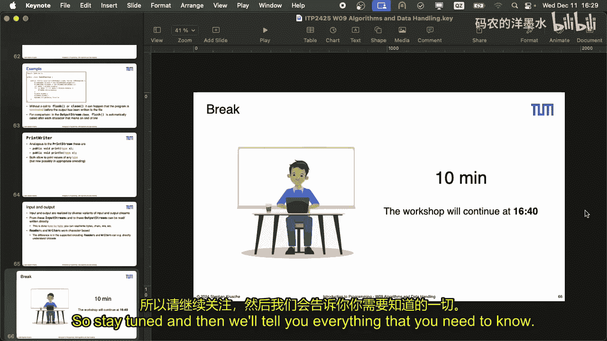

# 041：输入与输出


在本节课中，我们将要学习Java中关于输入与输出的核心概念。输入与输出是程序与外界交互的基础，无论是从用户获取数据，还是将数据写入文件或网络，都离不开它。我们将从简单的控制台输入输出开始，逐步深入到文件读写和字符编码等更高级的主题。

## 输入与输出概述

上一节我们介绍了程序的基本结构，本节中我们来看看程序如何与外部世界进行数据交换。输入与输出并非Java语言本身的关键字，而是由Java虚拟机及其丰富的库提供的功能。这些库使得读取文件、写入文件或处理网络数据流变得相对容易，尽管错误处理可能会变得复杂。

任何程序都需要某种形式的输入和输出，无论是与最终用户通信，还是处理来自用户的数据。因此，理解输入输出机制对所有类型的程序都至关重要。

## 流的概念

当处理输入和输出时，我们通常将其视为**流**。流分为输入流和输出流。主要原因是程序无法一次性处理所有输入数据，必须逐字节或逐字符地读取，以验证数据的准确性并确保正确写入输出。

一个流可能是无限的，但大多数时候我们只使用有限的流。你可以将其想象成一个序列：读取时从左端移除元素，写入时在右端添加元素。在数组中，这通过索引来实现。

## 字符编码：UTF-8

理想情况下，处理输入和输出时应始终使用**UTF-8**编码。这是标准编码，可以避免许多字符显示问题。UTF-8是一种非常灵活的编码，它对最重要的字符使用默认大小，并可以通过使用更多字节来扩展以支持任何字符，甚至是表情符号。Java通过`InputStreamReader`和`OutputStreamWriter`等类支持UTF-8。

## 数据表示：二进制与文本

处理输入输出数据时，有两种主要的表示方式：
1.  **二进制**：使用0和1作为内部表示。这种方式通常比较紧凑，但人类无法直接阅读。
2.  **文本**：使用人类可读的字符序列。这种方式更易于理解和调试，但占用的空间通常更大。

Java程序本身就是一个文本表示的例子。

## Java中的输入输出类

Java主要通过`java.io`包来处理输入输出。虽然也有更现代的`java.nio`包，但今天我们专注于更基础易用的`java.io`。

以下是`java.io`包中一些最重要的类的不完全概述：

*   **输入流**：`InputStream`及其子类，如`FileInputStream`和`DataInputStream`。
*   **输出流**：`OutputStream`及其子类，如`FileOutputStream`、`DataOutputStream`和`PrintStream`。

你已经使用过的`System.in`是一个`InputStream`，`System.out`和`System.err`是`PrintStream`。

### InputStream类

`InputStream`是字节输入的基础抽象类。它提供了一些有用的操作：

*   `available()`: 检查输入流中还有多少字节可用。
*   `read()`: 从输入流中读取一个字节。如果到达流末尾，则返回`-1`。
*   `close()`: 关闭输入流。

`read()`和`close()`方法都可能抛出`IOException`。

`FileInputStream`是`InputStream`的一个具体子类，用于从文件读取字节。创建它时需要提供文件在操作系统中的路径字符串。

以下是使用`FileInputStream`逐个字节读取并打印文件内容的示例代码：

```java
import java.io.FileInputStream;
import java.io.IOException;

public class ReadFileByteByByte {
    public static void main(String[] args) throws IOException {
        FileInputStream fileIn = new FileInputStream(args[0]);
        int data;
        while ((data = fileIn.read()) != -1) {
            System.out.print((char) data);
        }
        System.out.println();
        fileIn.close();
    }
}
```

你也可以使用`readAllBytes()`方法一次性读取整个文件，但要注意文件过大可能导致内存问题。

### OutputStream类

`OutputStream`与`InputStream`类似，但用于写入。它也是抽象的，提供以下关键方法：

*   `write(int b)`: 写入一个字节（整数的最低8位）。
*   `flush()`: 强制将缓冲区的数据写入目标（如文件或网络），因为写入操作可能较慢。
*   `close()`: 关闭输出流，释放资源（如文件句柄）。

`FileOutputStream`用于向文件写入字节。其构造函数可以指定路径，以及是否以追加模式写入。

以下是一个结合`FileInputStream`和`FileOutputStream`来复制文件的示例：

```java
import java.io.FileInputStream;
import java.io.FileOutputStream;
import java.io.IOException;

public class CopyFile {
    public static void main(String[] args) throws IOException {
        FileInputStream fileIn = new FileInputStream(args[0]);
        FileOutputStream fileOut = new FileOutputStream(args[1]);

        int bytesAvailable = fileIn.available();
        for (int i = 0; i < bytesAvailable; i++) {
            int data = fileIn.read();
            fileOut.write(data);
        }

        fileIn.close();
        fileOut.close();
    }
}
```

### 处理字符：Reader和Writer

直接处理字节不够直观，因此Java提供了用于处理字符的`Reader`和`Writer`类。

**Reader**用于读取字符。重要的子类包括：
*   `InputStreamReader`: 将字节流转换为字符流。
*   `FileReader`: 专门用于从文件读取字符。
*   `BufferedReader`: 提供缓冲功能，并能方便地按行读取（`readLine()`方法）。

以下是使用`BufferedReader`按行读取文件的示例：

```java
import java.io.BufferedReader;
import java.io.FileReader;
import java.io.IOException;

public class ReadFileLineByLine {
    public static void main(String[] args) throws IOException {
        FileReader fileReader = new FileReader(args[0]);
        BufferedReader bufferedReader = new BufferedReader(fileReader);

        String line;
        while ((line = bufferedReader.readLine()) != null) {
            System.out.println(line);
        }

        bufferedReader.close();
    }
}
```

**Writer**用于写入字符。重要的子类包括：
*   `OutputStreamWriter`: 将字符流转换为字节流。
*   `FileWriter`: 专门用于向文件写入字符。
*   `PrintWriter`: 类似于`PrintStream`，提供方便的`print()`和`println()`方法。

以下是使用`FileReader`和`FileWriter`进行文本文件复制的示例：

```java
import java.io.FileReader;
import java.io.FileWriter;
import java.io.IOException;

public class CopyTextFile {
    public static void main(String[] args) throws IOException {
        FileReader fileIn = new FileReader(args[0]);
        FileWriter fileOut = new FileWriter(args[1]);

        int data;
        while ((data = fileIn.read()) != -1) {
            fileOut.write(data);
        }

        fileIn.close();
        fileOut.close();
    }
}
```

## 总结



本节课中我们一起学习了Java输入与输出的核心知识。我们了解到输入输出通过**流**的概念来处理，并区分了用于字节操作的**InputStream/OutputStream**和用于字符操作的**Reader/Writer**。处理字符时，指定正确的**编码**（尤其是UTF-8）至关重要。我们还通过多个代码示例，实践了如何读取文件、写入文件以及复制文件。掌握这些基础是构建能够与文件系统、网络和用户交互的复杂应用程序的第一步。