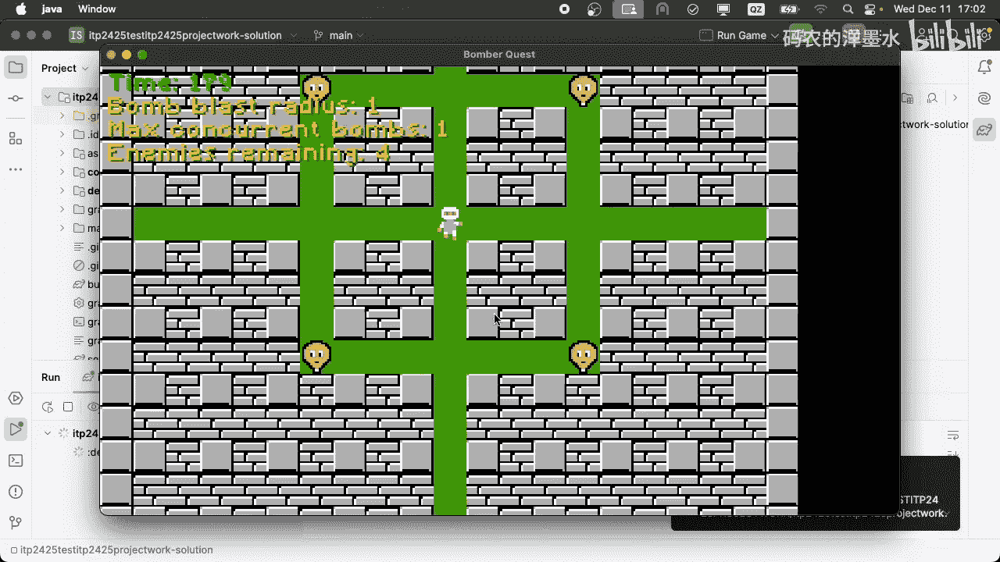
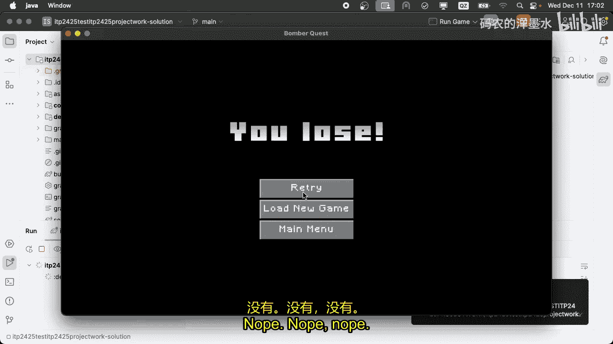
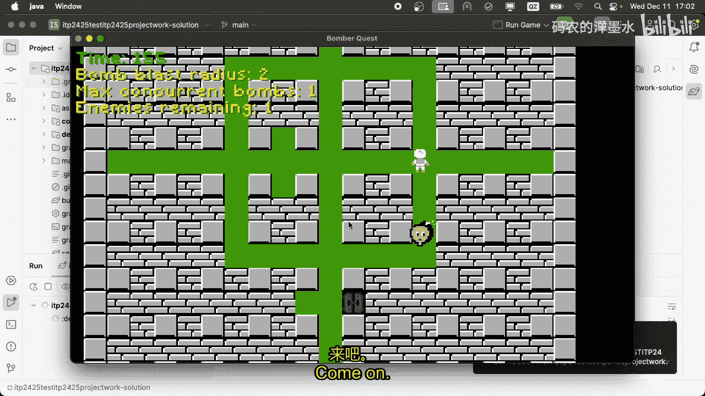
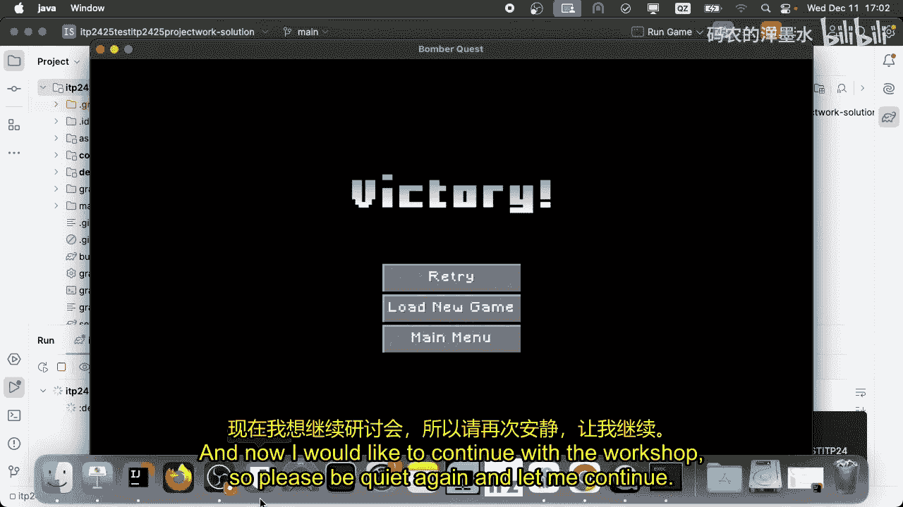
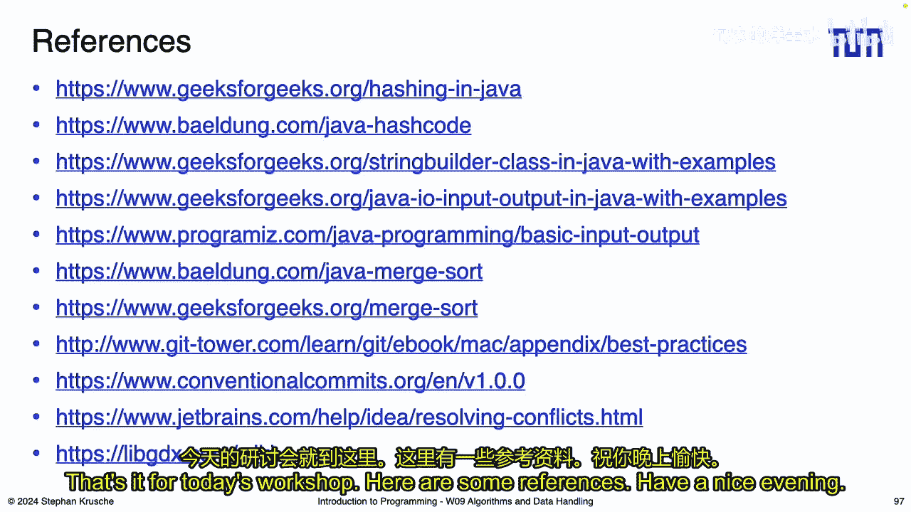

# 042：项目实践 🎮


在本节课中，我们将介绍本学期的项目实践。你将与一位伙伴合作，运用所学的面向对象编程知识，开发一个完整的游戏。我们将详细讲解项目主题、技术要求、开发流程以及团队协作的规范。

## 项目概述

在之前的课程中，我们解决了一些小型问题，完成了导师练习和家庭作业。现在，我们将进行一个更重要的项目实践。你将不再处理零散的小任务，而是需要自己设计一个游戏的整体代码结构。你将应用在研讨课上学到的所有面向对象概念，并最终完成一个可以向朋友和家人展示的作品。

## 项目主题：炸弹人 💣

今年的项目主题是“炸弹人”。这是一个经典游戏，其核心玩法如下：

*   **游戏场景**：玩家身处一个由墙壁构成的迷宫中。
*   **墙壁类型**：迷宫由**不可摧毁的墙壁**和**可摧毁的墙壁**构成。
*   **敌人**：迷宫中游荡着一些敌人。
*   **玩家目标**：玩家需要放置炸弹。炸弹爆炸后可以摧毁可摧毁的墙壁、消灭敌人。
*   **隐藏元素**：摧毁墙壁后，可能会发现隐藏的**出口**或**能力增强道具**。
*   **胜利条件**：玩家必须找到出口并逃离。出口在**击败所有敌人**之前是锁定的。
*   **能力增强**：通过拾取道具，玩家可以增强炸弹能力，例如**增加爆炸半径**或**增加可同时放置的炸弹数量**。
*   **计时器**：游戏设有时间限制，玩家必须在规定时间内完成目标。

## 游戏机制与要求

上一节我们介绍了游戏的基本主题，本节中我们来看看具体的游戏机制和技术实现要求。

### 核心游戏机制

以下是游戏需要实现的基本机制：

*   **角色控制**：玩家控制一个角色，该角色可以**放置炸弹**和**移动**。
*   **移动方向**：角色可以在迷宫中沿四个方向（上、下、左、右）移动。
*   **场景构成**：迷宫由**墙壁**和**通道**构成。角色和敌人只能在通道上移动，无法穿过墙壁。
*   **入口与出口**：每个迷宫有且仅有一个**入口**和一个**隐藏的出口**。
*   **敌人行为**：敌人在通道上移动。
*   **失败条件**：如果敌人触碰到角色（或角色触碰到敌人），则玩家失败。
*   **状态显示（HUD）**：游戏需要一个状态栏（HUD）来显示以下信息：
    *   当前可放置的炸弹数量。
    *   当前炸弹的爆炸半径。
    *   剩余游戏时间。
    *   剩余敌人数量。
    *   出口是否可用的指示器（当所有敌人都被击败且出口被发现时可用）。

### 技术要求

为了完成这个项目，我们需要使用特定的工具并遵循一些技术规范。

*   **游戏引擎**：我们将使用 **LibGDX** 游戏开发框架来渲染2D图形和构建游戏。别担心，我们会提供一个项目模板帮助你起步。
*   **地图文件**：我们会提供一些地图文件，也欢迎你创建自己的。你的游戏必须能够加载并运行任何来自文件的地图。
*   **相机系统**：迷宫可能比游戏屏幕大，因此需要实现一个**跟随角色移动的相机**，确保角色始终在屏幕视野内。
*   **屏幕自适应**：游戏窗口应能调整大小，游戏内容需要**自适应**不同分辨率，不能只针对固定分辨率（如全高清）开发。
*   **代码文档**：你必须为项目代码编写文档。
    *   使用 **JavaDoc** 格式为每个类和方法添加注释。
    *   JavaDoc 示例：
        ```java
        /**
         * 将两个整数相加并返回结果。
         * @param a 要相加的第一个整数。
         * @param b 要相加的第二个整数。
         * @return 两个整数的和。
         */
        public int sum(int a, int b) {
            return a + b;
        }
        ```
*   **README 文件**：需要提供一个 `README.md` 文件，解释项目结构、如何启动游戏以及游戏机制等。这对于我们评估你的项目至关重要。

## LibGDX 基础概念

了解了项目要求后，我们来看看将要用到的 LibGDX 框架的一些核心概念。

### 游戏循环（Game Loop）

在 LibGDX 中，核心是 **`render()`** 方法构成的游戏循环。这个方法每秒会被调用约60次，从而产生每秒60帧的动画效果。该方法还会接收一个 **`deltaTime`** 参数，表示自上一帧以来经过的时间（秒），这对于实现与时间相关的移动（如角色移动）非常有用。







在 `render()` 方法中，你可以：
*   告诉 LibGDX 在何处绘制图像、角色、墙壁等所有游戏元素。
*   处理用户输入（例如，按下方向键移动角色）。
*   更新游戏状态（例如，计算角色的下一步位置或敌人的移动）。



### 应用结构与屏幕管理

LibGDX 游戏遵循一个基本的类结构：

1.  **ApplicationListener**：这是顶层接口，用于响应游戏中的事件（如创建、渲染、暂停、调整大小等）。
2.  **Game** 类：这是 LibGDX 提供的一个实现了 `ApplicationListener` 的类。它管理多个 **Screen**（屏幕）。
3.  **Screen**（屏幕）：一个游戏通常包含多个屏幕，例如：
    *   开始菜单屏幕
    *   游戏主屏幕
    *   游戏胜利/失败屏幕
    *   每个 `Screen` 都有自己的 `render()`、`show()`、`hide()`、`resize()` 和 `dispose()` 方法。

`Screen` 类的主要方法：
*   **`show()`**：当该屏幕被激活显示时调用。
*   **`render(float delta)`**：渲染该屏幕的内容。
*   **`resize(int width, int height)`**：当游戏窗口大小改变时调用。
*   **`hide()`**：当该屏幕被切换隐藏时调用。
*   **`dispose()`**：**非常重要**。用于清理该屏幕占用的资源（如纹理、音效），防止内存泄漏。

### 学习资源

LibGDX 拥有丰富的社区资源：
*   **官方 Wiki**：包含大量教程和文档。
*   **Awesome LibGDX** 资源库：汇集了纹理、图像、工具等各种有用资源的链接。

## 项目演示与团队协作

我们看过了技术基础，现在来了解一下项目的组织形式和协作方式。

### 项目演示

我们的导师 Michael 开发了一个示例解决方案，它展示了最终项目可能呈现的效果。演示中可以看到角色移动、放置炸弹、摧毁墙壁、拾取道具、击败敌人并最终找到出口获胜的完整流程。

### 工作模式：结对编程

本项目要求以**两人小组**的形式完成。这旨在培养你们的团队协作、沟通和任务拆分能力。项目最后需要在导师小组中进行最终演示。

**重要规则**：
*   团队成员必须来自**同一个导师小组**。
*   如果遇到问题（如队友退出），请**立即**与导师沟通。
*   **结对编程是强制性的**。你们需要在1月份的导师课中至少参加**2次**并进行结对编程。也鼓励在课外进行。
*   在结对编程时，必须**每20分钟轮换角色**，并且**驾驶员（写代码的人）必须使用自己的电脑并提交代码**。

#### 结对编程角色

*   **驾驶员**：操作键盘和鼠标，负责编写代码，并向导航员解释**正在做什么以及为什么这么做**。
*   **导航员**：观察驾驶员的工作，思考整体架构，提出问题，并指出潜在的问题或改进点。
*   **核心是沟通**：通过持续的交流，可以显著提高代码质量和项目成果。

## 使用 Git 进行团队协作

由于是团队项目，我们需要有效地使用 Git 进行版本控制和协作。到目前为止，你可能只使用过 `git clone`， `add`， `commit`， `push`。现在需要学习更多命令。

### Git 工作流与核心命令

Git 有四个主要区域：
1.  **工作目录**：本地计算机上的文件。
2.  **暂存区**：准备提交的文件临时存放区。使用 `git add <file>` 将文件加入。
3.  **本地仓库**：存储项目提交历史的数据库。使用 `git commit` 将暂存区内容提交至此。
4.  **远程仓库**：位于服务器上（如 Artemis），用于团队共享代码。使用 `git push` 将本地提交推送到此。

#### 协作相关命令

*   **`git fetch`**：从远程仓库下载最新的提交历史到本地仓库，但**不改变**工作目录的文件。
*   **`git merge`**：将远程仓库的更新合并到当前工作目录。
*   **`git pull`**：这是一个快捷命令，相当于 `git fetch` + `git merge`。用于获取队友的更新。
*   **`git push`**：将你的本地提交上传到远程仓库。

### 处理合并冲突

当你和队友修改了同一文件的同一部分时，就会发生**合并冲突**。Git 无法自动决定保留谁的修改，需要你手动解决。
解决流程通常是：`pull` 时发现冲突 -> 手动编辑文件，选择或整合冲突的代码 -> 执行一个新的合并提交 -> `push`。

### Git 最佳实践

为了避免问题，请遵循以下最佳实践：
*   **频繁提交和推送**。
*   **开始新功能前先拉取**最新代码。
*   **提交相关的更改**（一次提交只完成一个明确的小功能）。
*   **不要提交未完成的代码**。
*   **提交前进行测试**。
*   **编写清晰的提交信息**（例如：“添加炸弹爆炸动画”，而不是“修复了一些bug”）。
*   **本项目只使用 `main` 分支**，不创建其他分支。

在 IntelliJ IDEA 中，你可以通过 **VCS -> Git -> Pull** 菜单轻松执行拉取操作。

## 项目评分、时间线与重要规则

最后，我们来明确项目的评分标准、时间安排和必须遵守的规则。

### 评分与加分

*   **基础要求**：完整实现项目说明书中规定的**所有最低要求**，即可获得该项目部分100%的分数（项目占ITP总成绩的30%）。
*   **创意加分**：最高可获得**5分**的额外加分。例如：
    *   实现更智能的敌人AI（如追踪玩家）。
    *   添加新的游戏机制（如敌人也能放置炸弹）。
    *   任何超越基础要求的创意功能。

### 时间线

*   **立即开始**：在导师课上寻找来自**同一小组**的队友，并向导师报告。
*   **组队截止日期**：下周二晚上8点。
*   **项目最终提交**：1月29日（讲座课前）。
*   **最终演示**：在1月份的最后一节导师课上进行。

### 重要规则与评分标准

以下规则至关重要，违反可能导致严重扣分甚至项目失败：

1.  **平等贡献**：两位成员必须大致平均地贡献代码（通过提交历史和代码行数评估）。每人至少应有10次有意义的提交。
2.  **仅使用 Artemis Git**：所有代码协作必须通过 Artemis 的 Git 进行。其他方式（U盘、Google Docs等）的贡献将不被认可。
3.  **强制结对编程**：必须参加1月份的导师课结对编程，并按规定轮换角色和电脑。
4.  **有意义的提交**：提交信息必须清晰描述更改内容。提交的代码量应适中，且是完整的功能模块。
5.  **演示与答辩**：两位成员都必须参与演示，并证明自己理解整个项目代码。
6.  **及时沟通问题**：遇到任何问题（团队或技术）请尽早联系导师。
7.  **严禁抄袭**：不得复制其他团队的代码。任何抄袭行为将导致所有涉及者该部分成绩为0分。
8.  **关于 AI 工具**：可以寻求 AI 帮助，但**不建议**作为首选。你必须理解并检查 AI 生成的代码。如果大量使用，需注意避免代码雷同。**来自互联网（包括AI）的代码必须注明出处**。
9.  **第三方库**：如需使用未在课程中教过的第三方库，必须在 Artemis 指定频道申请许可。

## 总结



本节课中我们一起学习了本学期的项目实践“炸弹人”游戏开发。我们明确了游戏的主题、机制和技术要求，介绍了 LibGDX 游戏引擎的基础概念。我们重点讲解了以**结对编程**为核心的团队协作模式，以及如何使用 **Git** 进行有效的团队开发。最后，我们详细说明了项目的**评分标准、时间线和必须严格遵守的重要规则**。请仔细阅读项目说明书，积极与队友和导师沟通，开始你们的游戏创作之旅吧！