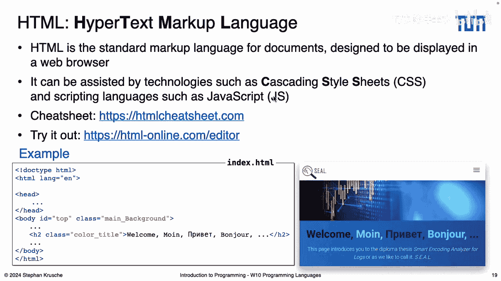
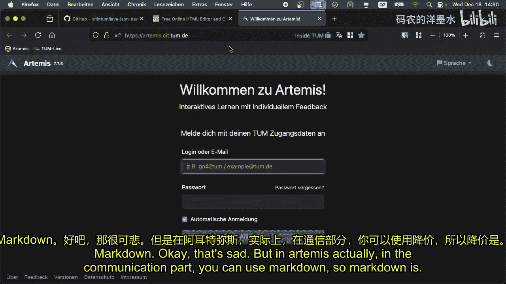
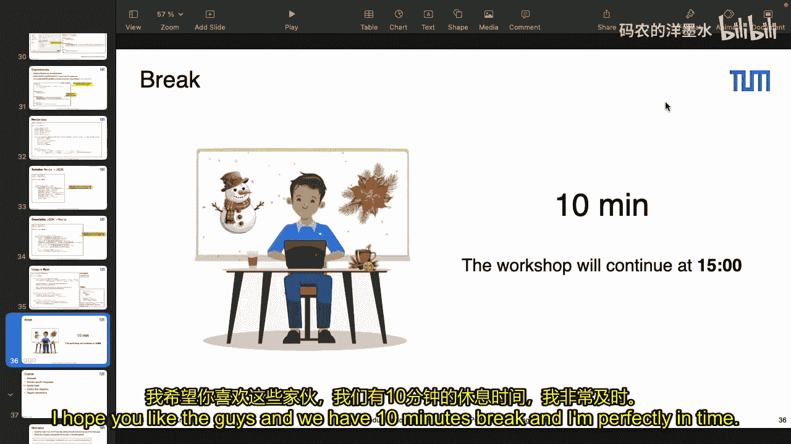

# 044：领域特定语言 🧩


在本节课中，我们将要学习**领域特定语言**。我们将了解什么是DSL，它与通用编程语言有何不同，并探索几个在现实世界中广泛使用的DSL实例，例如HTML、JSON和Gradle。

---

## 什么是领域特定语言？

领域特定语言是为特定任务专门设计的程序或语言。例如，**HTML**是专门为编写网页而设计的。你不能用HTML来编写数据库。

通用编程语言则相反，例如**Java**，你可以用它来做任何事情。虽然理论上可以用Java写网页，但这通常不是最佳实践。

有时这两种类别的界限并不分明。以**Python**为例，它是一个通用语言，但现在因其易用性，常被用于机器学习和人工智能领域。当然，Python在其他领域也有应用。



使用DSL的优势包括：
*   **更高效率**：相比用通用语言（如Java）编写网页，使用HTML没有那么多开销。
*   **更好代码质量**：代码更专注于特定领域。
*   **更高学习曲线**：需要专门学习。
*   **更高维护成本**：需要能够编写和阅读这些语言的人员，配置和维护系统可能需要更多精力。



---

## 常见的领域特定语言示例

上一节我们介绍了DSL的概念，本节中我们来看看几个具体的例子。以下是几种常见的DSL：

*   **HTML**：用于编写网页。在浏览器中，我们使用HTML标签（如`<h1>`表示最大标题，`<h2>`表示次级标题）来构建页面结构。HTML常与CSS（用于样式）和JavaScript（用于交互功能）结合使用。
*   **Markdown**：一种文档编写工具，程序员常用它来编写教程。它易于使用，且跨平台兼容。例如，用`#`表示一级标题，`##`表示二级标题，用`**文本**`表示加粗文本。
*   **JSON**：一种数据交换格式，主要用于在程序、工具或应用之间传输数据。它易于人类和机器阅读，采用键值对的结构，类似于哈希映射。例如：
    ```json
    {
      "title": "Hacksaw Ridge",
      "genres": ["History", "Drama"],
      "year": 2016
    }
    ```
*   **XML**：另一种数据交换格式，在微软和机器人技术等领域常用。它使用标签来定义数据结构，虽然看起来比JSON复杂，但使用一段时间后也会变得容易。
*   **YAML**：一种人类和机器都可读的数据序列化语言，结构与JSON类似，但格式更简洁。它也常用于配置应用程序。

---

## 现实应用案例：日志分析系统

前面我们讨论了几种不同的DSL，现在我想通过我的毕业论文项目来展示一个实际用例，说明如何将所学知识应用于现实世界。

项目是为一家名为**Bitmovin**的流媒体技术公司开发一个智能编码分析仪表板，用于分析日志文件。

**什么是日志文件？**
日志文件是计算机系统生成的记录文件。例如，当你晚上6点打开WhatsApp，这个操作会被记录在日志中；如果出现错误信息，也会被记录。我们分析这些日志数据，可以了解用户行为（如高峰使用时间）或诊断系统问题。

Bitmovin公司每天产生数十万条日志，人工无法逐一阅读。因此，我们需要一个系统来自动分析这些日志，并将结果以图表形式展示，因为人类阅读图表比阅读原始日志要容易得多。

该系统的数据流如下：输入是JSON文件，通过一系列应用（如日志过滤器、Elasticsearch数据库）处理，最终在Kibana仪表板上生成图表。所有这些应用都运行在**Docker容器**中。

**什么是Docker？**
Docker是一个容器管理工具。容器就像一个独立的盒子，每个应用（如Kibana、Elasticsearch）运行在自己的容器里，彼此隔离。这样，更新一个应用不会影响其他应用，大大简化了系统维护。我们使用**Docker Compose**（一种YAML文件）来管理这些容器。

---

## 动手项目：使用Gradle构建应用

最后，我们将讨论**Gradle**。你们都在课程中使用过它，可能也遇到过构建错误。Gradle是一个构建自动化工具。

**Gradle是做什么的？**
例如，我想编写一个关于电影的数据集，并希望将其转换为JSON对象以便传输。我不想从头编写JSON解析代码，可以复用他人已编写并托管在中央仓库（如Maven）中的代码。Gradle能帮我**下载**这些代码依赖、插件或框架，并将其**构建**到我的项目中。构建过程通常包括清理、编译、构建和测试。

现在，让我们一起完成一个小项目。

**步骤1：创建新项目**
1.  创建一个新项目，命名为“Movie”。
2.  选择**Gradle**作为构建系统，并使用**Groovy**作为DSL（不要选Kotlin）。
3.  设置GroupId，例如 `com.example`。

**步骤2：配置`build.gradle`文件**
项目创建后，打开`build.gradle`文件。初始内容会包含Java插件、仓库地址等。我们需要添加一些依赖。以下是需要添加的配置：

```groovy
plugins {
    id 'application'
    id 'checkstyle'
}

application {
    mainClass = 'com.example.Movie'
}

dependencies {
    implementation 'com.google.code.gson:gson:2.8.9' // JSON解析库
}
```
添加后，点击Gradle面板的刷新按钮，重新加载项目。

**步骤3：创建Movie类**
1.  创建一个新的Java类，名为`Movie`。
2.  在类中定义属性（`title`, `genres`, `year`）、构造方法以及一个`toString()`方法。
3.  实现将对象转换为JSON字符串的方法（`toJson`），以及从JSON字符串重建对象的方法（`fromJson`）。这需要用到我们通过Gradle引入的Gson库。

**关键点**：`toJson`和`fromJson`方法中使用的键名（如`"title"`）必须保持一致，否则在转换时会出错。

**步骤4：编写主方法并运行**
在`main`方法中，创建一个`Movie`对象，将其转换为JSON字符串，然后再将这个字符串转换回`Movie`对象。

要运行程序，可以在终端中执行命令：
```bash
./gradlew run
```
如果构建失败，请仔细阅读错误信息，通常可能是拼写错误或路径问题。

通过这个练习，我们不仅学会了如何使用Gradle管理依赖和构建项目，也亲身体验了在开发中常见的拼写错误等问题。

---

## 总结 🎬

本节课中我们一起学习了：
1.  **领域特定语言**的定义及其与通用编程语言的区别。
2.  几种常见的DSL：**HTML**（网页）、**Markdown**（文档）、**JSON/XML/YAML**（数据交换）。
3.  一个真实的工业级应用案例：使用多种技术（包括DSL、Docker）构建**日志分析系统**。
4.  通过一个动手项目，实践了如何使用**Gradle**构建工具来管理项目依赖并运行一个简单的Java应用。



记住，工具和语言都是为了解决特定问题而存在的。理解它们的适用场景，能帮助我们在项目中做出更合适的技术选型。