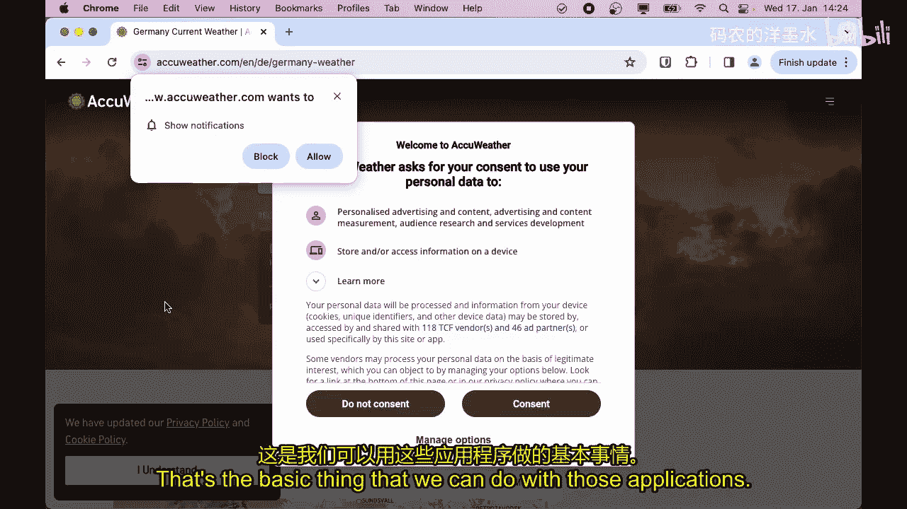
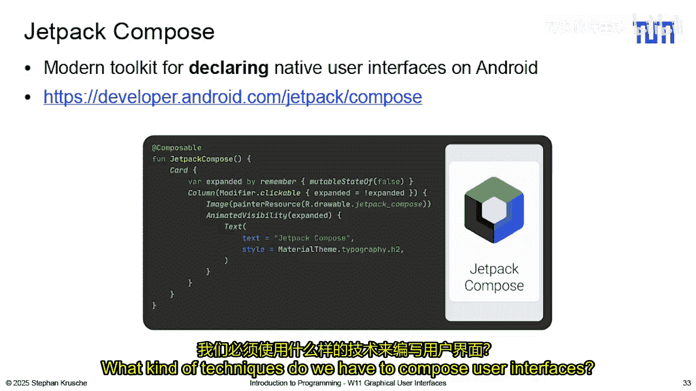

# 048：可用性与图形用户界面

在本节课中，我们将要学习图形用户界面的重要性，特别是可用性、原型设计以及相关的核心概念。我们将介绍不同的图形用户界面框架，并深入探讨模型-视图-控制器设计原则。最后，我们会以Java FX为例，讲解布局、形状和控件等基本元素。

## 图形用户界面简介

图形用户界面并非新事物，它已经发展了很多年。它允许用户通过符号、视觉隐喻和指点设备与计算机进行交互。如今，我们主要通过图形界面与计算机互动。在早期，人们只能通过控制台、终端或穿孔卡片与计算机交互，而现在我们拥有非常友好的图形界面，不仅出现在台式电脑上，也出现在移动设备上。

图形用户界面通常被认为是用户友好的交互方式。然而，也存在许多设计不佳的例子，我们将在今天展示一些。其核心思想是，任何可以通过计算机或计算机程序执行的操作，都以某种方式呈现在用户界面中。根据其重要性，这些操作可能被设计得很大或很小，易于发现或难以发现。开发者需要引导最终用户使用界面。

## 人机交互与输入输出循环

上一节我们介绍了图形界面的基本概念，本节中我们来看看用户如何与系统交互。用户界面和交互设计是一个涉及计算机科学和心理学的复杂领域。人类通过视觉、听觉、触觉和言语等多种感官与技术互动。如今，交互方式变得更加复杂，包括语音识别、移动设备触控甚至眼动追踪。

用户首先与硬件交互，例如屏幕、耳机或游戏手柄。硬件通过集成电路将信号转换为输入/输出，操作系统处理这些信号，然后将其传递给用户空间的软件应用程序。当开发者创建应用程序时，通常会使用框架来监听用户操作，例如点击按钮或移动鼠标，并据此做出响应。

这种交互过程被可视化为一个输入输出循环。用户进行操作（输入），界面随之变化（输出）。所有交互，无论是点击、语音还是眼动追踪，都遵循这一基本模式。因此，图形用户界面框架非常注重这些输入输出机制。开发者设计一个界面元素（如按钮），然后监听相关的动作或事件。当用户点击按钮时，会触发一个事件，开发者可以根据当前上下文和条件进行适当处理。

## 操作系统界面示例

理解了交互的基本原理后，我们来看看不同系统中的具体实现。以下是几个主流操作系统的用户界面示例：

*   **MacOS**：具有特定的设计元素，例如窗口左上角的三个圆点控制按钮，这与Windows的设计有所不同。
*   **Windows**：以其任务栏、通知区域和著名的“开始”按钮为特色。现代版本还引入了磁贴界面。
*   **Android**：作为移动操作系统，屏幕空间较小。除了传统的鼠标/触控板输入，它主要依赖触摸输入，甚至支持多点触控手势（如双指缩放）。
*   **iOS**：在安全性和可用性方面有特定设计，与Android存在差异。

这些例子展示了不同平台对“良好用户界面”的不同理解和实现。

## 应用程序界面与设计挑战

离开操作系统层面，我们进入应用程序领域。以Microsoft Excel为例，它是一个功能强大的应用程序，但其界面相当复杂，包含大量元素，如功能区和各种按钮。并非所有用户都按开发者预期的方式使用它，许多人只使用其基本功能。像Excel这样发展了二十多年的软件，其可用性和用户界面也在不断演变。

另一个极端例子是核电站的控制室界面。它们通常并不现代，且非常复杂，需要经过专门培训的专家来操作。这引出了手册的重要性：界面越复杂，就越需要一份好的使用手册。有人认为，如果需要手册，就说明用户界面设计得不好。但对于复杂系统，有时无法让所有最终用户都轻松上手。开发者需要考虑不同用户群体，从技术爱好者到不熟悉技术的老年人。

## 可用性灾难案例

糟糕的用户界面设计可能导致严重后果。2018年，夏威夷发生了一起错误的导弹警报事件。全岛居民都收到了“弹道导弹威胁来袭，立即寻找庇护所，这不是演习”的紧急警报。这引起了巨大的恐慌，幸运的是，这是一次误报。

事故原因在于操作人员使用的控制界面。界面中有两个选项：“PAcom state only”和“Drill PAcom state only”。操作人员本应点击“Drill”（演练）按钮进行测试，却不慎点击了真实的警报按钮。这个界面设计存在严重问题：两个关键选项区分度极低，可能缺少确认对话框，并且开发者低估了操作人员在真实警报压力下的心理状态。这导致了设计者的意图模型与用户的实际操作模型之间存在巨大差距。

## 可用性的定义与衡量

在看了这些例子后，让我们回到理论，思考可用性究竟是什么。许多人使用这个术语，但并不真正了解其含义。

**可用性**衡量的是用户能够多好地使用或利用系统功能。它基于以下五个可衡量的类别：

1.  **易学性**：系统有多容易学习？学习速度有多快？这取决于系统的复杂性。
2.  **效率**：用户完成特定任务需要多少步骤？可以通过快捷键、预设数据等方式为高级用户提升效率。
3.  **可记忆性**：用户在长时间未使用系统后，能多快重新熟练操作？良好的设计线索和遵循最佳实践有助于提升可记忆性。
4.  **错误率**：用户会犯多少错误？错误的严重性如何？从错误中恢复有多容易？例如，使用日期选择器而非文本框可以防止输入无效日期。
5.  **满意度/用户体验**：使用系统是否愉快、有趣？这是比较主观的，涉及用户的情感和感受。

要在所有五个类别中都取得优异成绩非常困难，因为它们之间可能存在权衡。例如，为了提高易学性而简化界面，有时会牺牲高级用户的使用效率。

## 用户界面设计的挑战与原则

许多人都声称自己的系统“易于使用”，但这可能是最常被滥用的术语之一，尤其是在市场营销中。实际上，很多被如此宣传的系统仍然难以使用。

用户界面设计之所以困难，是因为开发者（设计并初步测试系统的人）通常不是软件的最终真实用户。最终用户可能没有技术背景。界面开发本质上是与用户的沟通。如果用户遇到持续的问题，这通常是系统而非用户的过错。然而，用户也并非总是正确的，因为他们不是设计专家。这类似于建造房屋：我们会咨询住户的意见，但最终由建筑师和工程师负责设计和建造。

用户界面设计需要大量时间和精力。据估计，带有图形用户界面的软件，其设计、实现和维护工作的50%都投入在了用户界面上。管理层的支持也至关重要，如果管理层不重视可用性，开发者就难以做好这项工作。

## 原型设计：快速验证与迭代

那么，如何设计出更好的用户界面呢？软件开发者常用的一种技术是**原型设计**。它指的是创建一个用户界面的模型或初稿，展示给其他人看。这有助于将开发者脑海中的界面设计具体化，以便进行评估、讨论和证伪。

原型设计非常有效，因为它允许开发者在编写代码之前快速探索不同的可能性。这个过程可以非常迅速，并能提供即时反馈。它改善了团队内部以及与最终用户之间的沟通。错误越早发现，修正成本就越低。在纸上进行简单的草图绘制是一种开销极低的方式。

在德国社会，失败常被视为坏事。但另一种观点认为，失败是好事，因为我们可以从中学习并改进。美国工程师亨利·彼得罗斯基提出了“设计的悖论方法”，他认为从失败的设计中能获得比从（自认为）总是成功的设计中更好的信息。社会也往往从灾难中比从近乎失败的成功中学到更多。这种“破坏性创新”意味着，有时需要先打破旧有模式，才能实现真正的创新。

## 测试与评估技术

在开发包含用户界面的系统时，需要测试其是否有效。有以下几种技术：

*   **可用性测试**：观察真实最终用户基于特定场景如何与系统交互，让他们执行任务，观察其是否知道该怎么做、是否成功或失败，并询问原因。通常5名测试用户就能提供有价值的反馈。
*   **启发式评估**：邀请专家根据预先制定的规则或最佳实践（启发式）来识别可用性问题。

以下是十条常用的可用性启发式原则：

1.  系统状态可见性
2.  系统与现实世界的匹配
3.  用户控制与自由
4.  一致性与标准
5.  防错
6.  识别而非回忆
7.  使用的灵活性与效率
8.  美观简洁的设计
9.  帮助用户识别、诊断和恢复错误
10. 帮助与文档

开发者可以将其作为设计指南，或在完成后对照检查，以发现并改进问题。

## 图形用户界面框架概览

在深入具体技术前，我们需要了解有哪些工具可供选择。首先，你需要考虑开发什么类型的应用程序：是为Web、移动设备还是桌面电脑？然后决定要支持哪些操作系统。基于这些选择，会有很多不同的框架：

*   **Web**：需要处理HTML、CSS和JavaScript。
*   **macOS/iOS**：可以使用Cocoa/Cocoa Touch（已逐渐被弃用），苹果现在推荐使用SwiftUI。
*   **Windows**：可以使用.NET框架。
*   **Android**：有Jetpack Compose。
*   **Java**：有AWT、Swing、Java FX（更现代，本课将以此为例）以及游戏引擎如libGDX。

HTML是Web的基石，它提供了文本、链接、按钮等用户界面元素和布局。CSS则用于定义这些元素的样式，如颜色、大小、字体等。

SwiftUI是为所有苹果平台声明用户界面的现代方式，它允许开发者在预览中立即看到界面效果，便于快速原型设计。Jetpack Compose是Android上声明原生用户界面的现代工具包，它采用声明式语法，将界面元素嵌套在布局结构中。

## 总结

本节课中，我们一起学习了图形用户界面的核心概念。我们探讨了可用性的定义及其五个衡量类别（易学性、效率、可记忆性、错误率、满意度），并通过案例看到了糟糕设计可能带来的严重后果。我们介绍了通过原型设计来快速验证和迭代界面想法的重要性，以及可用性测试和启发式评估等测试技术。最后，我们概览了针对不同平台（Web、移动、桌面）的图形用户界面框架，例如SwiftUI、Jetpack Compose和Java FX。理解这些概念和工具，将帮助你创建出更友好、更有效的应用程序界面。