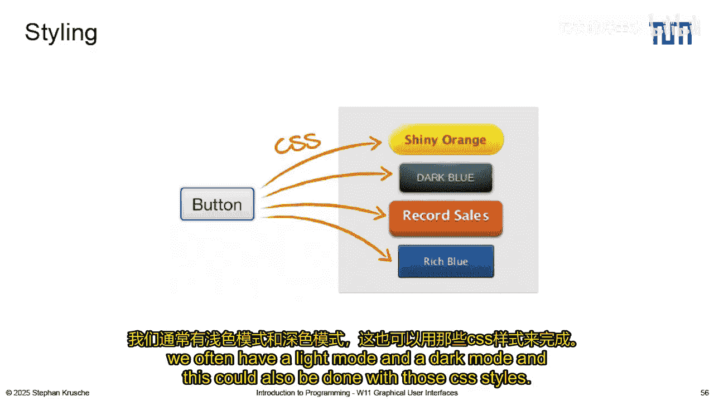

# 049：JavaFX

在本节课中，我们将深入学习一个用于构建Java图形用户界面的特定框架——JavaFX。这是一个开源框架，允许你基于Java为桌面、移动和嵌入式系统构建用户界面。

## 🎨 JavaFX 简介

JavaFX是一个开源框架，它允许你基于Java为桌面、移动和嵌入式系统构建用户界面。网上有可供参考的教程。它内置了大量组件，如按钮、文本字段、表格、树形视图等，使你能够轻松创建简单乃至复杂的用户界面。

你可以使用来自Web的技术，例如用CSS定义样式表，并手动或通过编程方式应用它们。它甚至可以进行2D和3D图形处理，并包含一个用于显示Web应用程序的Web视图。

它完全用Java编写，因此与你的技能完全兼容，并且是平台独立的。

## 📄 FXML 与场景构建器

JavaFX包含一种内置的领域特定语言——FXML。它允许你将用户界面的创建与应用程序逻辑的实现分离开来，我们在之前的示例中也见过类似的做法。

它甚至包含一个场景构建器，允许你通过拖放元素来创建用户界面，这意味着你可以使用一个用户界面来创建另一个用户界面。

### FXML 的工作原理

FXML是一种基于XML的领域特定语言，它允许你构建用户界面的基本结构，并将应用程序逻辑分离到你的代码中。网上有一个FXML入门教程，我们这里不深入太多细节，因为这已经相当高级。

你可以看到，基于这些XML文本，你可以定义一个具有特定内边距的网格窗格。然后，你可以有“欢迎”文本、用户名标签、用于输入用户名的文本字段、密码标签以及用于输入密码的密码字段。密码字段内置了输入后不显示明文的功能，而是显示圆点，以防止身后的人看到你的密码。

中间有一些间距，然后我们有一个右对齐的按钮，文本为“登录”。

通过这种方式，你可以构建用户界面的主要构建块。你还可以定义所谓的“动作”。例如，如果用户按下按钮，我们在这里有一个 `onAction` 元素。然后，你可以在代码中引用一个方法来处理提交按钮的动作，这个方法将被调用。

如果你还记得我们开始时讨论的输入输出循环，这就是其中一个输入。你可以配置操作系统，确保它调用代码中的特定方法 `handleSubmitButtonAction`，然后你可以响应用户的输入。

### 使用场景构建器

使用场景构建器，你可以可视化地创建用户界面，场景构建器会自动为你生成相应的FXML代码。你也可以查看并修改FXML，然后场景构建器会反映这些更改。这样，你就有了用户界面的可视化表示，这对于原型设计和快速创建用户界面的初稿或最小可行产品特别有帮助。

这里有一个网站描述了更多关于场景构建器的信息。你可以看到一个集成到NetBeans IDE中的示例。左侧库中有各种元素，你可以通过拖放将它们放入用户界面，按需组合。右侧有一个检查器，你可以在其中更改属性，例如应用特定样式或根据库中的元素定义特定值，从而以视觉方式创建有意义的内容。

## 🏗️ JavaFX 应用程序结构

一个JavaFX应用程序由舞台、场景和节点组成。JavaFX应用程序实际上可以有多个舞台，但在大多数简单情况下，只有一个舞台。在一个舞台中，我可以有多个场景。在一个场景中（这是我们窗口的主要容器），我有节点，这些节点内部可以包含其他节点。例如，你可以有一个垂直布局的元素（这是一个节点），然后你可以添加子节点（其他节点），这些子节点可以是按钮、输入框、密码字段、表格等。这就是基本思想：你有舞台、场景，然后在场景中有一个节点的层次结构。

你可以在这里看到一个视觉示例，这是一个简单的JavaFX应用程序。舞台基本上是整个窗口，顶部有菜单栏（这是系统提供的，你不需要实现窗口右上角X按钮的行为）。你还有一个标题和图标。在菜单栏下方，你的场景实际上开始了。在这个场景中，你可以有多个节点。在这个例子中，我们只有一个节点，所以是一个非常简单的场景，只有一个“点击我”按钮。

## 🚀 创建第一个简单的 JavaFX 应用程序

现在，我们想动手实践，一起创建我们的第一个简单的JavaFX应用程序。请启动你的IDE，我们现在一起操作。如果你有任何问题，请举手，我们也有助教在场，他们可以在你遇到问题时提供帮助。

我将打开IntelliJ IDEA，创建一个新的Gradle项目。我将其命名为 `JavaFXHelloWorld`，存储在默认位置。我们使用Java、Gradle、Groovy。然后点击创建。这还不是一个JavaFX应用程序，只是一个简单的Java应用程序。

你可以配置SDK，并等待Gradle构建完成。

下一步，我们需要打开我们的 `build.gradle` 文件，并配置应用程序，以便我们能够使用JavaFX。JavaFX是一个外部依赖，没有内置在Java中，所以我们需要告诉我们的项目我们想要使用它。

你可以简单地复制粘贴这个文件，或者单独操作。复制粘贴更容易一些，所以我推荐这样做。你打开根文件夹下的 `build.gradle` 文件，然后基本上可以用幻灯片上的内容替换所有内容，并重新加载Gradle。这将确保下载适当的插件。在这个特定示例中，我们下载一个JavaFX插件，它将确保我们下载所有JavaFX依赖项以及到你的本地操作系统的绑定。例如，如果你使用Windows，你将拥有与我略有不同的外部库集，因为你可以看到我们在这里定义了几个模块，如 `javafx.controls`。你可以在左侧的“外部库”下看到它们。例如，我拥有一个针对ARM 64位架构的本地绑定。你可能为Windows或Unix拥有其他东西。这实际上确保了应用程序将在你的特定操作系统上运行。

我们这里没有太多东西，基本上有这个特定版本的JavaFX插件，这允许我们定义版本（也是17，与我们使用的Java版本相同）。我们还有我们的主类名，这个主类名尚未实现，所以这是我们稍后需要确保的，我们不称它为 `main`，而是 `JavaFXHelloWorld`。

到目前为止有任何问题吗？

然后，我们想在项目中创建一个新的包（如果还没有的话），并添加一个名为 `JavaFXHelloWorld` 的新类。我已经有了这个包。如果你没有，请确保创建它。然后，在包内，我可以按 `Command + N`（在Mac上）或相应的快捷键来创建新类，并给它命名为 `JavaFXHelloWorld`。然后，我也从幻灯片上复制所有内容，稍后我会向你解释。

如果你的 `gradle` 文件成功下载了依赖项，那么这里的导入应该没有错误。

这里我们导入了 `JavaFX` 应用程序和 `JavaFX` 舞台，以便使用这些类。我们自己的 `JavaFXHelloWorld` 类扩展了 `JavaFX` 应用程序。所以，我们扩展了 `Application`，这是一个子类，记住，这是继承。当我们扩展一个抽象类时（实际上，`Application` 是一个抽象类），我们需要实现所有抽象方法。如果我不实现这个方法，IntelliJ会立即警告我，并建议实现 `start` 方法。我也可以这样做，实现它，但那样它会是空的。如果你从幻灯片复制代码，那么我们基本上调用输入参数 `primaryStage`（这是我们窗口的主舞台）。在这个主舞台内，我们设置一个标题（这是框架的预构建方法），并调用 `show` 方法使其对用户可见。

这对于使用图形用户界面的应用程序开发来说非常常见：你有一个框架，框架为你做了很多事情，但同时也给了你自定义的可能性。这就是其中之一：我们扩展 `Application`，然后当我们运行应用程序时，我们调用 `start` 方法，我们可以在 `start` 方法中设计我们的用户界面。我们可以使用为我们创建的主舞台，并按我们想要的方式操作它。

现在我们还不能真正启动应用程序，我认为我们需要做更多的事情。完成这一步后，我们现在需要做一些对你来说可能是新的事情：我们需要将应用程序模块化。这是因为JavaFX也使用模块。通过模块，你可以将大型应用程序结构化为更小的子系统，并简化开发。所以，我们做的是：我们进入我们的主包（这个），然后我们创建一个 `module-info.java` 文件。我们按 `Command + N`，这里有一个预定义的模板，所以我们不需要自己动手。我们已经得到了一些现有的代码。在这个模块定义中，我们基本上定义了与其他模块的依赖关系，以及我们的模块是否对其他模块可见。这都是关于信息隐藏和使依赖关系显式化。

再次，你可以复制粘贴幻灯片46的代码，并在这里输入。我们指定我们需要JavaFX的图形部分、FXML部分、控件部分等。这些是我们集成到应用程序中并使用的模块。如果它们在项目范围内不可用，我们的项目将无法工作。我们做的是：我们的包叫做 `de.tum.in.ase`，我们打开它，使其对框架可用，以便框架可以使用它。我们也导出它。这基本上就是我们在这里所做的。你不需要完全理解这一点。这些只是背景中需要配置的机械性事务，以使其工作。但基本思想是：一些子系统依赖于其他子系统，我们可以在这里配置这些依赖关系。

到目前为止有任何问题吗？

然后，我们可以转到 `JavaFXHelloWorld` 并点击运行按钮。希望它能工作，它需要编译一下。现在，我们有了我们非常简单的应用程序。如果你不相信这是我们的应用程序，你可以尝试更改它。例如，将 `primaryStage.setTitle("Hello and World")` 改为 `primaryStage.setTitle("TUM")`，然后再次运行应用程序。现在它叫做“TUM”。它可能看起来与你略有不同：如果你使用Windows，关闭应用程序的按钮在右上角；我在左上角，所以我也可以关闭应用程序。

我们还可以做我们到目前为止开发的普通Java控制台应用程序所知道的一切：我们可以调试应用程序，我们可以向终端输出日志语句或控制台语句，以识别发生了什么。所以，通常可能的一切在这里也是可能的。

对这个非常简单的、从零开始的JavaFX应用程序有任何问题吗？

从现在开始，我们假设你能够做到这一点，我们将在讲座中向你展示一些其他示例。然后，你可以随时回到这个“Hello World”游乐场。如果你想理解或尝试，可以从幻灯片复制代码，将其放入你在这里的主类中，放入应用程序的 `start` 方法中，然后尝试使用按钮、矩形、样式等如何工作。

## 🔄 应用程序生命周期

现在回到幻灯片，我想快速告诉你一些对应用程序很重要的事情：生命周期。每个图形用户界面框架都有一个所谓的生命周期，这是因为后台有一个运行循环，通常是一个 `while (true)` 循环，它响应可能来自硬件的事件，并且必须确保一切正常工作、一切正确设置。第二个原因是，图形用户界面必须在你的屏幕上渲染。如果你更改用户界面，框架必须重新渲染它。例如，如果你将一个按钮的颜色从绿色改为红色，这应该非常流畅。

你的应用程序需要确保，例如，每秒60帧。在你有时间做某事的这些毫秒内，生命周期实际上发生。我们可以区分整个应用程序的生命周期和用户界面的生命周期。

首先，我们想谈谈整个应用程序的生命周期。当你创建并启动一个应用程序时，应用程序的 `init` 方法被调用。我们没有处理 `init` 方法，因为我们只是重用了超类中的方法，但你可以重写它并自定义它。然后 `start` 方法被调用。现在应用程序在前台，运行时等待应用程序完成。应用程序只有在你终止它，或者最终用户按下红色X按钮（或在Windows上按下X按钮）关闭最后一个窗口时才会完成。只有当所有窗口都关闭时，应用程序才会关闭。在应用程序关闭之前，`stop` 方法将被调用。在 `stop` 方法中（我们也没有重写），你可以清理任何东西。例如，如果你仍有文件打开，你可以关闭它们；或者如果你有网络连接，需要将某些内容保存到云端，你可以这样做，以便用户不会丢失数据。你可以重写 `init`、`start` 和 `stop` 来执行应用程序的任何初始化或资源清理。

## 📝 使用 FXML 和控制器扩展教程

现在，让我们稍微扩展一下教程，回到我们的 `JavaFXHelloWorld` 应用程序，现在我们想快速尝试一下FXML。

我们现在要做的是调整我们的示例，并将 `JavaFXHelloWorld` 中的代码更改为此。所以，不是在代码中定义我们的用户界面（例如，定义按钮 `button = new Button()`，布局 `layout = new Layout()`，然后 `layout.getChildren().add(button)`），而是想导入一个我们在单独文件中设计的FXML文件，并在那里定义用户界面。

让我们看看这是如何工作的。我们还需要抛出一个异常，所以你可能会发现复制粘贴所有内容更容易。我们还使用 `FXMLLoader` 类加载文件，这将成为我们项目的一部分。我们基于从文件获取的父根创建一个场景，然后将场景放入我们的主舞台中。场景将包装根元素，根元素就像我们这里的一个节点、一个父节点。

所以，我们有了加载文件的代码，但我们还没有文件。在我们实际创建文件之前，我们现在还想引入一个新概念：控制器。

控制器是一个控制你的应用程序并确保你与最终用户相应交互的类。与其在视图类或应用程序类中处理所有事情，不如稍后根据你在应用程序中显示的内容拥有多个控制器。例如，对于登录视图，我们可能有一个登录控制器。登录控制器可以处理最终用户的操作。如果最终用户输入正确的用户名和密码，我们可以将用户转发到下一页；如果用户输入错误的密码，我们可以显示错误消息。这在一个控制器中很好地完成，该控制器拥有对我们用户界面中所有视图的引用，并且可以与用户界面以及我们在后台数据库中的模型进行交互（我们可能存储了用户的凭据）。

让我们创建这个 `SignInController` 类。这里有一个小技巧：你可以直接复制粘贴所有内容。与其创建一个新类，你可以在包打开时直接粘贴，然后所有内容都会自动为你粘贴，你不需要手动操作，名称也会自动从代码中派生。

我们这里有什么？我们有一个密码字段（这是一个用户界面控件）、一个文本和一个方法，所有这些都用 `@FXML` 注解标注。这基本上告诉你的IDE，它们在FXML文件中使用，并且可以确保名称正确，因为如果文件与你的代码不一致，它将无法工作。

有了这个，我们基本上可以控制我们的应用程序。现在我们需要创建示例文件。在资源文件夹中（仍然在 `main` 下，但不在 `java` 代码文件夹中，在 `resources` 文件夹中），我们现在创建一个新文件。将其命名为 `example.fxml`，并从幻灯片50复制粘贴所有内容。

现在我们不假设你完全理解这是如何工作的，正如我之前所说，你可以使用场景构建器来创建这个。但我会快速浏览一下，向你展示它是如何工作的。我们有一些导入，类似于Java中的导入，只是我们在这里有这种有趣的书写方式。然后我们基本上定义了一个网格窗格。网格窗格是一种布局，我们稍后会看到它的含义。这个网格窗格属于我们的 `SignInController`，所以这个窗格（基本上是整个窗口）将被分配给登录控制器。登录控制器负责这个窗格。我们可以在XML文本中配置一些对齐方式和属性。

然后我们有“欢迎”文本、用户名标签、用户可以与之交互的文本字段、另一个密码标签、密码字段和我们的登录按钮。所以，这基本上是我们之前看到的相同示例。在登录按钮中，我们有一个动作 `handleSubmitButtonAction`。我们甚至可以导航：我可以按 `Command` 键并点击它，然后转到代码；或者在代码中，我可以按 `Command` 键并点击该方法，然后返回到FXML文件。所以IntelliJ非常好，它将两者结合在一起。

对于几个UI元素，我想在代码中引用它们，以便使用它们的值，特别是文本字段。我可以通过使用这里的 `fx:id` 元素并给它们一个名称来做到这一点。这样，我基本上可以在代码中引用它们。例如，如果我按 `Command` 键并点击这里的密码字段，我将看到这个字段基本上被注入到我的 `SignInController` 中。稍后，我可以在这里访问它的值。动作目标也是如此。动作目标基本上是我们想在这里输入文本的地方。所以，每当用户现在点击提交按钮时，我们将通过设置这个文本（称为动作目标）来说“登录按钮被按下”。当然，你现在可能会说“动作目标”不是最好的名字，然后我们也可以重构它。IntelliJ也为我们提供了重构的可能性。我可以说重构 -> 重命名，也许这不是动作目标，也许我称之为 `infoText`。然后我重构它，现在我这里有 `infoText` 作为我的属性，并且当我使用该属性时，好处是：如果它用 `@FXML` 注解并且在文件中使用，那么我不需要担心这些值为空，因为框架将确保它们不为空。框架基本上读取你的XML文件，并为它拥有的每个元素创建一个新对象（用于网格窗格、文本、标签等），所有在这里引用的元素将自动注入，你不需要自己动手。所以这相当方便。在这里你也可以看到它在FXML中被引用。

对此有任何问题吗？

现在，我们基本上可以再次运行应用程序。所以，回到我们的 `JavaFXHelloWorld` 类，点击运行按钮。现在我们的用户界面看起来不同了。如果这对你不起作用，可能是某些配置错误：你可能将示例文件放在了错误的文件夹中，或者你可能在这里或那里有拼写错误，然后你需要识别并修复它。如果你没有任何编译错误，那么可能不那么容易，但你可以请一位助教帮助你。

关于我们的第二个教程就这么多。你已经看到了一个没有FXML的非常简单的JavaFX应用程序，如何从零开始完成它。我们还向你展示了如何基于FXML设计用户界面。我们给了你一个FXML文件，但你可以使用场景构建器来创建它，或者当然你也可以手动设计它。可能IntelliJ甚至有一些很好的建议，所以如果我创建一个文本并在这里关闭它，它将自动附加结束标签，所以你不需要——它不像一个简单的文本编辑器，它真的帮助你设计这个。我们可以马上试一试：也许不是这里的文本，也许是最后的文本。所以让我们快速更改这个，我们添加另一个文本。我们给它行索引7（再多一个），列索引1也可以。我们想在这里放什么？也许我们说 `text="Exit"`（我现在不是很有创意）。现在，如果我们再次启动应用程序，你会看到我们有另一个文本叫做“Exit”。这样，理论上，如果你熟悉它，你可以在这里设计你的用户界面。

如果没有更多问题，那么我们将继续。在进入较长的休息之前，我将快速概述一下最重要的JavaFX概念：我们将讨论布局、用户输入控件、形状和样式。对于所有这些，我们将在较长的休息后有更详细的课程。

## 📐 JavaFX 布局

JavaFX中有几种不同的布局，你可以在这里看到最重要的几种。我们可以有简单的垂直布局，称为 `VBox`，所以我们有多个元素，它们垂直堆叠。我们也可以有一个 `HBox`。我们可以有一个 `TilePane`、一个 `GridPane`、一个 `BorderPane`（我们专注于五个元素：顶部、左侧、右侧、底部和中间）、一个 `StackPane`（你将它们堆叠在一起）、一个 `FlowPane` 和一个 `AnchorPane`。所有这些都可以进行不同的配置，并允许你以最适合你的方式构建用户界面。这通常是你设计视图的外部结构，然后在这些 `VBox` 中，你甚至可以拥有另一个嵌套布局。例如，我可以有一个 `VBox` 布局，在 `VBox` 布局中我可以有一个 `HBox` 布局。所以，通过你可以在这里定义的层次结构，这可能会变得相对复杂。

## 🎛️ 用户输入控件

我们有许多不同的标准控件用于用户输入。你可以使用这些标准控件，但如果你水平较高，也可以创建自己的控件。我们有手风琴、复选框、链接、切换按钮、进度条、简单标签、简单文本字段、表格、树形视图（你可以做类似文件系统的操作，有文件夹和文件）等等。有许多不同的预建用户输入。这里的想法始终是遵循模型-视图-控制器风格：视图实际上是用户输入元素，但视图本身不处理交互，视图将交互委托给控制器（如我们见过的登录控制器）。因此，视图中的每个用户输入（如果我按下按钮，如果我在树形视图或列表中选择一个元素，如果我在选择框中选择某些内容），那么这个交互会转到控制器，然后控制器拥有你的应用程序的模型，以便对其采取行动。

例如，如果我点击一个按钮来删除列表中显示的一个元素，那么控制器将基本上确保这也在你的模型中被删除。然后，当模型更新时，它可以向视图发送更新事件，视图也可以请求模型以显示它。假设你有一个狗的列表，你在用户界面中显示它们，带有图片和名称。你可以向列表中添加新的狗，但也可以删除现有的狗。所以有一个删除按钮，当你按下删除按钮时，你要确保在你的模型中，你也删除被选中的狗元素。然后，你更新所有显示你的狗的视图，因为你可能有多个视图，并且你可能需要在它们之间同步数据。

这样，我们满足了与最终用户的输入输出循环。记住最终用户的大脑和感官：输入进入视图，但视图不在内部处理它，它委托给控制器。控制器可能会更改模型，如果登录正确，我们也可能会更新视图，并导航到下一页，然后我们可以再次向用户显示更改后的数据或更新后的视图。通过使用模型-视图-控制器，你以更易于重用和未来更易于更改的方式分离了任务。

关于用户输入控件就这么多。

## 🔷 形状与样式

接下来，我们可以用JavaFX绘制许多不同的形状：简单的线条或更复杂的线条，我们可以绘制文本、矩形、圆形、椭圆等等。当然，对于所有这些，你必须定义某些属性：颜色；如果你有一个多边形，你想使用多少个点；如果你有一个圆形，半径是多少；如果你有一个椭圆，宽度半径和高度半径是多少，等等。所以，所有这些预定义的形状都有某些值。如果你填充它们，你可以在应用程序中使用它们来绘制非常漂亮的用户界面或图像。

在样式方面，默认样式有点丑陋和无聊，正如你所见。但你可以创建自己的样式：闪亮的橙色、深蓝色、丰富的蓝色或任何你喜欢的样式，基于阴影、多种颜色、不同字体、内边距等。有许多不同的方式来样式化你的用户界面。你可以将样式应用于一个特定的UI元素，但这可能很繁琐：我不想将样式应用于我在应用程序中定义的每个按钮。通过CSS（层叠样式表），你基本上可以确保所有按钮都以闪亮的橙色或丰富的蓝色显示。这样，你甚至可以让最终用户自定义它，并为他们提供多种样式选项。例如，如果你现在使用网站和应用程序，我们经常有亮色模式和暗色模式。这也可以用那些CSS样式来完成。

## 📚 总结

在本节课中，我们一起学习了JavaFX框架的基础知识。我们介绍了JavaFX的核心概念，包括其开源特性、跨平台能力以及丰富的内置组件。我们深入探讨了FXML和场景构建器，它们允许我们将用户界面设计与业务逻辑分离。我们动手创建了一个简单的JavaFX应用程序，并了解了应用程序的生命周期。此外，我们还引入了模型-视图-控制器模式，并通过示例展示了如何使用FXML和控制器来构建更结构化的应用程序。最后，我们概述了JavaFX中的布局、控件、形状和样式等关键概念，为后续深入学习奠定了基础。