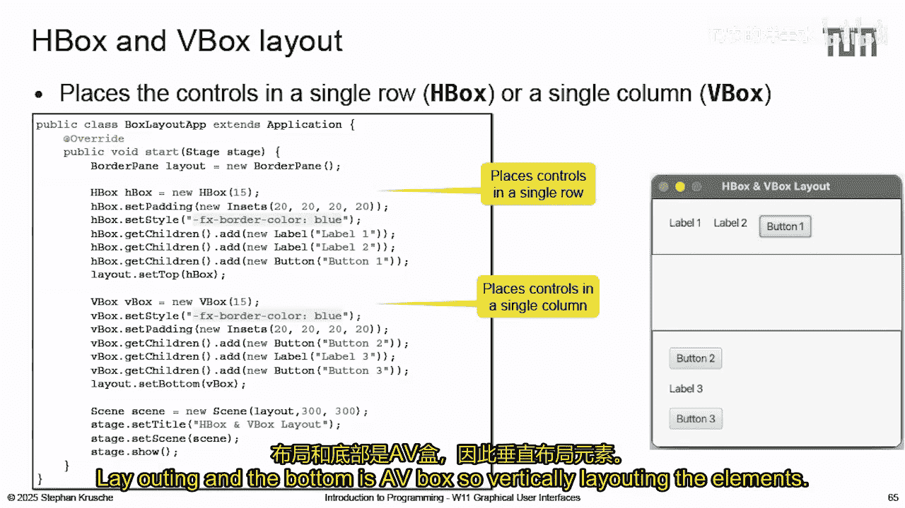

# 050：布局


在本节课中，我们将要学习如何在 JavaFX 中定义布局。布局决定了用户界面中各个控件的位置、大小和排列方式。我们将介绍几种常用的布局容器，并通过代码示例展示它们的使用方法。

## 坐标系与布局基础

在深入具体布局之前，需要理解 JavaFX 的坐标系系统。与其他一些系统不同，JavaFX 的坐标系原点 `(0, 0)` 位于窗口的**左上角**。

这意味着，如果一个控件的 Y 坐标值为正数，它将向下移动。理解这一点对后续的布局工作至关重要。

布局类的基本职责是决定其内部的子节点在窗口中的分布方式。一个典型的 JavaFX 应用结构如下：从一个 `Stage`（舞台）开始，它通常包含一个 `Scene`（场景），场景内有一个根节点，这个根节点就是一个布局容器（例如 `Pane`）。在这个布局容器内，我们可以添加多个控件节点。

布局决定了控件的对齐方式、是否形成矩阵排列，以及在窗口调整大小时控件是否会随之缩放。JavaFX 提供了多种方式来定制这些行为。

## 堆栈布局

上一节我们介绍了布局的基本概念，本节中我们来看看第一种布局：堆栈布局。

`StackPane` 将其所有子节点像堆栈一样层叠放置，后添加的节点会覆盖在先添加的节点之上。

以下是定义一个 `StackPane` 并向其中添加一个标签的代码示例：

```java
StackPane pane = new StackPane();
pane.getChildren().add(new Label("Hello World!"));
```

在这段代码中，`pane.getChildren()` 返回一个列表，代表了该布局容器内的所有元素。我们通过 `add` 方法向其中添加控件。如果添加多个标签，它们将相互层叠。

接着，我们将这个 `pane` 设置为场景的根节点，并将场景放入舞台中展示：

```java
Scene scene = new Scene(pane, 300, 200);
primaryStage.setScene(scene);
primaryStage.show();
```

这几行代码是 JavaFX 应用启动的通用模式：创建布局，包装进场景，再放入舞台，最后显示。

## 流式布局

接下来，我们学习流式布局。`FlowPane` 会将其子节点按行（水平方向）或按列（垂直方向）依次排列。

如果一行（或一列）的空间不足，子节点会自动“流动”到下一行（或下一列）。

以下是创建并配置一个水平 `FlowPane` 的示例：

```java
FlowPane pane = new FlowPane();
pane.setHgap(10); // 设置水平间距
pane.setVgap(10); // 设置垂直间距
pane.setAlignment(Pos.CENTER); // 设置整体对齐方式
```

然后，我们可以向其中添加多个控件：

```java
pane.getChildren().addAll(
    new Label("Label 1"),
    new Label("Label 2"),
    new Button("Button 1"),
    new Label("Label 3"),
    new Button("Button 2")
);
```

运行此应用，当调整窗口大小时，可以观察到控件会自动换行排列。

## 网格布局

上一节我们介绍了自动排列的流式布局，本节中我们来看看可以精确定位的网格布局。

`GridPane` 将界面划分为行和列的网格，我们可以将控件放置到特定的单元格中。计算机科学家从0开始计数，所以第一列是 `column 0`，第一行是 `row 0`。

以下是如何使用 `GridPane`：

```java
GridPane pane = new GridPane();
pane.setHgap(10);
pane.setVgap(10);

// 将标签添加到第0列，第0行
pane.add(new Label("Label 1"), 0, 0);
// 将按钮添加到第1列，第0行
pane.add(new Button("Button 1"), 1, 0);
// 将文本框添加到第1列，第1行，并横跨2列
pane.add(new TextField("Text Field 1"), 1, 1, 2, 1);
```

通过 `add` 方法，我们可以指定控件所在的列索引和行索引。还可以通过额外的参数设置控件横跨的列数 (`colspan`) 和行数 (`rowspan`)，从而实现更复杂的布局。

## 边框布局与自定义布局

接下来，我们介绍一种适用于常见应用结构的布局：边框布局。

`BorderPane` 将界面划分为五个区域：顶部 (`Top`)、底部 (`Bottom`)、左侧 (`Left`)、右侧 (`Right`) 和中心 (`Center`)。这非常适合用于创建具有导航栏、侧边栏和状态栏的应用。

以下是 `BorderPane` 的基本用法：

```java
BorderPane pane = new BorderPane();
pane.setTop(new HBox(new Label("Top Navigation"))); // 顶部放一个水平布局
pane.setLeft(new VBox(new Label("Left Menu")));    // 左侧放一个垂直布局
pane.setCenter(new Label("Main Content Area"));    // 中心放主要内容
pane.setBottom(new Label("Status Bar"));           // 底部放状态栏
```

每个区域都可以放置任何节点，包括另一个布局容器，这为构建复杂界面提供了灵活性。

此外，我们还可以创建自定义布局。例如，通过继承 `StackPane` 并重写其方法，我们可以完全控制子节点的排列逻辑。在自定义布局中，我们也可以方便地应用样式：

```java
public class CustomPane extends StackPane {
    public CustomPane() {
        this.setStyle("-fx-border-color: blue; -fx-padding: 10;");
    }
}
```

## 水平与垂直箱式布局

最后，我们来看两种最简单的线性布局：`HBox` 和 `VBox`。

`HBox` 将其所有子节点在**单行**内水平排列。`VBox` 则将其所有子节点在**单列**内垂直排列。

它们的用法非常直观：

```java
// 水平布局，设置间距为10像素
HBox hbox = new HBox(10);
hbox.getChildren().addAll(new Button("Yes"), new Button("No"), new Button("Maybe"));

// 垂直布局，设置内边距和样式
VBox vbox = new VBox();
vbox.setPadding(new Insets(15));
vbox.setStyle("-fx-background-color: lightgray;");
vbox.getChildren().addAll(new Label("Item 1"), new Label("Item 2"));
```

这两种布局是构建更复杂界面的基础模块，经常作为子布局被嵌入到 `BorderPane` 或其他容器中。

---



本节课中我们一起学习了 JavaFX 的核心布局容器。我们从基础的坐标系和布局概念讲起，依次探讨了用于层叠的 `StackPane`、用于自动换行的 `FlowPane`、用于精确定位的 `GridPane`、用于结构化应用的 `BorderPane`，以及用于线性排列的 `HBox` 和 `VBox`。理解并熟练运用这些布局，是构建美观、响应式 JavaFX 用户界面的关键。