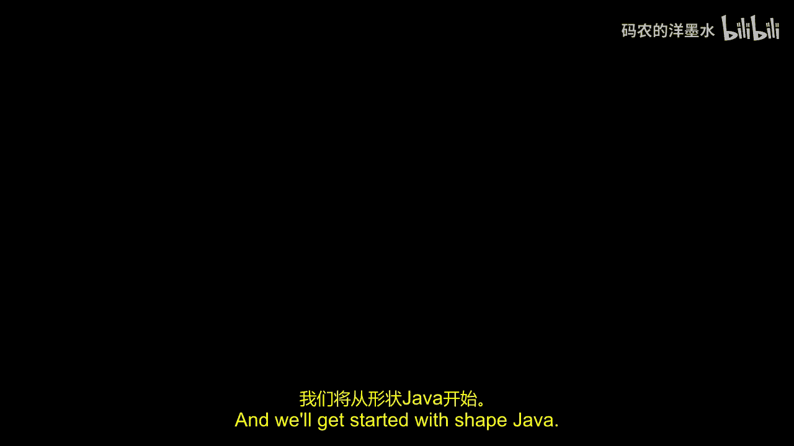
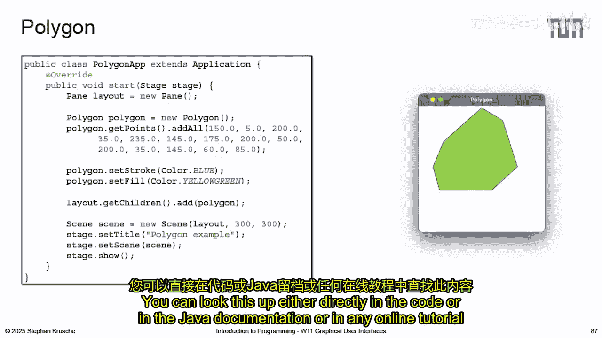

# 052：图形形状 🎨



在本节课中，我们将要学习如何使用 Java FX 提供的各种图形形状类，例如线条、矩形、圆形等。我们将了解如何创建这些形状、设置它们的属性，并将它们添加到布局中进行显示。

---

## 形状类概述

Java FX 提供了许多不同的形状类，用于绘制文本、线条、圆形、矩形等。形状是 `Node` 类的子类，因此可以添加到布局中。它是一个抽象类，拥有多个具体的子类，如 `Text`、`Line`、`Rectangle`、`Circle` 等。

以下是创建线条的一个简单示例：

```java
Line line = new Line(startX, startY, endX, endY);
```

我们还可以将线条的端点属性绑定到布局的尺寸上。这样，当应用程序窗口大小改变时，线条会自动调整。

---

## 绘制线条

上一节我们介绍了形状类的基本概念，本节中我们来看看如何具体绘制一条线条。

创建线条需要四个参数：起点的 x 坐标、起点的 y 坐标、终点的 x 坐标和终点的 y 坐标。我们可以设置线条的描边宽度和颜色。

以下是设置线条属性的示例：

```java
line1.setStrokeWidth(3); // 设置线条宽度为3
line1.setStroke(Color.BLUE); // 设置线条颜色为蓝色
```

我们可以将多条线条添加到一个布局（例如 `Pane`）中。一个关键技巧是将线条的端点坐标绑定到布局的宽度或高度属性上，从而实现响应式变化。

```java
// 将 line1 的终点X坐标绑定到布局的宽度
line1.endXProperty().bind(pane.widthProperty());
```

---

## 绘制矩形

了解了线条的绘制后，我们来看看如何绘制矩形。矩形的创建同样直观。

创建矩形需要四个参数：起始点的 x 坐标、起始点的 y 坐标、矩形的宽度和高度。

以下是创建并设置矩形的示例：

```java
Rectangle rect = new Rectangle(x, y, width, height);
rect.setFill(Color.WHITE); // 设置填充颜色
rect.setStroke(Color.BLACK); // 设置描边颜色
```

我们可以将多个矩形添加到布局中，并利用循环和随机颜色来创建动态效果。

```java
for (int i = 0; i < 4; i++) {
    Rectangle r = new Rectangle(...);
    r.setFill(Color.rgb(random.nextInt(256), random.nextInt(256), random.nextInt(256)));
    pane.getChildren().add(r);
}
```

此外，我们还可以调整矩形的其他属性，如旋转角度。

---

## 绘制圆形和椭圆

接下来，我们学习如何绘制圆形和椭圆。圆形是椭圆的特例。

创建圆形需要三个参数：圆心的 x 坐标、圆心的 y 坐标和半径。

```java
Circle circle = new Circle(centerX, centerY, radius);
circle.setStroke(Color.BLACK); // 设置描边颜色
circle.setFill(Color.YELLOW); // 设置填充颜色
```

而椭圆则需要两个半径参数：`radiusX` 和 `radiusY`。当这两个值相等时，椭圆就变成了圆形。

```java
Ellipse ellipse = new Ellipse(centerX, centerY, radiusX, radiusY);
```

---

## 绘制多边形

最后，我们来看看如何绘制由多个点连接而成的多边形。

多边形由一系列的点定义。我们需要依次添加每个点的 x 和 y 坐标。系统会自动将最后一个点与第一个点连接起来，形成封闭图形。

以下是创建一个多边形的示例：

```java
Polygon polygon = new Polygon();
polygon.getPoints().addAll(x1, y1, x2, y2, x3, y3, ...);
polygon.setStroke(Color.BLUE);
polygon.setFill(Color.GREEN);
```

---

## 如何查阅 API 文档

在使用 Java FX 或其他框架时，查阅官方文档是了解类属性和方法的有效途径。

有以下几种方法：
1.  **在 IDE 中查看**：在 IntelliJ IDEA 等集成开发环境中，将光标放在类名上，使用 `Ctrl`（Windows）或 `Cmd`（Mac）键点击，即可跳转到类定义。在左侧的项目结构窗口中可以查看类的方法列表。
2.  **查阅在线 Java 文档**：在浏览器中搜索 “Java FX [类名] documentation”，即可找到官方文档，其中详细说明了每个类的属性、方法和用法。

---



本节课中我们一起学习了 Java FX 中各种图形形状的绘制方法，包括线条、矩形、圆形、椭圆和多边形。我们掌握了创建形状、设置其样式属性（如颜色、宽度）以及将其添加到布局中的基本技能。同时，我们也了解了如何通过查阅代码或官方文档来探索框架的更多功能。这些是构建图形化用户界面的重要基础。