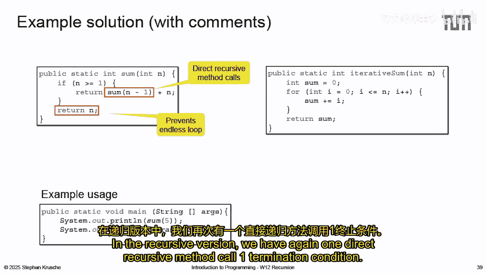

# 055：汉诺塔示例 🗼

在本节课中，我们将学习一个经典的递归问题示例——汉诺塔。我们将通过这个例子，深入理解递归思想如何将复杂问题分解为更小的、可重复解决的子问题。

## 汉诺塔问题介绍

汉诺塔是一个由法国数学家爱德华·卢卡斯提出的数学问题。它最初被描述为一个简单的游戏，背景设定在印度瓦拉纳西的寺庙中，但更广为人知的名字是“汉诺塔”。

在原始故事中，有三根柱子。其中一根柱子上有64个金盘，每个上方的盘子都比下方的盘子小，因此形成了一个由64个金盘组成的金字塔。出于显而易见的原因，我们在这个例子中不会使用64个盘子，而是用4个盘子来演示，但规则是相同的。

汉诺塔的规则是：你需要将这个金字塔堆从最左边的柱子移动到最右边的柱子。但在每次移动中，你只能移动一个盘子，并且不允许将较大的盘子放在较小的盘子之上。

## 游戏规则演示

让我们尝试一下。初始情况下，四个盘子在柱子1上。对于最顶部的元素（最小的盘子），它是唯一可以移动的，因为下方的元素被挡住了。我们有两个选择：可以移动到柱子2或柱子3。稍后你会明白为什么我选择移动到柱子2。

接下来，柱子1上现在最顶部的元素（次小的盘子）不能放到柱子2上，因为它比柱子2上当前的元素大。所以唯一的选择是将其移动到柱子3。

现在，我们不能从柱子1移动任何盘子，因为柱子2和柱子3上都有更小的盘子。我们只有两种可能的移动：要么将柱子3上的元素移回柱子1（这将是徒劳的，因为我们没有接近目标），要么将柱子2上的元素移动到柱子3。

到目前为止很简单。下一步，我们将柱子1上现在最顶部的元素移动到柱子2。然后将柱子3上最顶部的元素移动到柱子1。接着将柱子3上现在最顶部的元素移动到柱子2。最后将柱子1上的元素移动到柱子2。

现在想象一下，如果我们现在在柱子2上的盘子堆在柱子3上，那么问题就解决了。如果我们只考虑 **n-1** 个盘子，那么我们现在就有了一个中间目标。我们实际上已经解决了一个更简单情况的问题。

接下来我们需要做的是：将柱子1上最底部的元素移动到柱子3，然后再将其余元素排序移回。我将更快地浏览这个过程。有任何问题吗？看起来相当简单。

## 如何用代码实现？

这是递归威力第一次非常明显体现的时候。

对于有0个元素的情况，问题很简单，我们什么都不用做。即使只有一个元素，问题也很简单：将其从柱子1移动到柱子3即可。当堆栈变大时，问题才变得棘手。

但请记住我们之前所说的：如果我们有一个大问题，并且我们有一种方法可以在问题稍微简单时解决它（比如我们有一个基本情况），那么我们就可以使用递归。我们可以解决中间的每一步。

解决思路是：对于一个高度为 **H** 的塔，我们首先将 **H-1** 个元素移动到柱子2（暂时不要问我们如何移动，稍后再考虑）。然后，我们移动最底部的元素。最后，我们将所有从柱子2临时存放的元素移回到柱子3上。

第一步和第三步正是我们使用递归的地方。因为你看到，我们解决了 **H** 高度的问题，前提是我们有 **H-1** 高度的解决方案。而 **H-1** 高度的解决方案又依赖于 **H-2** 高度的解决方案，如此反复，直到最终到达只需要移动一个元素的简单情况。这基本上就是第二种情况：将最底部的切片移动到目标位置。这就是我们如何解决这个相当复杂的问题。

## 代码实现

以下是代码的实现方式。

如果塔的高度大于0，我们采取以下方法。首先，我们需要找到一个可以放置元素的空闲位置。为此，我们有一个 `free` 函数，我稍后会解释。假设我们有这个函数，我们知道将元素移动到哪里。我们将除了最底部之外的所有元素从第一根柱子移动到空闲位置。这基本上是这里的第二行代码：`move(height - 1, from, freeSpot)`。

然后我们执行一次移动，将最底部的元素从A移动到B（即目标位置）。接着，我们将临时停放在中间柱子上的其他元素移动到我们刚刚移动的那个元素之上。这些都是递归调用。因此，我们可以说，让问题变小一点。最终，因为我们在每次递归调用中总是递减高度，我们最终会到达高度为0的点，那时我们什么都不做。

这里很重要，A和B必须彼此不同。如果我们说将柱子从它所在的位置移动到它所在的位置，那就太简单了。A是源柱子，B是目标柱子。

这里我们再次有直接的递归方法调用。我们现在必须解决的问题是，因为你看，最下面的三行代码我们已经解决了（`System.out.println` 等，这些都很简单，你们在第一讲就学过了）。递归，当然，你们现在刚刚学到。但你可以直接使用它们，因为你面前已经有这个方法了。所以只剩下一个方法需要解决，那就是 `free` 方法。

## 寻找空闲位置

例如，如果我们需要将元素从柱子1移动到柱子2，我们的空闲位置是柱子3。如果从柱子1移动到柱子3，空闲位置是柱子2。

这个矩阵基本上向我们展示了这一点，因为我们不允许将元素从它所在的柱子移动到它所在的柱子。对角线没有被填充，但其余部分是有意义的。

我们如何解决这个问题呢？我们有一个中间步骤。我们可以看到，结果似乎取决于两个元素的乘积。这是一个中间步骤。例如，如果我们计算1+2，得到3；1+3，得到4。这是我们以下方式解决 `free` 问题的中间步骤。

想象一下，如果我们为此使用一个 `switch` 语句，基本上有一种方法来解决 a+b 的问题：如果是3，我们返回3；如果是4，我们返回2；如果是5，我们返回1。记住，我们这里基本上有一个中间步骤。我们可以这样做，但有点不实用。我们这里有一个 `switch` 语句，但在数学上有一个更简单的方法来解决这个问题，那就是 **6 - (a + b)**。

想象一下，如果 a+b 是3，6-3=3；6-4=2；6-5=1。是的，6减去默认值不行，所以对于默认情况，较低的那个有点难以处理。但我们在这里假设没有默认情况，即不允许从同一根柱子移动，所以我们基本上可以忽略这里的默认情况。

## 完整代码与思考

现在这就是代码，展示了这个移动应该如何工作。顶部是我们之前看过的移动操作，下面我们有 `free` 方法。在最底部，我们有 `main` 方法，它一开始读取塔的高度，然后开始第一次递归调用。这就是所谓的初始调用。因此，这个初始调用使用我们刚刚输入的高度，并且我们想将其从柱子1移动到3。然后递归方法一次又一次地调用自己，每次调用时，你都有另一个 `System.out.println` 命令。因此，我们一步一步地得到了所有可以进行的移动的概述。

在我们继续之前，做一个小思考实验：我们刚刚用4个盘子做了演示，你已经看到我们需要相当多的移动步数。现在，想象一下原始想法中的64个盘子，我们大约有 **2^64 - 1** 次移动，大约是1800亿亿次。

如果想象每次移动只花费十分之一秒，那么我们需要580亿年才能解决这个问题，而宇宙的年龄只有大约140亿年。或者想象一下，如果我们必须用一个字节来记录每次移动（我们大致可以做到），那么所有移动的完整文档将需要大约1800亿亿字节。这是18000拍字节。这只是为了让你了解64个盘子的问题有多么巨大。所以如果有人手工移动，在世界末日之前他们也完成不了。因此，这是一个实际上无法解决的问题，只是理论上作为一个思想实验，它可以工作。

## 课堂练习

在Artemis上，你的任务现在是创建一个递归函数，该函数可以确定从0到值n的整数之和，值n应该是一个输入参数。你应该思考什么是基本情况，然后一步一步地求和，直到得到最终结果。为此，请使用递归调用。

在第一版中，使用递归。在第二版中，尝试使用你已经学过的迭代方法来实现相同的功能，例如使用 `for` 循环。

## 练习解答

求和其实很简单。如果你的输入小于1（因为我们只有整数，在这种情况下只能是0），那么你返回0。0是求和中的中性基元，因为它不改变任何值。

对于大于或等于1的任何数，你知道数字本身将是解的一部分。然后在下一步，你只是减小问题规模，即 **n-1**，并再次将其放入 `sum` 函数方法中，并添加到目前已有的结果中。因此，最终，例如，如果你从8开始，你将得到 8 + 7 + 6 + 5 + 4 + 3 + 2 + 1 + 0。

对于小的附加任务，我们假设我们想迭代地做。所以我们有一个局部变量来累加元素。然后我们只需要一个 `for` 循环，从 `i` 到 `n`。我们将每个元素添加到这个局部变量上，最后返回解。

在 `main` 方法中，有两种使用方式：一种是通过递归版本的 `sum`，另一种是通过迭代版本。它们应该给你相同的结果。在递归版本中，我们再次有一个直接的递归方法调用和一个终止条件。

---

本节课中，我们一起学习了汉诺塔这个经典的递归问题。我们了解了它的规则，演示了解决过程，并深入探讨了如何用递归思想将其分解为更小的子问题。通过代码实现，我们看到了递归如何优雅地处理这种自相似的问题。最后，我们还通过一个求和的练习巩固了对递归和迭代两种编程范式的理解。递归的核心在于定义清晰的基本情况和能够不断向基本情况推进的递归步骤。