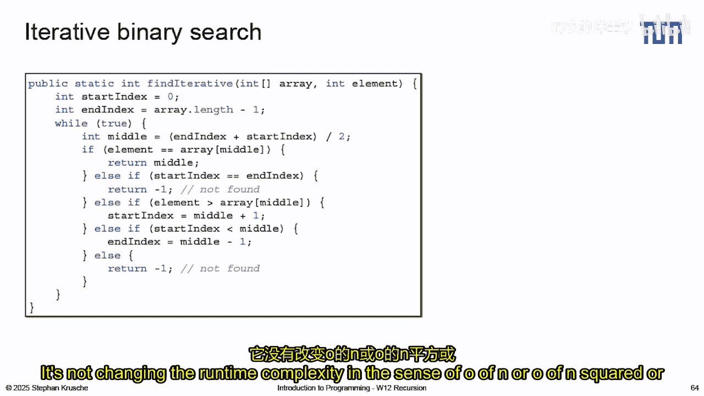

# 056：二分查找示例 🎯


在本节课中，我们将要学习一个重要的递归算法示例：二分查找。我们将了解它的工作原理、如何用递归和迭代两种方式实现它，并理解其相对于简单线性查找的效率优势。

## 概述

上一节我们介绍了递归的基本概念。本节中我们来看看一个更具体、更高效的递归应用：二分查找。这是一种在**已排序**的数组中快速查找特定元素位置的算法。

## 线性查找：基础方法

首先，我们考虑查找问题最直观的解法。假设我们有一个数字列表（数组），我们想知道数字7是否在列表中，如果在，它的位置（索引）是多少。

以下是我们的初始方法（通常称为线性查找）：
1.  从数组开头遍历到结尾。
2.  将每个元素与目标数字（例如7）进行比较。
3.  如果找到匹配项，则返回当前索引。
4.  如果遍历完整个数组仍未找到，则返回-1。

用代码描述如下：
```java
int linearSearch(int[] array, int target) {
    for (int i = 0; i < array.length; i++) {
        if (array[i] == target) {
            return i; // 找到目标，返回索引
        }
    }
    return -1; // 未找到目标
}
```

在一个包含7个元素的示例数组 `[17, 3, 21, 42, 5, 9, 7]` 中查找数字7，我们需要进行7次比较（最坏情况）。对于包含数百万个元素的庞大列表，这可能需要数百万次比较，平均而言也需要一半的比较次数。这种方法效率不高。

## 二分查找：更高效的方法

因此，我们需要一种更好的方法，这就是二分查找。它的工作原理基于一个前提：**数组必须是已排序的**。

以下是二分查找的核心步骤：
1.  查看数组中间的元素。
2.  如果目标值等于中间元素，则查找成功。
3.  如果目标值**小于**中间元素，则只需在数组的**左半部分**继续查找（可以完全忽略右半部分）。
4.  如果目标值**大于**中间元素，则只需在数组的**右半部分**继续查找（可以完全忽略左半部分）。
5.  在选定的半部分重复此过程，直到找到目标或搜索范围为空。

之所以称为“二分”查找，是因为每一步都将搜索范围**减半**，我们总是在“向左”或“向右”两个选项中选择。

让我们用同一个数组（但先排序）`[3, 5, 7, 9, 17, 21, 42]` 来演示查找数字7：
1.  中间元素是9（索引3）。7 < 9，因此我们丢弃右半部分，只在左半部分 `[3, 5, 7]` 中查找。
2.  新范围的中间元素是5（索引1）。7 > 5，因此我们丢弃左半部分，只在右半部分 `[7]` 中查找。
3.  剩余数组长度为1，中间元素就是7。匹配成功，返回其索引（在原排序数组中是索引2）。

我们只用了**3次**比较就找到了目标，而不是线性查找的7次。对于长度为 `2^n` 的数组，最多只需要 `n` 次比较。这使得二分查找的时间复杂度为 **O(log n)**，远优于线性查找的 **O(n)**。

## 递归实现

了解了递归的工作原理后，用代码实现二分查找就相对简单了。

首先，我们定义一个主要方法 `find`，它接收数组、目标元素以及当前搜索范围的起始和结束索引。
```java
// 内部递归方法
private static int find(int[] a, int element, int startIndex, int endIndex) {
    // 计算当前搜索范围的中间索引
    int middle = (startIndex + endIndex) / 2;

    // 情况1：在中间直接找到目标
    if (a[middle] == element) {
        return middle;
    }

    // 情况2：搜索范围已缩小到单个元素且不是目标
    if (startIndex == endIndex) {
        return -1; // 未找到
    }

    // 情况3：根据比较结果，在左半部分或右半部分递归查找
    if (element > a[middle]) {
        // 目标更大，在右半部分查找（中间索引+1 到 结束索引）
        return find(a, element, middle + 1, endIndex);
    } else {
        // 目标更小，在左半部分查找（起始索引 到 中间索引-1）
        return find(a, element, startIndex, middle - 1);
    }
}
```

为了方便调用，我们创建一个重载方法，只需传入数组和目标值，它自动从整个数组范围开始查找。
```java
// 公开的简化接口
public static int find(int[] a, int element) {
    return find(a, element, 0, a.length - 1); // 初始调用，搜索整个数组
}
```

### 调用栈与递归终止

在上面的递归实现中，`find` 方法内部调用了自身。这形成了一种称为**调用栈**的结构。每次递归调用都会将新的参数（新的搜索范围）压入栈中。当找到目标或搜索范围为空（`startIndex == endIndex`）时，递归开始“返回”，结果沿着调用栈向上传递，直到最初的调用者。

**确保递归终止至关重要**。在我们的算法中，终止条件有两个：
1.  找到目标元素（`a[middle] == element`）。
2.  搜索范围缩小到单个元素且不是目标（`startIndex == endIndex`）。

每次递归调用都会将搜索范围减半，因此最终必然会达到长度为1的情况，从而保证算法总会终止。设计递归算法时，必须仔细验证这种终止性，否则程序可能陷入无限循环并最终崩溃。

## 迭代实现

二分查找也可以不使用递归，而以迭代（循环）的方式实现。两种方式逻辑相同，只是控制流程不同。

以下是迭代版本的二分查找：
```java
public static int iterativeBinarySearch(int[] a, int element) {
    int startIndex = 0;
    int endIndex = a.length - 1;

    while (startIndex <= endIndex) {
        int middle = (startIndex + endIndex) / 2;

        if (a[middle] == element) {
            return middle; // 找到目标
        }

        if (element > a[middle]) {
            startIndex = middle + 1; // 在右半部分继续查找
        } else {
            endIndex = middle - 1; // 在左半部分继续查找
        }
    }
    return -1; // 未找到目标
}
```

迭代版本使用 `while` 循环和两个变量 `startIndex`、`endIndex` 来跟踪当前搜索范围，而不是通过递归调用传递参数。它的效率与递归版本相同，且避免了递归可能带来的调用栈开销。

### 关于一个优化检查的说明

在迭代版本的循环条件中，我们使用了 `while (startIndex <= endIndex)`。你可能会想，是否可以省略 `startIndex <= endIndex` 中的 `<=`，只用 `<`？

答案是：**技术上可以省略，但这是一个有益的优化**。
*   如果只用 `<`，当 `startIndex` 和 `endIndex` 相等时，循环不会进入。我们需要在循环外额外检查这个单个元素是否为目标。代码会稍复杂。
*   使用 `<=` 允许循环处理长度为1的范围，逻辑更统一。但理论上，当 `startIndex` 等于 `endIndex` 时，如果元素不匹配，下一次更新（`startIndex = middle + 1` 或 `endIndex = middle - 1`）会使 `startIndex > endIndex`，从而自然退出循环。所以，`<=` 检查可以被视为一种清晰表达意图的写法，而非绝对必要。它不影响算法的时间复杂度（大O表示法）。

## 总结

本节课中我们一起学习了二分查找算法。
*   我们首先回顾了简单的线性查找（O(n)），并指出了其在大型数据集上效率低下的问题。
*   接着，我们引入了二分查找（O(log n)），其核心思想是**在已排序数组上，通过不断将搜索范围减半来快速定位元素**。
*   我们详细分析了二分查找的递归实现，包括方法定义、递归调用过程以及至关重要的**递归终止条件**。
*   然后，我们探讨了功能相同的迭代实现，它使用循环代替递归调用。
*   最后，我们讨论了一个关于循环条件的细微优化点。




二分查找是一个基础且极其重要的算法，深刻理解其原理和实现对于学习计算机科学和编程至关重要。