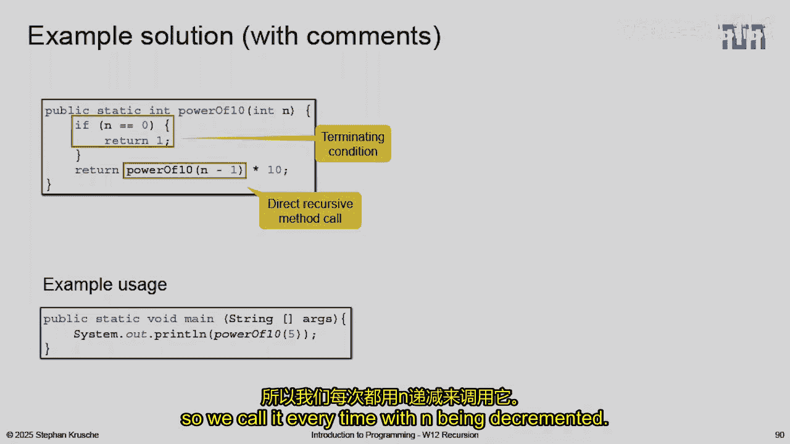

# 057：科赫雪花示例


在本节课中，我们将要学习一个递归的经典示例：科赫雪花。这是一个视觉效果显著但涉及一定数学知识的例子。我们将从基本概念开始，逐步理解其数学原理，并最终学习如何在Java中实现它。

## 递归与科赫雪花

科赫雪花是一种分形曲线。你可能在网上见过各种分形的精美图片，科赫雪花就是其中之一。

它的构造过程如下：我们从一个简单的直线段开始。在科赫曲线的每一个递归步骤中，我们将每条直线段的中间三分之一部分移除，并在该位置添加一个等边三角形。

例如，我们首先在一条线段中间添加一个三角形。然后，在新产生的每一条线段上，我们重复这个过程：移除中间三分之一，并添加一个更小的等边三角形。如此反复，就会形成类似雪花的形状。

通常，我们会从一个等边三角形开始，在其三条边上应用上述过程，从而生成完整的科赫雪花。

## 单条线段的数学分析

首先，我们分析如何对一条水平线段进行操作。假设线段长度为 `x`。

我们将线段平分为三段，每段长度为 `x/3`。然后，我们在中间段的位置构建一个等边三角形，使得三角形的两条边长度也为 `x/3`。

现在，关键问题是：这个等边三角形的高度 `h` 是多少？

这里我们需要用到勾股定理：`a² + b² = c²`。

在三角形中，斜边 `c` 的长度是 `x/3`。底边的一半 `a` 的长度是 `x/6`。我们需要求解高度 `b`，即 `h`。

通过公式变换，我们可以计算出：
`h = x * √3 / 6`

这个高度值 `h` 对于我们后续计算点的坐标至关重要。

## 处理任意线段：平移与旋转

上一节我们分析了水平线段的简单情况。但在实际递归过程中，我们需要处理的线段可能是倾斜的，并且起点也不在原点 `(0,0)`。

因此，我们无法直接应用上述简单的数学公式。

解决方案是使用**平移**和**旋转**。

1.  **平移**：首先，我们将线段平移，使其起点移动到原点 `(0,0)`。
2.  **旋转**：然后，我们将线段旋转一个角度 `φ`，使其与X轴水平对齐。
3.  **应用算法**：此时，线段满足了“水平且起点在原点”的条件，我们可以应用之前推导的简单算法来计算新点的坐标。
4.  **逆变换**：最后，我们将计算得到的新点进行反向旋转和平移，使它们回到原始线段所在的位置。

## 旋转的数学基础：三角函数

要进行旋转，我们需要一些基本的三角函数知识。

*   `sin(α) = 对边 / 斜边`
*   `cos(α) = 邻边 / 斜边`
*   `tan(α) = 对边 / 邻边`

我们还需要反三角函数 `arctan`（或 `atan`），它可以根据正切值计算出对应的角度 `α`。

假设我们有一个点，其极坐标表示为长度 `H` 和角度 `α`。那么它的直角坐标 `(x, y)` 为：
`x = H * cos(α)`
`y = H * sin(α)`

如果我们想将这个点旋转角度 `φ`，那么新坐标 `(x‘, y’)` 为：
`x‘ = H * cos(α + φ)`
`y’ = H * sin(α + φ)`

利用三角函数的和角公式：
`sin(α + φ) = sin(α)cos(φ) + cos(α)sin(φ)`
`cos(α + φ) = cos(α)cos(φ) - sin(α)sin(φ)`

并且我们知道 `sin(α) = y / H` 和 `cos(α) = x / H`。代入上式后，`H` 被消去，我们得到了一个只依赖于原始坐标 `(x, y)` 和旋转角度 `φ` 的旋转公式：
`x‘ = x * cos(φ) - y * sin(φ)`
`y’ = x * sin(φ) + y * cos(φ)`

## Java实现：Point类

在代码中，我们首先需要一个 `Point` 类来表示二维空间中的点。

```java
public class Point {
    private double x;
    private double y;

    // 构造函数、getter和setter...

    // 平移方法
    public void translate(double dx, double dy) {
        this.x += dx;
        this.y += dy;
    }

    // 旋转方法 (使用上述推导的公式)
    public void rotate(double phi) {
        double newX = this.x * Math.cos(phi) - this.y * Math.sin(phi);
        double newY = this.x * Math.sin(phi) + this.y * Math.cos(phi);
        this.x = newX;
        this.y = newY;
    }
}
```

## Java实现：Flake类与递归算法

`Flake` 类管理构成雪花的所有点。核心是一个递归方法，用于生成科赫曲线。

以下是算法步骤的概述：

1.  **终止条件**：如果递归深度 `depth` 为0，则直接连接起点和终点。
2.  **平移与旋转**：
    *   计算将起点平移到原点所需的偏移量。
    *   平移起点和终点。
    *   计算线段当前与X轴的夹角 `φ`。
    *   将终点旋转 `-φ` 角度，使线段水平。
3.  **应用科赫规则**：在水平线段上，计算生成等边三角形所需的四个新点（加上原有的起点和终点，共产生四条新线段）。
    *   点1：位于 `(x/3, 0)`
    *   点2：位于 `(x/2, h)`，其中 `h = x * √3 / 6`
    *   点3：位于 `(2x/3, 0)`
4.  **逆变换**：将计算出的新点反向旋转 `φ` 角度，再平移回原始位置。
5.  **递归调用**：对新生成的四条线段，分别以 `depth-1` 为参数递归调用本方法。

## 迭代算法作为替代

除了递归，我们也可以使用迭代方法来实现科赫雪花。

基本思路是：
1.  初始化一个点列表，包含初始线段的起点和终点。
2.  当未达到目标深度时，循环处理当前列表中的每一对相邻点（作为线段）。
3.  对每一对点，执行与递归方法中相同的平移、旋转、生成新点、逆变换的操作。
4.  将生成的新点序列替换原来的线段，加入到新的点列表中。
5.  用新列表替换旧列表，进入下一层循环。

## 示例程序与运行结果

我们可以创建一个JavaFX应用程序来可视化科赫雪花。

```java
public class KochSnowflakeApp extends Application {
    @Override
    public void start(Stage primaryStage) {
        Point start = new Point(100, 200);
        Point end = new Point(400, 200);

        // 使用递归方法生成深度为5的雪花
        Flake recursiveFlake = new Flake(start, end);
        recursiveFlake.createSnowflake(5, true); // true 表示递归

        // 使用迭代方法生成深度为4的雪花
        Flake iterativeFlake = new Flake(new Point(100, 400), new Point(400, 400));
        iterativeFlake.createSnowflake(4, false); // false 表示迭代

        // 将flake中的点绘制到Pane上...
        // 创建Scene和Stage...
    }
}
```

运行程序，你可以看到不同递归深度下的科赫雪花图案。代码的完整项目可以通过课程幻灯片提供的链接下载，建议你通过调试逐步理解其运行过程。

## 练习：计算10的N次幂

现在，让我们来看一个更简单的递归问题作为练习。

**任务**：使用递归计算10的N次幂。
*   10⁰ 应该返回 1。
*   10¹ 应该返回 10。
*   10⁵ 应该返回 100000。

**解决方案思路**：
*   **基准情况（终止条件）**：如果 `n == 0`，返回 `1`。
*   **递归步骤**：否则，返回 `10 * powerOf10(n - 1)`。

```java
public static int powerOf10(int n) {
    if (n == 0) { // 基准情况
        return 1;
    } else { // 递归情况
        return 10 * powerOf10(n - 1);
    }
}
```

这是一个典型的线性递归，每次调用将问题规模 `n` 减小1，直到达到基准情况。

## 总结

本节课中我们一起学习了科赫雪花的递归生成。
1.  我们首先了解了科赫雪花作为分形的基本概念和构造过程。
2.  然后，我们深入分析了其背后的数学原理，包括对单一线段的几何计算，以及通过**平移和旋转**处理任意线段的方法。
3.  接着，我们探讨了如何在Java中实现它，定义了 `Point` 类，并详细讲解了递归算法的每一步。
4.  我们还提到了使用迭代作为递归的替代方案。
5.  最后，我们通过一个计算10的N次幂的简单练习来巩固对递归思想的理解。

理解科赫雪花的实现，有助于深化对递归、坐标系变换以及数学与编程结合的认识。



