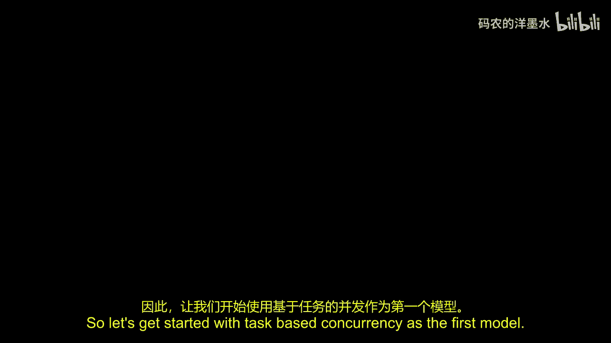
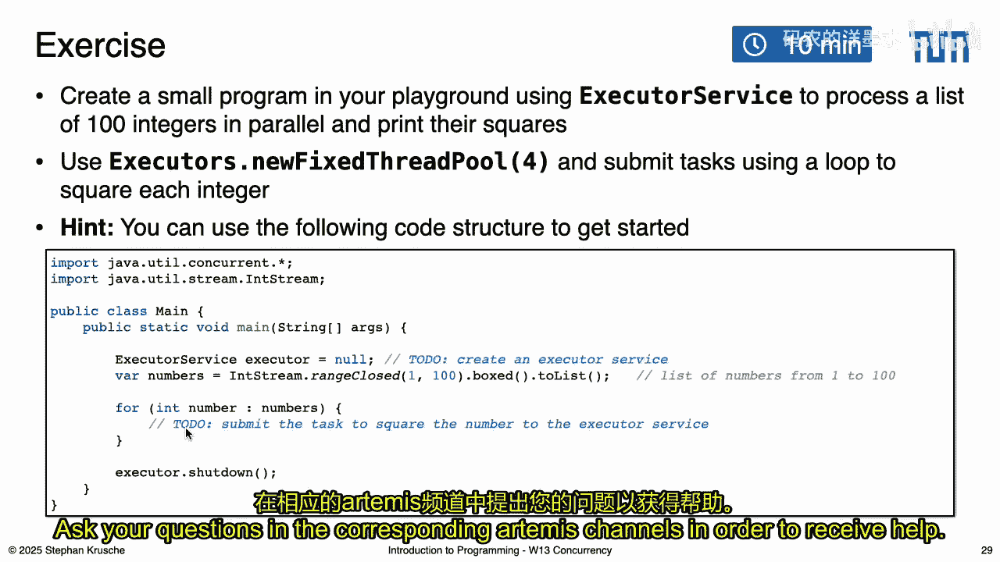
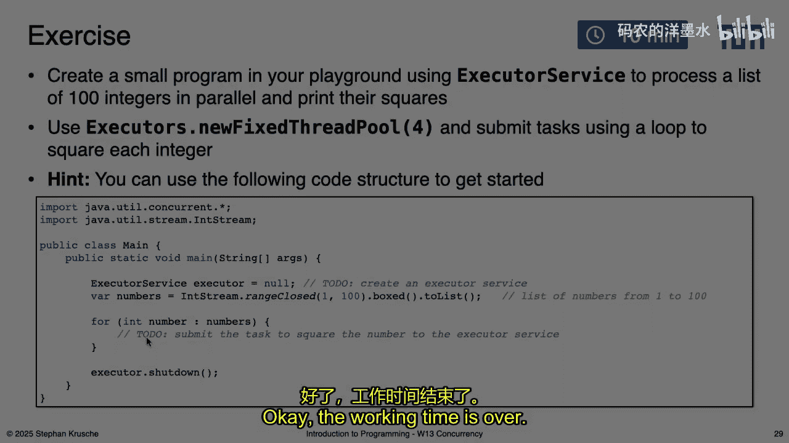

# 059：现代并发



在本节课中，我们将要学习现代并发编程中的任务并发模型。我们将探讨并行与并发的区别，并深入了解如何使用线程池和任务队列来高效地管理并发任务。

## 并行与并发的区别

上一节我们介绍了并发编程的基本概念，本节中我们来看看并行与并发的具体区别。

并行与并发是不同的概念。

**并行**意味着任务在不同的CPU核心上同时运行。
**并发**意味着你同时管理多个任务，但这些任务可能并行执行，也可能不并行执行。

在下图中，你可以看到四种不同的示例：
1.  非并发且非并行：你有一个CPU核心，两个任务只是依次执行。
2.  并发但非并行：任务看起来是同时运行的，但我们只有一个CPU核心。
3.  并行但不并发：任务被完全拆分并在不同的CPU核心上运行。
4.  并行且并发：你可以看到时间切片，多个任务被分配到同一个CPU核心上。

## 任务并发与线程池

当我们讨论基于任务的并发时，也必须讨论所谓的线程池和任务队列。

下图试图在高层面上向你展示其工作原理。其核心思想是，你有很多潜在的可运行任务需要完成。这些任务可以是简单的任务，例如对一个数字进行平方运算（这属于数学计算），也可以是繁重的、长时间运行的任务，例如视频编辑、计算非常复杂的公式或向ChatGPT发送请求并等待答案。任何计算机程序中可能存在的任务，你都可以将它们放入一个队列中。

这个队列由一个线程池管理。线程池本质上就是一个线程列表，例如，这里我们有六个不同的线程，这可能是因为我们的操作系统或计算机有六个核心，这是一个很好的匹配。

然后，我们有很多任务进来，线程池会自动以最佳方式将它们分配到所有可用的线程上。因此，你无需自己创建线程或管理它们的状态，只需将任务放入队列，然后让系统将它们分配到你所拥有的所有线程中。

如果一个线程完成了工作并空闲下来，所谓的执行器服务就可以从队列中获取下一个任务，将其分配给一个线程，运行它，并在最后给你结果。这基本上就是其思想：你有一个放入任务的任务队列，最后得到已完成的任务。

## 任务的定义与设计

基于任务的并发意味着我们有一个代表工作单元的任务。现在，作为程序员，你需要做好工作。如果你有长时间运行的任务，你需要思考如何将它们分解成更小的任务，这再次体现了“分而治之”的思想。就像编写计算机程序是将所有编程任务分解成更小的任务一样，如果你有一个视频编辑软件，它只有一个任务，你就无法将其拆分到多个核心上运行。你必须思考，这甚至可能改变背后的算法：如何将渲染视频、下载图像、播放音乐等工作拆分成更小的任务，以便它们可以并行执行，并发工作。

事实上，这些任务在内存方面最好也是分离的，因为如果它们操作相同的数据结构，可能会在并行性方面受到限制。然而，如果你处理任务并将任务提交给执行器执行，那么你就不需要手动管理线程，执行器服务会自动为你完成。

## 执行器服务的工作原理

其思想是，我们在一个所谓的线程池执行器中有一个可重用线程的池。此外，我们还有一个任务队列。然后，当我们的应用程序添加任务时（例如，以我们之前代码示例中看到的Runnable形式），线程池执行器会自动将它们分配到不同的线程上。然后，Runnable将返回计算的结果。

根据你的工作负载和任务，你可以选择多种不同的池大小，甚至不同类型的执行器服务。你可以有一个固定大小的线程池，一个缓存线程池，甚至可以有动态线程池，其中线程数量可以根据系统负载增加或减少，因此这个接口对你来说非常灵活。

## 代码实现示例

让我们看看这在代码中是如何工作的。这是一个很长的介绍，你需要导入两个类：`ExecutorService`和`Executors`类。

然后你只需写：
```java
ExecutorService executor = Executors.newFixedThreadPool(2);
```
在这个简单示例中，我们决定使用两个线程，但你也可以使用8、16或操作系统限制内的任何数字。

然后我们可以简化两个Runnable。使用与之前相同的符号，我们有task1的Lambda表达式，这里我们只做非常简单的事情：我们只是向控制台打印一些内容。当然，在Lambda表达式箭头右侧，也可以是一个非常繁重的任务，或者你可以调用程序中其他部分的方法。所以，请将此视为一个非常简单的示例，你可以在此基础上进行扩展。

我们创建了两个任务，如你所见，我们提交了它们。执行器服务有一个`submit`方法，它接受一个Runnable实例。这基本上是在告诉执行器服务：“嘿，我们有一些工作，请把它放入队列，当有线程准备好时，就让它处理这个Runnable，然后传回结果。”

在某种意义上，执行器服务就像你的Java应用程序内部的一个小型调度器。当你完成后，你可以关闭执行器，然后执行器将等待所有任务完成，然后自行清理。之后，你可能会继续进行其他工作。这也是为了最终再次同步工作，因为想象一下，如果你生成多个线程并在这些线程中工作，在某个时刻，你可能希望再次收集所有结果，例如将它们放入列表并打印到控制台，或者你想告诉用户：“嘿，使用八个线程的视频编辑现在完成了，这是最终视频，你现在可以观看了。”这就是其思想，也是为什么我们有一个`shutdown`方法来再次关闭执行器服务。

## 订单处理示例

这是另一个订单处理示例。我们再次创建一个执行器服务，这次使用三个线程。我们有一个从1到5的for循环，并提交了几个Runnable。在行内Runnable中，我们没有给它们变量，这里我们只是说“处理订单”并附带一些数字，同时打印当前线程名称。如果你将此代码复制粘贴到你的练习环境中，你会看到基于你选择的执行器服务，后台有某些线程名称，你还会看到它们随机出现，并且最终无法保证有特定的顺序。所以，可能的情况是，你得到我们这里定义的顺序：1、2、3、4、5；但也可能是1、3、5、2、4，这取决于一切是如何调度的。

## 使用Callable和Future获取结果

这是另一个示例，我们模拟获取数据，并模拟这个过程稍慢一些。这里我们没有真正的数据库实现，这就是为什么我们使用`Thread.sleep`方法，它实际上告诉线程等待2000毫秒或两秒，什么也不做。通过这个，我们可以模拟一个耗时的操作：从另一个系统获取数据涉及网络延迟、I/O（输入输出）等待或磁盘等待，这有时会发生或需要一点时间。

你现在看到的是，`executor.submit`实际上会给你一个返回值（如果你想使用它的话），即所谓的`Future`。什么是Future？Future是某种工作（在这种情况下来自Callable）的结果，但我们还不知道输出是什么。在分配它的时刻，我们有一个对象，但结果实际上还不可用。我们有一个变量，但其内部内容在某种程度上是空的。只有当并发操作（这里的Callable）完成后，我们才能最终得到它。如果我们想等待它，我们也可以等到得到它，这是使用`get`方法实现的。`get`方法将阻塞当前线程中的执行，直到结果可用。

与Runnable不同，Callable是一种替代方案，它提供了一种机制，其Lambda表达式的左侧同样是空的，但你现在有一个返回语句，并且有一个结果。因此，如果你使用Callable而不是Runnable，你可以产生一个结果，然后你可以用`get`等待，然后基本上可以将其输入到下一个任务中。但正如你所见，这还不是非常灵活，因为Callable有一个输入参数（抱歉，是一个输出参数，一个返回类型），我们也应该在这里指定类型。这里是一个字符串，但在现实中，如果你定义了完整的用户对象，它也可以是一个用户对象。

这两个区别在于，我们使用Callable而不是Runnable。Callable有一个结果，所以`executor.submit`有一个我们可以使用的返回值。当我们对这个返回值使用`get`时，我们会等待Callable完成工作。在这里，它将恰好花费两秒钟。如果你有一个正常的计算，你无法确切地说，有时它需要更长时间，有时更快。然后我们可以将其打印到控制台并再次关闭执行器服务。

## 定时任务示例

这是另一个通知服务示例。我们再次有一个调度线程池（之前我们有一个固定线程池，现在我们有一个调度线程池）。使用的接口略有不同，因为我们现在想做的是在特定的时间点调度某些事情。

我们创建一个发送通知器，这可能是你发送给用户的通知，这里再次使用一个非常简单的带有`System.out.println`的Runnable，但这当然也可以是其他东西。现在，我们要求调度器以固定速率调度某些事情，基于我们这里定义的Runnable。我们说等待0秒（这是初始等待时间），然后我们说，每5秒重复执行一次。这就是其思想：我们调度某件事，第一次立即执行，然后每5秒我们希望它被执行。然后我们还可以调度调度器在20秒后关闭，以停止执行，否则这将永远运行下去。

## 练习：并行计算平方数

我们将开始第一个练习。请打开你的练习环境，我请你现在创建一个小程序，使用执行器服务，我们希望你们处理一个包含100个整数的列表。你们应该打印它们的平方，并且我们希望你们并行地完成这个任务，利用你们笔记本电脑的所有核心。

我为你提供了一些示例代码，你可以复制粘贴。我们有一个带main方法的Main类，我们已经为执行器服务定义了一个变量，但还没有创建一个。所以这是你的第一个待办事项：创建一个执行器服务。

然后我给你展示一个小技巧，如何使用IntStream和`rangeClosed`方法获取从1到100的数字列表。这意味着给我1到100之间的所有整数值，这比说`new ArrayList`，1，2，3，4，5，6……要短得多。

然后我们准备了一个for循环，你遍历所有这些数字，你的任务是向执行器服务提交一个Runnable，并在其中打印结果，以便我们可以在控制台中看到所有计算。这不是一个Artemis练习，你必须在你的练习环境中完成，你可以自由选择如何做。你可以使用任何你喜欢的执行器服务，也可以进行调整。几分钟后我会给你展示一个示例解决方案，但这确实是一个你可以灵活发挥的地方，没有测试用例限制你的创造力。所以，玩得开心，几分钟后我会展示解决方案。助教会四处走动，如果你需要帮助，请举手。如果你在线观看我们，如果你观看录像，请在相应的Artemis频道中提问以获得帮助。





## 练习解决方案示例

工作时间结束。你们中谁已经有解决方案了？请举手。由于时间原因，我们必须继续，所以我将展示一个示例解决方案。

这是它可能的工作方式。我们修改了这里的语句：`Executors.newFixedThreadPool`，例如，使用数字4。然后在for循环中，我们提交一个Runnable，这是一个Lambda表达式，没有输入，一个箭头和一个花括号（如果不需要也可以省略）。这里我们说`System.out.println(number * number)`。这里的想法是，Lambda表达式从外部作用域（从for循环）获取数据。这非常重要，Java会自动为你管理。当然，理论上你也可以创建一个不同的数据结构并将其作为输入放入，然后作为输出取出，这也是可能的，但本练习并不要求这样做。


本节课中我们一起学习了现代并发编程的任务模型，理解了并行与并发的核心区别，并通过线程池、执行器服务、Runnable、Callable和Future等工具实现了任务的提交、调度和结果获取。我们还通过练习实践了如何将计算任务并行化以提升效率。