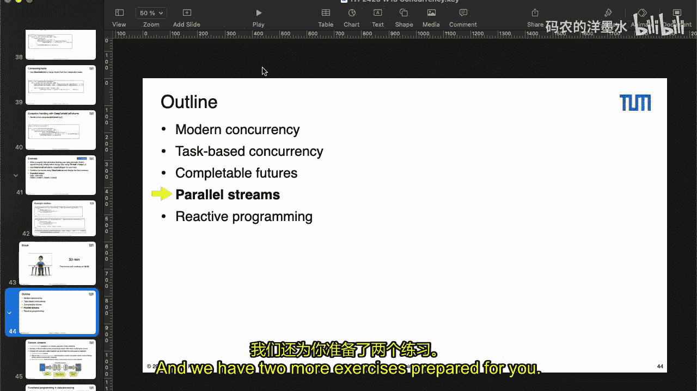

# 060：基于任务的并发


在本节课中，我们将要学习异步编程的核心概念，特别是 `Future` 和 `CompletableFuture`。我们将探讨它们如何帮助程序在等待耗时任务结果的同时，继续处理其他工作，从而提升程序的效率和响应速度。

## 为什么需要异步编程？🤔

在同步程序中，每个请求都必须等待其响应完全返回后才能继续执行。在此期间，程序会被阻塞，无法处理其他任务。

异步编程则采用事件驱动模型。多个请求可以同时进入系统。在请求与响应之间的等待时间（如上图中蓝色阴影部分所示），系统仍然可以处理其他请求。你无需等待第一个请求完全结束，就可以开始处理第二个请求。

因此，右侧的并行程序比左侧的纯顺序程序快得多，因为它能利用更多资源（如CPU核心）。异步编程允许我们在执行计算任务并等待结果的同时，继续进行其他工作。

## Future：未来的值占位符

`Future` 是一个占位符，代表一个将在未来某个时刻可用的值。它使用泛型，因此可以独立于具体类型。

```java
Future<Integer> futureResult;
```

`Future` 可以是 `Integer`、`String` 或任何自定义数据类型的占位符。

以下是一个模拟长时间运行任务的简单示例：

```java
ExecutorService executor = Executors.newSingleThreadExecutor();
Future<Integer> future = executor.submit(() -> {
    Thread.sleep(1000); // 模拟耗时操作
    return 42;
});
```

**提问**：我们提交给 `ExecutorService` 的是 `Runnable` 还是 `Callable`？

答案是 `Callable`。因为 `Callable` 没有输入参数，但有返回值（`Callable<V>`），而 `Runnable` 既无输入也无返回值。这里我们使用了一个匿名的 `Callable` Lambda 表达式作为参数。

`Future` 对象会立即返回。根据 `ExecutorService` 中可用线程的情况，它可能会立即开始计算。如果你想等待结果可用，需要调用其 `get()` 方法。

```java
Integer result = future.get(); // 阻塞当前线程，直到结果可用
System.out.println(result);
```

`get()` 方法会阻塞当前线程，直到结果就绪。

## Future 的局限性 🚧

`Future` 存在一些问题：
1.  **阻塞性**：调用 `get()` 方法时会阻塞。
2.  **组合困难**：难以直接组合多个任务（例如，将一个任务拆分为两个子任务并等待它们的结果）。
3.  **缺乏非阻塞回调支持**：`Future` 本质上是同步的，即使在并发编程中，最终也需要同步等待。

## CompletableFuture：更强大的未来

`CompletableFuture` 是 `Future` 的扩展，它解决了上述问题。它允许你：
*   **链式调用**：定义任务完成后要执行的操作。
*   **组合结果**：合并多个任务的结果。
*   **异常处理**：优雅地处理任务执行中可能出现的错误。

其核心思想是：可以将一个任务拆分为多个子任务，让它们在多个线程上并行运行，最后在所有子任务完成后进行同步，继续后续工作。

## CompletableFuture 代码示例

让我们看一个异步执行任务，然后链式进行转换并最终消费结果的例子。

```java
CompletableFuture.supplyAsync(() -> "Hello")
    .thenApply(result -> result + " World")
    .thenAccept(System.out::println);
```

**工作原理**：
1.  `supplyAsync` 方法接收一个 `Supplier`（即 `Callable`，有输出无输入），异步执行一个返回结果的任务。
2.  `thenApply` 方法接收一个 `Function`（有输入有输出）。它将上一步的结果作为输入，进行转换（这里是将 “Hello” 变成 “Hello World”）。
3.  `thenAccept` 方法接收一个 `Consumer`（有输入无输出）。它等待结果就绪后，执行最终操作（这里是将结果打印到控制台）。

通过 `.` 操作符，我们可以将多个任务链式连接起来。每个 `thenApply` 都可以进行独立的转换，`thenAccept` 则用于最终的同步和消费。

## 组合依赖任务

`thenCompose` 方法用于链接有依赖关系的任务，这类似于函数式编程中的 `flatMap`。

```java
CompletableFuture.supplyAsync(() -> "Task 1")
    .thenCompose(result1 ->
        CompletableFuture.supplyAsync(() -> result1 + " + Task 2")
    )
    .thenAccept(System.out::println);
```

这里，第二个任务 (`supplyAsync`) 依赖于第一个任务的结果 (`result1`)。`thenCompose` 确保它们按顺序执行并组合。

## 合并独立任务的结果

我们可以让两个独立的任务并行运行，然后合并它们的结果。

```java
CompletableFuture<Integer> task1 = CompletableFuture.supplyAsync(() -> 20);
CompletableFuture<Integer> task2 = CompletableFuture.supplyAsync(() -> 22);

task1.thenCombine(task2, (a, b) -> a + b)
     .thenAccept(sum -> System.out.println("Sum: " + sum));
```

**工作原理**：
1.  `task1` 和 `task2` 是两个独立的 `CompletableFuture`，可以并行执行。
2.  `thenCombine` 方法等待两个任务都完成后，将两者的结果 (`a` 和 `b`) 传递给一个合并函数（这里是 `(a, b) -> a + b`）。
3.  合并后的结果再通过 `thenAccept` 打印出来。

这种语法非常灵活，允许你将大任务分解为可并行运行的小任务，最后只合并需要的结果。

## 关于数据与内存的注意事项 ⚠️

**重要**：不能假设不同任务访问同一内存区域时，内存会被隐式妥善处理。理想情况下，每个任务应该操作自己的数据结构。

如果任务需要从公共数据结构获取输入，你需要将其分割。在 Lambda 表达式中，我们遵循 **“有效最终”** 原则：从外部捕获的变量必须是 `final` 或事实上不可变的。这是因为 Lambda 表达式（如 `Runnable`）可能在单独的线程中执行，如果多个线程修改同一个变量，会导致竞态条件或不正确的结果。

`CompletableFuture` 链式调用中的 Lambda 表达式应避免使用外部可变状态。输入应是不可变的，输出是计算产生的新结果。如果你的数据结构难以分割，那么并行计算也会变得困难。

## 异常处理

`CompletableFuture` 提供了 `exceptionally` 方法来优雅地处理异常。

```java
CompletableFuture.supplyAsync(() -> {
        // 模拟可能抛出异常的任务
        throw new RuntimeException("Something went wrong!");
    })
    .exceptionally(ex -> {
        System.out.println("Exception handled: " + ex.getMessage());
        return "Default Value"; // 从异常中恢复，返回一个默认值
    })
    .thenAccept(System.out::println);
```

`exceptionally` 方法类似于传统的 `try-catch` 机制，它捕获异常并尝试恢复，然后允许任务链继续执行。

## 练习：模拟数据获取与合并

**任务**：编写一个程序，模拟获取用户数据和订单历史。
1.  使用 `CompletableFuture.supplyAsync` 创建两个异步任务。
2.  第一个任务返回字符串 `"User: Chando"`。
3.  第二个任务返回字符串 `"Orders: [Order1, Order2, Order3]"`。
4.  使用 `thenCombine` 方法合并两个任务的结果。
5.  使用 `thenAccept` 打印最终摘要。

**预期输出**：
```
User: Chando
Orders: [Order1, Order2, Order3]
```

**示例解决方案**：

```java
import java.util.concurrent.CompletableFuture;

public class CompletableFutureExercise {
    public static void main(String[] args) {
        CompletableFuture<String> fetchUserData = CompletableFuture.supplyAsync(() -> {
            try {
                Thread.sleep(500); // 模拟网络延迟
            } catch (InterruptedException e) {
                e.printStackTrace();
            }
            return "User: Chando";
        });

        CompletableFuture<String> fetchOrderHistory = CompletableFuture.supplyAsync(() -> {
            try {
                Thread.sleep(800); // 模拟更长的操作
            } catch (InterruptedException e) {
                e.printStackTrace();
            }
            return "Orders: [Order1, Order2, Order3]";
        });

        fetchUserData
            .thenCombine(fetchOrderHistory, (user, orders) -> user + "\n" + orders)
            .thenAccept(System.out::println);

        // 等待异步任务完成，防止主线程过早退出（在实际服务器环境中通常不需要）
        try {
            Thread.sleep(2000);
        } catch (InterruptedException e) {
            e.printStackTrace();
        }
    }
}
```

## 总结 📚

本节课我们一起学习了基于任务的并发编程的核心工具。
*   我们首先回顾了 `Future`，它作为未来值的占位符，但存在阻塞和组合困难的问题。
*   接着，我们深入探讨了 `CompletableFuture`，它通过链式调用（`thenApply`, `thenCompose`）、结果合并（`thenCombine`）和异常处理（`exceptionally`）等功能，极大地增强了异步编程的能力。
*   我们强调了在并行任务中处理数据时，应注意不可变性和避免共享可变状态，以防止竞态条件。
*   最后，通过一个练习，我们实践了如何使用 `CompletableFuture` 来组织并发的异步任务。

掌握这些概念有助于你构建更高效、响应更快的应用程序，充分利用现代多核处理器的计算能力。



