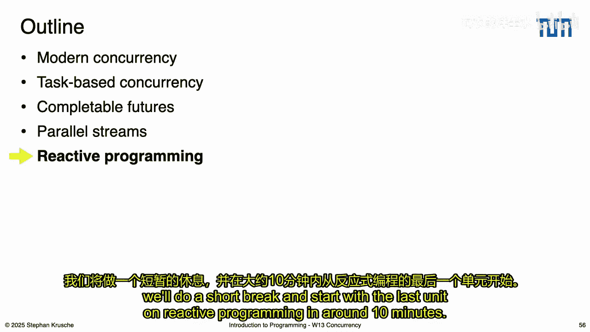

# 061：并行流


在本节课中，我们将学习Java中的并行流。我们将回顾流的基本概念，并重点介绍如何利用并行流来并发执行数据处理任务，从而提升计算密集型任务的性能。

## 概述

上一节我们介绍了流的基本操作。本节中我们来看看如何将流操作并行化。并行流允许我们利用多核处理器的优势，将数据集的元素分配到多个线程上同时处理，这对于处理大型数据集或计算密集型任务尤其有用。

## 流操作回顾

流是对数据元素序列进行函数式风格的操作。其核心流程如下：

1.  从数据源（如列表或集合）创建一个流。
2.  执行一系列中间操作，如过滤（`filter`）、映射（`map`）等。
3.  通过一个终端操作（如收集器 `collect` 或归约 `reduce`）来获取结果。

例如，对一个整数列表求和，可以将其转换为流，然后使用归约操作。

```java
List<Integer> numbers = Arrays.asList(1, 2, 3, 4, 5);
int sum = numbers.stream().reduce(0, Integer::sum);
```

## 并行流简介

并行流使得并发编程变得简单。你无需直接管理线程的创建、阻塞或等待，只需将普通流转换为并行流，Java会自动处理并发执行。

将顺序流转换为并行流的方法非常简单，只需调用 `parallelStream()` 方法或对已有流调用 `parallel()` 方法。

```java
// 从集合创建并行流
List<Integer> numbers = Arrays.asList(1, 2, 3, 4, 5);
int sumParallel = numbers.parallelStream().reduce(0, Integer::sum);

// 将现有流转换为并行流
int sumParallel2 = numbers.stream().parallel().reduce(0, Integer::sum);
```

并行流的核心优势在于其声明式语法。你只需描述“要做什么”（例如，对每个元素求平方），而无需关心“如何做”（例如，如何分配线程）。这使得代码更简洁、易读。

## 并行流的工作原理与适用场景

并行流尝试将输入数据分割成多个块，每个块在一个独立的线程中处理。线程数量通常由运行时环境根据可用处理器核心数自动决定。

**并行流最适合以下场景：**
*   **CPU密集型任务**：计算本身耗时较长。
*   **大型数据集**：有大量数据元素需要处理。
*   **任务可独立分解**：对每个数据元素的操作不依赖于其他元素的结果或顺序。

**在以下情况使用并行流可能无益甚至有害：**
*   **计算过于简单**：创建和管理线程的开销可能超过并行计算带来的收益。
*   **I/O密集型任务**：任务主要时间花在等待I/O（如网络、磁盘）上，而非CPU计算。
*   **操作有严格顺序依赖**：某些归约操作（如 `reduce`）如果依赖于特定顺序，则不能安全并行化。

## 代码示例与顺序问题

请看一个简单的并行流示例：

```java
List<Integer> numbers = Arrays.asList(1, 2, 3, 4, 5);
List<Integer> squares = numbers.parallelStream()
                               .map(n -> n * n)
                               .collect(Collectors.toList());
// 结果始终是 [1, 4, 9, 16, 25]
```

在这个例子中，`map` 操作（计算平方）会并发应用到各个元素上。虽然计算 `4*4` 的线程可能比计算 `1*1` 的线程更早完成，但终端操作 `collect` 会保证最终结果列表的顺序与源列表的顺序一致。**并行化的是将操作应用于多个输入元素的过程，而不是改变操作链本身的顺序或最终结果的顺序。**

## 性能对比与监控

为了直观感受并行流的性能差异，我们可以对比处理大量数据时的耗时。以下示例创建了一个包含大量整数的列表并进行求和：

```java
// 创建一个大的列表（示例为200万个元素，实际可根据需要调整大小）
List<Integer> hugeList = // ... 初始化一个非常大的列表
long startTime = System.currentTimeMillis();
long sum = hugeList.parallelStream().reduce(0L, Long::sum);
long parallelTime = System.currentTimeMillis() - startTime;

startTime = System.currentTimeMillis();
sum = hugeList.stream().reduce(0L, Long::sum);
long sequentialTime = System.currentTimeMillis() - startTime;

System.out.println("并行耗时: " + parallelTime + "ms");
System.out.println("顺序耗时: " + sequentialTime + "ms");
```

在实际运行中，对于计算密集型的求和操作，并行流通常能显示出更短的执行时间。你可以通过打印线程名称来监控哪些线程参与了工作：

```java
List<Integer> nums = Arrays.asList(1, 2, 3, 4, 5);
nums.parallelStream()
    .map(n -> {
        System.out.println(Thread.currentThread().getName() + " processing: " + n);
        return n * n;
    })
    .forEach(System.out::println);
```

输出会显示类似 `ForkJoinPool.commonPool-worker-1` 的线程名，表明任务是在ForkJoinPool的线程中并发执行的。

## 实践练习

现在，请打开Artemis系统，完成练习 **W13 E2: 并行数据处理**。

**你的任务是：**
1.  使用并行流计算总营收。
2.  找出交易额最高的前五笔交易。
3.  分别测量使用默认（顺序）流和并行流处理的性能。

你大约有10分钟的时间来完成这个练习。助教会巡回提供帮助。请注意，本次不会展示示例解决方案，你需要独立完成并通过Artemis提交以获得反馈。

## 总结

本节课中我们一起学习了Java并行流。我们回顾了流的基础，理解了如何通过 `parallelStream()` 将顺序处理转换为并发处理。我们探讨了并行流的工作原理、其最适合的CPU密集型和大数据量场景，以及需要注意的顺序和性能开销问题。通过将复杂的线程管理抽象化，并行流让我们能够以声明式、简洁的方式编写高效的并发数据处理代码。



休息之后，我们将开始最后一个关于响应式编程的单元。