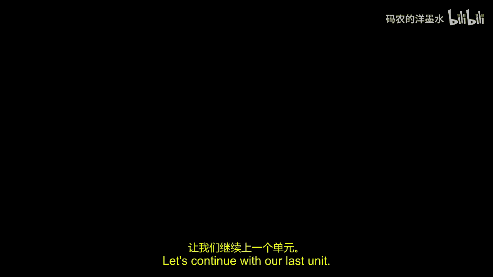
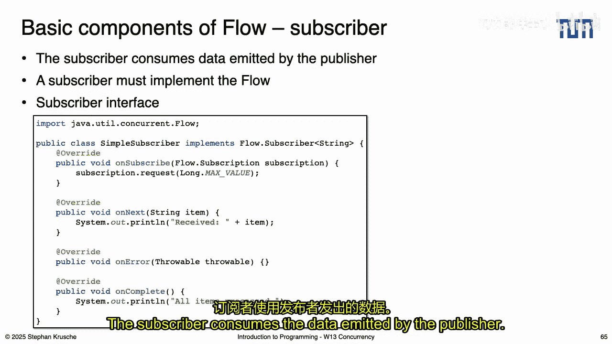
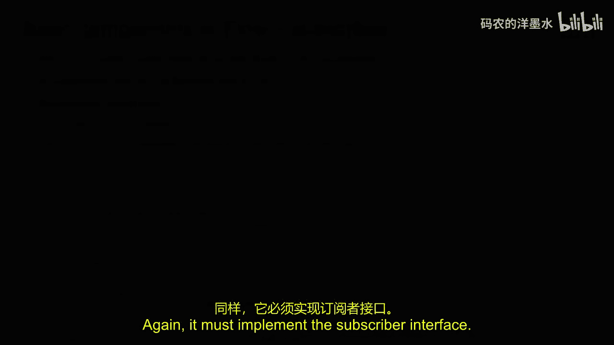
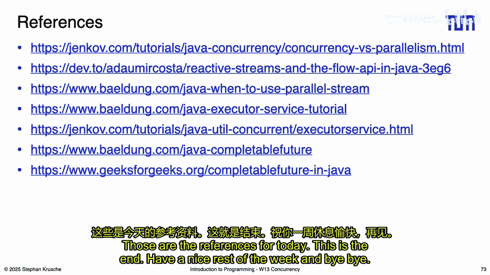
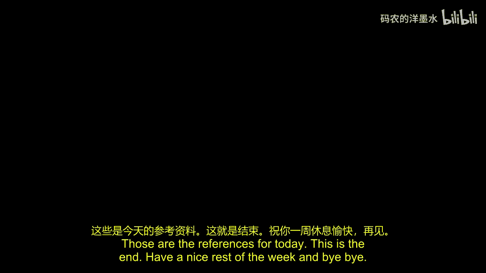

# 062：响应式编程



在本节课中，我们将要学习响应式编程的基本概念。响应式编程是一个专注于系统响应性、可伸缩性和弹性的广阔领域。我们将了解其核心思想、关键组件，并通过Java的Flow API来实践一个简单的发布-订阅模型。

## 响应式编程概述

上一节我们介绍了并行流，本节中我们来看看响应式编程。响应式编程是一个庞大的领域，它专注于系统的响应性和如何将小任务规模化，从而构建一个可伸缩且具有响应性的系统。


甚至有一个所谓的“响应式宣言”，其中定义了系统的四个特定属性。

## 响应式系统的四个属性

以下是响应式系统的四个核心属性：

1.  **响应性**：系统应该及时响应。
2.  **消息驱动**：系统通常是消息驱动的。这意味着组件之间不直接调用方法，而是通过消息队列发送消息进行通信，以实现松耦合并支持异步编程。
3.  **弹性**：系统在高负载下仍能保持响应性。无论有5个还是10，000个最终用户，系统都应表现一致。因此，所有操作都应尽可能小而原子化。
4.  **韧性**：即使一个组件失败，系统也应保持响应。一个被分解为10到15个更小的所谓“微服务”的系统，在某个组件失败时，可能有另一个组件接管，或者只是系统的某个功能失效，而其余部分仍能正常工作并保持响应。

有一个关于此的完整网站，如果你感兴趣，可以在 `reactivemanifesto.org` 上阅读更多内容。

## 为什么响应式编程很重要

响应式编程之所以有趣，是因为如果你有大量可以异步处理的数据，你可以更高效地处理它们。使用响应式编程的典型应用包括微服务、实时通知（例如，你想在足球比赛中进球时得到通知）以及包含数据管道的系统（数据在多个系统之间发送以进行处理）。

响应式编程也关注数据流，这与Java中的流概念有些相似，但重点在于**变化的传播**。我们不仅关注数据流及其上的操作，更关注变化的数据。每一个变化都会被发布给订阅者，订阅者会收到通知并可以处理变化后的数据。

## 变化传播算法

有不同的变化传播算法，这意味着系统的一部分需要通知另一部分变化发生了。

*   **轮询**：希望得到通知的消费者是主动的，需要定期拉取数据。
*   **推送**：生产数据的生产者以事件的形式通知消费者，事件是一个自包含的值，无需发送进一步信息，消费者就可以处理变化。
*   **推拉混合**：只推送一个非常简单的通知（例如，“嘿，有些数据变了”），然后消费者需要拉取具体内容。

举个例子：当你发送WhatsApp消息时，系统会通知你。对于小的文本消息，通常使用推送原则，服务器会发送包含全部文本内容的推送通知。然而，对于大的视频或图像数据，WhatsApp服务器可能只通知“有新图片/视频”，并附带一个小缩略图预览。当你点击它时，你的智能手机会拉取整个视频。如果你在处理通知时离线，就无法获取数据。这就是这里的区别。

## 发布-订阅模型

响应式编程专注于所谓的**发布-订阅模型**。其思想是将数据的生产者（发布者）与数据的消费者（订阅者）解耦。在中间，我们通常有一个通道、代理服务或消息队列，所有数据都发送到这里。

然后，订阅者可以处理数据，并按照他们想要的方式和时间进行处理。即使发布者因故停止工作，但只要数据已经发布到通道中，订阅者仍然可以处理它。

从图示中的数字可以看出，通常可以有多个发布者。但每一个数据点（图中圆圈里的1、2、3）可能会被所有订阅者处理。如果一个订阅者订阅了，他们可能仍然会处理所有三个数据点，因为不同的订阅者可能有不同的功能。例如，一个处理文本以便你能在推送通知中看到它，另一个使用文本并检查是否有违反WhatsApp行为准则的内容。

## 背压问题

如果你有这样的发布-订阅机制，可能会出现一个称为**背压**的问题。

背压意味着在你的数据流、中间的消息队列中有太多数据，淹没了订阅者。例如，如果你有非常快的发布者（每秒发布100次操作），但有一个相对较慢的订阅者（因为处理数据需要大量时间，可能每秒只能处理一次操作），那么队列中就会堆积大量数据，最终可能导致队列溢出。

背压意味着告诉发布者：“请停止发布，我们不堪重负了，休息一下或做点别的，但不要让我们过载，我们无法再处理数据了。” 你可以考虑如何应对，例如雇佣更多订阅者（即扩展系统，启动更多订阅者子系统），或者思考是否真的需要如此快速地发布数据，是否可以放慢速度，是否真的需要跟踪每一个变化。

## 响应式编程的优势

响应式编程的优势在于可以实现高并发，真正适当地利用所有基础设施，甚至高效地处理大规模数据流，并确保应用程序的韧性和响应性。

## Java中的响应式编程：Flow API

Java有一个内置的框架或功能用于发布-订阅模型或响应式编程，即所谓的**Flow API**，它实现了响应式流规范。我们有四个主要组件：发布者、订阅者、订阅和处理器。我们将逐一介绍。

### 发布者

发布者产生数据并将其发送给订阅者。你可以通过实现 `Flow.Publisher` 接口来实现自己的简单发布者。

这是一个泛型接口，所以你需要指定你的类型。在这个非常简单的例子中，我们只有一个字符串数组 `{“Hello”, “Reactive”, “World”}`。然后我们需要重写 `subscribe` 方法并提供订阅逻辑。





```java
import java.util.concurrent.Flow.*;

public class SimplePublisher implements Publisher<String> {
    private final String[] data = {"Hello", "Reactive", "World"};

    @Override
    public void subscribe(Subscriber<? super String> subscriber) {
        // 提供订阅逻辑，例如创建一个Subscription并传递给subscriber.onSubscribe
        subscriber.onSubscribe(new SimpleSubscription(subscriber, data));
    }
}
```

发布者必须实现这个Flow接口，然后才能使用其功能来发布这些数据点。当然，这里我们有一个固定的最终字符串数组，但在现实中，这也可能是从外部获取新数据项，这些项进入发布者并被发布给订阅者。

### 订阅者

订阅者消费发布者发出的数据。它必须实现 `Flow.Subscriber` 接口。


这个订阅者接口要求我们实现四个不同的方法：

*   `onSubscribe`：通知我们订阅机制已发生，并给我们这个订阅对象，然后我们可以在其上调用 `request` 方法来请求数据。
*   `onNext`：我们收到一个数据项，然后可以处理它。在这个非常简单的例子中，我们只是打印它。
*   `onError`：意味着某些地方出错了，发生了错误，我们可以进行错误处理。
*   `onComplete`：意味着我们完成了，所有数据都已处理。如果我们只有三个数据点，我们就调用三次 `onNext`，然后完成，订阅就结束了。

```java
import java.util.concurrent.Flow.*;

public class SimpleSubscriber implements Subscriber<String> {
    private Subscription subscription;

    @Override
    public void onSubscribe(Subscription subscription) {
        this.subscription = subscription;
        // 请求第一个数据项
        subscription.request(1);
    }

    @Override
    public void onNext(String item) {
        System.out.println("Received: " + item);
        // 处理完当前项后，请求下一个
        subscription.request(1);
    }

    @Override
    public void onError(Throwable throwable) {
        System.err.println("Error occurred: " + throwable.getMessage());
    }

    @Override
    public void onComplete() {
        System.out.println("Processing completed.");
    }
}
```

### 订阅

订阅逻辑在 `SimpleSubscription` 类中实现。它基本上使用数据并重写 `request` 方法。在 `request` 方法中，我们简单地遍历数据，直到没有更多数据可用。这也是我们在这里使用 `while` 循环的原因，因为在这个非常简单的例子中，我们只有三个数据点，但在现实中，我们并不知道有多少数据点。

订阅者应确保每当请求数据时，就调用订阅者的 `onNext` 方法；如果数据为空，则调用 `onComplete`。还有一个 `cancel` 方法，例如，当数据太多时可能会取消，但通常调用的是 `request` 方法。

```java
import java.util.concurrent.Flow.*;

class SimpleSubscription implements Subscription {
    private final Subscriber<? super String> subscriber;
    private final String[] data;
    private int index = 0;
    private boolean isCancelled = false;

    SimpleSubscription(Subscriber<? super String> subscriber, String[] data) {
        this.subscriber = subscriber;
        this.data = data;
    }

    @Override
    public void request(long n) {
        if (isCancelled) return;
        try {
            for (int i = 0; i < n && index < data.length; i++) {
                subscriber.onNext(data[index++]);
            }
            if (index >= data.length) {
                subscriber.onComplete();
            }
        } catch (Exception e) {
            subscriber.onError(e);
        }
    }

    @Override
    public void cancel() {
        isCancelled = true;
    }
}
```

### 整合一切

最后，我们可以将所有内容整合在一起。我们创建发布者，调用 `subscribe` 方法并传入我们的简单订阅者。这样我们就将两者连接起来，并在中间实现了订阅机制。在我们的简单例子中，我们只是转发数据，当然也可以有更复杂的例子，你还需要处理背压。

关于我在这里展示的代码有任何问题吗？这并不容易，这是一个你必须理解的新模型。但如果你能理解这个想法：有人发布了一些东西，每当有发布时，另一个订阅者就开始处理它，并且我们可以有多个数据从一个子系统流向另一个子系统，这基本上就是其思想。

这是Java中的一种实现，但许多编程语言都提供了这种响应式编程方式。例如，用于JavaScript的RXJS在Web应用世界中是一个非常著名的框架。基本上每种编程语言都有类似的框架，还有RX Java，它甚至比Flow API更复杂，提供了许多不同的机制。对于每种语言，如RX Python、RXC++等，都有相应的框架。

因此，我们认为以一种非常简单的方式了解它的工作原理并习惯它是很好的，因为未来响应式编程会越来越多。

## 实际应用与使用场景

有一些实际应用特别使用响应式编程，尤其是事件驱动系统，例如股价更新、智能家居环境中的传感器数据监控或聊天应用程序（其中出现大量不同的消息）。在这些情况下，发布者发出数据事件，然后甚至多个订阅者可以独立处理它们，这就是其思想。

从某种意义上说，有两种机制：一种是多个订阅者处理所有数据，因为他们都对此感兴趣；另一种是多个订阅者只对部分数据感兴趣，并基本上互相帮助。基于此，你必须以不同的方式实现这些订阅者。

**何时应该使用响应式编程？** 它适用于需要高吞吐量、可扩展性和响应性的应用程序，特别是大公司经常这样做，因为他们必须处理许多最终用户的请求。在这种情况下，这是有意义的。对于非常简单的应用程序和只有少数用户的应用程序，响应式编程并不是真正必需的。

## 练习：温度监控系统

我们还有一个练习让你尝试，我们希望您使用Java Flow API模拟一个温度监控系统。

你需要完成以下三个任务：

1.  **实现一个温度发布者**：该发布者生成并管理数据流，发出随机的摄氏温度读数。
2.  **实现一个温度订阅者**：该订阅者订阅事件，将它们记录到控制台，并在温度高于70摄氏度时发出警告。
3.  **实现一个简单的背压机制**：使得同时消费10个读数，而不是逐个处理。这意味着等待直到有10个读数可用，然后立即消费它们。

你需要在接下来的大约10分钟内完成这个练习。导师会四处走动提供帮助。这可能不是一个简单的练习，这是一个中等难度的练习，所以你可能需要多一点时间。把它当作初始工作时间，然后你可以在今晚之前完成剩余部分。

## 课程总结与后续步骤

本节课中我们一起学习了以下内容：

*   **并发**：允许我们保持系统响应性，可能看起来像并行运行，但不一定，这可能在后台发生。
*   **真正的并行**：使用多个CPU核心可以显著提高性能，前提是软件已为此优化。今天的重点是如何编程以优化多核使用。
*   **基于任务的并发**：我们已经抽象掉了所有线程管理这些难以理解的低级概念（很容易产生竞态条件），使用起来更简单，尽管你仍然需要学习如何使用它。特别是我们讨论了**Future**，它代表某种异步计算，将在某个时刻可用，但它们相当有限。
*   **CompletableFuture**：它使用更现代的语法进行链式调用、组合和错误处理。
*   **基于并行流的异步编程**：我们进行了简单回顾，它们可以帮助我们对序列进行并行操作。但是，你需要仔细查看具体用例，并需要避免并行流操作背后的线程管理导致过多开销。
*   **响应式编程**：这是我们今天的最后一个主题，是一个非常现代和健壮的模型，现在许多编程语言都使用它来处理异步数据流。许多人现在也以异步数据流的方式思考，他们不再以传统的面向对象方式思考。一切都需要是一个函数，一切都需要被转换为发布者、可观察对象或订阅者，以使其尽可能具有响应性。这是你可以使用的发布-订阅模型，它试图通过中间的消息队列将数据生产与数据消费解耦，有时需要处理背压以确保整个方法的稳定性。

这只是对这些主题的快速一瞥，你可以在这些主题上花费更多时间。我希望你将来有更多机会处理这些主题，因为我认为它们变得越来越重要，未来的开发者（我也把你们算在内，即使你们可能进入管理岗位）也需要理解它们是如何工作的。

今天的课程到此结束，祝大家本周剩余时间愉快，再见。






