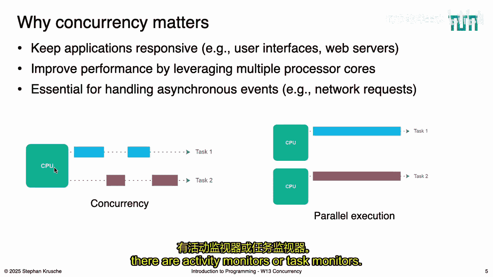
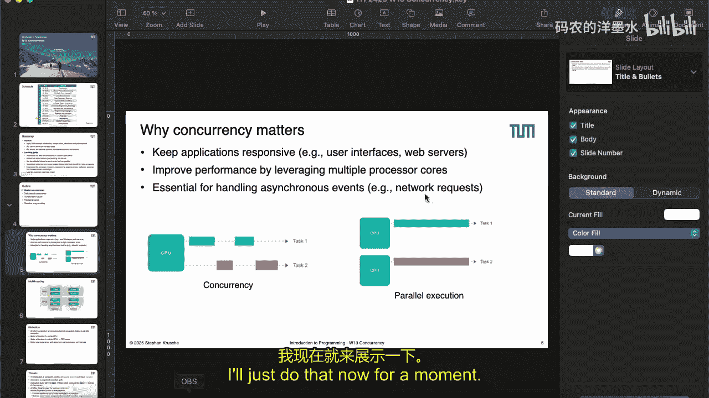
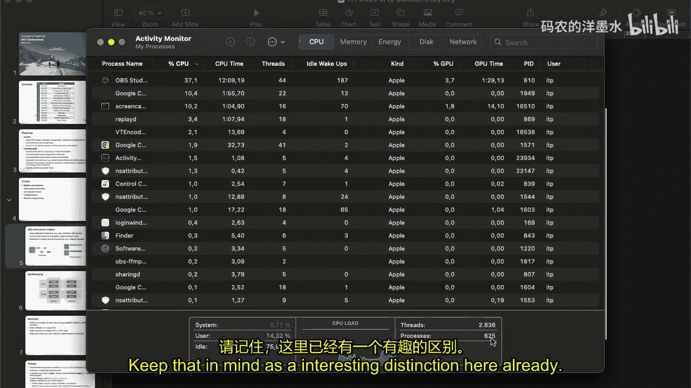
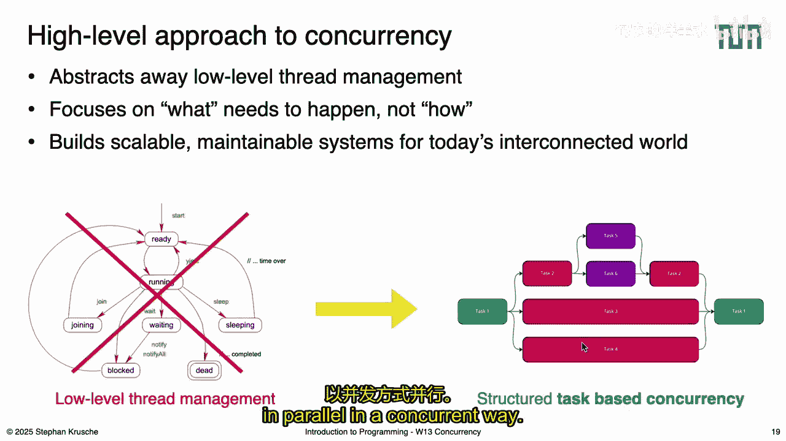

# 063：并发编程

欢迎来到第13次研讨会，主题是“编程导论”课程中的并发。

我们再次回到直播，我已经恢复健康，非常高兴能再次站在大家面前，教授这门课程中一个相对较新的主题。去年我们没有教授这个内容，但我们认为在当今涉及并发编程以及如何高效处理多CPU、多核心时，这是一个越来越重要的主题，目的是让您的最终用户，即使用您软件的人，获得最佳的响应性和用户体验。

课程已接近尾声，下周我们还有一次研讨会，将讨论编程之外的某些方面，并简要了解软件工程。两周后我们将进行课程回顾，然后是第二次监考考试。我知道大家都在积极地进行项目工作，因为它非常令人兴奋和鼓舞人心，你们还需要在挑战上多做一些工作，并在最后一次辅导课上向同学们展示。

现在，让我们开始今天关于并发的研讨会。

我们假设您对基本的面向对象编程概念有很好的理解，并且也知道如何使用Lambda表达式和流，这在今天将非常重要，我们将在下半部分回顾流。

今天的学习目标包括：更好地理解为什么现代应用程序需要并发；理解如何进行异步编程，我们将看到这意味着什么；并向您展示如何使用所谓的Future。由于Future还不够好，我们还有第二个版本，即所谓的CompletableFuture。因此，我们的想法是，在本周研讨会结束时，您应该能够使用CompletableFuture，以便在基于任务的并发中更好地控制任务，以及多个任务的组合及其相互关系，因为有时您想要交给计算机的任务之间存在依赖关系，只有在多个任务已经完成计算后，才能继续下一步。

我们还将再次讨论流，特别是并行流，以及它们如何使您的数据处理更高效。

在最后几个单元中，我们将简要讨论响应式编程、响应性、弹性、可伸缩性和消息驱动架构。我们希望您能更好地理解这些原则，虽然这之后您不会成为专家，还需要更多的练习和实践，但我们希望能为您提供一个很好的概述，因为这个主题变得越来越重要。

我们将首先概述现代并发的含义及其基本概念，然后再深入基于任务的并发。

## 为什么并发很重要？🤔

并发很重要，因为您希望保持应用程序的响应性。如果您开发用户界面，您不希望用户因为正在进行繁重的计算而等待。如果您开发Web服务器，您也不希望所有100万WhatsApp用户都在等待，仅仅因为另一个人发送了一条消息，而处理这条消息需要更长的时间。因此，理想情况下，我们可以以并发方式直接从最终用户的用户界面接收这些请求，或者在Web服务的情况下接收请求，甚至理想情况下，我们可以并行执行它们。

请注意，并发与并行不同。某些事情看起来是并发的，即使它不是并行的。在左侧的图表中，我们有一个CPU，看起来有两个任务在并发执行。然而，事实并非如此，它们是顺序执行的，但操作系统确保一个任务获得，例如，一秒钟，另一个任务获得一秒钟，然后第一个任务暂停，依此类推。实际上，如果您查看您的操作系统，有活动监视器或任务监视器，我现在就演示一下。

在Mac OS上打开活动监视器。您会看到我们有大量进程同时运行。实际上，我们有2，700个线程，出于某种原因，进程数需要一点时间，有625个进程同时运行。如果我只有一个CPU核心，它们仍然会并发运行，但不会并行运行。这台计算机有多个核心，所以它们也可以并行运行。请记住这是一个有趣的区别。

随着如今硬件中拥有越来越多的处理器核心，甚至我的智能手机现在也有六个核心左右，我们需要利用它们来使计算机执行的任务更快，从而减少用户的等待时间。同时，这些任务也变得越来越复杂。十年前，由于CPU性能有限，人们可以同时以720p的分辨率编辑一个视频，并且等待时间合理，比如不需要等待五个小时视频才完全转码。现在，我们可以在同一台笔记本电脑上同时处理4个4K视频，并且等待时间相同。

因此，硬件在过去几年中取得了巨大进步，提供了越来越多的应用和用例。因此，以能够利用这些多CPU的方式编程软件也至关重要。因为如果您开发的视频编辑软件，在多核处理器上的性能仍然与十年前在单核上相同，那么您的最终用户会讨厌您。

请记住，响应性和性能是用户体验最重要的指标之一。想想您自己，如果您在互联网上浏览您最喜欢的网站，无论它是什么，如果加载时间异常长，异常长指的是两秒钟。如果我打开一个网站，它必须立即出现，如果需要两秒钟，我已经开始思考发生了什么，我的大脑开始琢磨，如果五秒钟后还没有显示出来，我会尝试另一个网站。如今，我没有耐心等待一个网站超过五秒钟，我听说年轻一代甚至更缺乏耐心，如果TikTok视频太长且开头不有趣，他们就会直接滑到下一个。这是我们必须考虑的心理和用户期望。

因此，多线程已成为常态，不再是例外。每个应用程序，如果有繁重的计算，都应该有多个线程，并利用我们越来越多的CPU核心。这意味着应用程序可以同时执行多个任务，并发甚至并行，操作系统将负责以公平的方式将这些任务分配到不同的CPU核心，以便所有应用程序都得到公平对待。当然，某些应用程序可能会获得更多的CPU时间，因为它们更重要，您的操作系统有一些重要的事情要做，如果这些需要时间，那么您的应用程序可能需要等待，但总的来说，操作系统会尽量做到公平。

因此，缩短长时间运行程序的运行时间，更好地利用单个CPU，以及更好地利用多个CPU核心，并在响应性、公平性和用户体验方面提供更好的最终用户体验，是您应该考虑并发编程的主要动机。

## 问题解答 💬

好的，问题是：我们能多谈谈底层硬件架构吗？我想说不会太多，有单独的课程会向您介绍计算机体系结构和硬件工程。我现在可以告诉您的是，如果您只有一个单核，您无法并行执行多个进程。这是不可能的。它只是看起来像那样。操作系统会智能地分配进程，并试图以公平的方式进行，但一次只能执行一个进程和一个线程。它们可能只获得10毫秒，对我们来说，一秒钟是我们能理解的时间度量，在一秒钟内，可能有100个不同的进程顺序运行。

由于操作系统有时给您的线程和应用程序的时间非常短，但它只在单线上运行。如果您有多个核心，操作系统将确保将它们分配到多个核心上，然后这些进程也可以并行运行。但最终，当涉及到磁盘I/O、输入输出或网络读取等操作时，可能一次只能计算一个操作。但是，如果您必须等待这个操作，那将是非常糟糕的，对吗？例如，如果用户界面上没有其他事情可做。

希望这能稍微解答这个问题。

## 线程基础 🧵

在编程并发时，许多人会想到线程。线程是计算机科学家首次接触允许同时生成多个任务的方式之一。线程就是程序的执行，程序的执行可以有多个线程。到目前为止，我们大多只使用一个线程，即主线程。但有时您已经看到，可能会出现后台线程或多个线程被生成，这些线程可能并行运行。线程是程序中一条单一的执行路径，在每个点上，您可以分支出新的线程，主分支将继续运行，但您可以分支出并启动一个新线程，只要不超过某些硬件限制，您可以随意这样做。

主线程通过main方法执行。Java中使用的一个重要线程是负责垃圾回收的线程，它由运行时系统并行启动，并在多个时间点执行，然后清理程序中不再需要的所有对象。它的工作方式是这样的：您的主线程处理对象，它们在这里用蓝色圆圈表示。每当有一个对象不再被使用时，比如这个，它没有传入引用，如果没有传入引用，意味着该对象不再需要，那么垃圾回收器可能会启动，抓住它并释放它，以便您可以再次使用其他对象。垃圾回收器线程在后台运行，系统确保在某些时候主线程被中断，垃圾回收器启动，获得几毫秒的执行时间来释放内存，然后主线程再次运行。大多数时候您不会注意到这一点，因为CPU速度非常快。

但这种行为可能导致严重的问题。怎么会这样呢？有些操作系统需要某种实时保证，我给您一个重要的例子：汽车中的安全气囊。

想象一下，您为汽车编程一个电子控制单元。这完全关乎安全，拯救乘客和用户的生命。但是突然，当汽车发生碰撞，安全气囊应该弹出时，您只有几毫秒的时间，否则就来不及了。这时垃圾回收器启动了，您需要清理大量的，比如音乐对象，因为您还在车里听网络广播。那将非常糟糕，对吗？是的，如果您的安全气囊延迟了80毫秒，您可能会因为垃圾回收器启动而丧生。虽然这对于大多数Java应用程序来说完全没问题，但垃圾回收对于实时系统可能是个问题。也有一些编程语言没有垃圾回收，或者您可以禁用它，因为系统在实时执行方面有严格的要求。

因此，一方面，这是一个非常好的工具，但在某些情况下也可能导致严重问题。

## 使用线程 🛠️

我们使用多个线程来同时处理多个不同的事情。您可以在用户等待网络请求时做一些有用的事情，比如在屏幕上显示一个小动画，或者让用户使用应用程序的其他部分。程序可以在需要时随时创建和启动新线程。Java实际上提供了一个类，即Thread类，以及一个接口，即Runnable。让我们看看它是如何工作的。我们现在将看一些代码。

例如，我们可以创建一个名为MyThread的类，在MyThread中我们扩展Thread类，这是完全可以的，我们创建了一个子类。

在我们的主程序中，我们使用new操作符实例化这个类。

然后我们调用start方法。如果您这样做，如果您在线程上调用start，那么线程就会被生成，之后的所有内容都将在这个线程中执行。

不，抱歉，划掉，那是错误的。

start方法实际上在后台调用run方法，run方法中的所有内容都在新线程中执行。

而之后的所有内容仍然在同一个线程中执行。因此，如果您将此程序复制粘贴到您的Playground中，它将有两个线程：主线程，它将打印出“Thread has been started”，以及一个没有名称的后台线程，是的，您没有给它命名。它会说“I'm running”。并且，这也只是打印到控制台。

从“hello”到System.out.println的所有内容都在单独的线程中完成，当线程完成后，它也可以再次被垃圾回收器回收。

让我们试试看，将其复制粘贴到我们的Playground中。

让我看看，我想我需要启动它。让我们看看这里发生了什么。开始了，我把它粘贴进去。

然后如果我们启动程序。需要几秒钟，然后您会看到“Thread has been started”显示在控制台中，然后是“I'm running”显示在控制台中。对于控制台，我们总是有一个顺序，因为控制台会聚合所有输出。但是，如果您有多个核心，程序可以并行运行，那么我们无法真正说出哪个输出语句“I'm running”或“Thread has been started”先执行，因为这纯粹是并发完成的，取决于操作系统。

在这个特定情况下，哪个线程被赋予更高的优先级。我们还可以添加一个断点来验证系统正在运行哪个线程。所以，如果我现在调试应用程序。您会看到这个断点是在主线程中命中的，您在这里看到“main”。现在如果我继续。好的，出于某种原因，另一个线程没有停止。不确定为什么这没有奏效。让我们再试一次。

问题是它实际上同时命中了这个。所以，如果我们点击这个下拉菜单，您会看到我们有多个线程。

这里还有一些后台线程，它们是操作系统和Java虚拟机所需的，主线程在这里，然后我们有第二个线程，它同时处于等待状态，它只是被称为“MyThread”，您会看到这里有一些额外的方面，它是由主线程启动的，并且有一个特定的编号，thread-0。如果您创建更多线程，您会在这里看到不同的名称，并且您也可以看到，您可以给它们一个优先级，优先级帮助操作系统确定线程实际应该获得多少计算时间。

很好，然后如果我恢复，两个线程都可能恢复，然后我们看看这里发生了什么。

关于创建线程的第一种变体有什么问题吗？这并不太难。

但我们将看到，处理线程可能会变得相当困难，因为有时您需要同步多个线程。它们必须相互等待，您可能会遇到竞态条件和死锁。这是并发编程的难点。

很好，这是第二种变体，使用Runnable。我们可以创建一个实现Runnable的类，是的，这是一个接口，而不是类。所以，我们使用implements而不是extends，否则基本上是一样的。我们也创建一个线程，但不是MyThread，只是一个标准线程，因为我们没有子类，我们传递一个MyRunnable的实例，这意味着start方法之后也会调用run方法，并且基本上会做与上一张幻灯片相同的事情。因此，我们实现Runnable，每个Runnable必须实现run方法，就像Thread那样，然后我们可以创建或初始化一个新线程，如果我们有多个CPU核心，我们可以要求它并行运行，然后紧接着我们自己的程序执行继续。

关于变体2的问题：是的，问题是如果您在Java中编写代码，默认情况下是否只在一个线程中运行？是的，除非您使用并发包中的类，我们稍后会看到。所以，如果您不生成线程或Runnable，那么所有内容都在同一个线程中运行。可能的情况是，框架为您进行了一些线程处理，然后您并没有真正注意到您在单独的线程中运行。例如，如果您在项目工作中使用LibGDX，可能的情况是它们在后台生成了一些线程，那么这已经是并发的了。

很好。现在我们还有第三种变体，甚至更简单。这里，我们不需要实现或扩展任何东西，而是使用Lambda表达式，因为Runnable是一个函数式接口。我希望您记得，函数式接口意味着它只有一个方法，这意味着我们也可以将其用作Lambda表达式或匿名内部类，我们甚至可以在不使用Runnable这个术语的情况下创建一个线程。是的，所以所有没有参数，然后是一个箭头，然后是某些内容的东西都被视为Runnable。它可以运行，并且可以在单独的线程中生成。

关于变体3有什么问题吗？好的，很好。那么基础知识就快讲完了。快速看一下调度。

我已经告诉过您，操作系统通常在大多数情况下分配这些。在大多数情况下，线程数量远多于CPU数量。您已经看到我的机器上有1000个线程，即使我没有同时运行太多应用程序，并且可能有8个CPU核心左右。这在未来可能会改变，但需要很长时间我们才会有比进程更多的核心。

操作系统有一个叫做调度器的部分，这也是用编程语言编写的程序的一部分，负责管理所有可用的CPU，负责为线程分配执行窗口或时间窗口，以便它们可以运行，并且它实际上需要做很多事情。这就是为什么如果您在慕尼黑工业大学的操作系统课程中谈论调度器，您可能会花两到三节课来讨论它们，因为调度它们，首先有不同的策略、时间分片、朴素方法、优先级分配，但也有很多安全问题，因为您通常希望避免的是，当第二个程序运行时，第一个程序的某些数据仍然在CPU核心上和靠近CPU核心的内存寄存器上，因为那样第二个程序可能会窃取数据。

是的，所以在安全性方面，当您从一个线程切换到另一个线程时，有许多不同的机制来确保这些线程可以处理和使用的所有数据是完全分离的。

虽然在您的程序中，多个线程可能共享对数据的访问，但您绝对不希望多个应用程序之间共享。您不希望您计算机上的WhatsApp应用程序窃取您的银行账户密码或类似的东西，操作系统应该保护您免受这种情况的影响，并且有许多机制来确保这一点。

现在我们将开始讨论Java线程状态模型，这是真正有趣的地方，也是作为管理专业学生可能不会觉得有趣的地方，所以这是给硬核计算机科学家的内容。是的，您必须理解不同的状态以及它们如何相互转换。我们将从就绪状态开始，然后进入运行状态，然后您会看到线程可以处于训练状态、等待状态、睡眠状态，它们可以被阻塞，甚至可以是死亡状态，是的，这是一个最终状态。

如果您理解这一点，请举手。很好。谁想了解更多关于这个的内容？

嗯，那也很好，但我们不会涵盖这个。

抱歉，在我看来，这太底层了。是的，这就是70年代一切开始的方式，但我们不再处于70年代了，50年过去了，我们有更好的方式进行并发编程，这些方式更容易理解，当您不关心线程状态时。我鼓励您，如果您想学习这个，请去做，但我个人对此感到困难，我知道许多学生也是如此，这就是为什么我们不会在本课程中涵盖这个。

相反，我们将专注于更高级的概念。当我们这样做时，让我们再次快速回顾一下，并发编程确实是一项基础技能，因为现代软件要求响应性和可伸缩性，您不希望阻塞某些东西，这对于许多、许多用例和应用程序都非常重要。我们在这里看到的东西实际上相当古老。是的，我想这是10年前甚至15年前拍摄的，当时在单核上视频编辑的计算时间是九分钟。

您看到他们在这里测试的软件已经过优化，在四核上只花了2分39秒，这相当不错。当然，现在我们甚至有八核或十二核，它可能更快，但您可以看到这确实很重要，没有人愿意等待九分钟，如果任务可以在两分半钟内完成。因此，拥有这些技能非常重要，分布式系统在今天变得越来越重要。今天，不仅仅是一个应用程序单独完成所有事情，应用程序通过互联网与服务器、其他用户通信，可能还与附近的设备通信，例如，如果您有一个AirTag来寻找在客厅丢失的钥匙。越来越多的系统被分布到小型服务中，如果那里有一个阻塞操作，可能导致糟糕的用户体验和大量低效问题。因此，并发编程是关于优化资源使用，理想情况下使用小型服务，并保持系统响应性。

我们希望专注于并发的高级方法，我们希望抽象掉所有底层的线程管理，而更专注于需要做什么，而不是如何做。当然，我们也需要稍微关注如何做，我们需要教您如何同时拥有多个任务，但一旦您学会了这个，您会发现使用高级API相对容易，您可以真正专注于“什么”，并理想地构建一个可以实现结构化、基于任务的并发的系统，您只需定义：嘿，我有几个任务，并且您还定义它们如何相互依赖，然后程序、框架、Java虚拟机或您使用的任何东西决定如何以最佳方式并行、并发地运行它们。

这就是我们今天的目标。