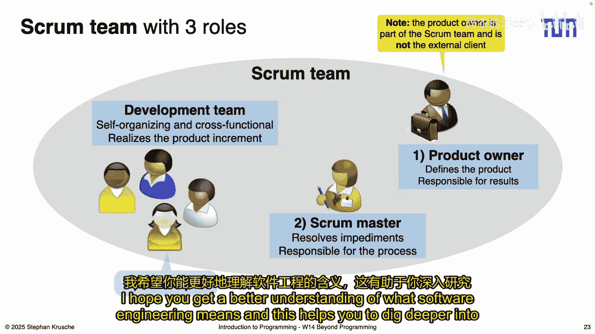

# 064：软件工程 🏗️

在本节课中，我们将超越单纯的编程，探讨软件工程的核心概念。我们将了解软件工程不仅仅是编写代码，它更是一套用于生产高质量软件系统的技术、方法和工具。课程将涵盖软件工程活动概述、代码审查、客户端-服务器通信以及现代开发工作流。最后，我们会进行总结，回顾所学内容。

---

## 软件工程概述

软件工程是一系列技术、方法和工具的集合，旨在帮助生产软件系统。在实践中，尤其是在工业界，这通常意味着开发非常复杂和庞大的系统。

我们的目标是从最终用户的角度开发出高质量的软件，这意味着软件需要具备良好的可用性、性能和可靠性等不同的质量特性。同时，开发必须在给定的预算和期限内完成，否则可能无法获得报酬或失去市场优势。这就是典型的项目三角：质量、成本和时间。

此外，我们现在还有第四个维度：**变化**。世界并非静止不变，法律、技术和公众意见都在不断演变。因此，软件需要不断适应新的需求、技术和法规，以最好地服务于最终用户。

挑战在于处理**复杂性**和应对**变化**。到目前为止，我们只开发过非常简单的程序。即使是项目中的游戏，与工业界中拥有数百万行代码的软件相比，也相当简单。

---

## 技术、方法与工具

为了更好地理解软件工程，我们需要区分技术、方法和工具。

**技术**是使用明确定义的符号来创建结果的正式过程。这就像现实世界中的食谱。例如，在计算机科学中，一个排序算法就是一种技术。它接收特定输入（如一个数字列表），并产生特定输出（从小到大排序的列表），中间包含一系列需要完成的步骤。

**方法**是应用于整个软件开发过程的一系列技术，通常由一种哲学方法统一起来。现实世界中的例子可以是烹饪书。例如，意大利菜谱遵循一种特定的文化或哲学方法。在软件中，面向对象分析与设计就是一种方法，它将系统的所有部分视为对象。

**工具**是用于完成特定技术的仪器或自动化系统。在厨房里，这可能是烤箱或锅。在软件工程中，这可以是集成开发环境（如 IntelliJ IDEA），它基于编译器、编辑器、调试器等。工具还包括建模编辑器或更通用的计算机辅助软件工程工具。使用这些工具可以更快地实现结果，因为它们自动化了我们不想手动完成的步骤。

随着技术的进步，工具和编程方式也在发展。未来，生成式人工智能可能会越来越多地协助我们编写代码。

---

## 超越编码

软件工程远不止编写代码。虽然编码是核心，但最终目标是解决问题。

首先，它是一种**问题解决技术**。你必须理解利益相关者（最终用户、客户）的问题。只有正确理解并充分解决问题，无论使用何种编程语言或技术，才能创造出好的软件。

**原型设计**在这里很重要。你可以开发系统的一个小版本进行尝试。如果关于问题和解决方案的假设有效，再继续开发完整的解决方案。

你需要遵循某些**设计原则**，否则软件可能运行缓慢、难以使用或不可靠。

为了处理复杂性，我们使用**模型**。模型是现实的抽象。我们不想指定现实的所有细节，而是希望有一个简化版本，以便更好地理解并在不同专家之间分配工作。

为了应对变化，有一些特定的技术和流程，例如**敏捷方法**，可以帮助我们。

---

## 关键洞察

我们已经确定了一些关键洞察。

首先，你需要与人沟通，尤其是与客户沟通。**软件工程很大程度上是关于沟通的**。如果沟通不畅，最终可能会开发出错误的软件。

其次，我们通常解决的是复杂问题。对于复杂问题，重要的是进行分析，将其分解为更小的部分，然后再将这些小解决方案合成为一个更大的解决方案。这被称为**分而治之**。在软件工程中，我们有两个活动：**分析**（分解问题）和**集成**（将解决方案组合起来）。

第三，如果问题陈述发生变化，我们无法真正构建系统。因此，**重新制定需求、改变需求以及适应变化**的哲学至关重要。过度详细的计划会降低灵活性。最好有一个粗略的计划，然后保持灵活，适应当前情况。

最后，我们使用**抽象**来处理复杂性，特别是通过建模。建模的核心是**沟通**，它提供了一个共同的词汇表。模型最重要的作用是帮助人类（开发者、最终用户或客户）理解和讨论复杂方面。当然，模型也可用于分析和设计，甚至可以从CASE工具生成代码，或者用于记录设计决策和理由。

---

## 重要模型

在软件工程中，有几种重要的模型。

我们可以创建**对象模型**，用于建模系统的结构。这对于理解系统结构和我们拥有的实体类型很重要。

我们可以创建**功能模型**，这是从最终用户的角度出发，描述系统的功能，即所谓的**用例**。

我们还可以考虑系统的**动态模型**，即系统如何响应某些外部事件。你可以定义系统支持的活动（不仅是外部的，也包括内部的），以及实现这些活动所需的高级算法。

这三种模型（对象、功能和动态）共同构成了**系统模型**，这是开发的基础。

---

## 应用域与解决域

另一个重要的区别是**应用域**和**解决域**。

**应用域**是系统后期运行的环境。这影响了需求的获取和分析。我们需要来自这些领域的专家，因为开发者通常精通解决域，但不一定熟悉应用域。例如，金融领域就是一个应用域。

**解决域**则侧重于用于构建系统的技术，如编程语言、架构、代码部署方式等。这非常技术性，并且可以完全独立于应用域。

在软件工程中，我们需要两个领域的专家：理解应用域的领域专家，以及理解如何构建软件的程序员和开发者。

两个领域都包含抽象概念，我们需要将它们结合起来，思考如何在解决域（如数据库、应用服务、用户界面）中表示特定的应用域概念。

---

## 软件生命周期

当我们讨论分析、需求获取、实现、测试等活动时，我们通常也会关注**软件生命周期**。它描述了特定项目中重要的活动及其关系。

软件生命周期模型试图提出最佳实践，而软件生命周期则是该模型的一个实例。模型帮助你更好地理解你希望如何开发软件，因为有很多不同的方式。

下图展示了一个适合基于模型的软件工程的软件生命周期概览。

你从应用域开始，从客户那里获得问题陈述。然后，一个多样化的开发团队（包括不同背景和专业的成员）会经历一系列步骤来最终产出软件。

这些步骤包括：
1.  **需求获取**：创建用例并将其分配给系统中的特定角色。
2.  **分析**：创建应用域中的初始对象。
3.  **系统设计**：构思架构，例如客户端-服务器应用。
4.  **对象设计**：考虑每个子系统的实现细节（用户界面、应用服务器接口等）。
5.  **实现**：用特定编程语言生成源代码。
6.  **测试**：在多个层面验证软件是否正确工作。

这些活动不一定有严格的顺序，并且可以迭代和增量地进行。此外，还有一些贯穿整个生命周期的活动，如质量管理、配置管理和项目管理。

主要信息是：我们有定期进行的特定活动，也有贯穿项目整个生命周期的活动。我们从问题陈述开始，最终得到一个软件系统，并且这些步骤会重复多次。

---

## 核心活动详解

让我们快速了解这些核心活动及其最重要的方面。

**需求获取与分析**：我们希望通过与人们交谈来理解需求，并将它们记录下来，使其在功能需求和非功能需求（如可用性、性能、可靠性）方面保持一致、完整和可理解。然后我们进行分析，尝试创建初步的系统模型（用例、对象、动态行为）。结果是一个包含动态模型、对象模型和功能模型的分析模型。

**系统设计活动**：包含八个子活动。我们尝试确定设计目标、创建系统架构风格、将系统分解为更小的子系统、讨论并发性、硬件软件映射、决定构建还是购买软件、处理持久数据管理、全局资源处理（访问控制），以及讨论软件控制风格和边界条件故障。

**对象设计与实现**：重点是重用现有解决方案，使用设计模式等来适当地实现子系统。必须指定子系统之间的接口，特别是当它们运行在不同的硬件节点上时。可能需要重构对象并优化对象模型以满足性能标准。

**测试**：我们验证软件是否正确工作。内部测试包括单元测试、集成测试和系统测试。外部测试通常由客户进行验收测试。

所有这些活动可能有特定的顺序，但在不同的项目中，重点可能不同。因此，**裁剪**非常重要，即根据项目的具体需求调整生命周期模型。

---

## 过程模型类型

理解有两种类型的过程模型很重要：**定义式过程**和**经验式过程**。

**定义式过程**遵循某些规则，有时非常严格。它们是完全计划好的，并避免偏差，因为偏差被视为会导致问题。这通常适用于制造过程，但不非常适合软件工程。

**经验式过程**则并非完全计划好的。你有一个粗略的计划，但并不知道最终条件如何。这意味着你需要检查正在发生的情况，寻找变化，然后适应它们。在经验式过程（也称为即兴过程）中，偏离计划被视为一个**机会**。因为如果你能尽早识别这种偏离，就能尽早修复它。你不希望坚持一个会导致开发错误软件的计划。这意味着原型设计和沟通非常重要。

---

## Scrum：一个经验式过程模型

Scrum是当今工业界广泛使用的一个经验式过程控制模型示例。

在Scrum中，主要思想是：
*   开始时有一个**产品待办列表**，这是最重要需求的列表，相对模糊地指定。
*   在一个称为**冲刺**的迭代（通常2到4周）中，团队尝试产出一个**潜在可发布的产品增量**。
*   从产品待办列表中取出最重要的需求，在冲刺计划会议上详细规划，放入**冲刺待办列表**，并定义**冲刺目标**。
*   团队专注于完成目标，避免导致中断的变更。
*   每天举行短暂的**每日站会**，讨论状态、障碍和承诺。
*   冲刺结束时，举行**冲刺评审会议**，演示成果，并举行**冲刺回顾会议**，专注于改进过程。
*   然后开始新的冲刺，逐步开发软件。

Scrum团队包含三个角色：
*   **产品负责人**：负责定义产品、价值和优先级，是与外界沟通的联络人。
*   **Scrum主管**：负责过程，帮助团队发展，并解决障碍。
*   **开发团队**：由多能、自组织、多样化和跨职能的成员组成，负责实现软件。

---

## 总结 🎯

在本节课中，我们一起学习了软件工程的基础知识。我们了解到软件工程不仅仅是编写代码，它涉及一整套用于在预算和时间内生产高质量、复杂软件系统的技术、方法和工具。我们探讨了处理复杂性和变化的关键，区分了应用域与解决域，并概述了软件生命周期的核心活动（需求、设计、实现、测试）。我们还比较了定义式与经验式过程模型，并以Scrum为例，了解了现代敏捷开发如何通过迭代、增量和适应变化的方式来管理项目。希望这些概述能帮助你在未来的学习中更深入地探索软件工程领域。