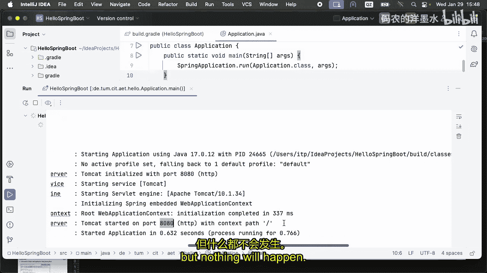
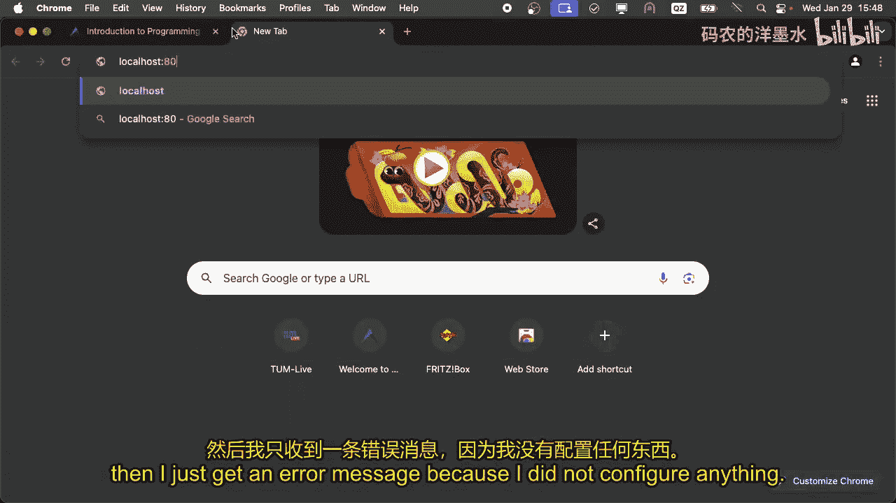
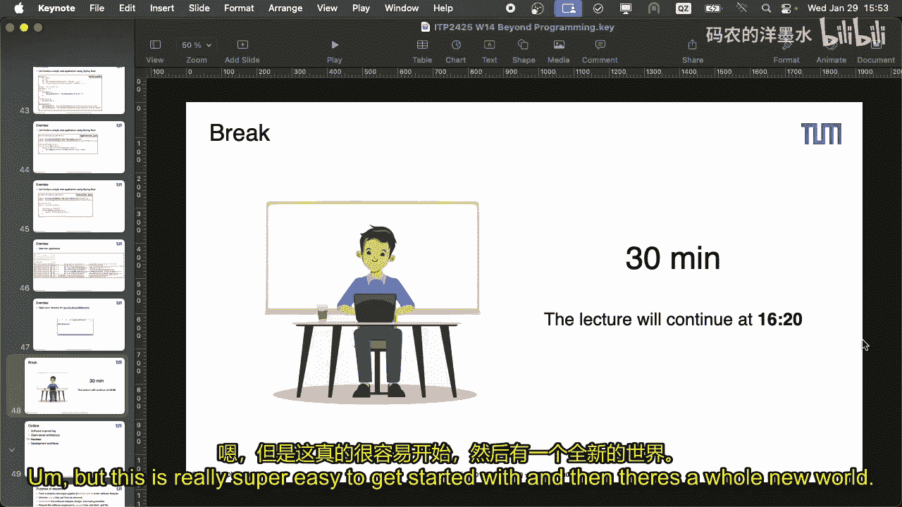

# 065：客户端-服务器架构 🖥️🌐

在本节课中，我们将要学习客户端-服务器架构。这是一种在现代软件开发中至关重要的架构模式，它构成了我们日常使用的绝大多数互联网服务（如网站、手机应用）的基础。我们将了解其核心概念、工作原理，并通过一个简单的例子来实践如何创建一个基础的Web服务。

## 概述

在上一节休息之后，我们继续新的单元。本节将讨论客户端-服务器架构。你可能已经听说过这个概念，但可能还不完全了解其所有细节。当然，我们无法涵盖所有内容，但会尝试提供一个初步的概述，解释为什么需要这种架构、它是什么，以及在遵循此架构开发软件时需要考虑什么。最后，我们将展示一个小例子，演示如何轻松开始开发一个应用程序并在浏览器中测试它。

## 为什么需要分布式系统？

在介绍客户端-服务器架构之前，让我们快速思考一下当今软件系统的现实情况：我们拥有越来越多的分布式系统。开发一个分布式系统比开发一个独立的单机应用程序要复杂得多。那么，为什么每个人都在开发分布式系统呢？

首先，硬件能力是分布式的。为了向最终用户提供出色的功能，并让他们下载甚至购买你的软件，你通常需要利用超出终端设备本身的能力。此外，分布式系统通常也更容易扩展，并且对故障更具弹性。这就是为什么如今几乎所有系统都是分布式的。即使是游戏，现在也都有多人模式，不再完全独立运行。甚至你智能手机上那些免费游戏，通常也会从互联网加载数据，无论是广告还是游戏内数据。因此，现在很少有完全不与其他软件系统通信的独立软件。

## 分布式系统的挑战

当涉及到分布式系统时，存在一些特定的挑战。

*   **连接性**：系统之间需要相互连接。如果你的手机上的电子邮件客户端无法与电子邮件服务器通信，你就无法下载或发送电子邮件。
*   **异构性**：分布式系统的子系统可能使用不同的语言、平台和协议。例如，你的浏览器可能使用JavaScript，你的智能手机应用可能使用Kotlin或Swift，而服务器端可能使用Java或Python。
*   **安全性**：安全性是一个重要挑战。并非每个人都应该访问所有数据，因此需要身份验证、授权和加密。

## 客户端-服务器架构简介

客户端-服务器架构帮助我们解决上述部分挑战。其核心思想是，我们拥有许多分布式客户端希望访问和使用的共享资源和共享服务，我们需要控制对这些服务的访问和服务质量。

一个简单的例子是WhatsApp。当你发送消息时，你有一个分布式系统，并且不是每个人都能访问你的账户，但同时有数百万用户在使用它。主要问题是如何管理这组共享资源和服务，同时使其易于开发、修改、重用、扩展，并理想情况下始终保持可用。

解决方案是，大多数系统现在都使用某种形式的客户端-服务器架构。在这种架构中，客户端通常非常接近最终用户（在你的智能手机、手表或个人电脑上），而服务器通常位于云端或某个数据基础设施中，远离最终用户。然后，多个客户端（不仅是我的iPhone，还有你的iPhone）与WhatsApp服务器交互。WhatsApp服务器也不止一台，而是有成千上万台，否则无法扩展。

主要思想是，客户端发起通信并发送**请求**。服务器以某种形式处理此请求，然后发送**响应**。

## 客户端与服务器的角色

以下是客户端和服务器通常承担的功能概述：

*   **客户端功能**：通常包括用户界面，以及对输入数据进行初步有效性检查。例如，在我的Sparkasse银行应用中，应用可以检查IBAN格式是否正确，但它无法检查该IBAN是否存在，因为这需要访问所有银行的数据。
*   **服务器功能**：通常包括集中式数据管理（如包含所有用户数据的数据库），确保数据完整性和一致性，以及实施安全性措施，确保人们只能访问属于他们的数据。

其核心理念是：一个或多个服务器向客户端提供服务，这些客户端可以发送请求。服务将被执行，其中涉及一些业务逻辑、功能，或将其委托给其他系统，然后将响应发送回客户端。

重要的是，客户端和服务器必须使用相同的“语言”进行交流，否则它们无法相互理解。这里指的不是编程语言，而是通信协议。如今，大多数通信通过HTTP完成，但客户端-服务器也有其他协议。即使使用HTTP，也需要确保使用相同的数据模式和接口，否则将无法工作。因此，客户端和服务器虽然通过接口解耦，但在数据定义上彼此有很强的依赖性。即使它们用不同的编程语言实现，数据定义通常也是相同的。

响应通常是相对即时的。最终用户只与客户端交互，从不直接与服务器交互。

## 通信风格

在这种分布式系统中，有不同的通信风格。我们可以大致区分为所谓的**基于消息**的通信风格和**基于方法**的通信风格。

最终，基于方法的风格在内部仍然使用某种消息，但对你来说看起来不同。如今，大多数通信使用HTTP、REST或类似协议，因此大多数通信是基于消息的。然而，也有一些标准，如远程过程调用、远程方法调用、CORBA和gRPC，从开发的角度来看，它们看起来不像你向服务器发送请求然后等待响应，而更像是你在Java程序中调用一个方法。但该方法不会在同一台计算机的同一进程中执行，而是被转移到另一台计算机，在另一个进程中调用，然后响应自动发送回来。因此，从开发体验来看，这可能更容易一些。尽管如此，即使在许多系统中调用方法可能更容易，我们仍然更喜欢基于消息的通信。

其思想始终是，客户端充当请求者，向Web服务（我们也称其为应答者）发送请求。一个请求可能是：“亲爱的Web服务，请给我Stefan的LinkedIn个人资料。”然后一个回复说：“好的，你有权访问Stefan的LinkedIn个人资料。这是Stefan的LinkedIn个人资料。请在你的用户界面中显示它。”然后客户端（可能是LinkedIn网站）显示我的个人资料图片、姓名、工作内容、历史记录、帖子等。

理想情况下，整个通信应该是**无状态**的。这意味着Web服务甚至不知道已经发送了什么样的请求。Web服务只需要知道客户端是否经过身份验证以及客户端具有什么角色。除此之外，你在请求我的LinkedIn个人资料之前是否已经请求过Markus的个人资料，这应该没有区别。这就是我们所说的无状态。

## REST架构

当涉及到客户端-服务器时，如今许多应用程序使用REST作为架构或通信协议。REST非常适合客户端-服务器，因为它使用HTTP，采用请求-响应机制，此外，它还提供了所谓的客户端REST层和服务器端REST层，这些层确保你遵循特定的通信风格。

这种特定的通信风格对于保证客户端-服务器和分布式系统的某些方面正常工作非常重要。如果开发人员遵循REST的规则，那么通常更容易维护软件，错误更少，用户体验更好。

REST使用所谓的**资源**，资源类似于对象。你在资源中存储某些对象，然后可以在此资源上调用某些方法。你可以获取资源中的对象，更改资源中的对象，删除资源中的对象（如果你有权限），并在此资源中创建新对象。

我们通常在这些资源中使用类的对象或实例。一个例子是，在社交媒体平台中，你有一个带有姓名和评论的用户，该评论可以添加到文章中。然后我们有对象的例子：`I` 将是 `User` 类的一个实例，因此 `I` 可能在 `user` 资源中；而ITP的通知可以是 `Article` 类的一个实例。

资源应该始终是名词或事物，如 `users`、`articles`、`comments`，永远不应该是动词或动作。这是约定。资源应该是可识别的，例如通过URI（统一资源标识符）。

## CRUD操作与HTTP方法

现在，假设我们有这样一个资源。我们使用所谓的**CRUD操作**：创建、读取、更新、删除。通过这些操作，我们可以操作资源中的对象。

*   **创建**：意味着你创建一个新用户。例如，你在网站上创建一个新账户。然后数据以所谓的 **POST** 请求发送到服务器，遵循创建的思想。然后这个新用户也在服务器上创建，并可能存储在数据库中。
*   **读取**：表示获取某些信息。这可能是“给我关于特定用户Stefan的所有信息”。然后服务器说：“嗨，这是Stefan的信息”，但不会给你其他用户的信息。
*   **更新**：更新对象的某些方面。例如，更新Stefan的电子邮件。然后更改后的电子邮件将存储在服务器端和数据库中。
*   **删除**：删除我的账户。然后很可能有一个 **DELETE** 请求发送到服务器，删除名为Stefan的用户。

这四个主要方法允许你与REST资源进行交互。通过它们，你已经理解了客户端和服务器之间95%的通信。

现在，我们可以将CRUD操作映射到HTTP动词。HTTP是用于在网络上通信的协议。HTTP消息总是由统一资源标识符（例如，`linkedin.com/profiles/stefan`）、HTTP方法、一些允许你自定义通信的附加信息键值对以及可能包含任意数据的消息体（例如，创建对象时需要发送的数据）组成。

*   **创建** -> **POST** 方法
*   **读取** -> **GET** 方法
*   **更新** -> **PUT** 方法（更新具有特定标识符的现有资源）
*   **删除** -> **DELETE** 方法（删除具有特定标识符的现有资源）

注意，对于GET，理论上可以区分获取列表中的多个对象，甚至获取所有对象（尽管这不是一个好主意，因为这可能需要一些时间），以及获取位于非常特定标识符后面的一个对象。

## 资源标识与URL

我们如何用URL（统一资源定位符）标识资源？大多数情况下，这是一个URL。URL通常看起来像这样：`https://cit.tum.de/ase`。我们有协议（现在大多是HTTPS，S代表安全加密通信），然后是主机名（也称为域名），它通常绑定到特定组织。然后我们可以选择性地有一个端口（大多数时候最终用户看不到端口，但通信有时使用端口，因为端口允许你在同一台计算机上建立多个连接到特定的Web服务应用程序），然后我们有一个路径（例如 `/articles`）。通过这个路径，我们可以将请求发送到此URL后面的服务器和这个特定路径。

因此，如果我们现在用这个URL调用GET，就意味着“给我你在这个特定Web服务上存储的所有文章”。

## RESTful API 结构

一个RESTful API由一个API（应用程序编程接口，即Web服务的接口）组成，它包含一组端点。你不仅有一个资源，而是有多个资源，一个端点总是由一个特定的路径和一个特定的方法标识。因此，使用相同的URL，你可以有多个不同的方法（GET、POST、PUT等）。

我们的资源然后必须具有创建、读取、更新和删除方法，并且通常具有特定的标识符。一个端点可以由多个资源组成。

这意味着我们可以很好地将URL结构映射到API。类被映射到端点，对象被映射到资源，我们甚至可以通过关联嵌套端点。

例如，假设我们有一个文章集合，由多篇文章组成。文章有一个标识符和文本，你可以发布它们。每篇文章可以有多个评论，每个评论属于一篇文章。你不能写一个属于两篇文章的评论。

## 状态变化示例

这里有一个Web服务状态的例子，以及特定客户端Web为了改变这个状态会做什么。状态是可能持久化在数据库中的东西。但现在，我们真正关注服务器端。

假设我们有一个报纸，它是一个文章集合，由多篇文章组成。现在有两篇：A1和A5。文章A1有三条评论：C11、C12和C13。这可能是你启动网站服务时看到的当前状态。

现在，假设一个客户端与之交互，并向 `/articles` 发送一个GET方法。那么将返回这两篇文章（A1和A5）。

假设有人在文章端点上调用POST。那么这个人需要在消息体中提供所有数据。这将意味着发布并创建一篇新文章。现在你可以在报纸中看到三篇文章，例如一篇名为A2的文章。

接下来，你可以更改现有文章，更改此处的文本。也许你发现了一个拼写错误，想要更正它，然后你调用 `PUT /articles/1`（因为1是标识符，唯一标识文章1），然后通过消息体更改一些现有值。

DELETE将意味着文章消失。也许你认为文章过时了，或者它是错误的（可能包含一些假新闻）。然后你可以调用DELETE方法。这里再次，`/articles/5` 标识了这里非常具体的那一篇。

接下来，你也可以通过文章导航到评论，所以你可以说 `/articles/1/comments`，这将给你文章1的所有三条评论的列表，然后客户端可以在场景中显示它们（例如，最终用户点击主页上的文章，评论不显示，但用户点击文章，然后你显示该文章的所有评论）。

当然，我们也可以通过向文章2发布评论来创建新评论，我们在这里有一个新评论。我们可以更改现有评论（可能用户想更正其中的拼写错误），使用PUT方法。同样，你看到我们如何在这里导航：`/articles/1/comments/2`，然后我们传递一个更改。

当然，我们也可以使用嵌套路径删除评论。

## 序列化与JSON

当客户端和服务器相互通信时，它们通常使用不同的编程语言。客户端可能是用JavaScript开发的网站，服务器可能是用Java开发的。即使Java和JavaScript听起来相似，它们在技术上是完全不同的。你需要确保这两个应用程序可以相互通信。

理想情况下，我们希望交换对象（如评论和文章），你只想向Web服务器发送一篇文章，或者想检索一篇文章。然而，如果客户端和服务器在内部使用不同的方式存储这些对象，我们需要弥合这个差距。这通常通过**序列化**和**反序列化**来完成，最显著的是，我们现在使用JSON格式。

其思想是，在将对象发送到服务器之前，你将其序列化为特定格式（称为JSON）的字符串。然后当字符串通过HTTP、通过网络、通过WiFi或电缆发送到另一台计算机时，另一台计算机可以使用该字符串，将JSON反序列化回对象。

因此，当我们从客户端向服务器发送评论时，我们首先将其转换为JSON字符串，通过网络发送，然后服务器检索字符串，将JSON形式的字符串反序列化为评论，然后双方就可以就评论进行交流。但正如往常一样，这中间存在序列化和反序列化。

JSON代表JavaScript对象表示法。它是一种开放格式，易于阅读、紧凑且与编程语言无关，因此每种编程语言都可以使用它。

客户端不会向服务器发送内存中的对象，而是序列化一个看起来类似于这里的字符串，将其发送到服务器，然后服务器可以说：“哦，好的，这个字符串对应这个对象”，然后再次转换它。这就是基本思想。

## HTTP状态码

当谈论HTTP时，重要的是你不仅要处理通信的成功，还要处理错误消息。HTTP有几个状态码来实现这一点。

*   **2xx**：如果没有发生错误，你通常有200范围内的错误代码。200表示OK，201表示在POST请求后创建了某些内容。如果某些内容因位置更改而被重定向，也可能是300。
*   **4xx**：如果发生错误，我们区分客户端错误（400）和服务器错误（500）。客户端错误意味着，例如，客户端指定了错误的内容，或数据错误，或不允许客户端访问数据。
*   **5xx**：以5开头的所有内容意味着服务器理解了请求，但某些事情没有顺利进行。要么请求尚未实现，要么存在某种内部错误。

当然，服务器也应该始终告诉客户端出了什么问题，以便客户端可以从错误消息中恢复。

## 实践示例：创建简单Web服务

为了了解其实际运作，我们将通过一个非常简单的例子来实践，你现在可以和我一起操作。我们将使用IntelliJ IDEA创建一个小的Spring Boot应用程序。

1.  **创建新项目**：点击“New Project”，创建一个简单的Java项目，命名为 `hello-spring-boot`。使用Gradle、JDK 17和Groovy设置。
2.  **配置构建文件**：打开 `build.gradle` 文件，粘贴提供的依赖项（`spring-boot-starter-web` 和 `spring-boot-starter-tomcat`）。Gradle将下载所有依赖项。
3.  **创建应用类**：在 `de.tum.cit.ase.hello` 包中创建主应用类，使用 `@SpringBootApplication` 注解和主方法运行Spring应用。
4.  **创建REST控制器**：在同一包中创建控制器类，使用 `@RestController` 注解，并定义一个处理 `/hello` 路径GET请求的方法，返回一个字符串。
5.  **运行应用**：启动应用程序。Spring Boot将在本地主机的8080端口启动一个Tomcat服务器。
6.  **测试**：在浏览器中访问 `http://localhost:8080/hello`，你应该能看到控制器返回的字符串。

通过这个简单的例子，你可以看到使用Spring Boot创建Web服务是多么容易。当然，真实的Web服务器会更复杂，需要连接数据库、定义对象模型以及处理JSON序列化/反序列化，但这是一个很好的起点。

## 总结

本节课中，我们一起学习了客户端-服务器架构的基础知识。我们探讨了为什么分布式系统成为主流，以及它们带来的挑战。我们深入了解了客户端-服务器模型如何通过分离客户端（靠近用户）和服务器（提供共享服务）来应对这些挑战。我们介绍了REST架构风格，它将资源映射到URL，并通过HTTP方法（GET、POST、PUT、DELETE）对应CRUD操作来操作这些资源。我们还了解了JSON作为数据交换格式的重要性，以及HTTP状态码在通信中的作用。最后，我们通过一个实际的Spring Boot示例，亲手创建并运行了一个简单的Web服务，直观地体验了客户端-服务器交互的过程。希望这为你打开了Web开发世界的大门。