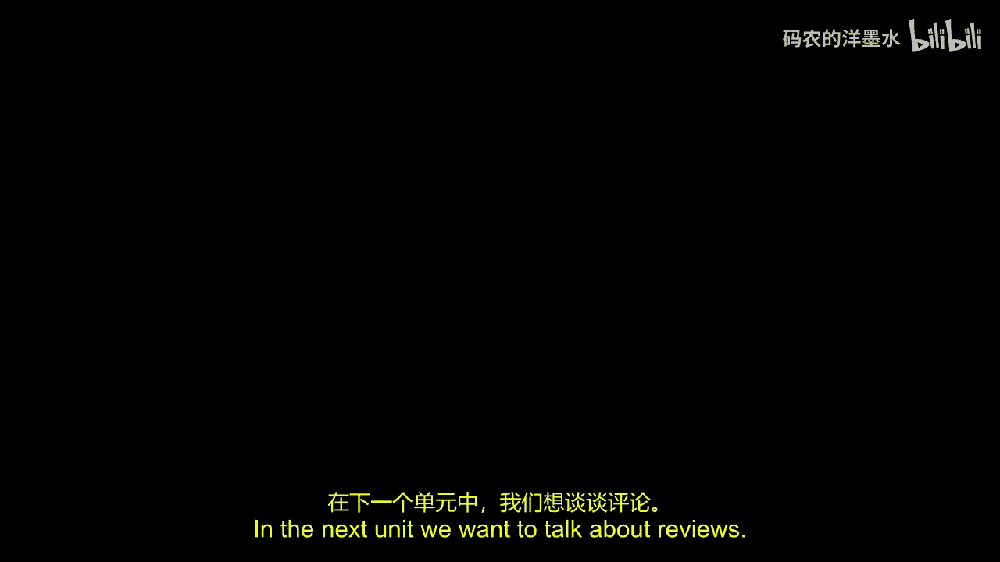
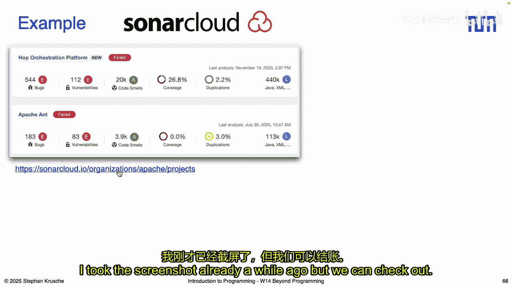
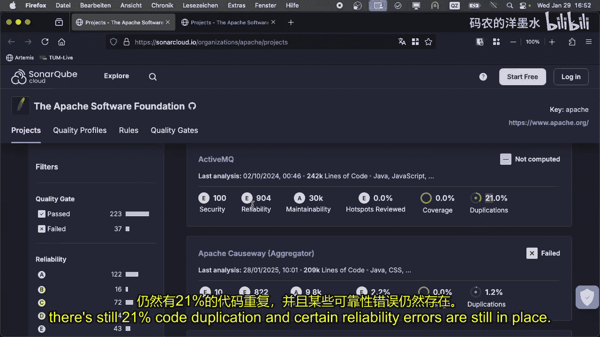

# 066：代码审查与静态分析

在本节课中，我们将要学习软件工程中一项至关重要的实践：代码审查。我们将探讨其重要性、不同类型，并深入了解如何利用静态代码分析工具来自动化审查过程中的重复性任务，以提高代码质量和开发效率。

## 什么是代码审查？🔍

在下一个单元，我们将讨论代码审查。

代码审查对于减少缺陷数量非常重要。这是一种缺陷规避技术，我们在软件过程的各个阶段应用它。

请注意，在软件中越早发现问题，修复这些问题就越容易、成本也越低。因此，代码审查是许多不同活动的一部分，不仅涉及代码质量，也涉及模型质量和需求质量。

代码审查意味着一个人首先创建一份文档（或代码），然后第二个人审查其结果，以发现问题、错误、不良实践等。审查可以是非常正式的，也可以是非常非正式的。例如，你可能偶然遇到某人，只是谈论你的想法，然后你注意到你的想法中存在一些缺陷。

在任何情况下，在软件工程项目中，代码审查都非常重要，它们需要你投入时间和精力。当然，组织也必须承担这些成本。但研究表明，代码审查非常有效。它们不仅能发现代码问题，还能发现设计问题或需求问题，这些构成了软件最终错误中超过50%的部分。

## 代码审查的类型与形式

根据软件项目或活动的阶段，我们有不同类型的审查。你可以审查分析结果、审查架构、审查代码。在Scrum中，你还需要进行冲刺评审。

另一方面，我们可以根据审查的正式程度来区分，其中“检视”是软件工程中最正式的审查技术。在这种形式中，甚至不是创建工件的人来展示它，而是由另一个未创建它的人来展示。通常有6到8人作为听众一起审查。有正式的协议，定义了某些角色，以得出最佳结果和分析，判断工作产品是否具有良好质量或存在需要解决的问题。

在这之间，还有“走查”和“同行评审”，人们可以同步进行（例如在同一台电脑前一起工作），或者异步进行。如今，许多开发者在分布式团队中工作，例如在开源社区中。他们通常在分支中创建代码，然后其他人在拉取请求中审查代码，并提供关于代码质量好坏的反馈。

## 代码审查的目标与优势

当涉及到代码审查时，目标是提高代码质量，并识别那些会导致错误和最终用户体验不佳的问题。有些人也称之为实现“整洁代码”。

其优势不仅在于显而易见的代码质量提升。另一方面，还在于相关人员之间的知识传递。我们希望你们在项目工作中也能体验到这一点。如果两个人处理同一段代码，那么他们都能更好地理解正在发生的事情。当你再次考虑涉及数百名开发人员且人员流动率高的更复杂项目时，每年可能有20%的人离开公司，20%的人加入公司，开发人员流动率为20%。那么，如果有人离开，有其他人知道这段代码实际上是如何工作的、代码做了什么以及其背后的含义，这当然是有益的。

它还可以改善开发人员之间的沟通、文化和团队氛围。

## 代码审查的挑战

当然，也存在挑战。你需要投入时间和金钱，这会减慢开发速度。审查工作相当重复，许多人并不喜欢审查某些东西。软件开发者真正喜欢的是在没有任何依赖的“绿地”上发明新代码。他们不喜欢的是编写测试、编写文档和进行审查。因此，管理者需要督促他们、激励他们，向他们解释为什么这很重要。否则，他们不会自然而然地去做。

## 静态代码分析：自动化审查

静态代码分析是一种技术，允许我们使用所谓的“Linter”和其他规则检测器来自动化代码审查的重复性方面。我们可以识别代码中的常见问题，确保格式正确等等，从而已经修复了许多问题。

然而，许多代码审查仍然是必要且有用的，因为静态代码分析，甚至是最好的LLM，都无法识别代码中的所有问题。因此，一个最佳实践可能是：只有在所有自动检查（可能是静态代码分析，可能是测试用例）都通过之后，才手动审查代码。只有这样，才让一个人花时间查看它。

## 代码中的典型问题

代码中存在典型问题或编程错误。可能是代码风格错误，导致代码难以理解，只有开发者自己能懂，但其他人不行。我们基本上试图摆脱这种情况。例如，当我从前任教授那里接手幻灯片时，有很多代码难以理解，我们试图使其更容易理解，但这总是一种权衡。

代码可能由于空块或没有实际意义的if-else语句而无法到达。代码可能过于复杂，包含安全问题。人们可能只是复制了代码。在架构方面，可能某些类之间依赖过多，导致高耦合；或者它们之间根本没有依赖，这可能导致低内聚的问题。

## 实践练习：识别代码问题

我们现在有一个小练习。请看幻灯片55。请举手告诉我你在代码中发现了什么问题。

这不是一段好代码。我们可以发现很多问题。我们想开始。有志愿者吗？

我们剩下的人不多了。这感觉有点像大讲堂里的辅导课。但无论如何，你们留在这里，你们经受住了所有不来上课的诱惑。为此感谢你们。但现在你们也需要参与进来。谁能发现代码中的一个错误？

你超出了范围。我知道你很容易做到。我们希望观众中有人来回答。否则，我会点名。你怎么样？是的，拿着黄色瓶子的那位，对，就是你。

是的，这段代码如果放入编译器甚至无法编译，因为变量3未定义。你还看到了什么？这超级简单。

是的，非常好。这里存在数组索引越界异常，因为我们只有索引0到4，但我们访问了索引5。还有什么？是的，这里缺少相同的冒号。还有什么？

这个除法没有意义，因为我们会除以零。非常好。

缩进在这里似乎也不对。或者可能缺少闭合大括号。是的，你无法立即看到这一点。

这里我们在同一行有开括号，下一行也有。然后一些变量以大写字母开头，另一些以小写字母开头。所以这在定义上不太一致。在for循环的定义中，我们有逗号而不是分号。所以这也不会工作。

你看，审查糟糕的代码并不是一件非常愉快的事情。当然，如果你能找到问题并帮助某人改进，这很好，但这可能不是你最喜欢的活动。

这里是一个包含一些问题的示例解决方案。我们谈到了算术异常，这里有一个找不到的符号“变量3”，数组越界，格式化问题，这里没有空格，这里有一些。Java找不到符号，因为它是用小写字母写的“s”，而这里是大写字母。格式化错误、命名错误、缺少分号等等。所以这真的是非常糟糕的代码。但这是我们在实践中看到的情况。当然，它会编译，因为编译器会帮助你。但关于变量名，我们甚至没有讨论变量名。它们不是很有帮助。是的，什么是var1、var2、bar3等等？为什么它们没有更好的名字？是的，拥有有意义的名称非常重要。否则，人们将无法理解发生了什么。我猜没有人能告诉我们这里使用了什么算法。我甚至也不知道。这无关紧要，但如果你看到变量名，并且它们有有意义的名称，理解起来就容易得多。

## 自动化工具：静态与动态分析

当然，要解决所有这些问题需要花费大量时间和许多双眼睛。在最好的情况下，开发者甚至不会编写糟糕的代码，但这并不总是可能的。好消息是，我们有一些工具可以帮助我们。首先，我们有静态分析。然后我们还有动态分析来验证软件的正确性。

有什么区别呢？静态分析意味着你不执行代码。你只是查看代码结构、空白、格式以及许多其他方面。你可以手动完成，就像我们刚才做的那样，手动浏览代码，查看，与最佳实践、代码规则进行比较，看你是否遵循它们。当然，这很繁琐，最好有一些自动工具来做这件事。每种编程语言都有很多这样的工具，例如SpotBugs，你可以轻松找到语法和语义错误，或者偏离编码标准的情况。

然而，另一方面，静态代码分析无法发现所有错误。动态分析也有用武之地，即你执行代码并编写测试，要么关注输入和输出（这称为黑盒测试，因为你不查看代码内部，代码就像一个黑盒），要么是白盒测试，你查看代码并专门测试子系统或类的实现。

我们想先看看静态分析，因为它与代码审查相关。动态分析有点超出范围，但你将在下学期的软件工程课程中学习它。

## 静态分析工具的工作原理

有不同的静态代码分析工具，它们都通过读取源代码来工作。从中提取一个模型作为中间表示，并分析这个模型是否遵循某些规则，然后向你提供一个输出结果，说明“嘿，这是好代码”或“不，这是坏代码，我发现了以下错误”。

中间表示可能不同。它可以是一个符号表，你在其中定义所有符号和分配。它可以是一个抽象语法树，例如你的编译器在重构时使用的。它可以是一个控制流图，你可以看到代码实际上是如何在代码中导航的，从而识别是否存在永远无法到达的死胡同。它也可以是一个调用图，你可以看到哪个方法调用了哪个其他方法，以识别程序调用语义的某些方面。

所有这些表示，所有这些中间表示，都帮助我们找出代码的某些方面，例如你是否遵循最佳实践，以及代码中有什么样的度量指标，是复杂还是简单。这有助于我们分析代码并识别改进之处。

在某种意义上，你在IntelliJ或VS Code中看到的代码警告和错误已经基于静态分析。因此，静态分析已经内置到IDE中。每个关于某些东西不工作的编译器警告或编译器错误都是某种静态分析。但还有更多。有度量指标可以让你发现代码中的结构异常。还有其他工具，如Java的SpotBugs、PMD或Checkstyle，以及其他编程语言的许多其他工具。所以再次强调，这里的重点是理解这个思想，而不仅仅是使其适用于一种编程语言。

## 集成静态分析到工作流

事实上，有如此多的工具和如此多的不同设置方式，以至于有一种集中化的趋势。SonarQube和SonarCloud以一种非常好的方式做到了这一点。也有其他例子，但这些特别好，因为你可以简单地将项目上传到GitHub，在SonarQube或SonarCloud注册一个账户，然后自动获得项目的静态代码分析。它会根据你的编程语言和业界商定的某些最佳实践，自动尝试从头开始设置，这使得开始使用静态代码分析变得非常快速和简单。

对于静态代码分析来说，重要的是将其集成到你的工作流中。理想情况下，每次提交都会根据某些问题进行检查，并且你的Git仓库中的每次提交实际上都会检查它是否满足规则，以及有多少偏差。你有多少技术债务。技术债务意味着你的代码中存在需要在未来某个时间点修复的问题。当然，技术债务越多，系统的质量就越低，未来维护和实现新功能也就越困难。如果系统永远不会再改变，那也没关系，但我不知道有任何系统会保持不变且不随时间变化，所有系统都在进一步发展。

## 实践演示：使用SpotBugs

让我们看一个使用SpotBugs的快速示例。我创建了一个仓库，我们可以通过以下链接使用它。所以现在请和我一起在IntelliJ中克隆这个仓库。

我们这样做：文件 -> 从版本控制新建项目。我们粘贴链接。你不需要任何身份验证。这是一个开源仓库。我们克隆它。

在它配置自己的同时，我们可以安装SpotBugs插件。你怎么做呢？你去IntelliJ设置。然后你去插件。然后你去市场，搜索SpotBugs。然后你安装它。

然后我们可能需要重启IntelliJ。但也可能不需要重启就能工作。

所以现在请这样做，给你一些时间。你会在幻灯片上看到它是如何工作的。

你打开文件，然后偏好设置或设置，取决于操作系统。然后你去插件。你在市场中搜索SpotBugs，然后点击安装按钮。助教也可以在周围走动，以防你需要帮助，他们不会一直坐着，你可以为你的健康做点什么。

很好，现在下一步，如果你已经完成了，就是再次打开IntelliJ。打开源文件夹。你看，我们有一个课程类、一个主类、一个学生类和一个在线类。现在你可以做的是，基本上右键点击项目。然后在上下文菜单中应该有一个SpotBugs条目。然后在这里你可以说“分析模块文件”或“项目文件”，这没关系，不包括测试源。这样，我们基本上就开始了静态分析。

在SpotBugs中，能够在你的代码中的四个类里找到7个错误或潜在错误。😊

你应该在左侧有这个小的错误图标。如果你点击它，然后点击应用程序，抱歉，我现在在错误的窗口里，让我关掉另一个。

所以我们在这里。再次，如果你点击左侧边栏中的这个小图标，那么你可以导航到错误中，并看到例如在学生类的第18行有一个错误。

这里的问题是什么？问题是这样的。Replace all，是的，我们这里有一个外国名字，我们想根据正则表达式用一些其他字母替换某些字母，我们甚至不需要理解正则表达式，这没关系。但这里的问题是，这在这里总结得很好：方法的返回值被忽略了。这里发生了什么？嗯，开发者认为replace all是就地改变字符串本身。并且for name本身被改变了，变量for name被改变了，但在你上完这门课后，你知道得更清楚。字符串是不可变的，对吧？你在字符串上调用的每个方法都不会改变字符串本身。但这里我们做的是返回一些东西。是的，这个返回值被忽略了。这是一个错误或错误模式的指示。现在，我们如何修复它？嗯，我们可以创建另一个变量存储它，然后在这里分配给属性，或者我们可以简单地复制粘贴这段代码，直接将其分配给属性。

现在，如果我们再次运行SpotBugs。分析项目文件，不包括测试源。我们看到错误数量减少了一个，并且在这个位置不再有错误消息了。你可以查看所有其他错误，现在你有几分钟的时间来处理这个问题并修复它们。这里没有示例解决方案，这真的只是让你尝试一下，这可能在你未来有一个子程序时帮助你发现某些问题并修复它们。所以我会给你几分钟，现在开始工作，如果你有问题或发现某些东西不工作，请举手，然后助教会过来。

好的，时间到了。我们希望你已经能够尝试并修复至少几个提到的问题。如果你还没有完成，你仍然可以在之后做，但由于时间原因，我们必须继续。

## 云端静态分析：SonarCloud示例

让我向你展示在SonarCloud中是什么样子，他们自动为你配置SpotBugs和其他Linting工具。它易于设置，并集成到开发工作流中，导致类似持续代码质量的东西，你可以看到分支中的某些提交是否未能通过质量门，或者是否通过了质量门，他们还在浏览器上给你一个非常好的概览，显示修复问题需要多长时间，以及他们有什么样的建议。

这里有一个例子，你也可以自己查看。这是SonarCloud上的一个Apache项目，我很久以前就截了图，但我们可以检查它是否在中间有所改进。

嗯，让我们看看这里发生了什么，如果我们去这个网站。然后我们看到它现在看起来有点不同。他们改进了设计，但基本上这个项目的安全评级仍然是E。仍然有21%的代码重复。某些可靠性错误仍然存在。所以即使人们使用它，也不意味着他们最终会改进他们的代码，但它确实给你一些很好的见解。还有你有多少代码，你使用什么语言等等。

如果你深入研究一个项目，你可以搜索不同类型的问题。例如，错误或安全漏洞、代码异味。SonarCloud尝试自动为你创建一些优先级或严重性，并区分阻塞、严重、主要、次要和信息性问题。然后如果你看一个具体问题，你会看到，嘿，这是一个错误。它是阻塞性的。它仍然开放且尚未分配，我们估计这将花费你五分钟来修复它。

如果你结合所有这些时间估计，你会得到项目技术债务的总体估计。修复所有问题需要多少时间。有544个错误、112个漏洞和20K个代码异味。那需要多少时间？

请注意，一些代码异味可以自动修复，特别是当涉及到某些最佳实践、格式或特定实践的使用时，某些方面可以自动修复，但这里发现的大多数问题必须手动修复。

我们也可以看到我刚才给你的例子的结果。我为SB示例设置了SonarCloud，我们看到他们识别出相同的七个问题，分为四个错误（针对replace all方法的返回值）和三个代码异味，然后你看到修复它应该花费多少努力。我不真的认为是10分钟。是的，如果你真的快速地去代码那里，修复它可能只需要一分钟。但当然，这涉及一些开销，你必须阅读这个，你必须导航到你的项目，最终你必须提交它，你必须将其集成到主分支，所以总的来说，这绝对可能需要10分钟。

## 静态分析的局限性与最佳实践

关于静态代码分析、SonarCloud有什么问题吗？是的，问题是：你被允许在监督练习中使用这个插件吗？是的，你被允许使用它，但它可能对你没有帮助，因为我们的代码设计方式通常不会遇到这样的问题，而且如果你不断检查，也可能导致开销。但只要你没有使用AI工具，并且SpotBugs尚未基于AI（未来可能基于AI，我们不知道，但目前它不是基于AI），你就有可能使用它。

你不能做的是将你的代码上传到SonarCloud。这是不可能的，但如果你在IntelliJ中使用SpotBugs插件或任何其他用于静态代码分析的插件，这是可以的。

静态代码分析存在某些局限性。正如你在幻灯片上的SonarCloud截图中看到的，他们发现了许多许多错误，有时这些错误无关紧要。它们并不重要。但有时存在重要的错误，如果你现在发现20k个问题，要找出哪些是相关的、哪些根本不重要，并不超级容易。并且有一些实验，例如William Po在Cha One会议出版物中的实验，表明静态分析可以发现5%到10%的软件质量问题，但这也意味着其他软件质量问题无法被发现，有时有太多的噪音，太多的误报，太多的错误需要修复。

然后，有时也会对开发者造成干扰或误导。当然，存在静态代码分析无法发现的问题，需要适当的动态分析（即测试）来解决。所以静态代码分析可以帮助你，但它不能替代手动代码审查，也不能替代测试。不要被工具提供商的营销所迷惑。

## 我们的建议

我们这边的建议是：不要跳过编写测试用例。即使在一个相对较小的项目中，比如你的游戏开发，编写测试用例以确保如果你改变功能，现有功能不会崩溃，这可能是有意义的。这也称为回归测试。

在实践中，不要跳过手动代码审查。然而，你可以做的是，只有在所有你拥有的测试都通过，并且所有你为项目配置的静态代码分析工具（你认为它们有意义）都通过之后，才手动审查代码。只有这样，才应该让一个人参与代码审查。在此之前，创建代码的开发者应确保测试通过，并且项目中配置的静态代码分析通过。因为如果这些最低要求没有满足，要求另一个人、另一个开发者花时间提供反馈和改进代码是相当不公平的，因为人类开发者不知道静态代码分析是否能同样发现问题。

所以静态代码分析可以提高代码质量和代码的可维护性，但它不是灵丹妙药。如果你有效地使用它，它比捕捉同类错误的其他技术更便宜。

因此，绝对值得将其集成到流程中，例如，让SonarCloud检查你在开源项目中的所有提交和所有拉取请求。

将其与动态分析（测试）结合也是一个非常好的主意，但你必须投入一些时间进行手动代码审查，或者可能让LLM审查你的代码（如果它们变得更好，未来可能会取代人类代码审查）。但目前要小心，在一些项目中，LLM也可以取代人类代码审查。然而，这在未来可能会改变。

很好，我们将再做一个短暂的休息，并在5点10分继续今天的最后一个单元，在那里我们将发现更多开发工作流，并深入探讨持续集成和持续交付，这是我在软件工程中最喜欢的话题之一。😊

## 总结

在本节课中，我们一起学习了代码审查的重要性及其在软件开发生命周期中的关键作用。我们探讨了从非正式讨论到正式检视的不同审查类型，并深入了解了如何利用静态代码分析工具（如SpotBugs和SonarCloud）来自动化识别常见代码问题。我们认识到，虽然自动化工具能显著提高效率并发现许多问题，但它们不能完全替代手动代码审查和全面的测试策略。一个平衡的方法——结合自动化检查、同行评审和动态测试——是确保软件高质量、可维护性和团队知识共享的最佳实践。