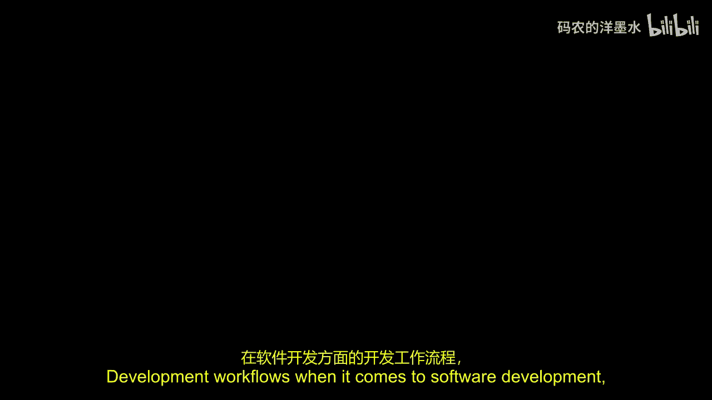
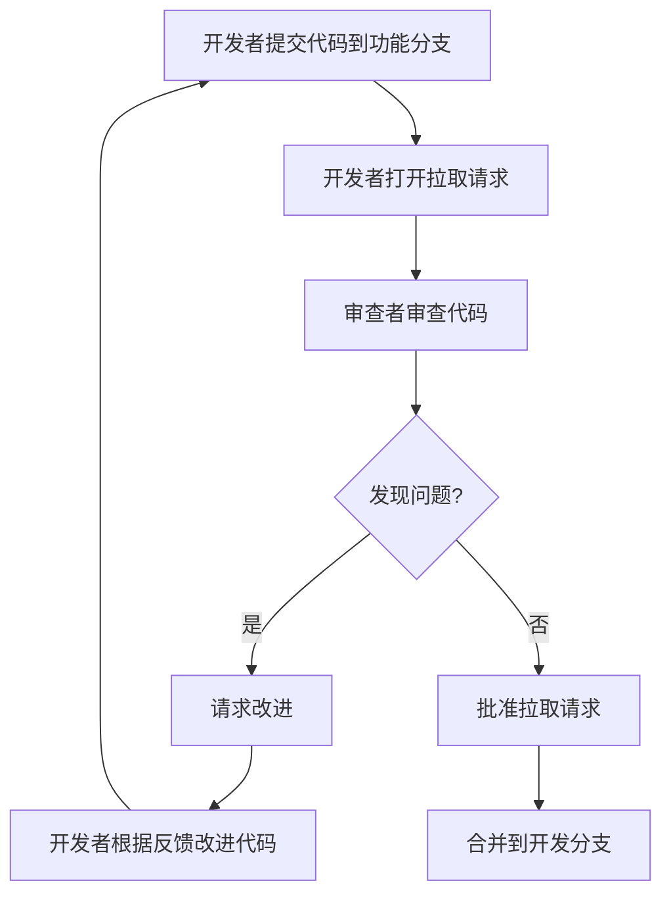
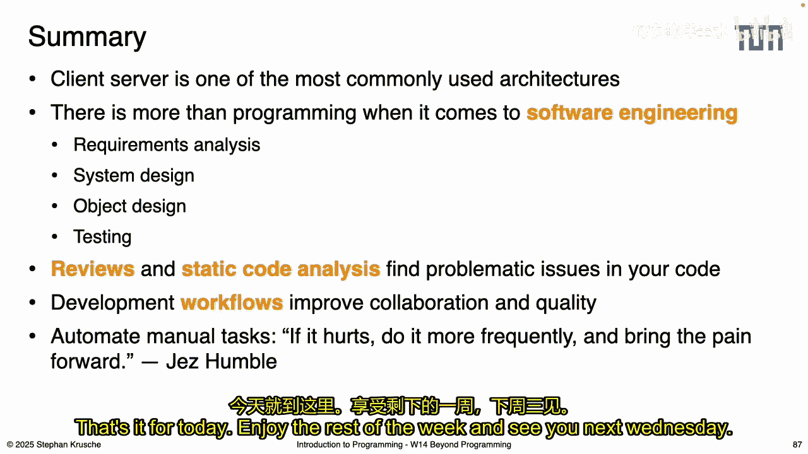

# 067：开发工作流 🚀

在本节课中，我们将要学习现代软件开发中的核心工作流。我们将探讨如何使用版本控制（如Git）进行协作，理解分支管理模型，以及如何通过持续集成和持续交付等实践来自动化构建、测试和部署过程。这些知识将帮助你更高效、更可靠地开发软件。

## Git 工作流回顾

上一节我们介绍了软件工程的基本概念，本节中我们来看看一个具体的协作工具：Git。对于软件开发人员来说，掌握Git并理解其基础原理至关重要。

Git允许你将工作副本中的更改添加到暂存区，然后提交到本地仓库。这意味着你可以在离线状态下快速完成这些操作。如果你想与其他开发者共享代码，则需要将其推送到远程仓库。如果其他开发者对代码库做出了贡献，你需要获取这些更改并将其合并到你的工作副本中，这个过程通常通过 `git pull` 命令完成。

以下是Git的基本操作流程：
1.  **`git add`**: 将工作区的更改添加到暂存区。
2.  **`git commit`**: 将暂存区的内容提交到本地仓库。
3.  **`git push`**: 将本地仓库的提交推送到远程仓库。
4.  **`git fetch` + `git merge` (或 `git pull`)**: 从远程仓库获取更新并合并到本地。

当多个开发者使用分布式版本控制在一个Git仓库上协作时，默认情况下会使用一个远程仓库（如GitHub、GitLab等）。开发者通常与本地仓库交互，并在准备好与其他开发者同步时，通过远程仓库来同步更改。此外，通常还会有一个Web界面，用于在浏览器中查看代码，并支持代码审查和拉取请求等额外工作流。

## 分支管理模型 🪵

到目前为止，你可能只使用过一个分支，这对于初学者和仅涉及少数开发者的小型项目来说完全可行。然而，当涉及更多开发者时，使用多个分支会更有意义，因为这样人们可以更独立地在特定功能或错误修复上工作。

以下是一个在实践中被广泛使用的简化分支管理模型。它并非唯一模型，但对于初学者来说足够简单，并且足够灵活以覆盖许多不同场景。

该模型包含主分支（main）、开发分支（development）和多个功能分支（feature）。实际开发工作在功能分支上进行，而不是在开发分支上。

以下是该工作流的关键步骤：
1.  **创建功能分支**：当你想要开发一个新功能时，从开发分支创建一个新的功能分支。
2.  **在功能分支上工作**：在功能分支上进行提交（每个圆圈代表一次提交）。多个开发者可以在同一个功能分支上协作。
3.  **合并到开发分支**：当功能完成且代码质量令人满意时，将其合并回开发分支。

这种模型有一个非常重要的优势：只有已完成的功能才会成为开发分支的一部分。这确保了开发分支始终处于可工作的状态，其他开发者可以基于一个稳定的基础创建新的功能分支。

请注意，将工作分离到多个分支并不能防止合并冲突。这只是一种机制，让你可以快速尝试新想法，并且让开发者能够专注于自己的工作而不受他人过多干扰。合并冲突仍然可能发生，例如当你在功能分支上工作时，开发分支被其他人更新了，你需要将开发分支的更新合并到你的功能分支时。

## 拉取请求与代码审查 🔍

上一节我们介绍了分支模型，本节中我们来看看一个增强协作的关键实践：拉取请求（Pull Request， 有些平台也称为合并请求）。我之前展示的将功能分支合并到开发分支的过程是一个高度简化的模型。在现实中，这通常涉及多个步骤，而拉取请求为此提供了很好的工具支持。

拉取请求的理念是，你有一个负责质量的“守门员”（例如代码审查者）。开发者首先需要说服审查者：“亲爱的审查者，这是一个很棒的功能，我测试过了，代码质量很好，遵循了最佳实践，请将我的功能拉取到开发分支吧。”

以下是拉取请求和代码审查的典型工作流程：

该流程的参与方和活动如下：
*   **开发者活动**：提交源代码到功能分支；在功能完成后，请求将所有提交合并到开发分支，即打开拉取请求；根据审查反馈改进源代码（产生新的提交）。
*   **审查者活动**：基于可理解性、架构一致性、编码规范符合性、静态代码分析结果、测试用例通过情况等审查更改；发现问题并请求改进；最终批准拉取请求。
*   **共享实体**：拉取请求是双方沟通的核心平台。

这是一个非常好的工作流，可以防止“破窗理论”在代码中发生（即糟糕的代码像破窗一样在代码库中蔓延）。然而，它也可能减慢开发进程，特别是在开发者提交的拉取请求描述不清，或者审查者没有时间及时审查时。因此，需要在代码质量检查和开发速度之间取得平衡。

## 持续集成与回归测试 ⚙️

接下来，我想介绍一个帮助你集成软件、测试软件并基于测试发现潜在问题的开发工作流：持续集成（Continuous Integration， CI）。

持续集成与版本控制服务器中的源代码仓库相连。每当开发者推送提交时，持续集成服务器会收到通知，并执行以下操作：
1.  检出代码。
2.  编译代码。
3.  根据预先定义的质量要求和测试用例进行测试。

然后，持续集成服务器会将状态通知开发者。状态可能是：“代码编译失败，请修复”；“代码未通过所有测试用例，请修复”；或者“一切正常，请继续”。所有这些检查都是自动完成的，不涉及人工操作（除了开发者查看错误信息）。

持续集成的架构通常是分布式的。多个开发者与版本控制服务器交互，触发持续集成构建。构建计划或构建过程可以根据项目（Java、Python、JavaScript等）进行定制。持续集成服务器可以将构建任务委托给多个构建代理以并行处理。

持续集成的核心概念是**回归测试**。回归测试意味着对你的版本控制中的每一次提交、每一次更改都进行反复测试，以确认所有之前能正常工作的功能仍然正常工作。这是一种极好的技术，因为它能防止我们引入导致现有功能失效的更改。

然而，在非常复杂的软件系统中，你可能拥有成千上万甚至数百万个测试用例。每次提交都执行所有测试可能非常耗时且成本高昂。为了解决这个问题，可以采用一些技术，例如：
*   **测试选择**：基于依赖分析，只测试受更改影响的子系统。
*   **测试用例优先级排序**：确保最重要的功能优先得到测试。

## 持续交付与持续部署 🚢

如果我们把持续集成再向前推进一步，就可以实现**持续交付**（Continuous Delivery）。持续交付基于持续集成，但不止步于构建和测试。它引入了发布经理的角色，负责获取持续集成服务器生成的构建产物（可执行文件），并将其上传到交付服务器（如应用商店、测试分发平台等），然后通知用户有新版本可供试用。

用户安装新版本并提供反馈，这些反馈可以被收集并存储在问题跟踪器中，通知相关开发者进行处理。持续交付自动化了流程中的所有步骤，使得通过一次点击就能将软件交付给最终用户进行试用，从而能够在短周期内产生有价值的软件。

持续交付可以进一步区分为**持续部署**（Continuous Deployment）。两者的关键区别在于：
*   **持续交付**：在自动化流水线（编译、单元测试、集成测试等）的末端，总是有一个由发布经理执行的手动步骤——按下按钮，将软件发布给实际用户。
*   **持续部署**：这个发布步骤也是自动化的。只要代码更改通过了所有自动化阶段，软件就会自动交付给最终用户。

许多公司采用持续部署来最小化从开发到用户手中的时间。为了降低风险，他们通常会实施：
*   **部署后测试**：在软件部署到生产环境后运行测试。
*   **自动回滚**：如果关键性能指标下降，则自动回滚到上一个版本。
*   **金丝雀发布**：首先将新版本发布给一小部分用户（例如特定地区），根据反馈和指标再逐步扩大发布范围。

通过这些实践，公司可以实现**持续软件工程**，即具备在短周期内开发代码、自动发布并从中学习的能力。学习来自用户的反馈（如应用商店评价）和隐式测量（如用户参与度、收入流变化等），这对于改进软件和商业模式至关重要。

## 容器化部署 🐳

在结束之前，让我们简要了解一下软件部署的演进。传统的软件应用直接安装在裸机硬件上。对于Web服务应用，这意味着公司需要自行购买和维护硬件，成本高且应用间隔离性差。

随后，部署实现了虚拟化，通过虚拟机来运行应用，这改善了隔离性并降低了硬件成本。但虚拟机仍然比较重，启动和关闭需要数分钟时间。

近十年来，一个非常强烈的趋势是转向使用Docker和Kubernetes等工具的**容器化部署**。容器更加轻量级，它在一个完全隔离的环境中运行应用，启动速度可达秒级。此外，容器允许你轻松扩展软件，因为你可以在所谓的集群中同时运行多个容器。

容器化的工作流程如下：
1.  **描述基础设施即代码**：通过Dockerfile等镜像描述文件，定义应用及其所需的基础设施（如操作系统、Java运行时）。
2.  **构建镜像**：镜像是一个包含应用及其依赖的模板，类似于面向对象中的“类”。
3.  **运行容器**：从镜像可以轻松生成或运行多个容器实例，类似于“对象”。
4.  **集群管理**：容器可以在Kubernetes集群中运行，集群管理器可以根据用户需求自动扩展容器数量。

最佳实践是为每个应用创建独立的容器和镜像。应用在持续集成过程中构建，并插入到镜像中。每次应用更改都会生成新的镜像版本。在运行时，可以生成这些容器，并在Kubernetes集群中根据需求自动伸缩。

## 总结 📚

本节课中我们一起学习了现代软件开发的核心工作流。

我们首先回顾了Git作为基础协作工具的使用。接着，探讨了分支管理模型，特别是使用主分支、开发分支和功能分支来组织协作，并介绍了通过拉取请求进行异步代码审查的详细流程。

然后，我们深入了解了持续集成如何通过自动化构建和测试来保证代码质量，并强调了回归测试的重要性。在此基础上，我们进一步学习了持续交付和持续部署，它们将自动化扩展到软件发布环节，甚至实现自动发布和监控反馈。

最后，我们简要了解了部署技术的演进，从传统部署到虚拟化，再到当前主流的轻量级、可快速伸缩的容器化部署（如Docker和Kubernetes）。

这些工具和实践共同构成了一个高效、可靠的现代软件开发工作流，能够帮助团队更好地协作、保证质量并快速响应用户需求。记住这句关于自动化手动任务的名言：“如果某件事很痛苦，那就更频繁地去做它，并把痛苦提前。”

---

**下一步安排**：从明天开始，你们将进行项目演示，有10分钟展示时间和简短的问答环节。导师将评估演示并告知项目工作的得分。在接下来的教程小组中，将没有新的家庭作业或练习。我们推荐了两篇关于持续交付和代码审查指南的文章供感兴趣的同学阅读。下周三（2月5日）我们将不再有新内容，而是尝试总结课程最重要的方面，并为第二次监督练习提供一些提示。

祝大家本周愉快，下周三见！