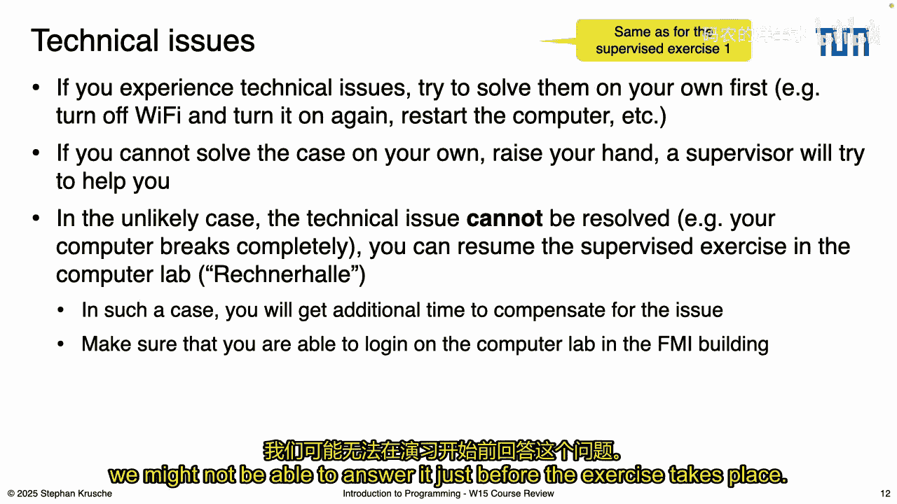

# 069：监督练习 2 说明与复习

在本节课中，我们将介绍第二次监督练习的具体安排，并快速回顾课程中最重要的知识点。本次监督练习将于下周举行，我们将详细说明其形式、规则和准备事项。

## 监督练习 2 信息

上一节我们介绍了课程的整体安排，本节中我们来看看第二次监督练习的具体信息。其流程将与第一次监督练习完全相同。

以下是监督练习 2 的基本安排：
*   开始时间为晚上 7 点。
*   请最晚于 6 点 30 分到达指定的演讲厅，以便有充足时间进行准备。
*   考试时间为 90 分钟，另有 10 分钟用于处理技术问题。
*   满分为 100 分。

在内容方面，课程涵盖的所有内容都可能成为考试的一部分。第一次监督练习侧重于前几周的内容，而本次练习将侧重于后续几周的内容。然而，前五到七周的内容是所有后续知识的基础，因此不能忽视，你应当能够编写课程中涉及的所有程序。

## 地点与设备要求

本次监督练习将在加兴校区举行。最晚于周一早上，你将收到一封包含具体演讲厅信息的邮件。你需要前往加兴校区，演讲厅可能与上次相同。

以下是关于参与和设备的关键要求：
*   你必须亲自到指定的演讲厅参加考试，不允许在世界其他地方或慕尼黑工业大学主校区参加。
*   我们将进行考勤检查，请确保参与并正确录入数据。
*   你需要使用自己的笔记本电脑，这是一场自带设备的计算机考试。
*   如果你没有合适的笔记本电脑，可以使用我们实验室的 Mac 电脑。请确保熟悉 Mac 的操作，如果你完全习惯使用 Windows，可能会感到困难。如需使用实验室电脑，请务必提前发邮件给我们。

## 考试规则与行为准则

本次监督练习为开卷考试，你可以使用任何资源，但必须独立完成。

以下是必须严格遵守的规则：
*   禁止与任何其他人交流，也禁止与任何人工智能工具交流。这是一个非常宽泛的术语，特别禁止使用 GitHub Copilot 以及任何基于 AI 的智能编程插件。ChatGPT 等工具同样不允许使用。
*   我们将使用 Artemis 平台的考试模式。请确保在 IntelliJ 或其他 IDE（如 VS Code）中禁用所有 AI 功能。
*   考试重点在于理解和解决问题，而非死记硬背。请确保能够应用在研讨会、辅导课和作业中涵盖的编程概念。
*   考试形式将从过去几周的大型项目作业，回归到课程初期你已习惯的、用于测试个人能力的小型练习题。

## 编程练习提交须知

监督练习将主要包含编程练习题。你需要在 IDE 中完成这些练习。

以下是提交代码的关键步骤和注意事项：
1.  你需要将代码仓库克隆到 IntelliJ 等 IDE 中。
2.  提交代码时，需要执行提交和推送操作，就像完成所有练习时一样。
3.  你的代码必须在 Artemis 上能够编译。如果无法编译，我们将给予反馈，但仅限于告知代码是否编译成功，不会提供额外的测试反馈。
4.  如果因你的原因导致编译失败，该练习将获得零分，且无法规避此规则。
5.  请勿在最后一刻推送代码。如果这样做，你可能无法及时收到编译失败的反馈，从而可能失去本应获得的分数。

## 重要规则总结

为确保考试公平，以下规则至关重要：

**独立完成与禁止 AI：**
*   必须独立工作，禁止使用任何人工智能工具，特别是 OpenAI ChatGPT、GitHub Copilot 或其他任何 AI 系统。
*   对于 IntelliJ，有具体的禁用说明，请务必应用。

**关闭无关应用：**
*   请关闭所有聊天应用程序，如 WhatsApp、Instagram、Signal、Messages 等。
*   在 Mac 上，关闭窗口不一定意味着应用已完全退出。请确保完全退出应用程序，避免在后台运行，以免引起监考人员的怀疑。

**允许与禁止的资源：**
*   允许在线搜索、查阅幻灯片或类似练习题。
*   禁止在网上发布问题（如 Stack Overflow）。
*   禁止使用任何实时协作工具（如 Notion、Google Docs），因为这看起来很可疑。如需做笔记，请使用本地编辑器。

**设备与环境要求：**
*   只能使用一个显示器。
*   必须关闭所有其他设备，特别是智能手机、平板电脑和智能手表。
*   任何抄袭、交流等可疑行为都将被视为作弊。在德国，这被称为“Unterschleif”，后果严重，可能导致本课程不及格，并使你在第一次监督练习、演示和项目工作中的所有努力付诸东流。

## 考前准备与故障排除

使用个人电脑参加考试，你需要做好充分准备。

以下是考前检查清单：
*   **设备准备：** 确保电脑设置正确，安装好浏览器、JDK 17 和 IntelliJ。
*   **提前测试：** 在周末或周一早上尝试做一些练习，确保一切正常运行。如果出现错误信息，请确保能够修复。助教也可以提供帮助。
*   **系统更新：** 提前安装所有操作系统更新，或在系统中禁用自动更新，以免考试期间开始更新。
*   **关闭无关程序：** 关闭所有不需要的窗口和应用程序，并禁用所有通知。
*   **网络与电源：** 确保可以连接到 Artemis，并以 UniWLAN 作为备用网络。为电池充电，并带上充电器和可能的延长线。如果使用蓝牙鼠标，请确保其电量足以支撑 90 分钟。

如果遇到技术问题，请按以下步骤操作：
1.  首先尝试自行解决，例如断开并重新连接 Wi-Fi，或重启电脑。
2.  在 IntelliJ 中，你可以尝试使用“修复 IDE”或“使缓存无效/重启”功能来解决问题。
3.  如果无法自行解决，请举手示意。监考人员会前来尝试帮助你，但请注意，他们并非专业的 IT 支持人员。
4.  如果问题仍无法解决，我们备有应急预案：你可以更换考试地点（例如前往附近的 FMI 大楼），并且会根据你解决问题所花费的时间，给予相应的额外考试时间。

## 课程重点回顾

现在，让我们快速回顾一下课程中最重要的方面。你可以将此作为复习的起点，但请注意，周一监督练习的内容可能涵盖所有知识点。

本节课中我们一起学习了第二次监督练习的所有安排细节、重要规则以及考前准备指南。请务必认真对待这些规则，并做好充分准备。如果在考试安排方面仍有任何不清楚的问题，请在 Artemis 上提问，我们将尽快协助你。预祝大家在监督练习中取得好成绩。