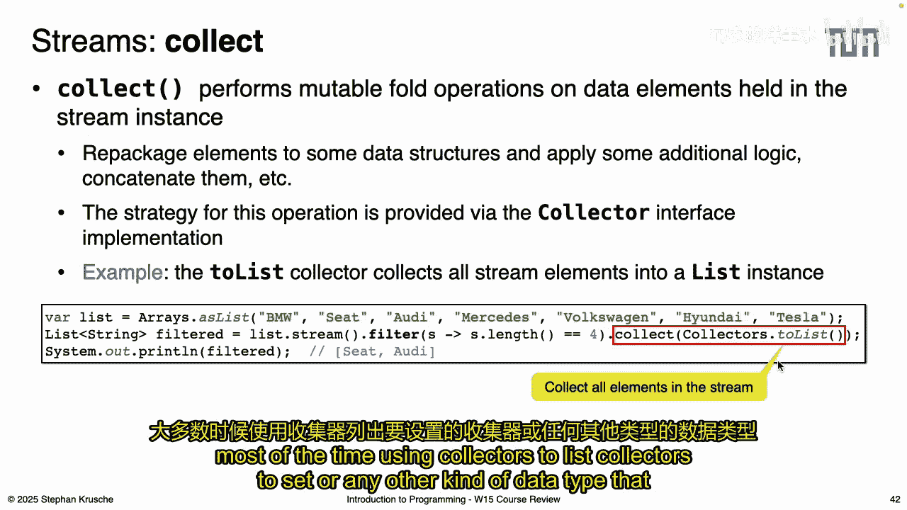

# 070：课程回顾与核心概念总结


在本节课中，我们将快速回顾面向对象编程的核心概念。本次回顾旨在强调最重要的知识点，而非详细解释所有内容。我们假设你已经理解了这些概念，现在将重点指出关键部分。

## 对象与类

上一节我们介绍了对象与类的基本概念，本节中我们来看看它们的核心区别。

*   一个**类**是一个蓝图或模板。
*   一个**对象**是根据这个类创建的具体实例。
*   一个类可以创建多个对象。

类和对象关注三个不同方面：
1.  **身份**：由名称和引用确保。
2.  **状态**：通过其属性实现。
3.  **行为**：通过其方法实现。

## 从建模到实现

我们讨论了如何将现实世界建模为UML类图（包含属性和方法），然后将其编码实现。

以下是创建对象、赋值属性和调用方法的基本代码结构：
```java
// 定义类
class World {
    String name;
    void greet() {
        System.out.println("Hello from " + name);
    }
}

// 创建对象
World myWorld = new World();
// 赋值属性
myWorld.name = "Earth";
// 调用方法
myWorld.greet();
```

请注意，对象将其数据存储在内存中的独立位置。变量（如示例中的 `myWorld`）本质上是指向该内存位置的**引用**。

## 方法

方法实现了对象的动态行为。我们讨论了如何定义、调用方法，以及如何根据返回类型、名称和参数来构建方法。

*   **方法签名**由方法名和参数列表组成，返回类型不是签名的一部分。
*   **方法重载**：可以在同一个类中定义多个同名但参数不同的方法。这被称为**重载**。

在方法调用中，实际参数的值被复制到形式参数中供方法内部使用。方法调用结束后，其内部的一切都将不再可用。

为了在方法调用后保留更改，可以使用对象。此时复制的是对象的**引用**，通过引用可以在方法内部修改对象，产生**副作用**，这些修改在方法调用后依然有效。但对于基本类型的参数，则无法实现此效果。

## 类图与关系

我们讨论了更复杂的UML类图，其中包含：
*   **继承**：例如，支票账户和储蓄账户是银行账户的特定版本。
*   **关联**：通过属性实现的关系。
*   **可见性**：`+` 表示公有，`#` 表示受保护，`-` 表示私有。

## 面向对象特性

面向对象编程有几个关键特性，其中多态性可能是最复杂的主题。

*   **继承**：使用 `extends` 关键字实现。`protected` 成员对子类可见，`super` 关键字用于调用超类的特定构造函数或方法。
*   **抽象类与方法**：允许我们重用代码，即使某个概念在现实中无法实例化或不存在。抽象方法规定所有子类必须实现它，这也被称为**规范继承**。
*   **接口**：与抽象类的主要区别在于，接口通常只指定方法而不实现（默认方法除外）。一个类可以实现多个接口，一个接口也可以扩展另一个接口。
*   **多态性**：
    *   **静态（编译时）多态**：即**重载**。
    *   **动态（运行时）多态**：即**重写**，涉及继承。编译器在编译时进行的绑定是**静态绑定**，而运行时系统根据 `new` 操作符（右侧）决定调用子类还是超类的方法，这是**动态绑定**。

## 泛型

泛型允许我们以类型无关的方式定义功能。

例如，实现一个列表或集合时，可以使用泛型定义如何添加、删除元素，而无需关心放入的具体类型。类型只在创建该泛型数据类型的对象时才指定。

```java
List<String> stringList = new ArrayList<>(); // 指定类型为String
List<Integer> integerList = new ArrayList<>(); // 指定类型为Integer
```

**包装类**（如 `Integer`）允许将基本类型用于泛型，因为泛型只适用于类类型。Java提供了自动装箱和拆箱功能，使得基本类型看起来可以直接使用。

## Java集合框架

我们假设你能自然地使用集合框架中的 `Set`、`List`、`Map` 和 `Queue`。请确保你能将其用于自定义数据类型、包装类或 `String`。许多程序员都会使用这些默认的集合类型。

使用泛型的主要优势在于**类型安全**，它有助于在编译时尽早发现问题。

## 错误处理：异常

我们讨论了异常处理，区分了必须捕获的检查型异常和不需要捕获的运行时异常（如 `NullPointerException`）。

我们介绍了 `try-catch` 机制来处理特定错误（例如，处理用户输入错误导致的 `NumberFormatException`）。

你可以通过继承 `Exception` 类来定义自己的异常，并使用 `throw` 关键字抛出，以通知程序的其他部分发生了无法处理的非法情况。调用方可以通过 `catch` 捕获异常或继续抛出。

## 枚举

枚举是一种值域有限的数据类型。当你只想支持有限的几个特定值时（例如月份、状态），可以使用枚举。

枚举可以与 `switch` 语句（旧风格）或 `switch` 表达式（新风格）结合使用，优雅地处理多个 `if-else` 情况。请记住语句和表达式的区别，`switch` 语句和表达式是理解这一点的很好例子。

## 常用接口

我们讨论了一些Java编程语言中的常用接口：

*   **Iterable 和 Iterator**：允许自定义数据类型使用增强型 `for` 循环，这比传统 `for` 或 `while` 循环更简单、更安全（不易出现索引错误）。
*   **Comparator**：用于排序的重要接口。只要数据类型实现了 `Comparator` 接口，就可以使用Java通用且强大的排序功能。你可以让数据类型实现此接口，也可以即时定义排序规则，例如使用匿名内部类或Lambda表达式，从而实现简洁的排序代码，无需大量样板代码。

## Lambda表达式与函数式编程

Lambda表达式是函数的引用。你可以定义一个包含输入参数列表、箭头和相应函数体的Lambda表达式。

```java
(参数) -> { 函数体 }
```

Lambda表达式通常是简短的函数。通过Lambda表达式，我们可以进行函数式编程，甚至将函数存储在变量中。

**函数式接口**是只包含一个抽象方法的接口，它可以与Lambda表达式一起使用。这遵循了接口隔离原则。

## 流

流允许我们以函数式风格对集合数据类型进行操作。

操作流程通常如下：
1.  从集合（如 `List`、`Set`）创建流。
2.  进行零个或多个**中间操作**（如 `map`、`filter`）。
3.  执行一个**终端操作**（如 `count`、`sum`、`collect`）。

流的优点在于，如果源中有大量元素（如100万个），你甚至可以并行化中间操作，使用并发编程以提高性能。

*   **`map`**：转换数据类型或导航对象。例如，从学生列表中收集所有学号。
*   **`filter`**：根据条件过滤流中的元素。通常先进行过滤可以提高后续操作的效率。
*   **`reduce`**：一种终端操作，将一系列输入元素组合成单个汇总结果（如求和、求积）。
*   **`collect`**：另一种终端操作，使用收集器（如 `Collectors.toList()`）将流元素折叠回集合数据类型。

## 面向对象设计原则：SOLID



最后，我们介绍了面向对象设计的五个重要原则（SOLID）：

1.  **单一职责原则**：每个类应该只有一个职责。
2.  **开闭原则**：对象应对扩展开放，对修改关闭。
3.  **里氏替换原则**：关注继承，子类和超类应有强“是一个”的关系。
4.  **接口隔离原则**：接口应尽量小，最好只包含一个方法（如函数式接口），不强迫实现类做它们不想做的事。
5.  **依赖倒置原则**：关注松耦合，高层模块不应依赖低层模块。

遵循SOLID原则可以创建具有高代码质量的可重用代码。

---

本节课中我们一起回顾了面向对象编程的核心概念，包括类与对象、方法、继承、多态、泛型、异常处理、枚举、常用接口、Lambda表达式、流以及重要的SOLID设计原则。掌握这些概念是构建健壮、可维护Java应用程序的基础。