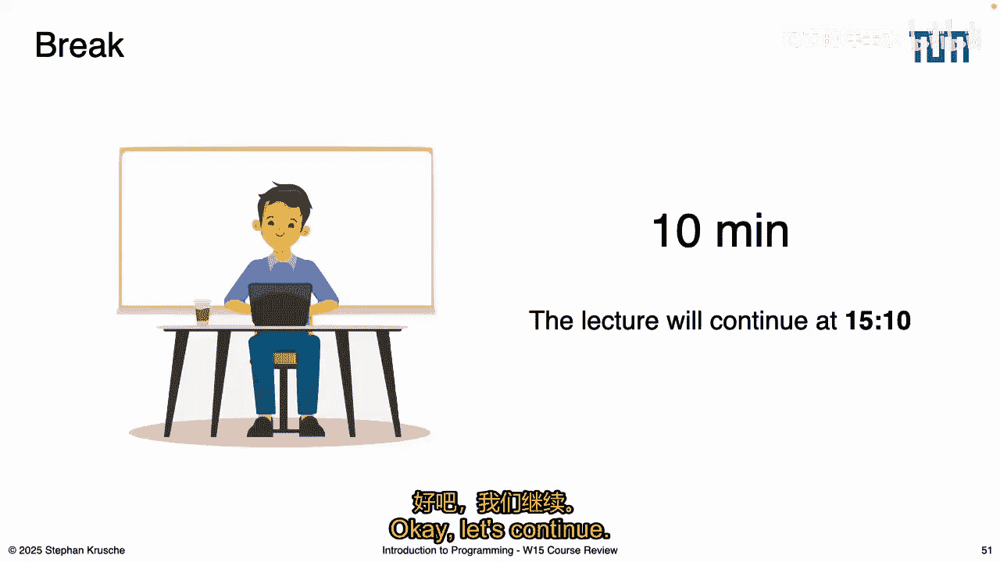
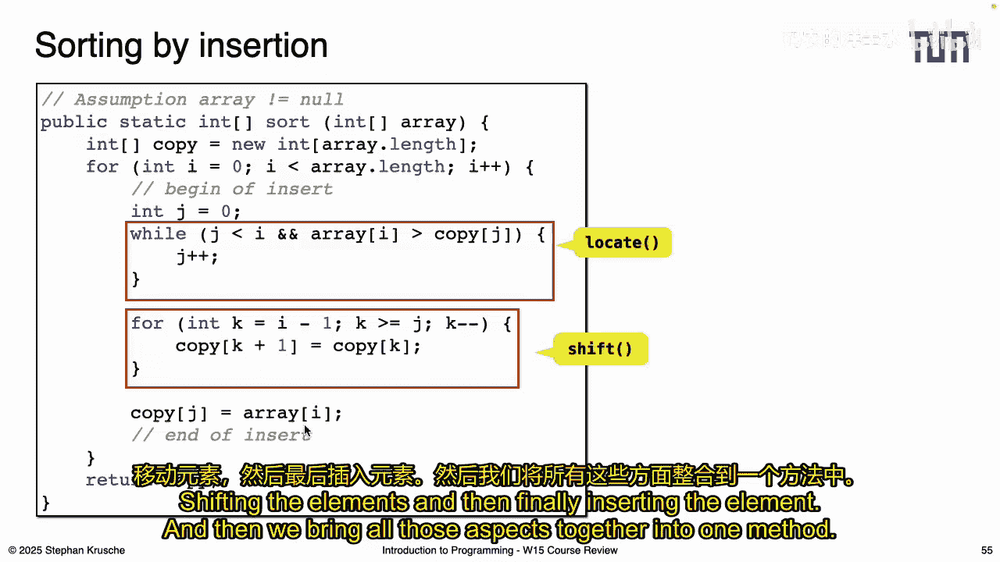
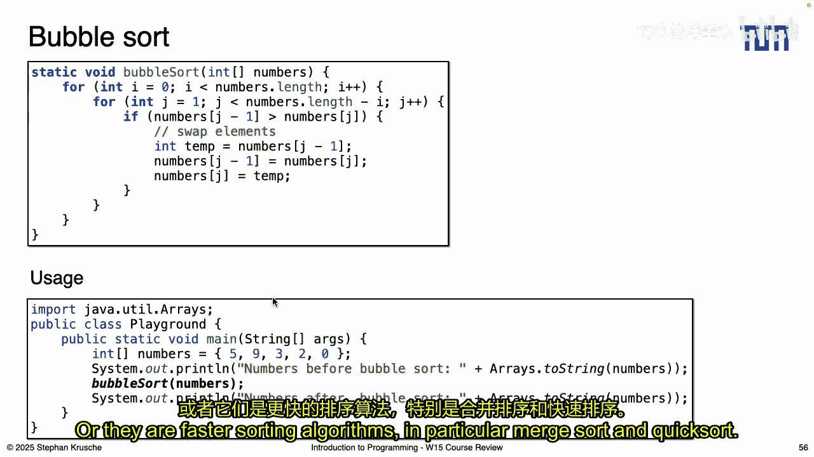
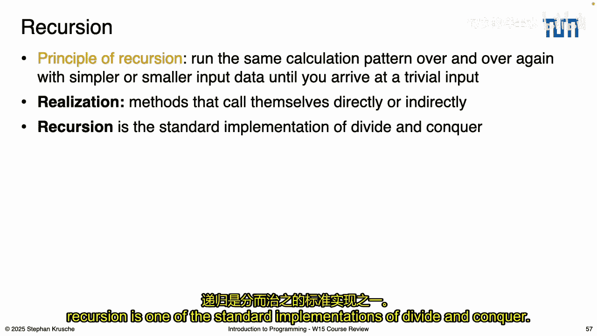
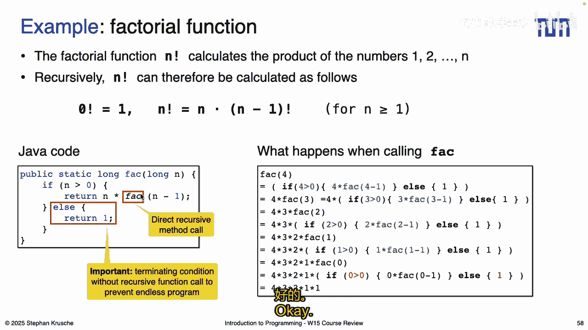
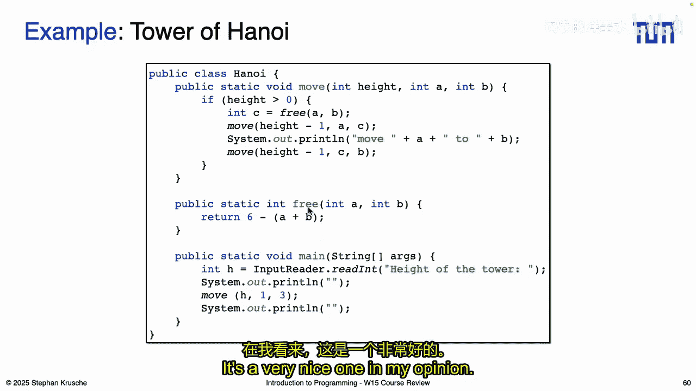
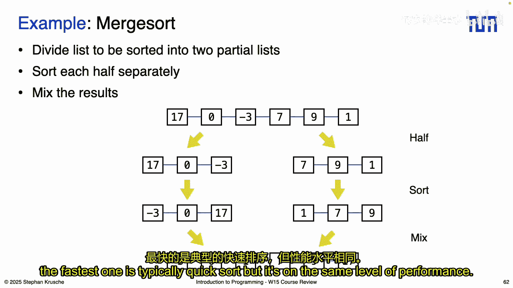
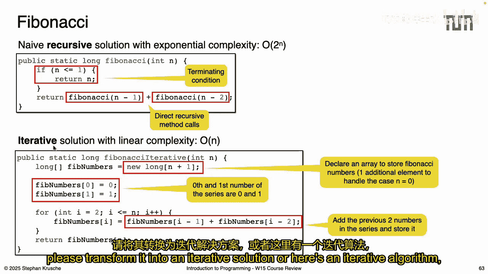

# 072：算法与递归 🧠



在本节课中，我们将回顾算法与递归的核心概念。我们将探讨分治原则、几种经典算法（如搜索和排序）的实现，并深入理解递归的工作原理及其应用。

---

上一节我们介绍了课程的整体安排，本节中我们来看看算法与递归的具体内容。

我们学习了几种算法，特别是递归这个许多学生觉得不太容易的主题。由于我此前生病，大家观看了去年的视频，希望你们对这些主题有了良好的理解。

首先，许多算法都运用了**分治**原则。这不仅是编程中的重要原则，也是整个软件工程领域的重要思想。其核心是：当你遇到一个难以直接解决的大问题时，首先需要将其分解为更小的子问题，直到每个子问题都能被个人在短时间内轻松解决。然后，你需要将部分解决方案重新组合成完整的解决方案。这是一个极其重要的概念，以一种非常通用的方式描述了每个项目和算法。

问题的分解涉及**分析**。你需要先分析问题，否则无法进行分解。而将部分解决方案组合起来的过程也称为**集成**。这就是为什么我们有“持续集成”这样的术语，意味着我们希望从项目开始就持续进行这个过程。

---

以下是关于简单搜索算法的介绍。

我们有一个简单的搜索算法，用于在数组中查找元素。其逻辑是：通过一个 `for` 循环遍历数组，如果当前索引的元素与我们要查找的元素相同，则返回 `true`；如果循环结束仍未找到，则返回 `false`。



```java
// 伪代码示例
boolean search(int[] array, int target) {
    for (int element : array) {
        if (element == target) {
            return true;
        }
    }
    return false;
}
```

---



上一节我们介绍了搜索，本节中我们来看看排序算法。



我们讨论了几种排序算法。首先是**插入排序**，我们有一个很好的可视化展示来理解其工作原理。其思想是：创建数组的一个副本，遍历它，找到要插入元素的位置，然后将该位置右侧的所有元素向右移动一位，最后将元素插入到特定位置。这是一个完整的方法。但我们也展示了使用多个方法的版本，以便代码复用和理解更小的子问题。这是分治的一个很好例子：我们将排序分解为遍历数组元素、定位位置、移动元素和插入元素等子问题，然后将所有这些方面整合到一个方法中。

我们还讨论了**冒泡排序**，这是最简单的排序算法之一，其核心是如果两个元素的顺序错误就交换它们。请注意，它的性能并不很好，但非常简单易懂。我们也展示了如何使用它。

当然，还有更快的排序算法，特别是**归并排序**和**快速排序**。

---

上一节我们介绍了排序算法，本节中我们深入探讨递归的世界。

在递归中，你基本上重复运行相同的模式，但会尝试简化输入，直到达到**平凡输入**（即可以直接解决的基本情况）。你可以通过直接递归方法调用或间接递归方法调用来实现。递归是分治的标准实现方式之一。

这里有一个阶乘函数的例子。`n!` 计算从1到`n`的所有整数的乘积。其基本定义是：`0! = 1`，这是一个平凡例子。然后，对于 `n >= 1`，`n! = n * (n-1)!`。这是数学定义。

```java
// Java 代码实现
int factorial(int n) {
    if (n == 0) { // 终止条件
        return 1;
    } else {
        return n * factorial(n - 1); // 递归调用
    }
}
```



在右侧，我们可视化了代码中实际发生的情况以及如何得到正确结果。这里的关键是**终止条件**。如果在递归方法调用中没有终止条件，你将陷入无限递归，导致程序崩溃。

当然，练习中的递归问题难度会被控制在可管理的范围内，不会像展示的雪花例子那样复杂，但也不会像阶乘函数那样简单。它可能是一个可以用10到15行代码实现的问题。递归函数的难点不在于代码长度，而在于理解其运行机制，处理好直接或间接的递归调用。

---

以下是另一个递归示例：最大公约数。

最大公约数也可以递归实现。这里的终止条件是：如果两个数相同，则返回其中一个。否则，我们取第一个数与两数之差的绝对值的最大公约数。这确保了问题规模不断减小，因为相减会使数字变小，最终会达到两数相同的平凡情况，从而结束递归。

```java
// 伪代码示例
int gcd(int a, int b) {
    if (a == b) {
        return a;
    } else {
        return gcd(Math.min(a, b), Math.abs(a - b));
    }
}
```



另一个例子是**汉诺塔**。这是一个非常适合作为监督练习的题目，既不太简单也不太复杂。你可以用大约15行代码实现它。汉诺塔是一个有趣的游戏，目标是将一堆盘子从一根柱子移动到另一根柱子，并保持原有顺序，规则是较小的盘子可以放在较大的盘子上，反之则不行。示例代码通过将问题分解为移动元素、释放元素等子问题，并使用直接递归方法调用和终止条件来实现。

我们还用递归算法实现了**二分查找**。这也是一个具有代表性的练习示例。在递归调用中，我们通过改变起始或结束索引来缩小搜索范围，本质上将一个已排序的数组分成两部分，然后在左半部分或右半部分继续搜索。这是一个非常重要的算法，因为它使搜索变得非常快。例如，对于10,000个元素，通过不断对分列表，可能只需10步左右就能找到目标。

我们还讨论了**归并排序**。它将列表分成部分列表，直到得到平凡情况（单个元素），然后在这些子列表已经排序的基础上，再将它们合并起来。归并排序是一种非常快的排序算法，虽然最快的通常是快速排序，但它们在性能上处于同一水平。

---

上一节我们看了递归的应用，本节中我们来看看递归的潜在问题及优化。



我们也以**斐波那契数列**为例，说明了其递归版本可能非常慢。因为递归版本通过 `F(n-1)` 和 `F(n-2)` 来缩减问题，但由于这里有两个递归调用，会形成一个巨大的依赖树。即使对于 `n=15`，计算也已经很慢，对于 `n=50`，即使是性能很强的计算机也可能无法快速计算，因为它具有指数级的时间复杂度。

这是一个很好的例子，说明了该算法的线性版本要好得多。我们只需在一个很小的数组中缓存值，然后就能更快地计算，具有线性时间复杂度，甚至可以计算 `n=1000` 的斐波那契数。

```java
// 线性迭代版本示例
int fibonacci(int n) {
    if (n <= 1) return n;
    int prev = 0, curr = 1;
    for (int i = 2; i <= n; i++) {
        int next = prev + curr;
        prev = curr;
        curr = next;
    }
    return curr;
}
```

因此，关于递归算法，你应该学会的另一点是：如何**使用循环将递归算法转化为线性迭代算法**，以及如何将迭代算法转化为递归算法。这也可能成为下周一的练习内容。

---



本节课中我们一起学习了算法与递归的核心内容。我们回顾了分治原则，探讨了搜索和排序等基础算法，并深入理解了递归的定义、实现、应用场景（如阶乘、最大公约数、汉诺塔、二分查找、归并排序）以及其潜在的性能问题和优化方法（如斐波那契数列的迭代优化）。掌握这些概念对于编写高效、清晰的代码至关重要。