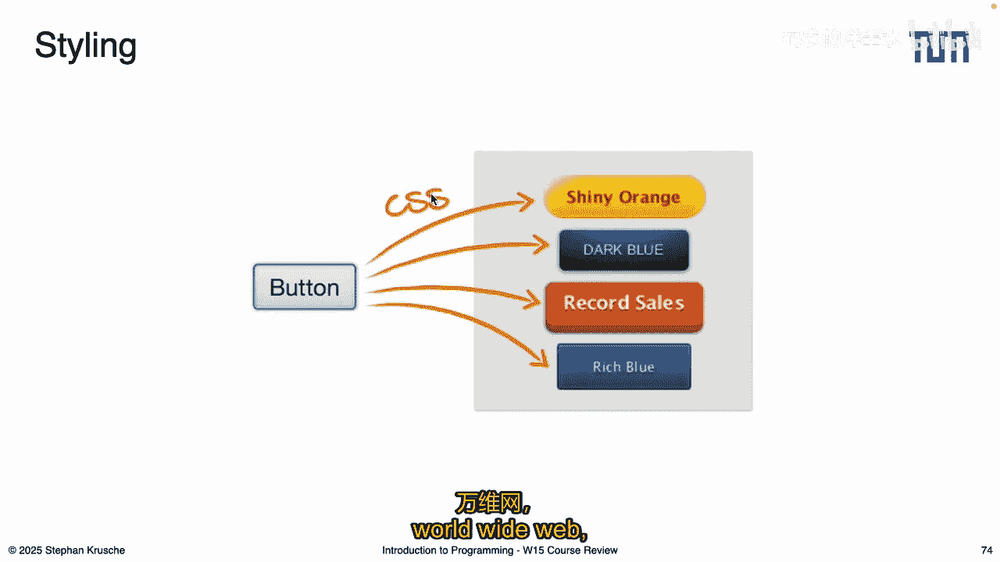

# 073：图形用户界面

在本节课中，我们将学习图形用户界面的基本概念，并以Java FX技术为例，介绍如何构建一个GUI应用。我们还将探讨可用性的重要性及其核心原则。

---

## 概述

本节课程将介绍图形用户界面的开发。我们将以Java FX框架为例进行说明，但目的并非要求你死记硬背Java FX的细节，而是通过一个现代框架的示例，使你具备触类旁通、学习其他框架的能力。课程内容涵盖可用性的基本概念、原型设计的重要性、基本的可用性启发式原则，以及Java FX应用的基本架构和组件。

---

## 可用性及其范畴

上一节我们介绍了图形用户界面的概念，本节中我们来看看与之密切相关的“可用性”。可用性衡量一个软件产品对于最终用户而言是否有效、高效和令人满意。它主要包含以下几个可衡量的范畴：

以下是可用性的几个核心范畴：

*   **可学习性**：用户能够多快理解并学会使用系统。
*   **效率**：用户学会系统后，能够以多快的速度完成任务。
*   **可记忆性**：用户在间隔一段时间（例如一年）后，再次使用系统时，能多好地记住其功能。
*   **容错性**：系统防止用户出错以及帮助用户从错误中恢复的能力。
*   **满意度（用户体验）**：用户使用软件时的主观愉悦感。这是一个相当主观且难以精确测量的范畴。

请记住，可用性、用户界面设计和可用性工程正变得越来越重要。对于未来可能创业或开发面向最终用户产品的同学（尤其是兼具技术专长的经济专业学生）而言，这是非常重要的技能。

---

## 关于“易于使用”的误区

在讨论可用性时，我们特别提到了不同“说法”，尤其是广告中常出现的“废话”——声称“系统易于使用”。这种说法基本上没有意义。

作为一名计算机科学家、工程师或软件工程师，你应该知道我们需要可衡量的方法来判定某物是否真正可用。当然，如果你最终进入公司的市场部门，你可以使用这种说法。但如果你进入工程部门，请永远不要说“系统易于使用”。如今，这种说法甚至被称为“不可用性宣言”。许多公司声称其系统易于使用，但实际上很多用户在使用中遇到困难。

雅各布·尼尔森和诺曼集团（Nielsen Norman Group）提供了大量优秀的在线示例、指南和方法，教每个人如何进行得体的可用性评估。

---

## 原型设计的重要性

我们讨论了原型设计作为一个重要概念。其核心是尝试将我们的知识外化，并快速构建出可演示的东西。你可能听说过“最小可行产品”这个术语，这是当今创业和产品开发中最重要的概念之一。

其理念是快速构建出产品原型，然后与最终用户一起测试，以验证你的想法是否可行。这在可用性工程中也是可以应用的。

我想再次强调丹尼斯·博耶说过的话：**永远不要不带原型就去开会**。因此，要随时准备好可以向他人展示的东西。如果你只是解释软件如何工作，或者只展示代码，效果并不好。向他们展示一个可以在设备上运行的东西会更好。例如，在进行移动应用开发时，可以使用TestFlight这样的工具，让他人将原型下载到自己的设备上进行试用，并反馈是否可行。

---

## 基本的可用性启发式原则

我们探讨了由尼尔森和诺曼集团定义的基本可用性启发式原则。这些原则是评估和设计用户界面的实用指南。

以下是十项主要的可用性启发式原则：

1.  **系统状态可见性**：系统应始终通过适当的反馈，在合理时间内让用户了解正在发生什么。
2.  **系统与现实世界的匹配**：系统应使用用户熟悉的语言、词汇、概念，而不是面向系统的术语。遵循现实世界的惯例，使信息以自然和逻辑的顺序呈现。
3.  **用户控制与自由**：用户经常会误操作，需要一个明确的“紧急出口”来离开非预期的状态，而无需经过冗长的对话。支持撤销和重做。
4.  **一致性与标准**：用户不应怀疑不同的词语、情境或操作是否意味着同一件事。遵循平台和行业惯例。
5.  **错误预防**：比好的错误信息更好的是精心设计，从根本上防止问题发生。
6.  **识别而非回忆**通过使对象、操作和选项可见，最大限度地减少用户的记忆负担。用户不应记住从对话框的一部分到另一部分的信息。系统的使用说明应在需要时可见或易于检索。
7.  **使用的灵活性与效率**：加速器——对新手用户不可见——通常可以加快专家用户的交互速度，使系统能够同时满足无经验和有经验的用户。允许用户定制频繁的操作。
8.  **美学与简约设计**：对话框不应包含无关或很少需要的信息。对话框中的每个额外信息都会与相关单元竞争，并降低它们的相对可见性。
9.  **帮助用户识别、诊断和从错误中恢复**：错误信息应使用通俗语言表达（无错误代码），精确指出问题，并建设性地提出解决方案。
10. **帮助与文档**：即使没有文档，系统也能使用是最好不过的，但可能仍需提供帮助和文档。任何此类信息都应易于搜索，专注于用户的任务，列出具体的操作步骤，并且篇幅不宜过大。

---

## Java FX 基础架构

现在，让我们将目光转向Java FX的具体实现。一个Java FX应用程序在结构上分为多个层级。

一个Java FX应用的基本结构可以用以下关系表示：
**`Application -> Stage -> Scene -> Node`**

以下是各层级的说明：

*   **Stage**：相当于一个窗口。一个应用可以包含多个Stage。
*   **Scene**：放置在Stage中的内容容器。一个Stage可以包含多个Scene，但通常一个应用只有一个主Stage和一个主Scene。
*   **Node**：Scene中的所有可视元素都称为Node。Node可以是简单的（如按钮、文本），也可以是复合的（如布局面板），复合节点可以包含其他节点，形成嵌套结构。

---

## 布局与控件

为了设计出合理的界面，布局管理至关重要。Java FX提供了多种布局面板（如`VBox`, `HBox`, `BorderPane`, `GridPane`）来帮助组织界面元素的位置和大小。

同时，我们介绍了各种控件，例如：
*   **按钮** (`Button`)
*   **列表** (`ListView`)
*   **选择框** (`ChoiceBox`)
*   **滚动条** (`ScrollBar`)
*   **进度条** (`ProgressBar`)
等等。

---

## 模型-视图-控制器架构

在构建GUI应用时，**模型-视图-控制器** 架构风格能帮助你构建易于维护的系统。该模式将应用分为三个核心部分：

*   **模型**：代表应用的数据和业务逻辑。
*   **视图**：代表用户界面，用于显示数据（模型）并接收用户输入。
*   **控制器**：作为模型和视图之间的中介，处理用户输入，更新模型，并刷新视图。

这种分离使得视图和模型组件可以复用，控制器负责协调两者之间的通信。

---

## 图形与样式

除了标准控件，Java FX还支持绘制基本形状，如矩形 (`Rectangle`)、圆形 (`Circle`) 等，这为创建自定义图形元素提供了可能。

在样式方面，你可以为应用定义特定的配色方案、字体、按钮视觉效果等。为了实现样式的统一和高效管理，Java FX借鉴了万维网的技术，使用 **CSS** 来定义和应用样式。这使得视觉设计可以与逻辑代码分离，便于维护和更换主题。

---

## 总结

本节课中，我们一起学习了图形用户界面开发的核心知识。我们从可用性的概念和重要性出发，探讨了其衡量范畴，并指出了“易于使用”这一模糊说法的不足。我们强调了原型设计在快速验证想法中的关键作用。接着，我们详细介绍了十项基本的可用性启发式原则，作为评估和设计界面的实用指南。最后，我们以Java FX为例，讲解了GUI应用的基本架构（Stage-Scene-Node）、常用布局与控件、以及利用模型-视图-控制器模式构建可维护应用的方法，并简要介绍了图形绘制和通过CSS进行样式美化的技术。掌握这些概念，将为你使用任何GUI框架打下坚实的基础。