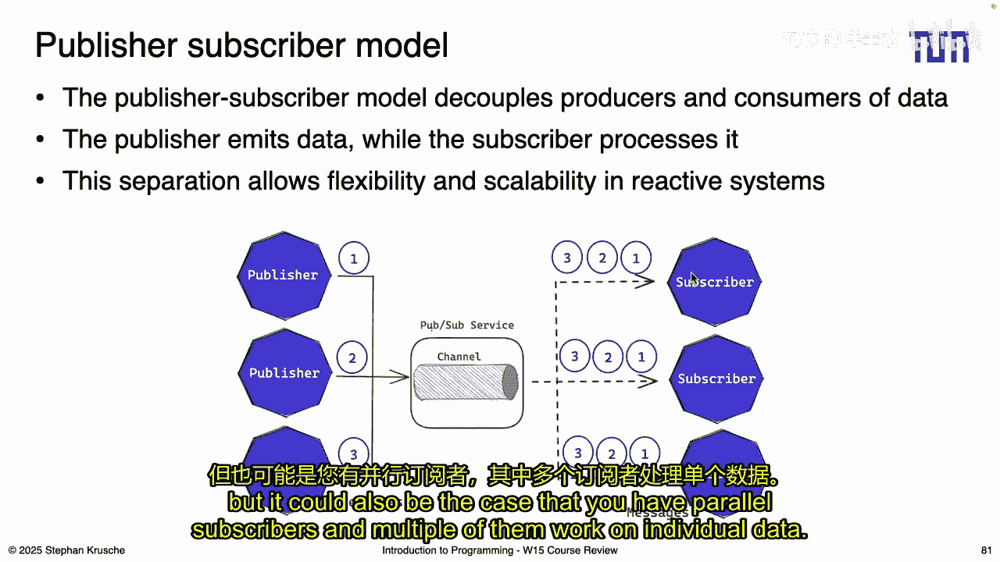

# 074：并发编程

在本节课中，我们将要学习并发编程的核心概念。我们将探讨多线程的重要性、其基本实现方式，以及现代编程中更高级的并发模型，如基于任务的并发、异步编程和发布-订阅模式。

上一节我们介绍了其他编程范式，本节中我们来看看并发编程。

在并发编程部分，我们简要阐述了多线程为何在当今如此重要。现代应用对用户响应要求很高，用户不愿长时间等待。特别是当同一台计算机拥有多个CPU或多个核心时，我们可以并行处理任务。线程是实现这一目标的基本概念。

然而，线程也较难理解。我们展示了一个简单的示例，说明如何在Java中使用Runnable接口实现线程。我们有一个Lambda表达式，可以在启动的线程中运行。但这是非常底层的操作，你应该考虑更现代、更高级的概念。

特别是基于任务的并发，它涉及线程池。你定义一个由任务队列组成的线程池。

然后你插入任务，线程池会自动生成线程，并根据你希望池管理的最大线程数，确保它们彼此不冲突。

我们讨论了异步编程，它在分布式系统中变得越来越重要。

程序不应等待某些操作完成，而应继续执行。当响应异步返回时，程序再处理它。

通过这种方式，我们可以减少等待时间。处理时间保持不变，但等待时间可以显著减少。

我们还讨论了响应式宣言，其中响应式、消息驱动、弹性和韧性的系统变得越来越重要，这对于将软件扩展到数百万最终用户也至关重要。

我们讨论了发布-订阅模型，该模型通过某种通道机制（如中间的队列）将数据的生产者与消费者解耦。当生产者有新数据时，就将其发布到队列中。

然后通道或队列被填充。

随后，订阅者或消费者可以在数据可用时立即对其进行处理。

存在不同的机制。可能是所有订阅者处理所有数据。

但也可能是存在多个并行订阅者，它们各自处理独立的数据。

本节课中，我们一起学习了并发编程的基础。我们了解了线程的基本概念及其在Java中的简单实现。更重要的是，我们探讨了更高级的并发模型，包括基于任务的线程池、异步编程以减少等待时间，以及发布-订阅模式如何解耦系统组件以实现更好的扩展性和响应性。这些是现代软件开发中处理并发和构建高性能、可扩展应用的关键思想。