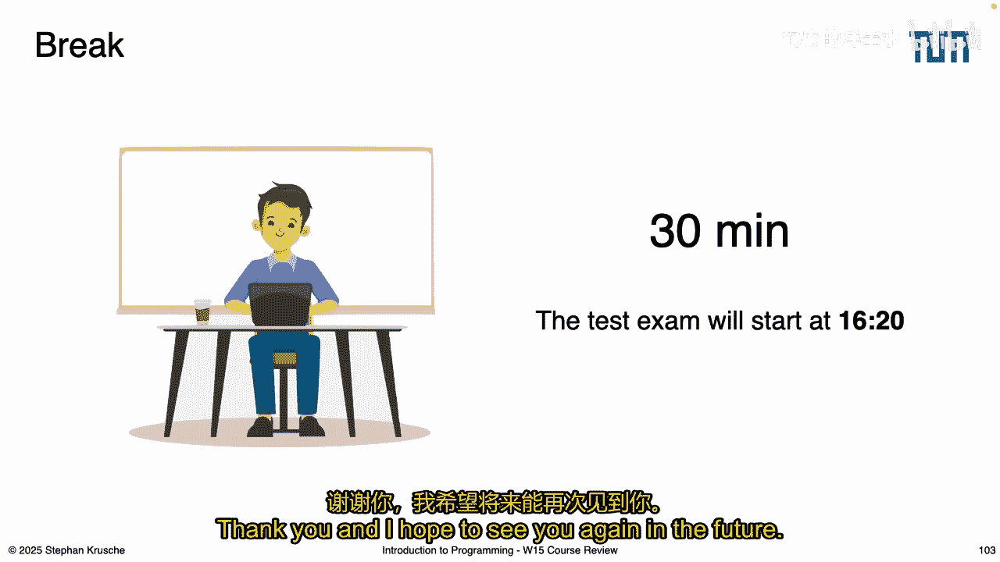

# 075：编程之外的内容 📚


在本节课中，我们将回顾并总结编程课程之外的一系列重要概念。这些主题涵盖了软件工程领域的多个方面，从编程语言特性到现代开发实践，旨在为你未来的学习打下坚实基础。

---

## 编译型与解释型语言

上一节我们回顾了编程核心，本节中我们来看看编程语言的执行方式。我们讨论了编译型语言和解释型语言之间的区别。

例如，Java 语言兼具编译和解释的特性。它首先被编译成一种称为**中间代码**（或字节码）的形式，然后这个字节码在运行时由 Java 虚拟机（JVM）进行解释执行。理解这一点对于掌握编程语言的工作原理至关重要。

**核心概念示例**：
```java
// Java 源代码被编译为 .class 字节码文件
// JVM 解释执行字节码
public class HelloWorld {
    public static void main(String[] args) {
        System.out.println("Hello, World!");
    }
}
```

---

## 领域特定语言

我们介绍了领域特定语言，它们与 Java 这类通用目的语言不同。DSL 专为特定领域设计，例如用于标记的 HTML、XML、Markdown 和 JSON。

以下是几种常见的领域特定语言示例：
*   **HTML**：用于构建网页结构。
*   **XML**：用于数据存储和传输。
*   **Markdown**：用于编写格式简单的文档。
*   **JSON**：用于轻量级数据交换。

---

## 构建工具：Gradle

我们探讨了 Gradle 作为领域特定语言的一个例子，它用于自动化软件构建和依赖管理。这在每个编程练习中都是基础部分。

我们展示了如何添加新的 Gradle 依赖，例如：
```groovy
dependencies {
    implementation 'com.google.guava:guava:31.1-jre'
}
```
你无需成为专家，但应大致理解 Gradle 的用途以及如何添加外部库。

---

## 编译器与抽象语法树

我们简要了解了编译器如何使用语法分析来生成抽象语法树。AST 对于代码分析至关重要，它能判断代码是否能编译、支持重构，并在 IDE 中提供改进建议。

AST 是编译器中使用的一种代码表示形式。你应该能够将代码转换为 AST，反之亦然。这可能是监督练习的一部分。

---

## 正则表达式

我们讨论了正则表达式及其在搜索替换、输入验证等方面的不同用例。虽然看起来复杂，但基础相当简单。

我们有一些特定术语，例如 `\w` 匹配单词字符。我们可以指定某些字符以及它们在待验证文本中应出现的次数。这在编程中有许多不同的用例，并且有很多优秀的在线工具可以验证正则表达式是否正确。

我们展示了一个在 Java 中使用的例子。例如，验证一个用户名，该用户名总是由两个小写字母、两个数字（用 `\d` 表示）和另外三个小写字母组成。

**核心概念公式**：
```
用户名模式 = [a-z]{2}\d{2}[a-z]{3}
```

---

## 基于模型的软件工程

我们了解了基于模型的软件工程及其不同的活动，从问题陈述开始，进行需求获取、分析、系统设计、对象设计，以迭代和潜在敏捷的方式实现测试。这样你不仅可以交付一个软件系统，还可以交付多个版本。

---

## 定义式与经验式过程

我们区分了定义式过程和经验式过程。Scrum 是一种经验式过程，我们专注于制定项目的大致计划，但总是在迭代开始时详细说明特定需求，以产生对最终用户有价值的、潜在可交付的产品增量。这是一个非常重要的点，我们希望专注于实现能为最终用户创造价值的东西。

---

## 客户端-服务器应用与 REST 架构

我们还讨论了基于 REST 架构设计客户端-服务器应用程序，我们使用请求-响应协议，并且通常具有自动的序列化和反序列化。这样，客户端（例如手机）可以使用一种面向对象的编程语言，而 Web 服务可能使用另一种面向对象的编程语言，但它们仍然彼此兼容。

---

## 代码审查

我们了解了代码审查，并讨论了它们的优点和挑战。请注意，这不仅仅是关于提高代码质量，还关乎沟通、知识传递。从某种意义上说，你们在教程小组中进行的结对编程也是一种代码审查技术。

你们有一个坐在电脑前打字的“驾驶员”，和一个同时审查进展、提出建议、评论解决方案好坏的“观察员”。这样，代码审查在编写代码时就被整合到技术中，同时也改善了知识传递，并希望两位参与的开发者之间也能相互学习。

---

## 静态与动态代码分析

我们讨论了静态和动态代码分析的区别。静态分析意味着手动或使用基于抽象语法树的自动工具查看代码。动态分析就是测试，这是我们所做的事情。我们在 Artemis 上测试你们周一在 C 语言实现中产生的软件，并在这里区分黑盒测试和白盒测试。

---

## 版本控制：Git

我们了解了 Git。你应该非常熟悉克隆 Git 仓库、将代码提交到本地仓库，然后将代码推送到项目的远程仓库。你也需要从其他开发者那里拉取更改，并且可能必须合并冲突。解决冲突是一项宝贵的技能。

---

## 持续集成与交付

我们简要了解了持续集成，即使用计算机系统自动编译、构建和测试你的软件，以便快速反馈，让你知道想要引入的更改是否正确工作。

你可以更进一步，进行持续交付。你配置一个流水线，不仅用于构建和测试，还在人工干预下交付软件。持续交付意味着有一个手动步骤（可能只是一个按钮点击），然后软件就被部署了。而更进一步，持续部署意味着一切都是自动部署的。在这里，你真的需要非常好的测试，甚至可能需要在部署后测试失败时回滚更改。

---

## 容器化与 Docker

我们讨论了容器化过程，例如使用 Docker 来以代码形式描述运行软件所需的基础设施，即所谓的镜像。从这个镜像描述中，我们可以构建一个采用分层方法的镜像。例如，你定义一个基础镜像，比如使用 JDK，然后安装你需要的额外依赖，接着打包你自己的软件。这就像一个模板，我们可以从这个模板创建多个容器并运行它们。我们的软件就集成在容器的实例中。

---

## 课程总结与备考建议

以上是关于课程回顾的内容，一些最后的思考。这是一个摘要，如果你想高效地复习最重要的方面，可以使用它。但请记住，如果某个主题没有在摘要幻灯片中提到，它仍然可能是考试或监督练习的一部分。因此，这并非一个详尽无遗的概述，只是你应该关注的最重要方面。

我们建议你组建学习小组，一起学习和学习更有趣。例如，你可以使用 Artemis 上的练习模式一起编程。你可以向彼此解释概念，看看是否能以易于理解的方式进行。可以重复我们提供给的所有编程练习（Artemis 上大约有 70 到 80 个），使用练习模式即可。你可以从我们再次给出的模板从零开始，然后重新做练习。这可能有助于你双重检查是否理解了概念。请注意，在周一你也需要相对快速，你不能花 20 分钟思考如何解决一个练习，你必须快速解决。我们会非常仔细地估算你在 90 分钟内可以编写多少代码。

你也可以使用练习模式重复 Artemis 上的所有测验，因为周一也会有一些测验问题。如果你这样做，你就做好了充分准备。再次提示考试模式学生指南，确保你理解考试模式并能正确使用。

---



本节课中我们一起回顾了软件工程中编程之外的广泛主题，包括语言特性、开发工具、工程方法和团队协作实践。掌握这些知识将帮助你在未来的编程和软件工程道路上走得更远。祝你在接下来的练习和考试中好运，也祝你未来职业生涯一切顺利！