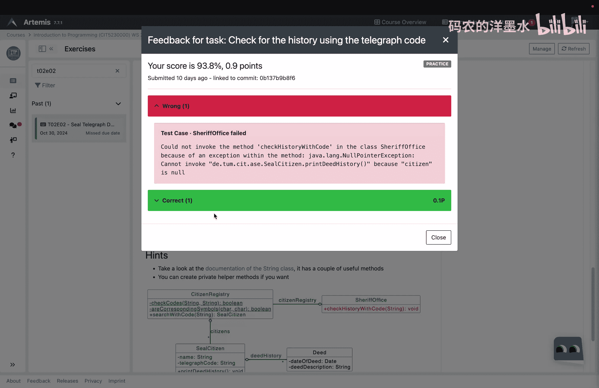
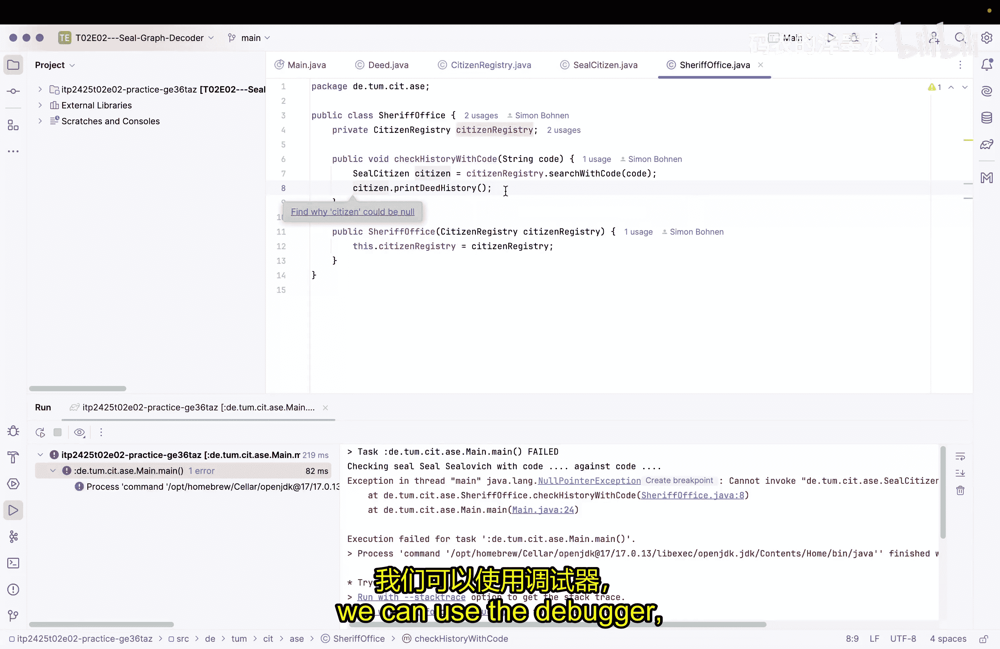

# 【全集】慕尼黑工业大学 计算机编程：从入门到实战 中英字幕 p01 Lecture 1 - 理解代码运行的报错 -BV1WFrTBZExY_p1-

If you have an idea why your code might be failing。

 you can go into In and run your code in the main method。In this case。

 we're going to do that for the seal telegraph decoder exercise。

 where we are trying to figure out whether there is a seal with a given code using this method called check history with code。

To do so， let's head into intelligent。And our best friend here is the main class。

 which has our main method， which you can run。In this main method。

 it's a good idea to create some objects of the classes that are relevant for this exercise。 So。

 for example， a deed。A citizen and a registry。Once you have those objects。

 you can call methods on those objects to verify their behavior。 In this case。

 we're calling the check history with code method。What I've also done here is if we go inside this method and then inside the search with code method。

That I've added a print statement which prints out for each seal that we're checking what the seal's name is and what its code is。

 This will help us to understand why our error is occurring。When we've prepared our code。

 we can head over to the main method and click the little green arrow。To run it。Down here。

 we will see the output of our run。 It's important to select the second of these dropdowns。

And then if you scroll up， you will see the output of your code。For example， here， we can see。

What we printed， we print that we're checking the code of one seal because we only have one seal in our registry。

And we're checking the code 4 dots against four dots。Which。

 according to the specification of the exercise， should fail。We can also see below here。

The null pointer exception。 And we can see precisely where it is being thrown if we click on this blue link。

Now， if we want to do some further debugging to really understand what's going on。

 we can use the debugger， which I will show you in the next video。

