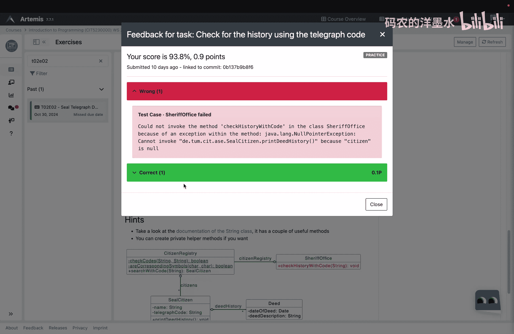
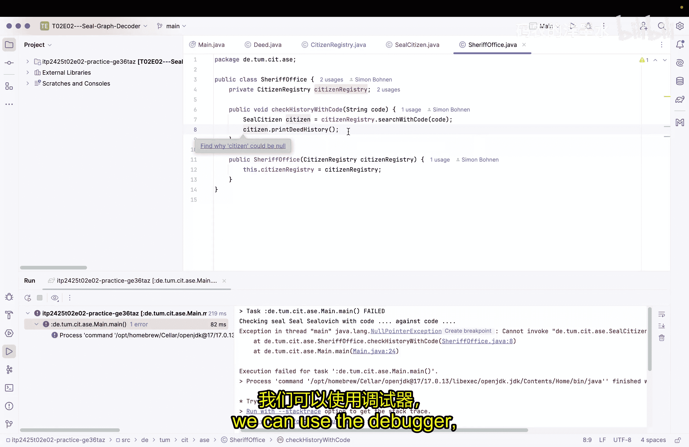

# 计算机编程：从入门到实战：1：理解代码运行的报错

在本节课中，我们将学习如何理解代码运行时的报错信息。通过一个具体的例子，我们将看到如何定位错误、分析错误原因，并介绍使用调试器的基本思路。

## 定位与分析错误

上一节我们介绍了编程的基本概念，本节中我们来看看当代码出现问题时，如何定位并分析错误。

如果你对代码为何失败有初步想法，可以进入集成开发环境（IDE）并在 `main` 方法中运行你的代码。在本例中，我们将针对“海豹电报解码器”练习进行此操作。该练习的目标是使用一个名为 `checkHistoryWithCode` 的方法，判断是否存在一个具有给定代码的海豹。

为此，让我们进入 IDE。我们最好的帮手是包含 `main` 方法的 `Main` 类，你可以运行它。在 `main` 方法中，创建与本练习相关的类的对象是一个好主意。

以下是创建对象的步骤：
*   创建一个 `Deed` 对象。
*   创建一个 `Citizen` 对象。
*   创建一个 `Registry` 对象。

拥有这些对象后，你可以调用这些对象上的方法来验证它们的行为。在本例中，我们调用 `checkHistoryWithCode` 方法。此外，如果我们进入这个方法，再进入 `searchWithCode` 方法，可以看到我添加了一个打印语句。

该打印语句会为我们检查的每个海豹，输出其名称和代码。这将帮助我们理解错误发生的原因。

## 运行代码与查看输出

准备好代码后，我们可以转到 `main` 方法，点击绿色箭头运行它。下方将显示运行输出。重要的是选择第二个下拉选项。

然后，如果你向上滚动，将看到代码的输出。例如，这里我们可以看到打印的内容：我们打印出正在检查一个海豹的代码，因为我们的注册表中只有一个海豹。

我们正在将代码“4个点”与“4个点”进行比较。根据练习的规范，这应该失败。我们还可以在下面看到 `NullPointerException`。如果点击这个蓝色链接，可以精确地看到异常被抛出的位置。

## 进一步调试

现在，如果我们想进行更深入的调试以真正理解发生了什么，可以使用调试器。

我将在下一个视频中向你展示调试器的使用方法。

## 总结

本节课中我们一起学习了如何理解代码报错。我们通过一个实例，演示了如何在 `main` 方法中运行代码、添加打印语句来追踪程序状态、查看运行输出以定位异常，并了解了使用调试器进行深入分析是下一步。掌握这些步骤是有效诊断和修复程序错误的基础。