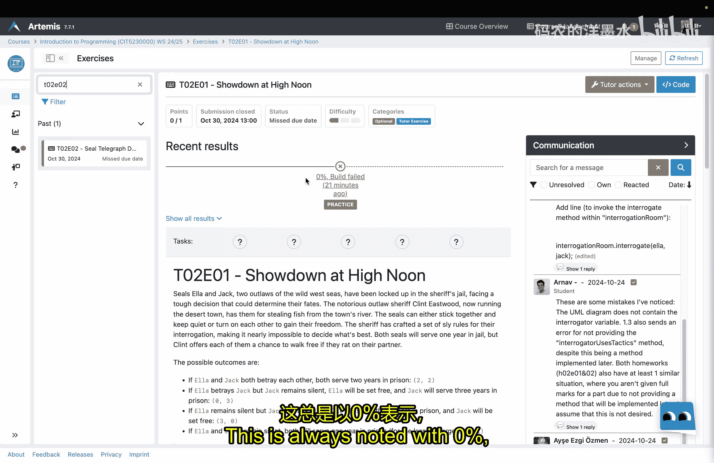
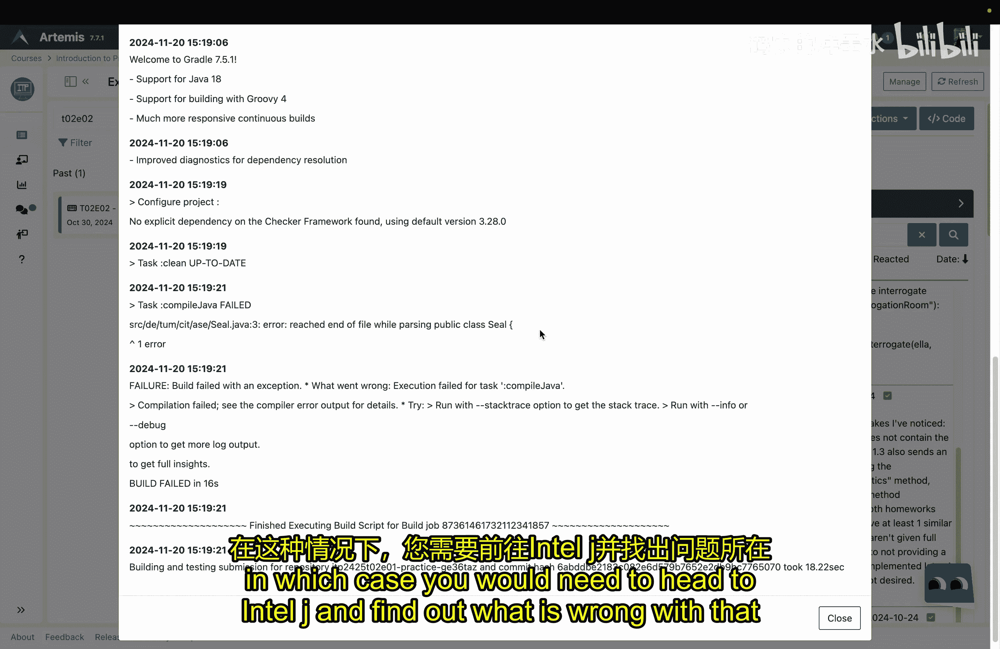
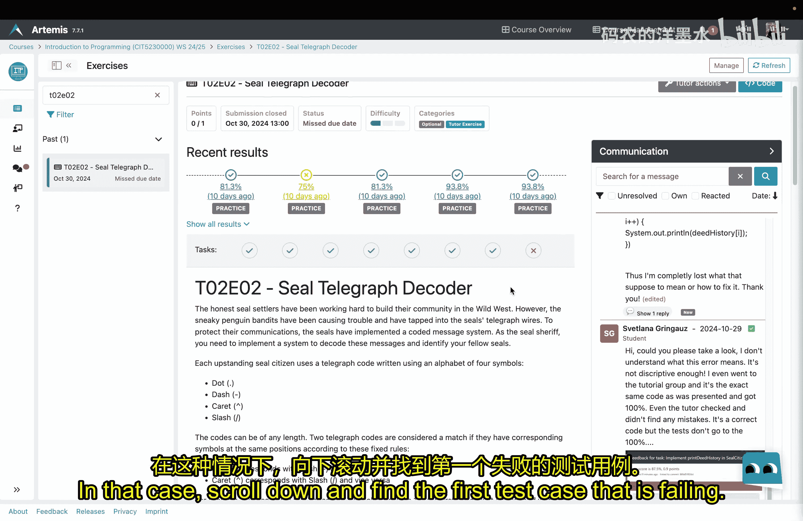
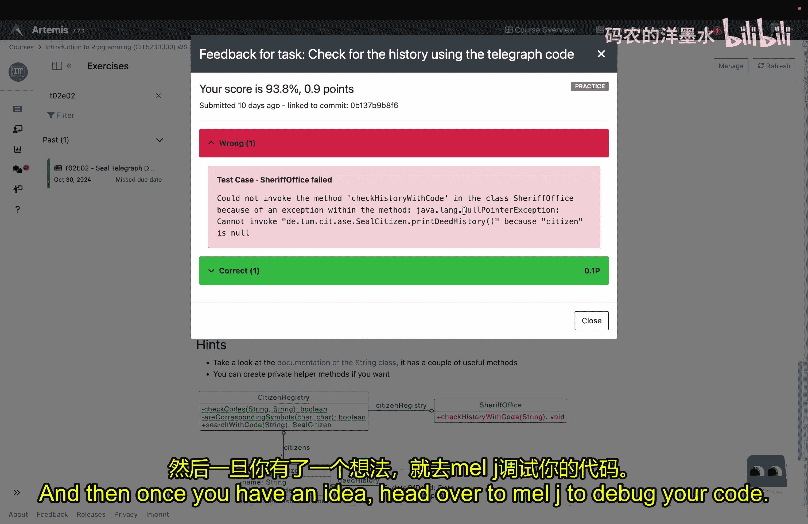

# 【全集】慕尼黑工业大学 计算机编程：从入门到实战 中英字幕 p03 Lecture 3 - 在 Artemis 中理解反馈 -BV1WFrTBZExY_p3-

Hey everyone， in this video we would like to show you some steps which you can take if some of your test cases or the whole project is failing on Artemis。

As you can see here we are looking at the case where the build failed， this is always noted with 0%。

 but might only mean that， for example， a semicolon is missing somewhere or a curly bracket is missing somewhere。

We can verify that if we go to the log and scroll down and find this line which says compile Java failed。

Here you will see one or more files where the error is occurring。 In this case， our seal file。

 and it will also give you the line where it has the error。In our case here。

 we're missing a closing bracket。 It might also be the case that the actual error is on a different line。

 in which case you would need to head to in and find out what is wrong with that file。

The other option is that one of your test cases is failing。In that case。

 scroll down and find the first test case that is failing。

And try to understand why it is failing and what is wrong with your method。In our case here。

 we are running this method check history with code， and it is throwing a null pointer exception。

Try to come up with some ideas why this error might be thrown。And then once you have an idea。

 head over to Ontario J to debug your code。

