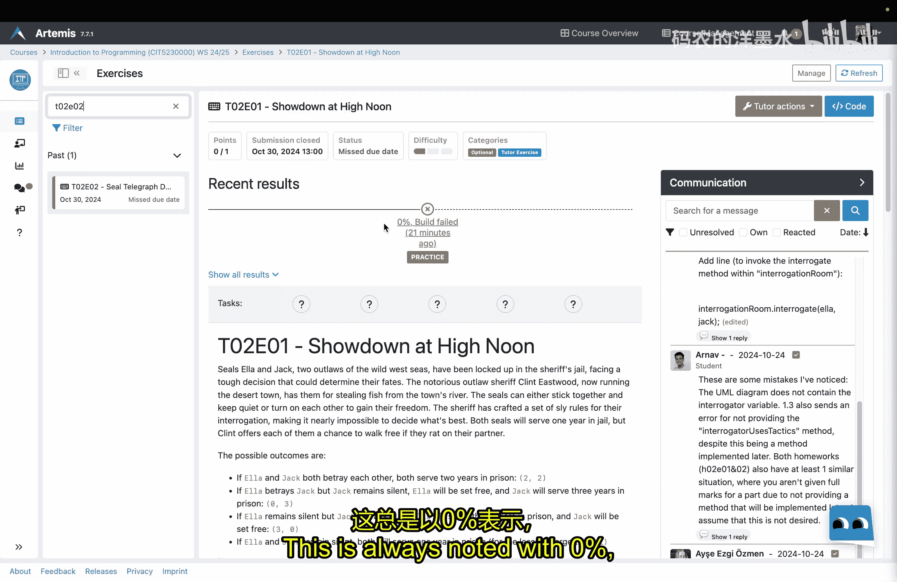
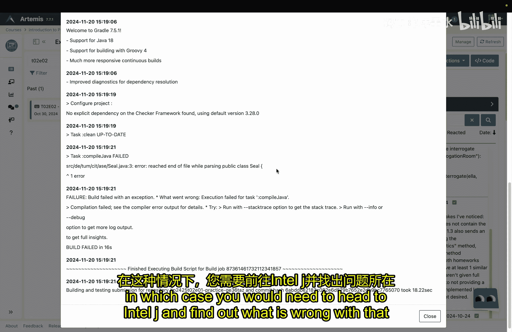
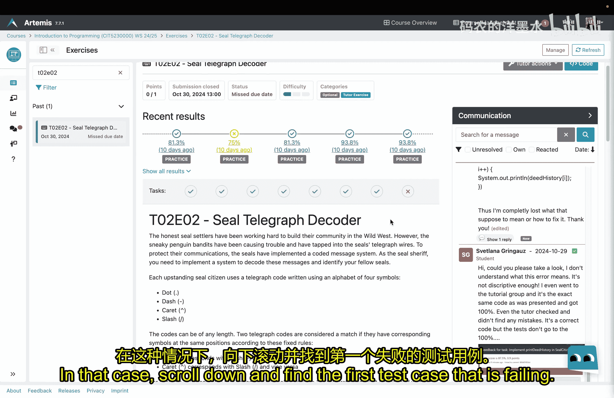
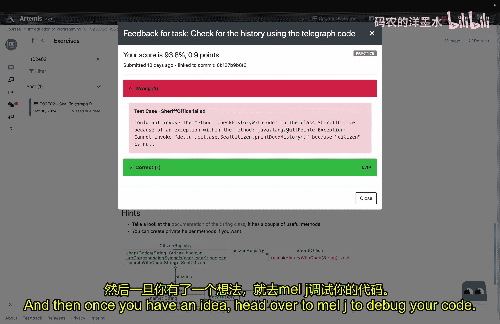

# 慕尼黑工业大学 计算机编程：从入门到实战：P03：在 Artemis 中理解反馈 🐛

在本节课中，我们将学习如何在 Artemis 平台上处理测试用例失败或整个项目构建失败的情况。我们将通过解读错误日志和测试反馈，来定位并解决代码中的问题。

上一节我们介绍了编程的基本概念，本节中我们来看看如何利用 Artemis 提供的反馈信息来调试代码。

## 处理构建失败

当你的项目在 Artemis 上构建失败时，系统会显示 **0%** 的完成度。这通常意味着代码中存在语法错误，例如缺少分号或花括号。





为了定位错误，你需要查看构建日志。以下是具体步骤：

1.  点击进入日志页面。
2.  向下滚动，找到标有 **“compile Java failed”** 的行。
3.  日志会指出发生错误的文件（例如 `Seal.java`）以及具体的行号。

例如，日志可能显示：
```
error: ‘}’ expected
```
这表示代码中缺少一个闭合的花括号。有时，实际错误可能发生在日志指出的行号之前，因此你需要检查该文件，找出问题所在。




## 处理测试用例失败


如果构建成功但部分测试用例失败，你需要分析测试反馈来找出逻辑错误。





以下是分析步骤：

1.  向下滚动到第一个失败的测试用例。
2.  仔细阅读测试名称和错误信息，理解测试意图和失败原因。

例如，测试反馈可能显示：
```
Test `checkHistoryWithCode` failed with a NullPointerException.
```
这表明在运行 `checkHistoryWithCode` 方法时抛出了空指针异常。你需要思考哪些操作可能导致此异常，例如尝试访问一个未初始化（`null`）对象的属性或方法。




在有了初步想法后，你应该回到开发环境（如 IntelliJ IDEA）中，使用调试工具逐步运行代码，观察变量状态，从而精确地定位并修复问题。


本节课中我们一起学习了如何利用 Artemis 的反馈信息。我们掌握了处理**构建失败**（检查编译错误日志）和**测试失败**（分析测试输出并调试逻辑错误）的基本流程。理解这些反馈是提高调试效率和代码质量的关键技能。