# 【全集】慕尼黑工业大学 计算机编程：从入门到实战 中英字幕 p04 Lecture 4 - 通用编程 -BV1WFrTBZExY_p4-

Okay， welcome everyone to the course Introuction to programming。

 it's really nice that so many of you are here， I hope that we see so many of you throughout the whole semester。

My name is Stefan and I'm the main instructor of this course and I'll tell you more what the course is about today。

 So again， welcome to this course。 This is your for most of you this is the first journey towards programming and this will be a very tough course for many of you I can already tell you。

 but well help you through and we'll do our best in order to support you as good as we can before we start with the first content let me tell you a bit more about our teaching concept。

 This course is based on AI enhanced interactive learning and this means we have a couple of different aspects I'll tell you now an overview and in the next couple of minutes I'll tell you more details about every aspect and then you can also ask questions in case something is unclear。

 First of all， we have a couple of synchronous concepts that we apply in this teaching concept here and the first one is that we do onsite workshops with exercises here in the lecture hall So we kindly ask you to come。

Here to Garing， we know that most of you study in Munich and it's a long distance with the U 6。

 but it's worth it。 We have support here for you。 And this is not a traditional lecture。

 It's not the idea that I'm talking all the time。 It's the idea that you get active and that you practice。

 First question to you。 who has already installed in Teleliche on your computers。

Okay that's the majority。 If you have not done it yet， this is your chance。

 I'm not sure if everyone can download it at the same time based on the internet that we have here but download it and install it later on tutors will go around and help you with that We have a live stream so hi to everyone in the live stream This is a very complex lecture hall in terms of setup every week there's Murphy's law and something will break and some setup will not work so please bear with us we do our best we have a whole dedicated team with backup systems just to provide the live stream and the lecture recordings afterwards but sometimes it might not perfectly work out and we are really sorry about that but this is not in our hands this is a central room management that is responsible for this lecture hall and it's to be honest not the best experience for us so far。

The second important thing， and this is much more important than the workshop is the onsite tutorial group where you do exercises and presentations。

 And this is also no lecture。 So if you are used to going to a tutorial group and that the tutor is talking all the time。

 This will not be the case in our course。 You need to be active。

 You need to practice something and the tutor instead will be a coach， a moderator。

 a supervisor to make sure that you have a good learning experience。

The lecture is four hours long with breaks in between and the tutorial groups are three hours long with breaks in between。

 and we highly recommend you to visit both onite。 There are a couple of asynchronous concepts we will provide you with the workshop recordings。

 slides will also give you a couple of readings， books and online articles in order to make us familiar with programming concepts and they will also be homework for selft so that you deepen your knowledge with the programming concepts that we teach you We have a really。

 really great support three instructors， including me Ramona and Marcos and 34 tutors for around 800 students。

 there are still students registering for the course。 We might end up with more。

 But right now we have around 800。 and we have a great learning platform。

 some of you might already have used it It's called Artemis We develop it on our own in order to improve teaching and learning。

 it's much better experience than using。😊，I promise you that there are a lot of different activities that support you in your learning process。

 and it also includes AI support。 We have a dedicated。Little feature in Artemis called Iris。

 a virtual or personalized tutor that helps you if you get stuck in your exercises。

 More about that later on。 But our main goal is to provide the best possible learning experience for everyone。

 including personalized learning。 So if you have specific learning habits will try to create a learning atmosphere that works for you。

 Of course， this is very difficult because we have a very heterogeneous group of students。

 maybe to get more about to get to know more about you。 some， some questions to the audience here。

 Who of you has already programmed before。😊，Okay， that's less than half of the people right so some people already have programme。

 some people have never programmed before， and this is quite challenging for us。

 especially if you have never programmed before， take all those offers from us。

 this is all optional Yeah we don't force you to come。

 but you need to take those offers in order to get to know how to program and in order to improve your skills in that。

Great， we have a couple of expectations to you as well。

 and I'd like to clearly communicate them and be transparent about them。

There will be a lot of new things that you experience in this course。

 We kindly ask you to be open about new technologies， new learning methods， new teaching approaches。

 This is not what you traditionally experience in other courses。 This is something else。

 be open for it， try it out and provide us feedback if you don't like it if you think things can improve。

 tell us and we try to accommodate them， even if we might not be able to accommodate all your feedback request。

Also try to be active and curious。 Cursity is the most important aspect for learning only if you ask questions。

 only if you want to know how something works， you can actually better understand it and learn to organize yourself。

 This is an important soft skill when studying， you need to organize yourself。

 you need to make sure that you know when the lecture happens when the tutorial groups happens when there is an exercise deadline and so on。

Be kind and patient， sometimes it takes time to answer your emails or your questions online。

 sometimes it also takes time higher。New lecture sometimes it also takes time to listen to your feedback we are not working 247 for you。

 even if it sometimes appears like that we can also not answer all the questions within a minute sometimes we have to discuss how we address the question and sometimes things are unclear for us as well so please be kind and patient you can follow up on your questions if you don't get an answer within a few working days but don't expect us to answer everything within a minute and bear with us if something does not work out as expected we continuously improve the learning tools we continuously experience the difficulties here in the lecture hall so if something breaks。

 we'll try our best to fix it so that you have again the best possible learning experience but we can't guarantee that everything is perfect all the time。

Our teaching goals for this course are that you learn how to program in terms of problem solving and that we also would like to enrich your soft skills when it comes to communication in A team and problem solving and presentations。

So we'll teach you a lot of programming concepts。 You'll try them out in lecture and small exercises。

 You deepen them in the tutorial groups， and then you eventually do the homework and a team project in order to really learn how to program on your own。

 And of course， we want you to achieve the best possible grade in the course。

 This is your starting point with programming and we want to motivate you to keep it up。

 We know it's hard We all suffered when we learn programming on our own。

Take the support that you can get here。 And then we hope that you stay focused on your learning experience regarding programming。

 In my opinion， programming is an essential skill in our in our world today。

 And there is no job that you want to achieve in the future where you can stay without basic programming knowledge。

 And， in fact， even without basic AI knowledge， you can't go to those chops in the future。

 So take it as an opportunity to learn this to master those challenges and to achieve a。

Good career in the future， based on those skills。Okay there's someone else coming in please open the door we can also leave it open to get some fresh air with so many people This is the course team or part of the course team we have more slides doesn't fit on all the slides as you see my name is Stefan you can call me Stefan we don't have to be too formal here I'm the main instructor then we have Ramona here maybe you can stand up and say hello。

Very quickly to everyone， she's one of the exercise instructors and then we also have Marcos here say hello yeah great。

 I'm also one of the exercise instructors and then we have four very dedicated and experienced tutors who already did that several times before and they joined us again it's really nice that they help us。

So maybe Timor Yasminina Ya and Yaana if you're here you can also quickly stand up and say hello okay the boys are here。

 the girls have to do something else， but you will see them at some point later on and as I said we have 30 more tutors and I'd like to introduce them to you very quickly if you are on the slide please stand up and say hello and I'll give you the names Benjamin。

 Han Yang， Simon， Ahmamed Vincent， Abdul Zmed I hope I spell it correctly， Suel， Cindy。

 Anthony and Alexander。Then next slide， stand up if you're on the slide， Dlia， Conrad， Maria。

 Florian， Michael。Michael is doing something else， please stand up and say hell no。😊。

He's probably fixing one of the issues regarding Artemis or Iris， then we have Ima over there， Kevin。

 Tang Long， Kim and Daniel。And last but not least。If you are on this slide， please stand up。

 Dennis Fut Bear， Feras， Airru， Yaazir， Tuguur， Saul， Catherine and Vi。

And I'd like to give them a quick round of applause。

I can only thank you all the tutors that they provide this great support here and we did a tutor training last week and I tell you what I told the tutors they are responsible for providing a great learning experience I'm only like 10% of your learning experience I can set up the course I can set up the whole experience but they are the ones who interact with you I can't interact with 800 individual students on a personal level this is simply not possible the tutors will do that and they will do the 90% of your learning experience so take the chance to talk to them network them leverage their programming skills so that you learn it and you will have a very good time as part of this course。

A couple more insights about the course setup， you are currently in one of the workshops as I said this is not a traditional lecture we focus on in-class exercises。

 we divide the whole slot of four hours into four times 40 minutes and smaller units and all the videos that you can download or watch later on and all the slides we also be divided into those chunks to provide you more and a better experience when you watch the videos you don't have to watch four hours with all the breaks in between we will cut it for you make sure that you can focus on the most important aspects。

The course focuses on a lot on interaction and activation it's great that so many of you have your laptops already open and this also means that we ask you to practice here in the tutorial groups and to get active Yeah this is not based on passive learning you can't learn programming by me telling you and then you will hear it and then you suddenly know it。

 this is simply not possible you have to apply the skills you have to practice all the time。😊。

Tuttorial groups are around three hours and we tried to have small onsite tutorial groups。

 Our goal initially was to have 15 students， but we have a lot more students registered for this course so we probably end up with 20 or maybe even 25 students in one tutorial group let's see how this will work out we will tell you more about that later on。

 but the idea is that we have a very intense supervision and then you should raise your hand and ask questions in the tutorial group that you should get in to interaction with the other students as part of the tutorial group and so on。

There will be group exercises so you will not only work alone。

 but also with a few other students on the tutorial group exercises and there will also be student presentations。

 you need to present the homework， you need to present the result of the tutorial group exercises to your fellow students in order to actually show others that you have understood the concepts that are part of those exercises。

We will give you weekly homework exercises， and you should solve this independently。 You can。

 of course， use AI to solve it in particular Iis if you're stuck。

 but you should not blindly copy and paste code from others。

 This is really bad practice and an anti pattern。 You are they are on your own。

 we will not double check the homework exercises in terms of plagiara。

 but you basically betray yourself。 you can do that。 you can blindly copy paste code from others。

 but then you will not pass this course。 I promise you。 So make sure if you get help from others。

 which is teamwork， that you at least understand what you're doing and do not blindly copy and paste code。

There will be two supervised exercises in the lecture halls with computer based tests， presentations。

 a team project， and you will also be able to get a bonus more about the assessment later on just as an overview for you now。

You have certain requirements for this course， we assume that you are motivated。

 that you really want to learn how to program and that you're not just here because you have to be here。

 that that you want to learn how to solve problems。

 computer science is all about problem solving and sometimes you have very large problems and then you have to break them down into smaller ones。

 solve the smaller problems and then integrate the work together and this is a very important skill divide and conquer that you will not only see in programming but also in software engineering if you pursue a career in this domain。

We assume that you have a laptop and that you can use it during the workshop and the exercises。

 Is there anyone who does not own a laptop， raise your hands now and then we'll try to help you by talking to the study advisorrs。

 whether they can borrow you someone。Okay， this is not the case。 so we assume everyone has left。

 If you don't have one， talk to us， I can't promise anything， but we'll try to help you out。

And of course it's beneficial but not required if you already have programme before or if you already have participated in a software project then this course could be a little bit easier。

 but we also try to get everyone on board who has never a programme before。

Here are the main learning goals on a high level。 I will not read them now。

 This is for your own reading pleasure so that you better understand what's going on。

 We'll try to tell you every lecture or every workshop about the main learning goals for this particular session。

 and then we have something which is called constructive alignment where we try to align the exercises。

 the activities and later on also the assessment towards those learning goals。

 So the learning goals are quite important for you to study and to understand what we expect from you in terms of competences。

 And the idea is that every learning goal is a competence that you should achieve until the end of the course for this slide or later on。

 if I show you the ones for this specific session until the end of the session or until the end of the week based on the tutorial groups and the homework exercise。

You have some more detailed learning goals and you see that many of them use the terms apply。

 understand， implement， use and so on so we don't want you to remember facts by heart。

 this is not a course where you can learn things by heart so if you are used from the management study program to learn things by heart and to spill them on paper and then you forget everything again this is the wrong course for you。

 sorry here you really have to get competent and apply those skills that you learn throughout the course。

This is the roadmap for today as you see we have the context which is are basically the assumptions now we just assume that you are motivated to learn programming that you have a laptop and the learning modes for this particular session that has already started is that you understand how the whole course is organized in terms of workshops and exercises that you are able to interact with us on Artemists。

 the main learning platform that we use for all the different aspects in the course you should be registered for a tutorial group at the end of this workshop if you're not there will be more chances。

 but the first tutorial groups will start tomorrow so participate in the registration later on and in the second part we will then cover a first small program so you will already see some code we will show you how to create simple classes in objectoriented programming with attributes and methods we will show you。

To instantiate objects out of those classes and invoke the methods on those。

 and we will talk a little bit about the most important data types。

 basic data types that you use during programming。Great。

 so this is the outline for today until 6 PMm and we'll start with more details about the general organization of the course After that。

 this will be a little bit longer than the typical 40 minutes because we have so many things to cover after that we have a 10 minute coffee break and then we go into the details of the first small program。

And I'd like to talk a little bit about the tools that we use。

 The main tool that we use for this course is called Artemis。

 and it allows you to participate in many different activities， mainly downloading slides。

 participating in exercise， getting automatic feedback for those exercises。

 participating in the supervised exercises aka exams later on， communicate with us ask questions。

 find answers to typical questions and so on。 and we do the first tutorial together now。

 So I kindly ask you all to navigate into the course。 If you have not enrolled for the course yet。

 this is the chance to do this now。 So please open Artemis in your favorite browser。

 I will use Google Chrome， but you can also use safari， Firefox。

 anything that you would like to use and log in with your to online account your term online account consists of seven digits。

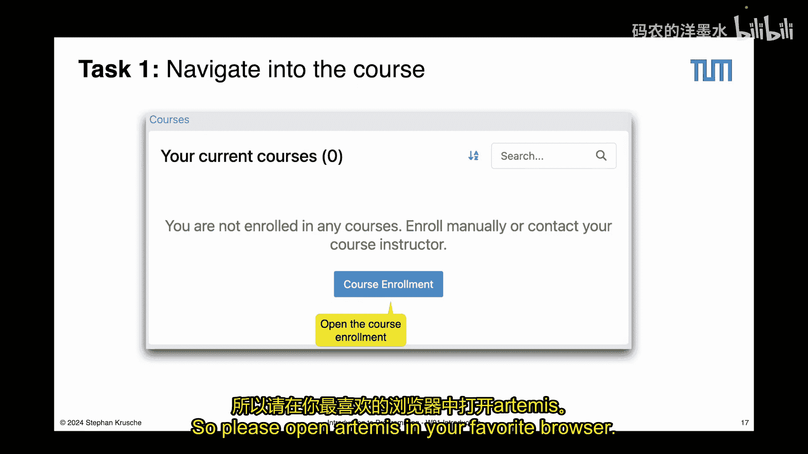

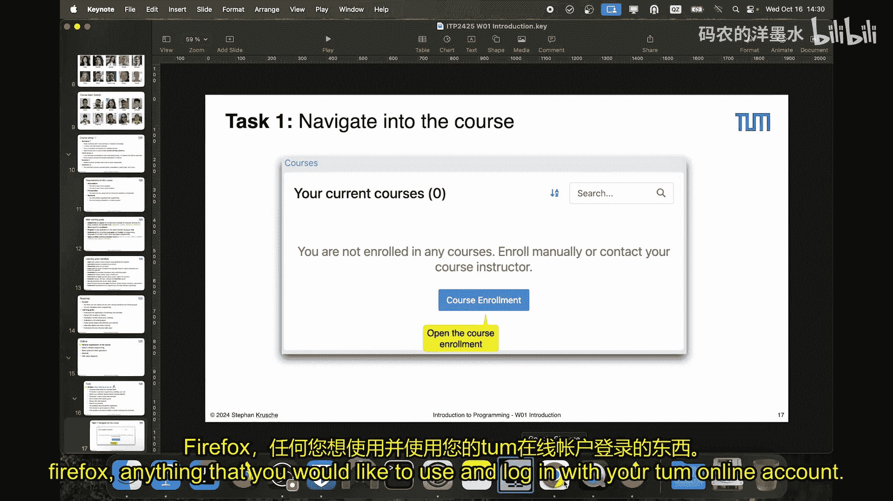

is N E23 KOW yours is probably starting with a G， the current generation has a G in the beginning and then you also have those seven elements you can also use your email address。

 your main to online email address， for example， and then your to online password and then log in and if you've never used it before。

 you see something like that。And now the idea is that you enroll for the course。

 so you click on course Enrollment and then you see a couple of courses。

 you can also search for your favorite course， I hope your favorite course introduction to programming。

 and then you can click on the Enroll button at the right。Now， in order to enroll in this course。

 you need to read our general terms， so to speak， we try to keep them as short as possible。

 but you can only enroll in this course if you study at School of Management。

 this is a course exclusive for management students。

You should strictly follow certain best practices in terms of commitments and code of conduct that we set up I'll show you more about that later on。

 make sure to review them and read them you can just click on them and then they open here for example you see the student code of conduct of the Department of Inforatics there's also a。

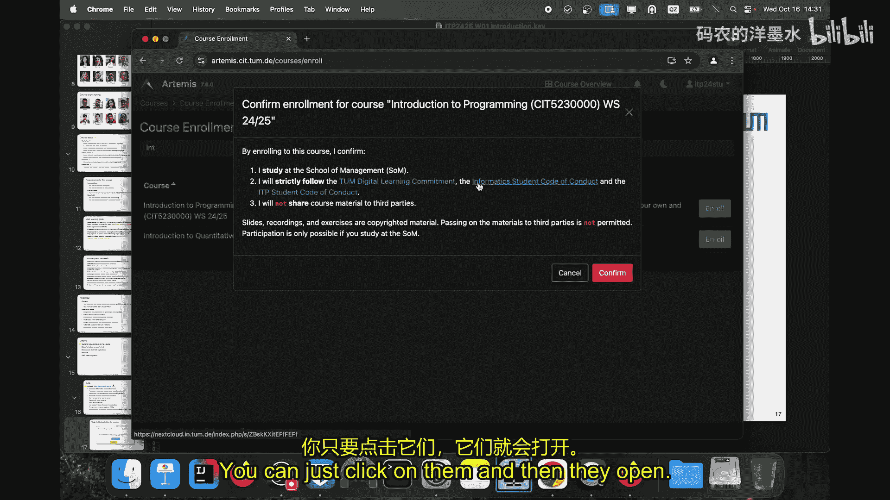

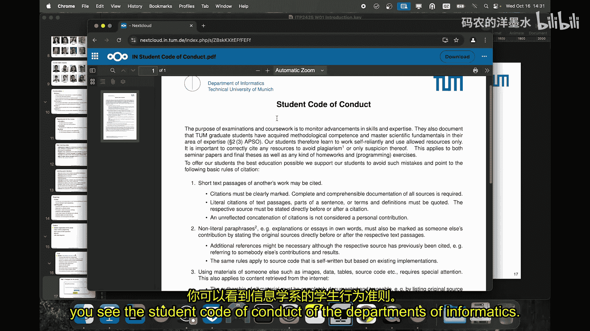

One specifically for this course ITP， and you also need to confirm that you will not share course material to third parts you can share it with your fellow students that are enrolled in this course。

 but you should not upload it publicly or share it with someone else outside of the course。

So because all the material is copyrighted and it's not allowed to share it。If you agree to this。

 click on confirm。And then the enrollment should be successful。

 and then you can click again on course overview and you should see the course over here。

And you can simply click into the course and a course has several aspects on artemists。

A course consists of exercises so far there are no exercises visible for you the first exercises will be visible after the workshop starting tonight then there are lectures or something that we now call workshopshop you already have the first workshop here where you can download the first session by clicking on the download button and then you can see the slides in your browser or download them and follow them along while I showed them to you on a projector or in the live stream。

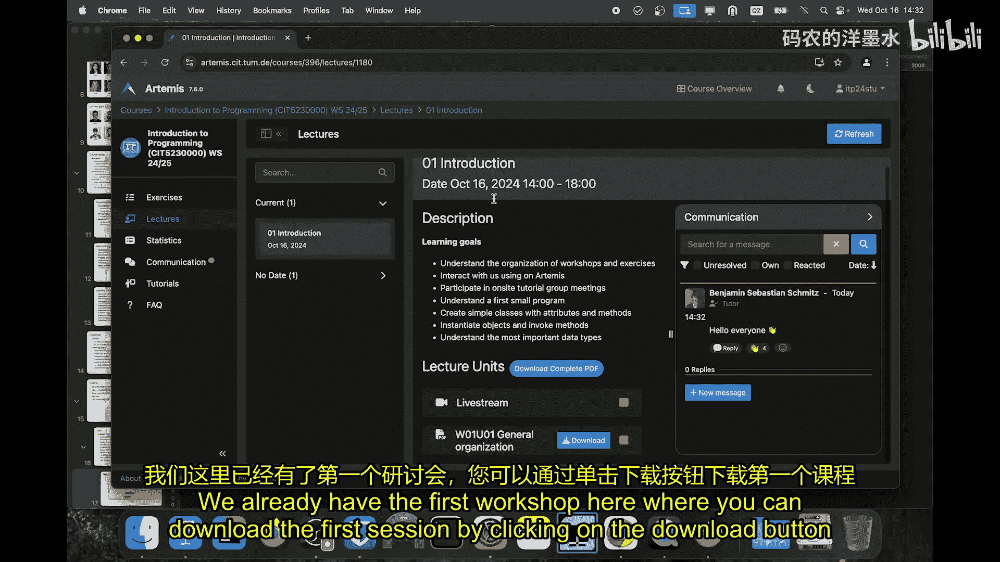

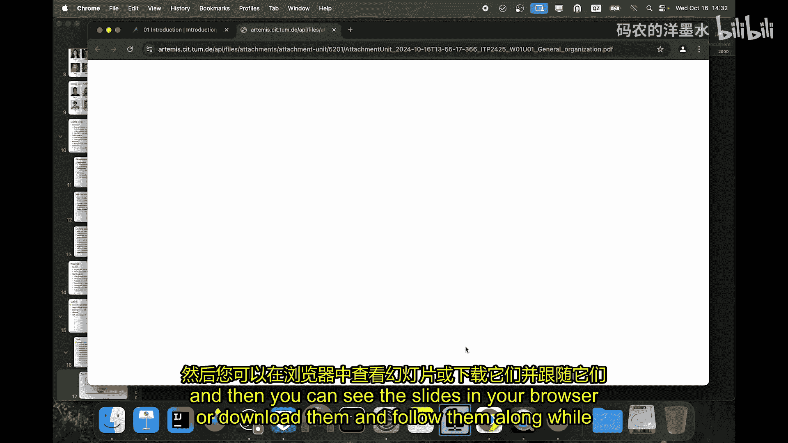

And you can also communicate with us so either you use the little sidebar on the right side to communicate your questions regarding the lecture。

 we see that Benjamin and Timma， two of the tutors having already some fun here。

 but you can also ask questions if something is unclear to you specifically for this introduction workshop in the beginning。

 I'll tell you a lot more so don't start with all the questions right now， wait a little bit。

 but later on if you would like to ask something feel free to do that here。

We can basically collapse the menu on the left side if you would like to have a little bit more space and you can also collapse the side bar here。

 but make sure to don't forget that there is a side bar here you can open it again and then navigate through all the different lectures there's also one with the code of conduct where you can read all the aspects again。

We also have statistics they are quite empty right now。

 but later on you can see your scores and how many points you get for each individual exercise。

We have a communication menu item where you can see a couple of channels and where you can interact with us and with your fellow students based on specific topics。

 For example， based on specific lectures， we see that all the messages that you state in the。

On the lecture page that we just have seen with Benjamin and Tima will also be shown here。

 and then you can click on show reply and communicate with your fellow students in a thread in order to get answers to your questions。

There are also a couple more， you will have one for your tutorial group and you can do also direct messaging with tutors or with your fellow students。

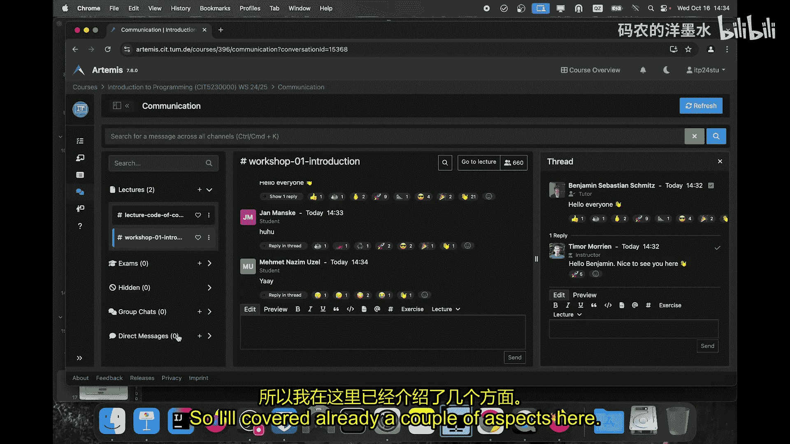

Great， so I'll cover already a couple of aspects here。

Maybe a show fence who is enrolled in the course already。Great， who was able to download the slides。

Is anyone who has technical issues and who needs help？

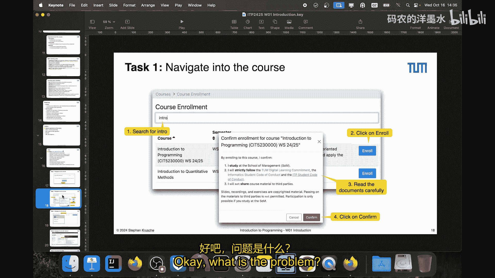

Okay， what is the problem。Okay， so you open the exercise page。 This is the exercise page， right。

And then you should have a menu here on the left where you can navigate to lectures and so on。

 and you can expand the menu here。Yeah， so ask the people around you。

 there are also tutors who could come around and help you if you have questions。

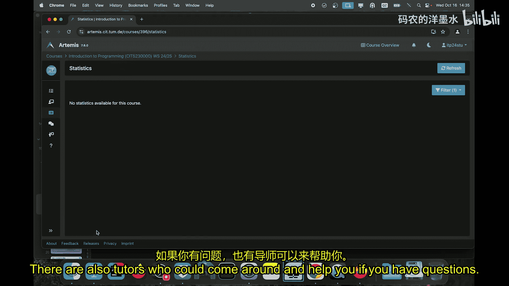

Great， let me go through the slides， we also have screenshots on the slides so that you can follow up this along if you don't have your laptop right now。

 or if you would like to double check later on how this works。But this is the basic idea。

 We already covered those。 Yeah， the next step is that we kindly or the next task is that we kindly ask you to upload a profile picture of yourself。

 The main reason is that I'm really， really bad with NAs if you tell me I don't know your name is Alexandra or Michael or Tobias I will not be able to remember it。

 but I might remember your face and this helps me in the communication quite a lot so go back to Artemis and click in the upper right corner on your username and then you can click on settings and then you should be landing in the account information part of it you can see your full name Yeah I'm using a technical account here you can see when you joined Artemis some of you just joined it recently and you have a profile picture button and here you can add a profile picture I used this one for now。

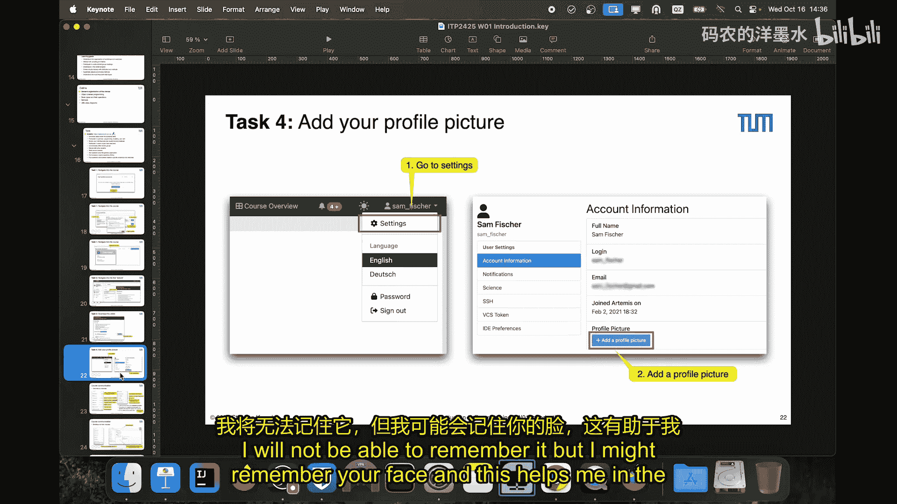

And then you see you can cut or crop your image as you want I'll do it like that or maybe it's nice to have the code in the background for this one and then you click on save and then you have the profile picture。

 you can remove it or edit it at any time and you will also see it in the upper right corner and you can easily identify yourself in Artemis as well And now if I go back and ask a question so maybe I'll just say。

Hello here。And then you see that my picture appears here and your picture would also appear in this。

Greatly simplifies communication， in my opinion。😊。

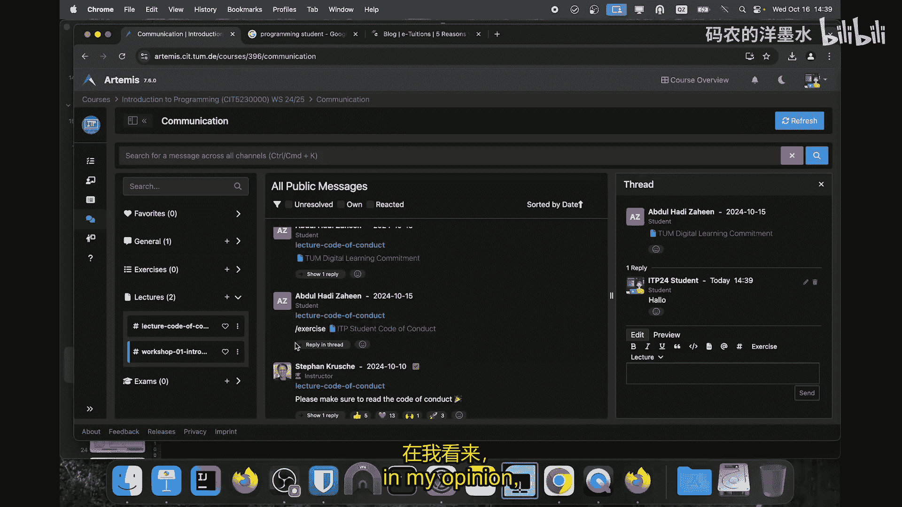

Great， we have a couple of different channels and we kindly ask you to use them for their dedicated purpose in order to make it easier for the tutors to answer your questions and in order to have a focused and organized conversation you can mark the channels that you like most as favorites。

 so they appear at the top of the page we have specific exercise channels。

 so whenever we publish an exercise to you， there will be an exercise channel where you can ask specific questions on this exercise if you're stuck。

 if you don't understand the problem statement and so on， also for lectures， AK workshops。

 there can be group chats and you can do private messages as well there are also announcements where only the instructors can post where you can get additional information。

 this is where we， for example， communicate with you in case there are it does important information so make sure that you receive those announcements in form of notifications as well。

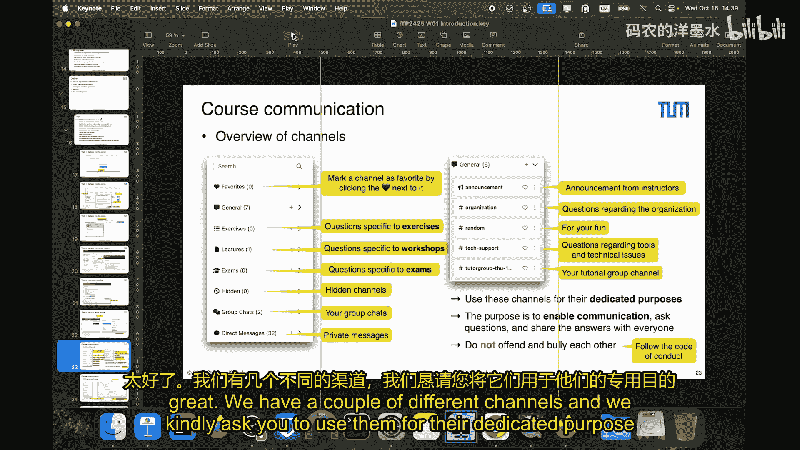

You can also ask questions regarding the organizational。

 we have a random channel for your fun where you can post memes， for example。

 text support and you have one channel for your dedicated tutorial group where you can interact with the students in the tutorial group。

And again， this is to enable communication to make it easier for you to get in touch with other students to help each other more easily。

 please do not send emails to us all the communication should take place on Artemis for now and please follow the code of conduct。

 This is not social media。 This is not Twitter or ex。

 this is not Facebook where people bully each other。

 It's really important to me that you stick to the rules and that you are as friendly as possible to your fellow students and to your Twittertors。

 we are also following the rules。 we also try to be patient kind and friendly and we kindly ask you to do that as well。

Of course， you can send private messages by clicking the plus button on the direct message element。

 then you can choose any student in the course， any tutor or me as an instructor and send private messages。

 we have reactions with emojis， you can reply in separate threads， you can format your text。

 bold italics and so on， you can even link exercises and lectures and slides in here。

 so there are a couple of possibilities for you as part of this communication feature。

If you'd like to ask a question about a specific workshop， navigate into this corresponding channel。

 ask your questioner， and then someone can reply an answer in the thread。

This is how the threat looks like you have on the left side the initial questioner where people could still ask additional questions。

 but the answers should be happening like you would do it in Slack or other messaging tools on the right side and here you see Sam the student has ask a question and yes Mina has answered it and then there's also this screen little check mark to show you that the question that already was answered if you're unhappy with to answer you can still do a follow-up questioner and then you can have a good conversation in here。

In addition， we also have so-called FAQs frequently asked questions。 This is currently empty。

 but we will enter frequently asked questions here so that you can more easily find important information。

 sometimes in the chat， it's a little bit cumbersome to find something So if we get a lot of questions multiple times。

 you will put them into the FAQ section of the course and everything that is written in the FAQ is confirmed。

 Everything that is in the slides is also confirmed。

 if you privately talk to a tutor or if a tutor is posting something in a channel。

 it might not be confirmed information So if you really would like to rely on the information because it affects your studying。

 it affects your grade in the end and how we assess you。

 make sure that you look up the slides and the FAQs。

And if a tutor is telling you something and you would think， could this be true。

 I heard something else， then double check with an instructor or with the FAQs if this is actually a case。

 Yeah， and of course， our tutors try their best to give you all the information that you need。

 but by having in total almost 40 people， it can be the case that they are misunderstandings and that the tutors not by doing a bad thing。

 Yeah， but that they simply have a different understanding based on their previous experience about the course and they tell you something that is slightly inaccurate and then。

Always make sure that it's written in the FAQs or in the slides or do a follow up questionnaire to make sure this is the case。

And FAQs have a filter and a search mechanism so that you can find the answers and the questions here as well。

You also have mobile apps for Artemis and you can find the links。

 you can click on those little elements here in the iOS App store and in the Google App store or use the QR codes in order to download the applications。

 the applications， the mobile apps， they do not offer all the features So you for example。

 can't participate in a programming exercise on your iPhone， which would be quite cumbersome anyway。

 but in particular， the communication features are also available on iOS and Android and those all those aspects。

 the web application and the mobile apps are actively and currently in develop So in development。

 So if you have anything that doesn't work for you if you have any feedback to us how we can improve it。

 if you have any questions that you don't understand how to use them。

 please talk to your tutors or let us know on Github。

 all the code is open source and we are actively asking you to engage in the development because those。

Apps are there for you。 Yeah they should provide a good learning experience for you。

 I also use them sometimes， but not as a student。 and I'm just one person。 Yeah。

 you are 800 almost in this course。 So if you have important feedback， we try to listen to it。

 we try to implement it as quick as possible。 Also if you find any issues。 Any bugs。

 please let us know and we'll try to fix those as quick as possible。

Great any questions for now regarding Artemis， regarding the communication features regarding the mobile apps？

Anything that is unclear。And。Prevents you from further listening to this session。

Okay then take the time and get familiar and we'll continue。

 This is our course schedule you see that we have this workshop every Wednesday today we are in the introduction section and starting next week we go mainly into all the topics every workshop will introduce you to new concepts and will allow you to try them out in small exercises however there are also two sessions marked and blue namely in week three and in week seven。

In those weeks， we basically offer something like a repetition session where you can go in depth with the most important concepts。

 And this is particularly helpful for the ones of you who never programme before。 So if you struggle。

 we take one full workshop，1。Time4 hours in order to repeat the most important concepts covered in the previous sessions and in order to offer you additional exercises so that you can practice so take this as a chance。

 if you're already very good in programming， you might be able to skip them。

 they will not cover new content， but they will repeat the content that we covered on this until this moment in time。

Our teaching philosophy， just to emphasize this once more is based on a Chinese proverb， it says。

 tell me and I will forget， so I assume if I tell you something you will forget it。

Show me and I will remember， so if I show you how it works in Artemis， how it works in Antelliche。

 you might remember it。😔，Involve me。 and I will understand。

 this is the part where you need to get active。 You want to involve you in exercises。

 And then we hope you better understand this while trying it out and step back， and I will act。

 And this is when we ask you to give presentations。 then you have to act。

 And when we ask you to work on a larger project in a team later in this course in the second half of the course。

 then you also have to act and manage yourself。And this whole Chinese probi actually leads us to the concept of interactive learning。

 You've already heard about this。 I'd like to tell you a bit more what it means。

 Inactive learning means we want to involve you in the learning process using digital tools and engage you in doing things but also reflecting or thinking about those things and we'll do that in chunks that are 40 minutes long and in each of those roughly 40 minutes long and in each of those chunks we teach you a little bit of a concept and show you examples。

And then you should apply those concepts in small in class exercises on Artemis。

 where you directly get feedback and where you can immediately see if you do it correctly or wrong with individual feedback and where you can try it out multiple times。

Not all the exercises will be on artemis。 Some of those will also be simple exercises that you do on your computer together with me。

 but some of them will be on artemis， And then ideally， you can reflect on the concept。

 and we think again about how did this work out， this new programming concept in this particular exercise。

 Did you understand it， Do you still have questions， We reflect on it。

 and we close the interactive learning side。Aremis fully supports in active learning by providing automatic feedback to you almost instantly。

 you have to wait after you submit your code 10 to 20 seconds and then you'll get feedback。

 and we show you in the tutorial groups， how that works。

 So make sure to attend the first tutorial group to better understand how to work on programming exercises in Artemis。

 And of course， your tutorial tutorial groups。 They should deepen the knowledge that you learned based on group exercises and homework exercises。

 And here we also focus on soft skills。 You need to be able to communicate with others。

 and you need to be able to present what you have achieved in a specific programming exercise。

 and the presentation will be part of your grade。 I'll show you that in a few minutes。😊。

To be the schedule is that every week weve started two or to5 with a quiz， so make sure next week。

 shortly after 2 AM at 2 PM in the afternoon， there will be a quiz。Yeah， don't be surprised。

 We will not announce this multiple times。 We announce it now next week， 2 PM。

 there will be a quiz where you get a few questions and where you already can earn some bonus。

And then we have the first unit where we go through the circle， a short break， the second unit。

 then we plan a longer break in between because it's important that you refresh yourself with fresh air outside。

 get a coffee so that you can still focus in the second half and then we do unit three a short break in unit four and we'll try to finish a few minutes before 6 PMm but I can't promise this sometimes we also take the full time until 6 pm this also depends on how many questions we get and how fast we can go through certain concepts I'll do the schedule until for 540。

 but sometimes it doesn't work out perfectly。As we said， all the material is copyrighted。

 so you're not allowed to distribute it or to publish them on the internet。

There is a little bit of literature for this course in particular， two books。

 computer Science and Interdisciplinary App by Robert Sechwick and Wayne and Kevin Waynein。

 and the second one is by the same authors， introductiontrouction to programming in Chaba and interdisciplinary approach。

 you can find the material online on the University of Princeston homepage and those books can basically help you to better understand the concepts。

However， every slide deck that we give you at the end of the slide deck will also include specific references to literature or online tutorials。

 where you can read more about those concepts。 So starting point are the books。

 And then for each and every workshop slide deck， we will offer you specific references。

We plan to have 32 tutorial group slots and they are spread throughout the week except Wednesdays。

 Wednesday is the lecture workshop day。 we don't plan any tutorial groups then but all the others are spread around the week so that you have a chance to participate in one of those according to your personal university schedule most of them are offered at the city campus because we know that many of you study at the city campus。

 but some are also offered in Garhi， and as you see we follow a specific naming pattern here。

 the name of the tutorial group starts with the day， three letters for the day man to。

Third for Thursday or for Friday， then we have the slot number。

 So you're either in the morning slot in the afternoon slot 2 or in the evening slot 3。

 then you have the campus， either Munich M U or G A for Garing and then you have a mapping to the room。

 So if you are in M U 1， you are in the room 0，5，10。 if you are in M U 2， you're in the room 1，2，3。

7 and so on， you can see the mapping here and we will allow you to。

Apply for a couple of those tutorial groups in a few minutes and show you how this works。

 And then you get one assignment after the long break today and tomorrow。

 the first tutorial group starts。 That's basically the idea。 And then look up slide 35。

 and make sure that you find the correct room and time where and when your tutorial group will take place。

O。😊，Great， then registration。 you can register for tutorial groups into online and enter your priorities。

The idea is that you should enter your tutorial group preferences before the big break in the middle of this workshop。

 so before today 330， this is important because only if you state your preferences until then the matching can take them into account。

And try to distribute you as s as possible throughout all the slots。In order to make this fair。

 it is quite important that you do not just select one tutorial group slot。

 but multiple slots that fit to your schedule if you only choose one chances are high that you do not get a slot afterwards。

If you choose multiple ones， you might not get your highest priority in terms of preferences。

 but you still end up with a lot。You will receive the assignment of the first matching today on to online。

And the first tutorial group meetings will take place tomorrow。

 so it can be the case that tomorrow you have your first meeting and the tutor and all the other students together will do the first exercises。

If you for some reason miss the matching today while because you're watching this as a recording。

You could be matched because you only give us one preference。

 and there are only 20 slots in this tutorial group。

Or you are completely unhappy with your slot and you find out this is absolutely not possible and you want to change your group。

 Late registration is possible。 In fact， every day， starting tomorrow， we will do another matching。

 So if you don't get match today， you can enter your preferences again。

 and the matching will take a place for the remaining slots tomorrow。 we don't get a match tomorrow。

 you can do it again on Friday， Monday and so on。 but this is only possible until Friday， October 25。

 At some point， we have to stop the matching processes。 but until that， we have a daily matching。

If you have any issues， if you cannot。Work on this if it doesn't work out for you completely。

 let us know。 we are here to help you。Approach the tutors。 And then we are happy to assist you。

 If you want to switch and there is no empty space in this tutorial group。 this is not possible。

 Yeah you can't switch to a full group。But if you find another student。

 maybe a friend or who also wants to switch， talk to them， and then you can basically do that。

Changing the groups， however， is only possible with a good reason。

 because if every one of you wants to change the group afterwards。

 the whole matching doesn't make any sense， right， we have to stabilize this process。

 We know there are a couple of personal exceptions。

 and we try to accommodate them as good as possible。

 but we kindly ask you to accept the matching process in case you can make this possible。

Any questions regarding the registration for tutorial groups and how the whole process works。

Who of you is able to access this URL， Raise your hands。

 Can you click on it and enter your preferences。Who is not able to access this URL。 Raise your hands。

Okay， there was one question over here。So the question is。

 can I join a tutorial group if I'm not in real world？If you' are not enrolled in the university。

 you cannot attend a tutorial group as of the matching here if there is a free spot， for example。

 in a not so。Preferred time throughout Friday afternoon， I'm happy if you join it。

 but being enrolled in the university is kind of a prerequisite to study in this course。

 Yeah so if we have free spots， feel free to come， but if all tutorial groups are full。

 I'm sorry then we can't offer you something。Any other questions regarding tutorial groups？

Okay then let's continue there are certain ruless again tutorial groups are optional but we highly recommend you to attend them onite we do not have virtual tu groups because this simply doesn't work out we learned this during the last couple of fear that virtual tu groups do not work out it's much easier if you are sitting next to each other if you stand next to each other and then you just have a good time。

Now there might be cases that do not allow you to attend a tutorial group could be the case that a tutorial group meeting is cancelled because of certain student events like Studentdentship Fshafts Voilfa Samlo。

 and so on or there might be a holiday on this particular day。

 then your tutor will cancel the tutorial group， you will also see that on Artemis。

 and you will get notified about that。It can always be the case that you are ill。

 it can be the case that the tutor is ill， or it can be the case that we have a very small participation in this particular slot。

 and then it might be the case that the tutorial group is cancelled at all In such cases。

 we kindly ask you to reallocate yourself for this particular case， not in general。

 just for this particular case to another tutorial group。

So if you happen to be on a Thursday and there is a holiday at some point on a Thursday。

 then simply reallocate yourself to another one。 The good news is all the tutorial groups are also on Artemis So after you've joined them on to online you don't need to interact with to online anymore you can look it up on Artemis and on Artemis you can also see which of those have empty spots or which of those are rather full and it's not easy to join them because there's no seat and which of those have a few empty places or which of them are almost empty and it's a really good chance to switch to those。

additional questions， yeah。Can you all silence a bit。

 so otherwise I will not understand the question。Yeah there's a very good question so how does the tutorial group schedule work so the idea is that we do the workshops on Wednesdays。

 introduce a you know concepts and then the tutorial group week starts on Thursday。Friday。Monday。

 Tuesday。 So Tuesday is the last day of the。Coourse week， so to speak。

 right so if you go for a Tuesday tutorial group slot。

 then you have a few days in between the last lecture or the last workshop。 If you go for a Thursday。

 there's just one day in between， and you can directly practice afterwards。

 This also has implications to the homework。 the homework is always published Wednesday evening and it's due until the next Wednesday just before the workshop starts。

So if you join a Tuesday group and you only would like to work on your homework after the tutorial group is over。

 you have a very short timeframe to work on your homework exercises。

 so we kindly ask you to start working on it beforehand， otherwise you will not have enough time。

Any other questions regarding tutorial groups？Great。

We showed you already the code of conduct as part of the enrollment。

 We have it on the slides as well。 make sure to read them and to follow them。

 This is really important to us again。 We'd like to have a good time for you and for us and the university is not a place for。

Yeah， acting against the laws and if you violate in the code of conduct。

 we will warn you and if you still violates the code of conduct multiple times， of course。

 there are differentities right， but if you violate it multiple times without listening to us。

 we might exclude you from this course as well。So please follow it so that we have a good time。

 The most important eight rules in the student code of conduct for this particular course are that we like you to respect others and to opinions。

 no one is here to harm you we all try to have a good time together。

 but people have different opinions。 people have a different background。

 so please respect them and talk in a nice and friendly way to each other。 Foow the laws。

 Even online， there are laws。 you cannot get the identity of other persons。 Yeah。

 you cannot share your username and password and log in with another account。

 This is not allowedud and you need to use your identity and stand behind your comments and your questions that you put online of course sometimes you are angry and sometimes you don't like certain decisions that we do。

 Then my recommendation is to step back get some。Other things done yeah stay away from the conflict and then after some time put your thoughts again into a nice way and tell us what a conflict is about and then we are happy to search a solution with you。

 but of course not all the conflicts can be resolved in the end and sometimes are certain rules in the university we have to stick to those rules in particular for so large courses like this one。

If you communicate with us on Artemis， please stay on topic。

 we have the random channel if you want to do off topic， but for everything else。

 please stay on topic， we kindly ask you to participate actively because only if you do that you can achieve a good learning be kind and patient when it comes to asking questions we can't answer all of them immediately please do not post solutions on Artemis if you're stuck tell us where you are stuck but do not post your code on Artemis because otherwise people might。

Simply copy and paste it。 And the idea is that this is not a sharing platform for solutions。

 This is really to help you if you have issues。 And after all， we all want to have a good time。

 So also try to have a good time as part of this course question。Okay。

 so the question is there is apparently an inconsistency between the tutorial groups into online and the tutorial groups on Artemis。

And please tell us exactly where the issue is。 Yeah put it into one of the channels。

And then one of the instructors or tutors will look it up and find the inconsistencies。

 I would assume that the one to online is more accurate because there's where we do their room booking。

 so it might be the case that while copying the information into artemis。

 we did a small mistake and then we fix it as soon as possible。

 but let us know the exact inconsistency， otherwise we have to compare all those things。

 Thank you for the feedback， by the way。Great， the typical schedule for the tutorial group is like that。

 We do a short review of the content of the workshop in the beginning。

 This should be at most five minutes and it's not meant to be a repetition。

 Please do not go to the tutorial group and expect a mini lecture。😊。

I know that some of you feel that the lectures or workshops are boring。

 and then you think I don't go to them fine。 This is your personal decisioner。

 This is just an offer by us。 But then please don't go to your tutor and assume that the tutor is giving a lecture to you。

 This is not the idea of a tutorial group。 Of course， your tutor is happy to answer your questions。

 but it's maybe much better if you discuss the questions as part of the whole group and not just the tutor is talking all the time。

The second part， which will not happen in the first week， because there was no homework yet。

 but the second typical part is that you present and discuss the previous homework。

 the idea here that students present it so that you get the perspective of an example solution from another student。

 not from the tutor and that you then discuss it and that your tutor is asking questions to you。

The presentations are also part of the grading。 So you need to make sure that you give a good presentation when you present your homework or when you present the group exercises。

 the majority or the major part of the tutorial group is spent on the group exercises。

 we typically have two large exercises that you work on with a couple of other students So you help each other。

 you try to get the problem solved in a group and then someone of this group also presents this in front of all other students and you have a discussion and you can ask questions why this is actually the solution and why not something else could solve the problem as well。

 And last but not least at the end， we have five minutes for a short discussion of the new homework。

 please look up the homework exercises beforehand。 they are already published on Artemis every Wednesday evening。

 And if you have any questions if something is unclear， you can ask it and quickly discuss it。

 but it's not。The idea that the tutor present the whole concept of your homework group to you。

 The idea is really， you read it， you look it up how it works。 And if you completely。

 if you're completely lost， you can ask questions about it。How is the grading done。

 we already published this on our course website a few weeks ago to let you know this is the grading scheme we have a couple of activities that have a specific weight counting towards your grade in total you can get 12 ECTS for this course which is a huge amount I don't know any other course that gives so many ECTS and this also means we have a lot of activities as part of this course。

There are basically two so-called supervised exercises。

 Those are like computerbased exams in the lecture hall where you work on programming exercises and quiz exercises on your computer。

 you bring your own computer into the lecture hall。

 we make sure that you have power outlets and that the Wi-fi is good enough and then people from us will walk around and make sure you follow the rules in particular。

 you don't use any artificial intelligence in the supervised exercises and you solve this on your own without the help of other students。

And those two supervised exercises are already scheduled。 The first one is Tuesday。

 third of December in the evening， and it counts 30% into your grade。

 and the second one is at the end of the course Monday。February 10。

 also in the evening after the Christmas break and also counts toward 30% towards your grade。

It's important that you solve those on your own， this is the part of the course where you need to solve small programming exercises on your own。

😔，There's another part as well， and this is a team project。

Where you have to develop a small game in a team of two students so you can already think about with whom you would like to work on it。

 we don't tell you a lot about that now we tell you more about that in December before the Christmas break we will announce the team project and then during January you will work on this also as part of the tutorial groups。

 you will do pair programming and you will present the outcome of the team project at the end and the main idea is that you。

Integrate all the concepts that you have learned in small programming exercise in a larger project that you can then also showcase to your friends and family。

 And we will support you throughout this game development。

 and it will also count 30% towards your grade。😊，In addition， 10% are made up of presentations。

 either homework or tutorial group exercises， so every one of you needs to present twice in order to get those 10%。

In the tutorial groups， we will tell you about how we grade those exercises and what we expect from you and you will receive the grade relatively right after you've done the presentation in the tutorial group notice in order to do the presentation you have to be present once or twice actually so you can't get the presentation score by skipping all the tutorial groups。

 so while the tutorial groupss are not really mandatory all the time。

 some great activities depend on you visiting the actual tutorial group。

We also have a couple of aspects regarding the team project that will be done within the tutorial group。

 but we'll tell you more about that， make sure that you are available and that you can participate in those tutorial groups on site。

And this makes 100% and we know sometimes it's a bit tricky to get 100%。

 so we also would like to give you a great bonus for selected workshop in- class and homework exercises so there will be exercises on artemists that have a specific bonus category if you participate in those you can get up to additional5% and those are mapped towards your grade in the end if you pass the whole course then you can apply the bonus and then you can make up a few points that you lost in the middle or that you lost because you didn't understand something in the supervised exercise。

We have a possible grading key here， we intend to use it， but we might adapt it in the end。

 and as you can see in the grading key when we sum up all your scores and points。

 according to our plan， you need to have 50% of the whole score in the course in order to pass it。

And you can also see the different grades according to the score that you achieve in the whole course for the bonus system。

 we have the following and I already see that this is not up to date sorry for that we have to change that the numbers here are slightly inaccurate。

 let me fix that right away。

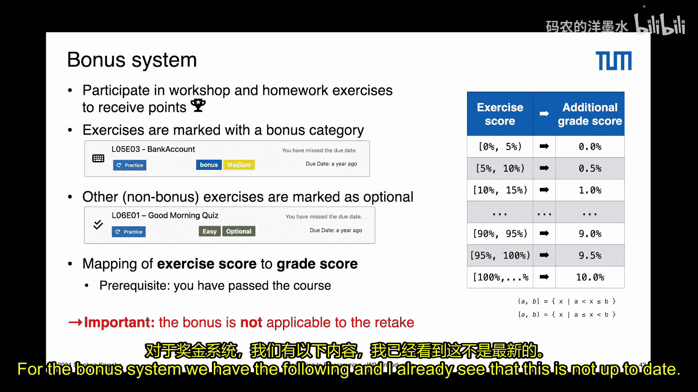

This is based on the last year where we had this done slightly different。

 We will update the slides right afterwards and make sure that you get the newest version here。um。

And then。This would be。Like that。

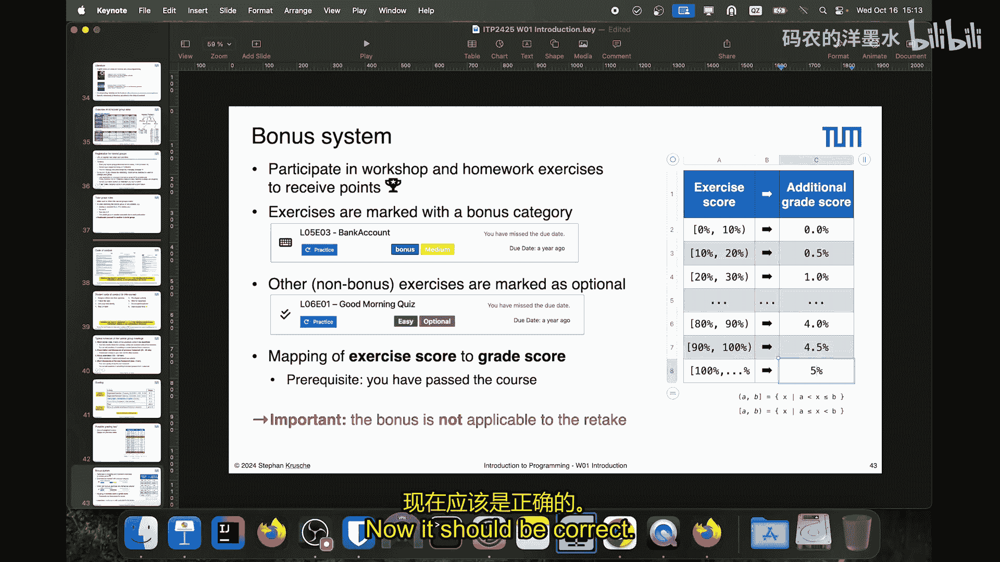

Here we go， now it should be correct。We will update the PDF afterwards， but as I said before。

 if you have the full bonus， you can get up to additional 5% or make up 5% that you lost in between。

 and as you see， we will mark the exercises with the bonus category so the exercise L 5 E3 account bank account in the screenshot is's a bonus exercise and the other one is not a bonus exercise because it doesn't have the category。

The bonus is only applicable to the normal course activities if you do not pass the course and you need to go into the retake。

 then the bonus will not be applicable。Any questions regarding the grading or the bonus system。

 anything that is unclear for now， yeah， go ahead。Yeah， the question is how will the retail work。

 we will announce the exact details in February， how this works。

 but we currently plan that there will be two supervised exercises in the lecture halls in the beginning of April。

But this is not fully determined yet。 And the idea is that those。

ReRetake activities are completely independent of the normal course activities。

 So you cannot use some。Gras from the course activities。 if you fail the course。

 you cannot apply them in the written。The retake， you start again from0。 it's really all or nothing。

 Either you pass the course， then you get a grade or you don't pass the course。

 then you need to go into the retake， and then it starts from0。

Which means you do not have any advantage。If you just want to take the retake by participating in the course activities。

 but also means you do not have any disadvantages right if you don't get a good grade in one course activity。

 you can still participate in the retake and get the best possible grade because it's completely independent。

Any other questions regarding grading or bonus？Okay， so the question， if Im understand it correctly。

 otherwise correct me is whether the weekly quizzes are part of the bonus or not。

 I this the questioner， normally they are part of the bonus。

 but it really depends if they have the bonus category， They are part of the bonus if they don't。

 they're not， right， And we mix this up。 Yeah， not every exercise。 we think about it。

 Is this exercise easy enough or is it too difficult or does it make sense。

 we also don't want to overload you with too many exercises that count toward the bonus because。

They are seen as kind of mandatory by some students because they really want to get the bonus。 Yeah。

 and we just don't want to overlook you。 That's the basic idea。

 So make sure that you look for the bonus category。 If it is part of the exercise in artemis。

 it will be。Part of the bonus， otherwise， it won't。Not a question we。Yeah。

 the question is does the bonus is or is the bonus applicable if you do not pass the course and the answer is no。

 you have to pass the course according to this grading key。Yeah， so according to our plans。

 which might change at the end based on your performance， but according to our plans。

 you need to have at least 50% in the overall grade of the course， no matter how you achieve that。

 now you can have0% in the first supervised exercise fine。

 you can have 30% in the second supervised exercise and 20% in the team project which adds up to 50% in total。

 then you pass the course and then you can apply the bonds。

There's no requirement for an individual activity。 You can even skip one of those still past the course。

 but of course， it's also not easy to achieve full score handles， right。

So make sure to participate in all of them to have the best chance to get a good grade。

Any other questions？I think there will be a lot more questions in the future。

 We do one more on the side。The question is how many people can be in a team， too。

Two people in a team， yes。再吃一点。Okay， one last question， and then we'll continue。So， the question was。

Is it a good idea to already find a partner for the team in the same tutorial group？

And the answer is， yes。As you need to do pair programming in the tutorial groups in January。

 your partner in the team has to be in the same tutorial group。

 So if you have your favorite friend that you definitely want to work right now in the in the team project。

 make sure that you end up in the same tutorial group or if this doesn't take place。

 think about switching later on， but this is a hard requirement and we can't。We in it。

 your partner in the team project needs to be in the same tutorial group。

 Otherwise this whole concept will not work out and we can't do any exception to this group。But。

It's also good to learn new friends to work with someone you' have not known before。

 right So even if you don't end up with your best friend in a team。

 there are many other partners or many other students that you will learn out that you will learn throughout the course in the tutorial group。

 and maybe it's good to work with someone that you don't know。

 Maybe then the team dynamics are much better。Okay let's continue as we said we have three different exercise types we have workshop exercises we have let me call this tutorial group exercises and we have homework exercises and you can quickly identify them based on the first letter in the short name of the exercise and Artemis so if the first letter is a W it's an in-class exercise for the workshop if the first letter is a T it's a tutorial group exercise and you are supposed to solve it in the tutorial group if it starts with an H is a homework exercise and you are supposed to solve it on your own at home。

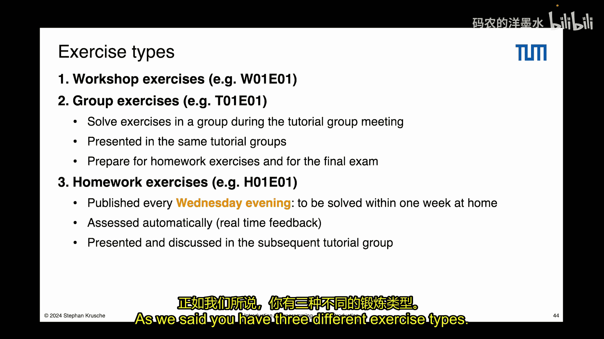

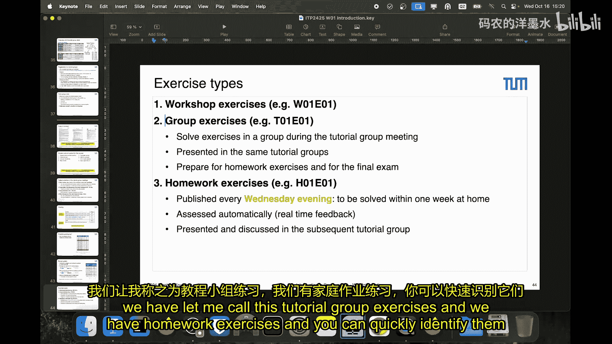

Homework exercises and tutorial group exercises are all published on Wednesday evening。

And are due until the next Wednesday， 1 PMm so you have one week to solve them and we kindly ask you to not work on them during the workshop because of the workshop we should focus on the things that you learn here and not solve homework exercises。

There are certain exercise rules。 and this is really。

 really important for us because there were a couple of misunderstandings last year。

You need to submit all your solutions on Artemis。 It's not possible to work somewhere wells。

 and this also includes the team project later on。The team project and all the history regarding the team project needs to be on Artemis。

 It cannot be somewhere else。 This is really， really important because you might fail the team project if you work on it somewhere else。

NowTake that into account， you can't submit homework exercises or something like that via email。

Or why use be stick， this is not possible。 You have to use Artemis。 If Artemis doesn't work for you。

 for whatever reasons， let us know。 And then we are happy to assist you。

 If Artemis doesn't work for everyone， we are happy to。Delay or or extend the deadlines。 Yeah。

 so you should not have a disadvantage because the tools are not working。

 but you need to make sure your own personal setup up is working。

And you have many chances to try out that the exercises work。Each exercise has a due date。

 if you miss a due date， the exercise will not be graded and it will not count towards your grade or your bonus and keep again in mind that you should work on those exercises independently blindly copying it from others is a thing where you just betray yourself。

We also have an AI policy as part of this course， which is also quite important to us to be transparent about that and to。

Give you this information as early as possible so that you can obey it。

And we have three categories here。 We have the red color from the traffic light。

Which means not allowed。And during the supervised exercises where you work on your own in the computer。

In in the lecture hall on your own computer， it's not allowed to use any kind of AI。Not Je GT。

 not Github Co pilot， not any other thing that is considered SA AI。

 So in case you have activated it in your integrated development environment。

 you need to disable it for this supervised exercise， which。Counts a little bit like an exam。

And this is really important to us if we identify you during the exam， scouts towards as cheating。

 and then you will fail the course with a 5。0 and a little U into online， which means unto life。

And which has severe consequences to you。And we really take this serious。

Now you may install GitHub Copit in the second category for programming tasks during exercises。

 homework or the team project。But we kindly ask you to use it spaingly if everything in your homework is done by Gitthub Copit or by any other AI。

And you don't understand what's going on。 You also betray yourself。

 It's a little bit like blindly copying the solution from another student。

If it helps you to understand things， if it helps you because youre stuck。

 if it helps you in your learning experience great， but do not rely on those tools。

 too much in the homework or in the tutorial group exercises or in the team project。

 because in a supervised exercise， you can't use it。

And then there's the last category green recommended， and this is we encourage you to use Iris。

 our own little virtual tutorer for all the programming exercises that you do on Artemis the good thing about IIS is that it's programmed and designed in a way that it's deically meaningful so we actually instruct it to give you a good advice so that you can do the next step and to not reveal the solution to you。

Like a virtual tutor would do。Right， a virtual or like a real tutor would do。

 If a real tutor stands behind you， if he or she would not tell you the solution。

 He or she would tell you， hey， look at this concept or maybe look at this line of code。

 You have an error here。 Think about this again and try to solve it。

 So you can ask Iris a lot of questions。On the exercise page， if you want to do that， it's up to you。

 but it will not show you the solution。 And this is for us the ideal way of how to integrate AI into a learning experience。

I'd like to emphasize that AI tools are no requirement to pass the course。

 if you don't like to use them， it's also perfectly fine to do everything on your own。

This is just optional。 And we know that some students use it and profit from it in order to improve their learning experience in order to。

Solve situations where you are stuck and where maybe on the weekend。

 no other tutor is available to help you， but this is your own decision。

 Try to follow the traffic light scheme here and then you have a good time。

Any questions regarding the AI policy？If are any additional questions， let us know， otherwise。

 we will tell you more about Iris in your first tutorial group and show you in detail how you can use it on Artemis。

Great， we'll got now do a break。 I'm a little bit behind my own schedule。 So we meet again at 3，40。

 So you have now around 30 minutes to relax a little bit。

 And then the workshoprk continues with the second unit。 Thank you for listening。😊。

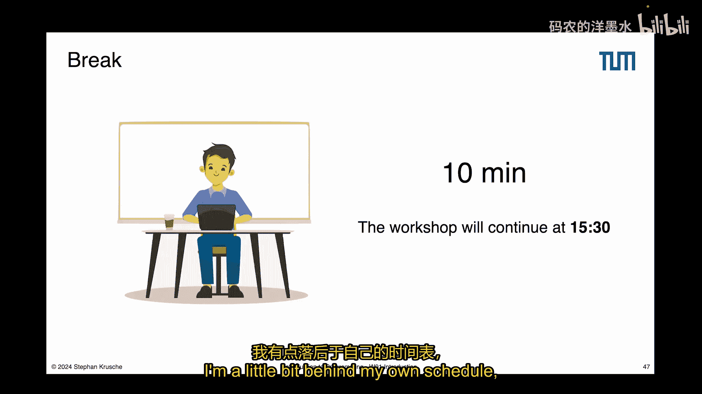

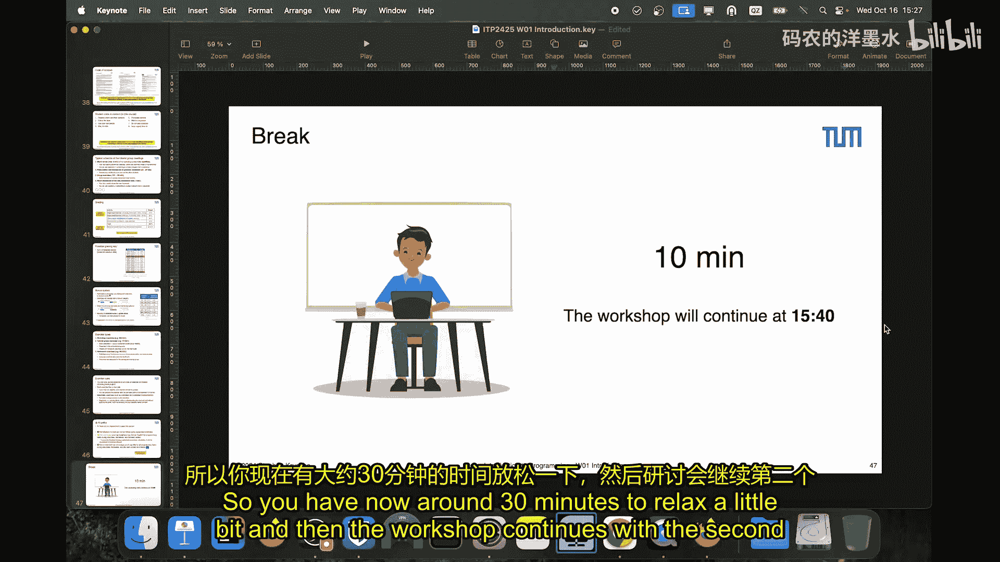

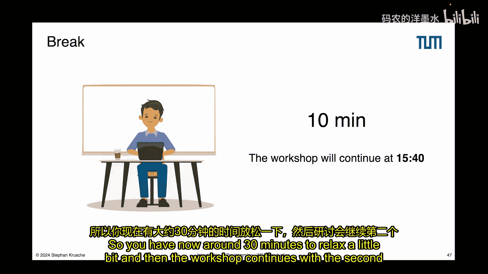