# 计算机编程：从入门到实战：第4讲：通用编程

## 概述
在本节课中，我们将学习慕尼黑工业大学《计算机编程：从入门到实战》课程第四讲的内容。本节课主要介绍课程的组织结构、学习平台的使用方法、评分规则以及人工智能工具的使用政策。我们将从课程概述开始，逐步深入到具体的操作指南和编程基础概念。

---

## 课程介绍与组织结构

欢迎来到《计算机编程入门》课程。我是Stefan，本课程的主讲教师。对于大多数同学来说，这是你们编程学习之旅的起点。这门课程对许多人来说会很有挑战性，但我们会尽力提供最好的支持，帮助大家度过难关。

在开始具体内容之前，我们先了解一下本课程的教学理念。本课程基于**人工智能增强的交互式学习**，这意味着我们将采用多种不同的教学方式。

以下是本课程的主要组成部分：

*   **同步学习活动**：我们会在讲堂进行现场研讨会和练习。这不是传统的讲座，而是鼓励大家积极参与和实践的环节。同时，我们也有现场辅导小组，在这里，辅导老师更像是教练和引导者，帮助大家获得良好的学习体验。
*   **异步学习资源**：我们会提供研讨会录像、幻灯片、阅读材料（书籍和在线文章）以及家庭作业，帮助大家巩固所学的编程概念。

我们拥有强大的支持团队，包括3名讲师和34名辅导老师，为大约800名学生服务。我们使用一个名为**Artemis**的自研学习平台，它提供了比传统平台更好的学习体验，并包含名为**Iris**的人工智能辅导功能。

为了提供最佳的学习体验，我们对大家也有一些期望：

*   **保持开放心态**：尝试新的技术、学习方法和教学方式。
*   **积极主动并保持好奇心**：提问是学习的关键。
*   **学会自我管理**：合理安排学习时间，了解课程各项活动的时间节点。
*   **保持友善和耐心**：有时回复问题或处理反馈需要时间。

本课程的教学目标是让大家学会如何通过编程解决问题，并提升团队沟通、问题解决和展示等软技能。编程是当今世界的一项基本技能，掌握它将为未来的职业生涯打下良好基础。

---

## 课程团队与学习模式

我们的课程团队包括主讲教师Stefan、练习讲师Ramona和Marcos，以及34位经验丰富的辅导老师。他们将在你的学习过程中提供90%的支持，请充分利用与他们交流的机会。

关于课程设置，有几点需要了解：

*   **研讨会**：这不是传统讲座，而是专注于课堂练习。我们将4小时的课程分为4个40分钟的小单元，方便大家学习和复习。
*   **辅导小组**：时长约3小时，目标是进行小班化、高强度的辅导。你需要在小组中积极提问、与其他同学互动，并进行小组练习和学生展示。
*   **家庭作业**：每周会有家庭作业，需要独立完成。虽然可以使用AI工具（特别是Iris）寻求帮助，但**严禁盲目复制粘贴他人的代码**，否则将无法通过课程。
*   **考核方式**：包括两次在讲堂进行的计算机测试、展示、一个团队项目，以及可以获得额外加分的活动。

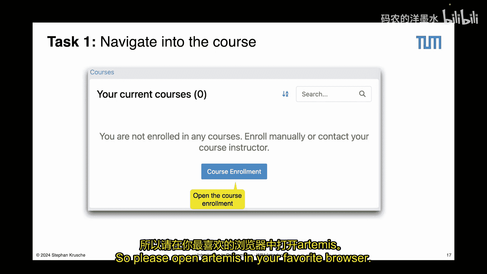

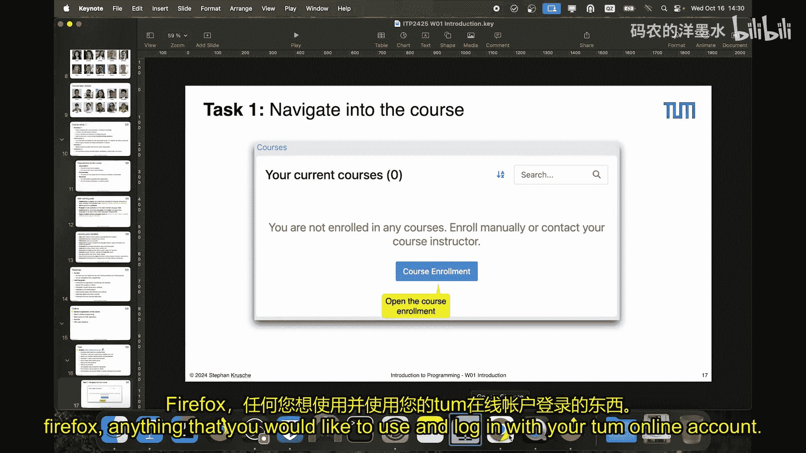

学习本课程，我们假设你具备以下条件：
*   有学习编程的动力。
*   拥有一台可以在研讨会和练习中使用的笔记本电脑。
*   有编程经验或参与过软件项目会更有帮助，但非必需。

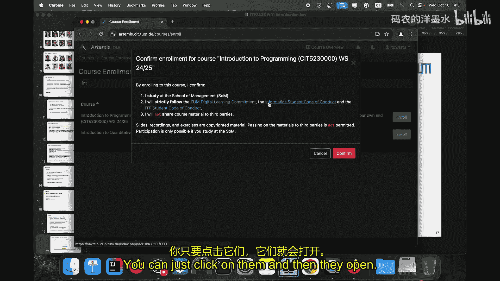

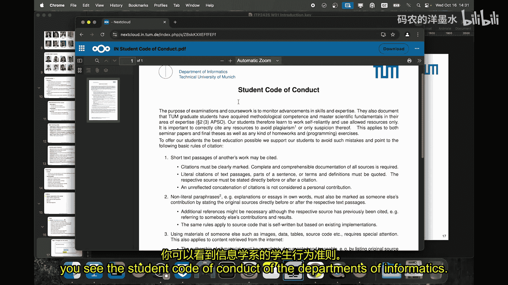

本课程的核心学习目标是培养你的**应用能力**，而不仅仅是记忆知识。你需要真正掌握并运用这些技能。

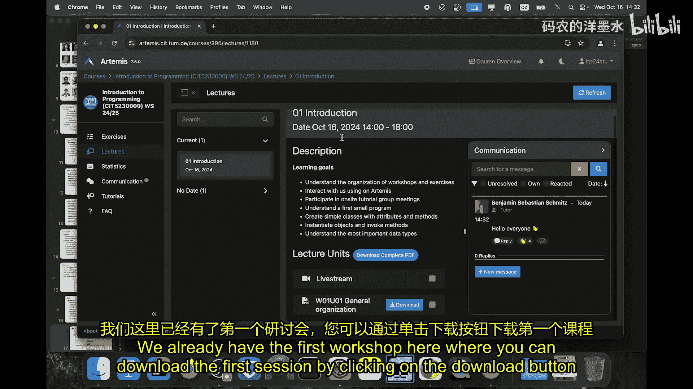

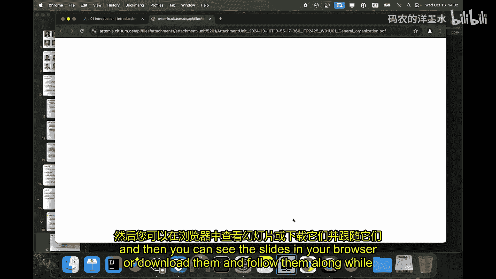

---

## 今日课程路线图与Artemis平台使用

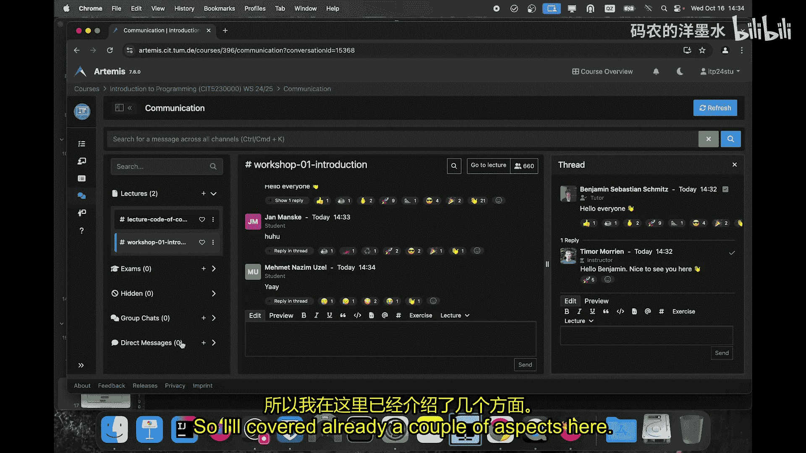

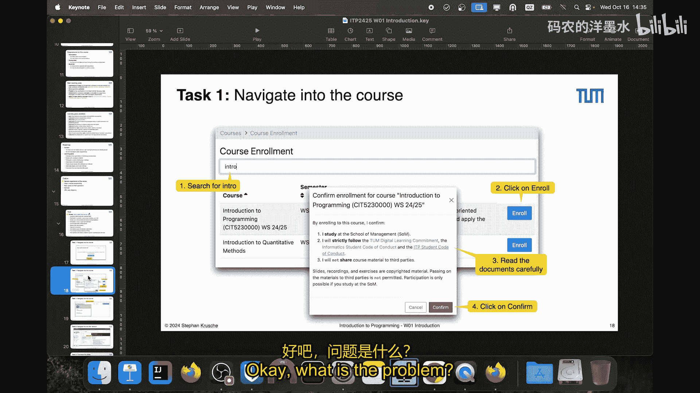

今天的课程路线图如下：首先，了解课程的整体组织方式；其次，学会在主要学习平台Artemis上与我们互动；然后，在本次研讨会结束前完成辅导小组的注册；最后，在第二部分，我们将编写第一个小程序，学习如何创建简单的类、实例化对象以及了解基本数据类型。

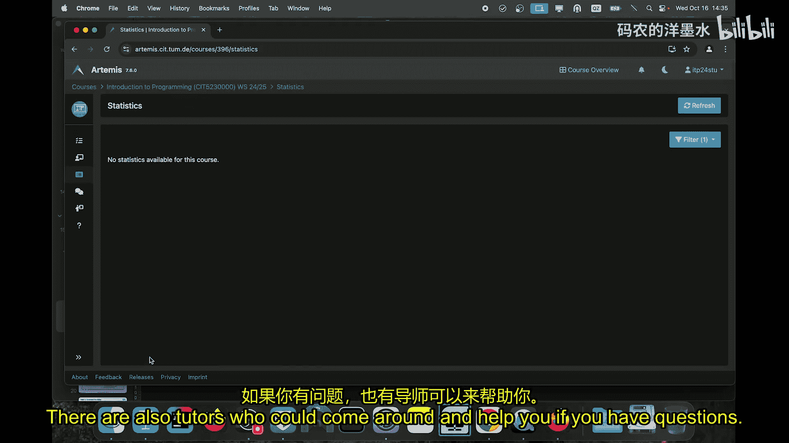

现在，让我们深入了解我们将要使用的主要工具：**Artemis**。

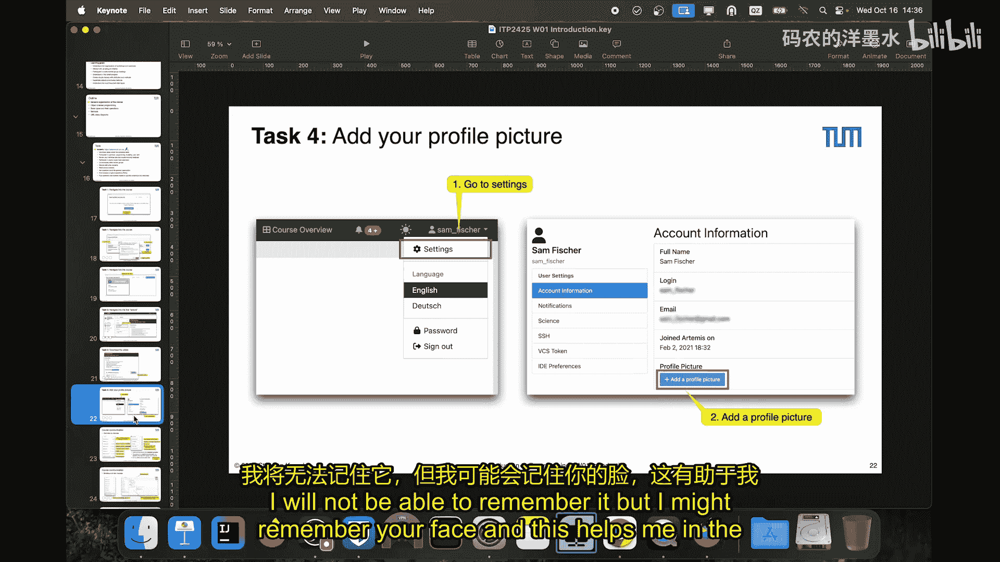

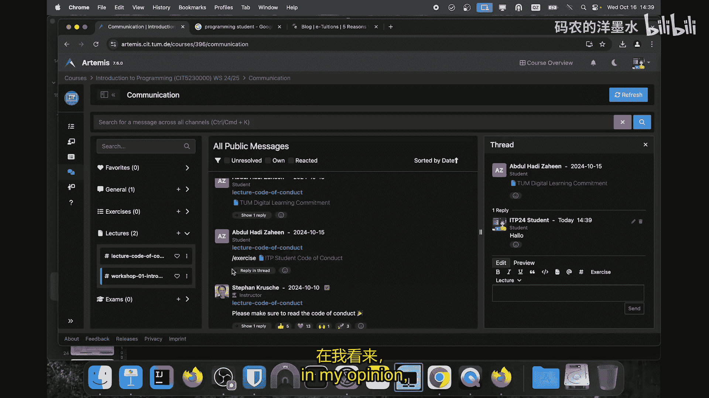

Artemis平台允许你参与多种活动，包括下载幻灯片、参与练习、获得自动反馈、参加监督练习（即考试）、与我们沟通等。现在，我们将一起完成第一个教程。

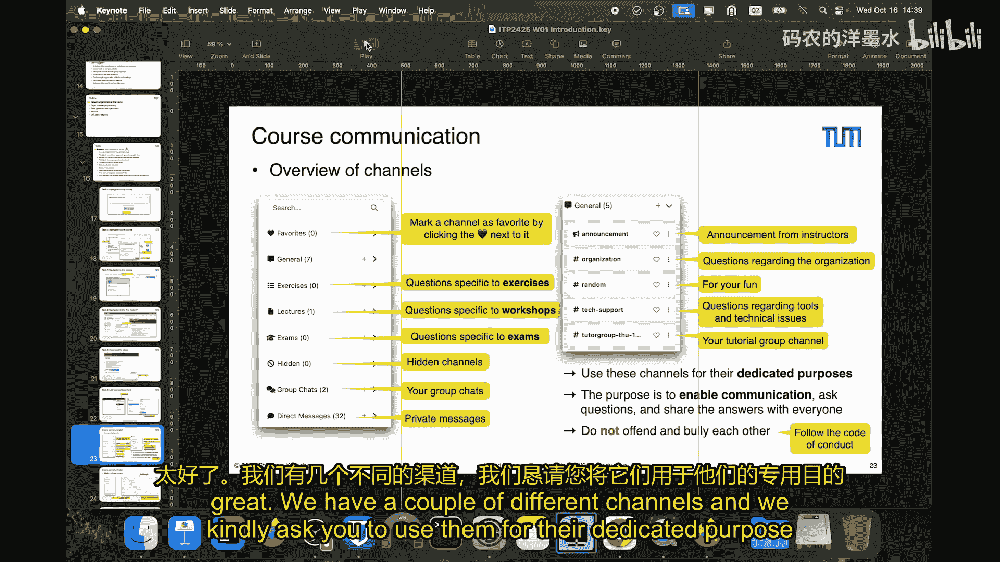

**以下是注册和使用Artemis的步骤：**

1.  **登录**：在浏览器中打开Artemis，使用你的TUM在线账户（7位数字，通常以G开头）或邮箱登录。
2.  **注册课程**：点击“课程注册”，搜索“Introduction to programming”，点击“注册”按钮。
3.  **同意条款**：阅读并同意课程条款，包括学生行为准则和不向第三方分享课程材料的承诺。
4.  **探索课程**：注册成功后，进入课程页面。你可以在这里找到练习、讲座（研讨会）资料和沟通渠道。
5.  **设置个人资料**：点击右上角的用户名，进入“设置”，上传一张个人头像照片。这有助于我们更好地进行交流。

在Artemis上，我们通过不同的频道进行有组织的沟通：

*   **练习频道**：针对每个发布的练习提问。
*   **讲座/研讨会频道**：针对特定讲座内容提问。
*   **公告频道**：仅讲师可发布重要通知。
*   **辅导小组频道**：与你所在辅导小组的同学和老师交流。
*   **私信功能**：可以向任何学生、辅导老师或讲师发送私人消息。

请遵守行为准则，保持友好交流。所有与课程相关的沟通都应在Artemis上进行，请勿发送邮件。

此外，Artemis还有**常见问题解答（FAQ）** 板块，我们会将常见问题汇总于此。平台也提供移动端应用，但部分功能（如编程练习）可能在移动端受限。

---

## 课程时间表与教学理念

本课程每周三举行研讨会。从下周开始，我们将深入各个主题。请注意，在第3周和第7周，我们安排了复习课，专门帮助从未编程过的同学巩固重要概念。

我们的教学理念基于一句中国谚语：“**告诉我，我会忘记；展示给我，我会记住；让我参与，我会理解；让我后退，我会行动。**”

这引出了**交互式学习**的概念。我们希望在40分钟的小单元内，先讲授一个概念并展示示例，然后让你在Artemis上通过课堂练习立即应用，并获得即时自动反馈。最后，我们一起反思这个概念，巩固理解。

Artemis完全支持这种交互式学习。你的辅导小组将进一步深化这些知识，并侧重于软技能培养，如沟通和展示。

典型的研讨会日程包括：简短测验、四个学习单元以及中间的休息时间。所有课程资料均受版权保护，请勿公开分发。

课程推荐了两本参考书，但每份幻灯片末尾也会提供具体的文献或在线教程参考。

---

## 辅导小组注册与规则

我们计划开设32个辅导小组时段，分布在除周三以外的日子。大多数设在市中心校区，部分在加兴校区。小组命名规则为：星期几（三个字母）-时段号（1上午，2下午，3晚上）-校区（MU慕尼黑，GA加兴）-房间号映射。

**以下是注册流程：**

1.  **提交偏好**：在今天下午3:30之前，通过TUM在线提交你的辅导小组时段偏好。**请务必选择多个合适的时段**，而不仅仅是一个，以增加匹配成功率。
2.  **接收分配**：匹配结果将于今天在TUM在线公布。
3.  **首次会议**：第一次辅导小组会议将于明天开始。
4.  **后期调整**：如果今天未能匹配或对结果不满意，可以明天再次提交偏好，我们将进行每日匹配，直到10月25日截止。如需调换小组，需有正当理由且目标小组有空位。

辅导小组虽然是可选的，但我们**强烈建议现场参加**。虚拟小组效果不佳。如果因节假日等原因取消，请自行重新安排到其他有空位的小组。

典型的辅导小组流程包括：简短回顾研讨会内容（不超过5分钟）、展示和讨论上周家庭作业、进行小组练习并展示、以及简短讨论新布置的家庭作业。

---

## 评分规则与人工智能政策

本课程的评分由以下几个部分组成，总计12个ECTS学分：

*   **两次监督练习（各占30%）**：类似于在讲堂进行的计算机考试，需独立完成，**严禁使用任何人工智能工具**。
*   **团队项目（占30%）**：与另一位同组同学合作开发一个小游戏，整合所学概念。
*   **展示（占10%）**：在辅导小组中展示家庭作业或小组练习成果，每人需展示两次。
*   **额外加分（最高5%）**：通过完成标有“加分”类别的课堂练习和家庭作业获得。

总分达到50%即可通过课程。加分仅适用于正常课程活动，如果未通过课程需要补考，则加分无效。

关于**人工智能工具的使用**，我们制定了明确的政策：

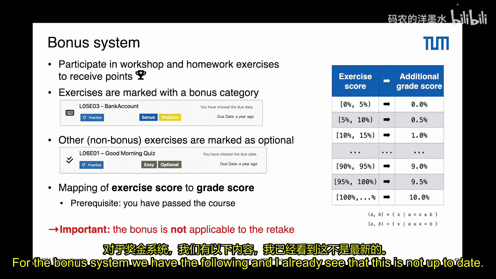

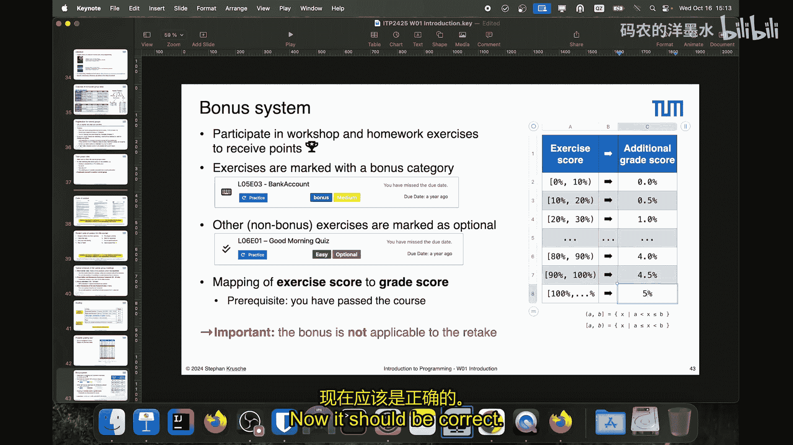

*   **红色（禁止）**：在监督练习（考试）中，**严禁使用任何AI工具**（如ChatGPT、GitHub Copilot）。违规将被视为作弊，课程成绩记为不及格（5.0）。
*   **黄色（谨慎使用）**：在家庭作业、辅导小组练习或团队项目中，可以安装使用GitHub Copilot等工具，但应**谨慎使用**。如果完全依赖AI而不理解代码，无异于欺骗自己。
*   **绿色（推荐）**：我们鼓励在Artemis的编程练习中使用**Iris**（我们的虚拟辅导老师）。它被设计为提供有意义的指导，帮助你思考下一步，而不是直接给出答案。

使用AI工具**不是通过课程的必要条件**，你可以完全自主完成所有练习。请遵循上述交通灯方案。

---

## 练习类型与提交规则

本课程有三种练习类型，可以通过Artemis上练习名称的首字母快速识别：

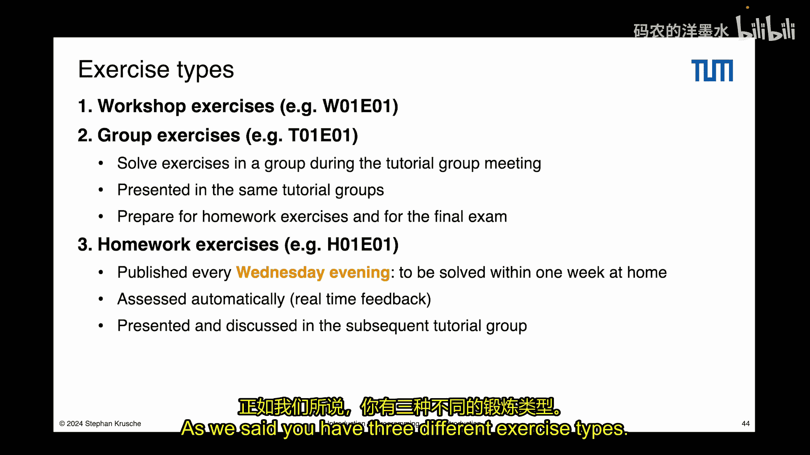

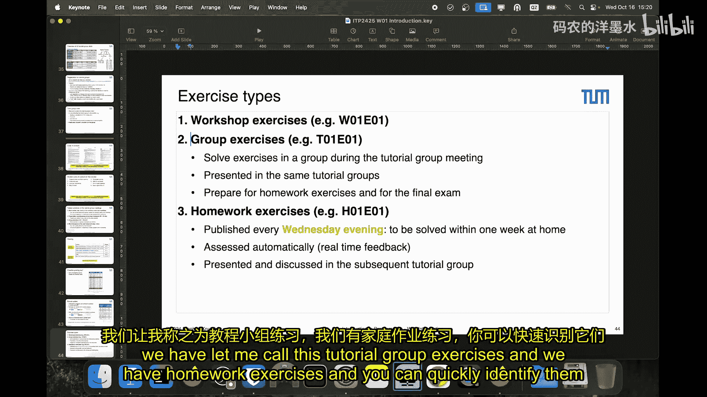

*   **W** 开头：课堂练习，在研讨会期间完成。
*   **T** 开头：辅导小组练习，在辅导小组期间完成。
*   **H** 开头：家庭作业，需要在家独立完成。

家庭作业和辅导小组练习均在每周三晚上发布，并在下周三下午1点截止。你有一周的时间完成。

**重要的练习规则：**

*   **必须在Artemis上提交**所有解决方案，包括未来的团队项目。不能通过邮件或其他方式提交。
*   每个练习都有截止日期，逾期提交将不计分。
*   应独立完成作业，盲目抄袭他人代码是欺骗自己的行为。

---

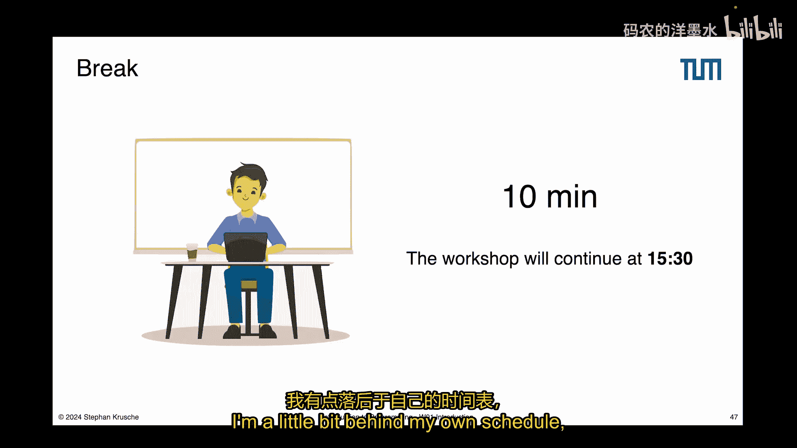

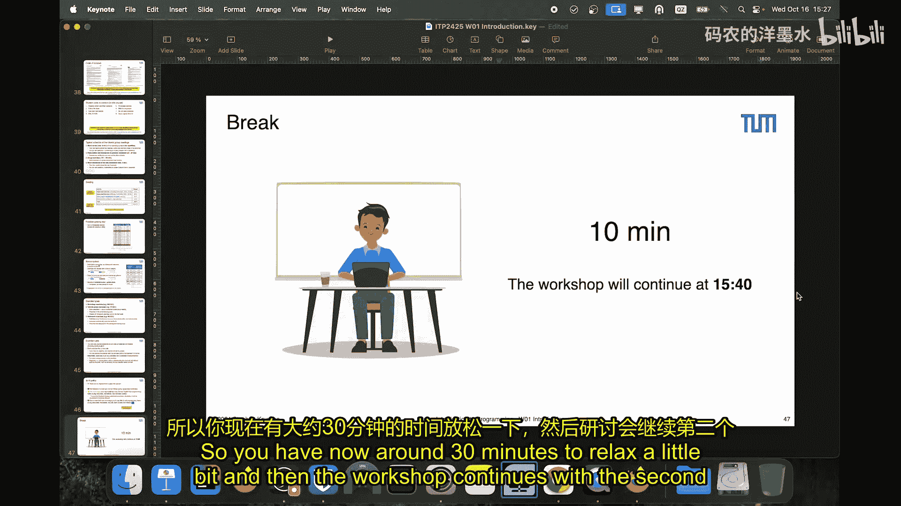

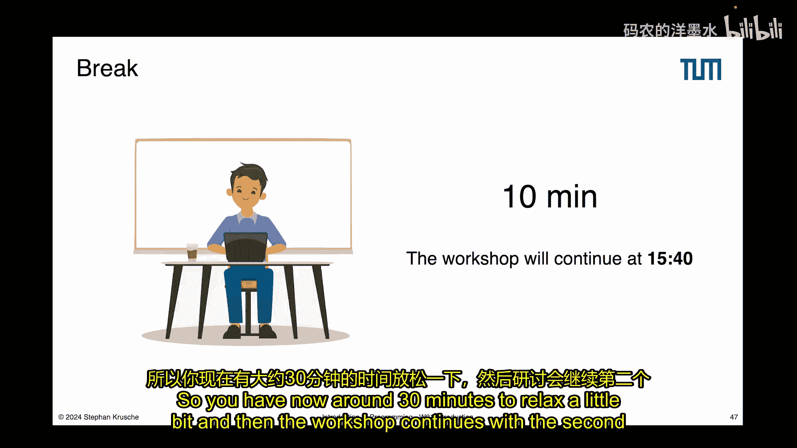

## 总结
在本节课中，我们一起学习了《计算机编程入门》课程的整体框架。我们了解了课程基于AI增强的交互式学习理念，认识了强大的教学支持团队，并详细掌握了主要学习平台Artemis的使用方法。我们还明确了辅导小组的注册流程、课程的评分构成，以及关于人工智能工具使用的“红黄绿”政策。最后，我们区分了不同类型的练习及其提交规则。这些信息将帮助你更好地规划本学期的学习，为接下来的编程实践打下坚实的基础。