# 【全集】慕尼黑工业大学 计算机编程：从入门到实战 中英字幕 p05 Lecture 5 - 面向对象编程part1 -BV1WFrTBZExY_p5-

Okay， let's continue。 I kindly ask everyone to。Be silent and stay focused。

 We'll go into our next unit， object oriented。Programming。

 and in order to experience what the code is about。

 I'll kindly ask you to open the integrated development environment on your computer if you have downloaded in Teleche。

Please open Intelch。 You can also use Vicious Studio code or any other integrated development environment。

 I will use Inch， and we want to create a new child project called Playground。

And then you can basically copy and paste the code from the slides that are just available on Artemis to download into the playground project and experience the code。

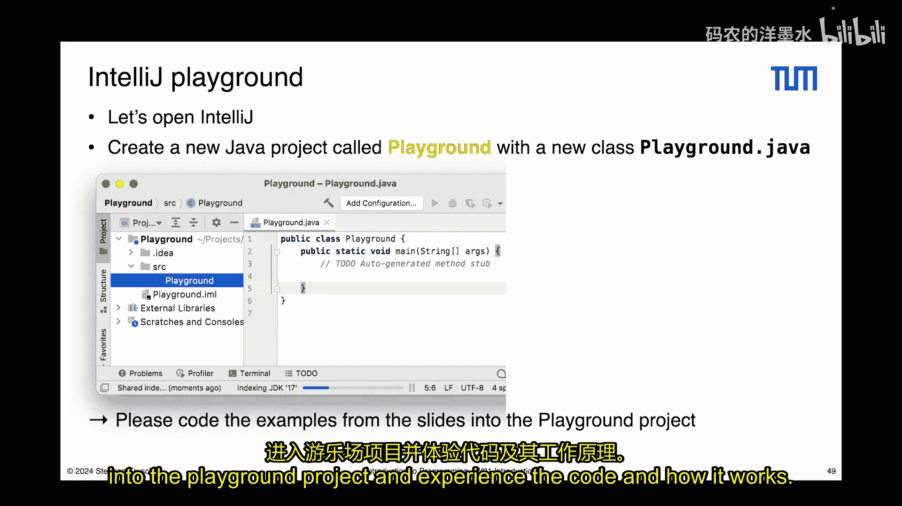

And how it works。 So let me do that Now， I open Inche idea。

 You can use the community edition or you can also use the ultimate edition if you register as a student with the company。

 then you can get the ultimate edition for free， but。Community edition is good enough。

 And then we can say new project here。 and I'll call it playground。I'll store it on my computer。

 It doesn't really matter what kind of build system use。

 but we typically use cradle and we typically use JDK 17 as part of this course。

 you might also for the playground use a later JDK。

 but in general we kindly ask you to use JDK17 so that you are compatible with the build system on Artemis and I can simply download Ver 17 of the JDK you can use any vendor。

 it doesn't really matter。I typically go for eclipse tamarine。And then， I can。Download it。

 And this might take a few moments。And I can。Create。The project。And while the。

SDK is downloaded and set up we can already see a little glimpse here。

 the public class is called mania with the package orRC example。

 you can ignore this for now and it's a little bit of code written here either you stay with main or you can also create a new file。

唔。A new file。And you call it playground。And then you have an empty class。

 and then you can also create this main method as a starting point。 So if you just type main。

It will do all the completion and here we can put in the code from the slides in order to see how it works Yeah so if you have severe issues setting this up。

 don't worry in their first tutorial group， your tutor will make sure that you have a working setup we also have a couple of tutors on the right and left side now so if you need help you can raise your hands and they can come to you and help you with the setup。

But。If you have two CBA issues， then you can also set this up at a later point。

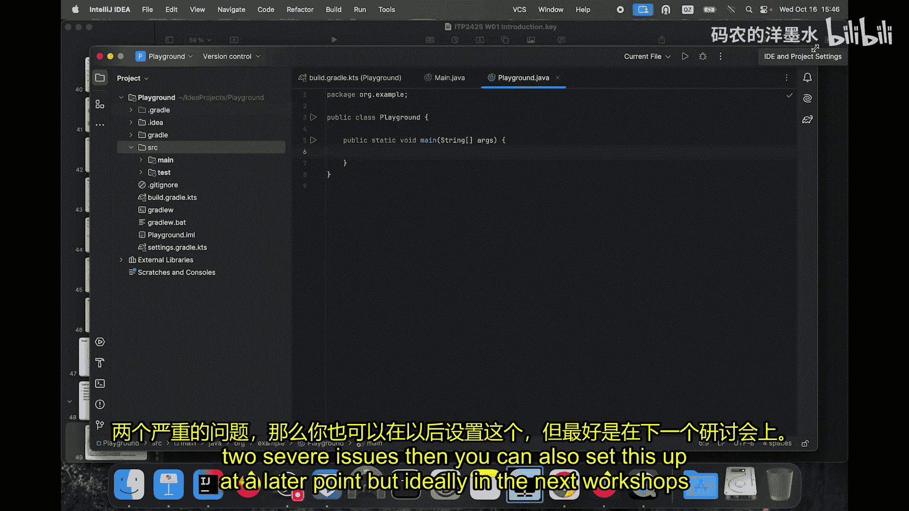

But ideal ideally in the next workshops and also the tutorial groups。

 you always have this playground in order to try things out programminging is really something where you do lots of trial and error so you try something out。

 you find out it's not working， you get the feedback。

 and you improve the code so that it's working again。Great， so before we show you the first code。

 let me start with the world of object oriented programming。

And the idea of object oriented programming is that our world， as we experience it。

 consists of objects。 Yeah， the wfi router here is the objects， suitcase is an object， the table。

Cha is an object。And in also program， we trying to。

Have an understanding of those objects in the reality and put them as a virtual counterpart into our program。

And in those objectss， they have attributes and they cooperate with each other through data exchange and invocation of services or methods。

And the property of this chair， for example， would be that is made out of foot。

That's a specific property for this Cha because we may a plastic or something else and then other。这。

Brown yellowish。And that's also had to be up this chair and other chairs might go differently， right。

 so we can also then create。この政府。And put the extra values of those actually to the skin。

And if you can do certain operations for that chair， I can， for example， sit for that chair。

 that's an operation that I can do。たね。ぱ。おせの話が。公す。写多嘢。Use data， for example。

 So there are certain services or corporations on those functions。 and we also would like to。

Talk about that when it comes to program。 That's the idea。 So we create a program。

 We mimic the objects from the real world that we are interested in。

 and we can then use them in our program。 Here's another example。The example of a library。

A library consists of books。 Yeah so we have a book， the Myical man month。

 It's an object of the real world， and we could model this as an object in our computer program。

 and it looks like that。 Ob are simple rectangles where you have a name。

 M M M Myical man month of typed book， and you have a few attributes， for example， who is the author。

 Fred Brooks， What is the title， the Myical man monthth and which edition is it its edition number two。

 Those are attributes and their corresponding values and in in the object word。

 they have concrete values。Now， from the instance， from the object we can also generalize。

 of course there are millions of different books in the reality。

 but all of them have quite similar attributes， right， Every book has an author。

 Every book has a title， Every book has an edition。

And you also have certain operations that you can do with a book in the context of a library can go to the library and borrow a book。

And you can give back the book。 And if you do that certain dates， Yeah。

 start date for boring and end date for boring are involved。

 or when you give it back the date when you actually the actual end date of your borroworough are also involved in that。

 So we have certain methods in the second。Part of the object here or of the class in this example。

 we have a book。Inst， and then we have a book class so by generalizing the object into something generic like a blueprint。

 then we can have a so-called class， a class iss nothing else as a type and you can have different classes in your program。

 all classes have attributes and all classes have methods。

And when we do that now we have a model here that this is already part of the UML。

 the unified modeling language， we can also create code out of this。

 So here's the first little Javava class。We have a class book。

And this book has three attributes with certain data types。

 A string is a type that consists of letters or characters。If an in， an inteature， which is a number。

And we have those methods with again， certain syntax that you will get used to as throughout this workshop and this particular methods。

 they have input values， dates， so you give you put something into the method。

 but they do not have output types or return types so we used to term void。

 void basically means nothing you do not return something a method can be used in order to compute something。

For algorithms， but it can also be used in order to change the object， for example。

 if you borrow a book， it's basically not in the library anymore。

 so you would implement some functionality to remove it from the library and to attach it to a certain user of your program。

Green elements here are comments。 And basically， in this case。

 I just want to emphasize that there could be more attributes。 There could be more methods。

 and a method itself would also include code in order to implement the functionality or the dynamic behavior of the method。

So this is the definition we define the class book in the code。

 but now then we also need to instantiate objects like the object that we see here。

 and we do that with the so-called new keyword， which invokes the constructor of the class。

 as we create a book that the type book called MMmM， which is the abbreviation for Myical man month。

And then we say equals new book。 And then we instantiate one object of this particular class。

 and we can instantiate multiple objects。 It's quite common that you have lots of objects that follow the same blueprint or template with of the class。

😊，And then we can assign the values， we can say author equals Fred Brookooks。

 and this is a string because it's written in quotation marks。

 we can also say title equals Myic command month and we can say edition equals two。So theoretically。

 you can copy and paste this code into your playground and then see how it works。

 Let's do that for a moment。

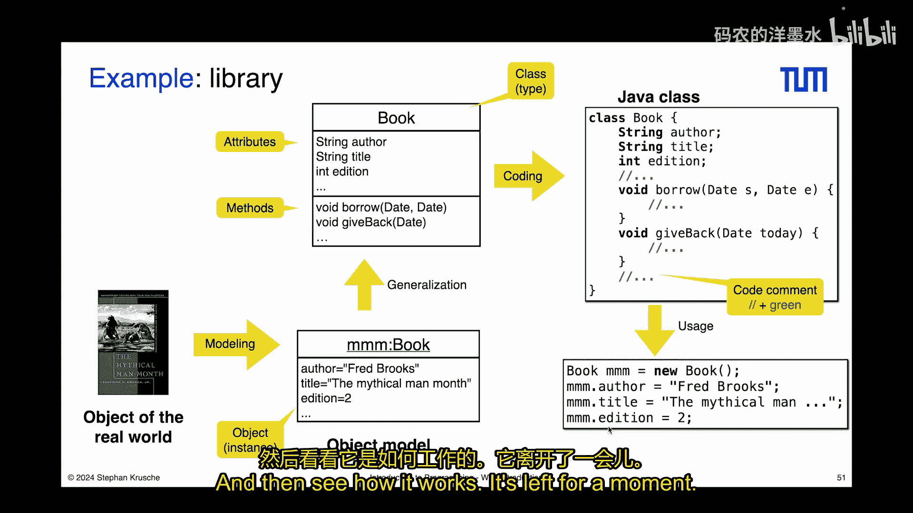

In Chava， it's best practiced at every class。

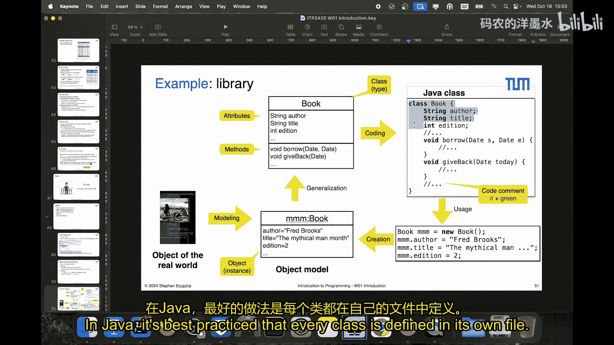

Is defined in its own file。Let me do that right away， so I'll go in here。And within the package。

 I right， click。And I say new Java class， I call it book。

We'll see that the integrated development environment helps me and already provides some kind of definition here。

 can copy and paste my code。 Yeah， unfortunately， there are some。Additional characters。

 Let me get rid of those。That's basically the encod in the slides。

 which sometimes does not really work out。And here we go， this is basically our class definition now。

 the date is a little bit of a shortcut here， Java has different date types and we would use need to use a different one。

 for example， local date in order to get this compiled。

let me change that now but now I basically have a book class as defined in the slides。

 Now I can go to the main class or to the playground class class， maybe that's easier。

And copy and paste the usage。 And this basically now oops。

This basically now means we create a new book So from now on India there。Program。

 we have an object of typed book， and we set the attributes to those values。 And theoretically。

 we could also invoke methods on this。 So I could also say， give back and pass a local date。

There should be something like now right and then I have an object， an instanceense of a class。

 I created it with this new keyword， I assign certain attributes。

 values to the object and another object could have different attribute values and I can invoke a method。

And it's the basics of object oriented programming that these are already the main ingredients of programs in computer science。

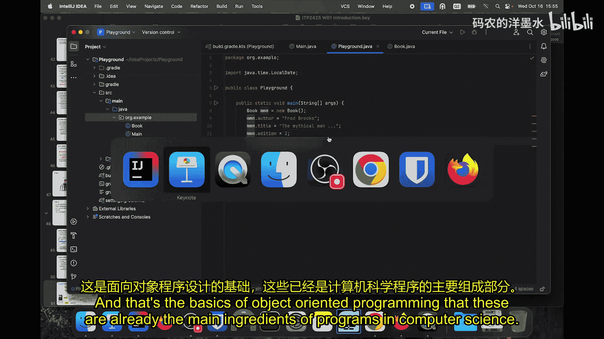

Now。Let's have a quick definitioner。 Again， we have three aspects that categorize objects。

 We have the identity， which is done with the name。

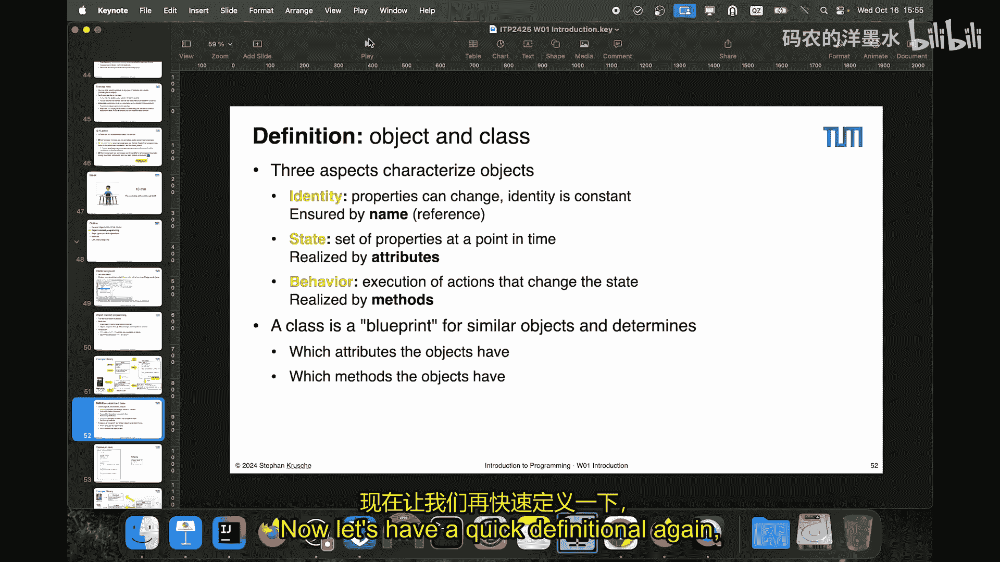

So even if the properties changed， the identity stays the same。We have the state。

Which is realized by the attributes。And their values at a given point of time。

And every object has a state。And we have a behavior which is basically the execution of certain actions or operations that could potentially change the state if I borrow a book。

 it's borrowed， it's not free anymore。And the state has changed， and this is realized by methods。

And a class， as I said before， is then a blueprint for all the objects that would like to behave and have a similar state and would like to behave similarly。

 Of course， they could have slight changes based on the values。

But they do not have completely different attributes。

So the blueprint defines which attributes an object has and which methods an object have。

 And the good thing is， you are completely free。 You can define any class that you want with any attribute that you want with any method that you want。

 so you really can kind of replay or or instantiate the real world。😊，For the purpose of your program。

 if you write a program about any， you could create an animal class。

If you write a program about flowers， you can create a flower class and then instantiate flower multiple times。

So， here' is a more。Generric example。 Yeah we have the class book with the different attributes。

 We have the constructor constructor， which is a specific method。 Sorry。

 that allows us to initialize the object Notice that every class has the so calledled default constructor and in the future。

 we will also see how you can come up with your own constructors。

 The default constructor basically does not take any parameters in order to initialize the object。

 So the object is kind of empty。But there could also be constructors that pass certain values and initialize the object already。

 and then we have methods and methods have input parameters with types Yeah。

 you see the date or the local data type， and they have a return type， which in this case is white。

So the schema is you write class， then the name of the class book， you have curly braces。

 and then you have the body of the class。And the body of the class defines the attributes。

 the constructor， what multiple constructors and the methods。That's the main idea fors in Javava。

 Now when we go back to the library， of course， they can have multiple books so in the object model。

 you might have a book， the handbook of So Engine by Dita Rammba in the first edition。

 we might have clean room software engineering another book by Staisy Powell and colleagues in the first edition and we might have Fred Brooks the mythical manual in the edition2。

 and all those books they basically do not exist alone they do not exist in isolation。

 No they interact with other objects of the real world that we would like to have our program。

And we will see that in a moment how they interact with a library object， for example。

 but they are all instances of the same class。So with a class。

 we describe something that we can typically see in the reality。

But that is so generic as a blueprint that we can instantiate malable。😊。

Objects or instances out of it。 I hope this is somehow clear。Great， now， as I said， those。

Books they do not exist in isolation。 They also interact with a library。 We could， for example。

 have the Hydebron Library from the Tomb Compass Hybron， which has specific attributes as well。

 opening hours and which contains books as part of the their shelves。 Yeah， So the three books， HSE。

 CSR and MM M M， could be part of the library。 And then we have a relationship between those books。

AndSo one object is related to another object。Or one class。

Consists of other classes when we generalize this。 So in our class world that we need to define in order to use the objects in our program。

 we can define the library。And the library consists of multiple books by using a so calledled association。

So you have the library class with its name。And in the first rectangle in the second rectangle。

 all the attributes， in the third rectangle， all the methods， you can for example， visit a library。

Now here as well， book， attributes， methods， and then we can draw a line to connect both of them with each other。

 and we can model the multiplicities。 Yeah， so one library can have multiple books。

But each book is always stored within one library。When it comes to the real object。Yeah，Of course。

 from the music， we have multiple objects later on and one。Book could be in the first library。

 and another book could also be the second library。 but then we have them multiple object instances。

Great， and if we if we use those associations， we do not need to write the book。

 the type as an attribute here， we can actually leave it out because that's already visualized and inserted into the diagram into our class world through this association。

Any questions regarding this little example of a library that consists of books？Okay。

 then we'll continue now。In programming， the attributes of the object are also called instance variants because they provide us a way to define values for the instance of the class。

And the instance has certain variables。And we can define values。😔，However。

 there will also be other kinds of variables within the class we can define variables that do not belong to the object those are typically static。

And we can also have local variables within a method。

 we can declare a method think sorry declare a variable and assign a value to it。

 If we go back into inche， we could see it， for example， yeah。

 so instead of using those instance variables， you could also simply say string name equals Stefa。

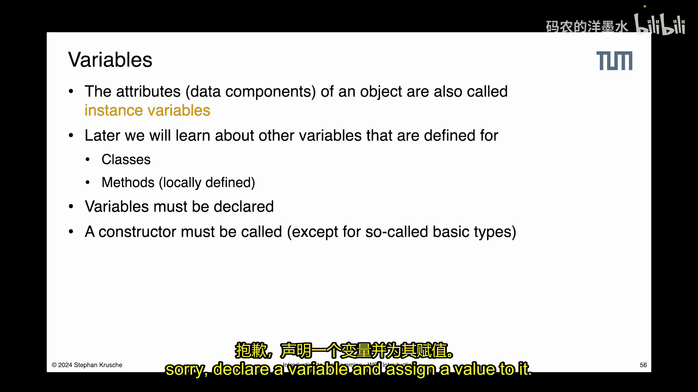

And then we have a local method variable that is not assigned to another object yet。

 that is part of this method。 After the method main is finishing。

 this local variable does not exist anymore。 It's basically thrown away。But within the method。

 I could use it。 So instead of directly assigning a string here。

 I could also reuse the variable and assign it here and maybe even assign it here。

 it doesn't make sense， of course， that the author and the title is the same。

 except for very specific cases， but it could be the case that I reuse the variable here and now I only have to define Ste on once and not multiple times。

 so this is a local variable author title and addition are instance variable of the corresponding object。

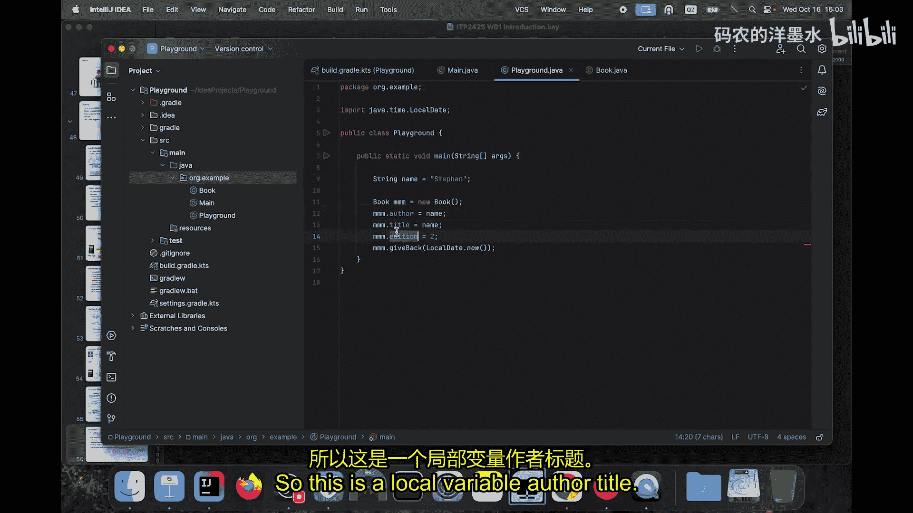

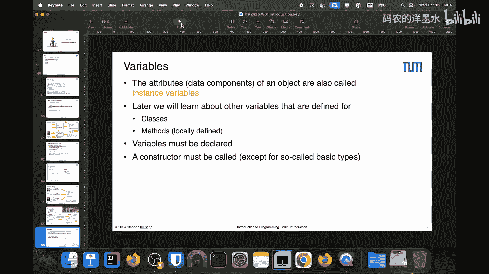

Now you always need to create a construct， you always need to call a constructor in order to create a tie。

 You've seen that here， a new book。

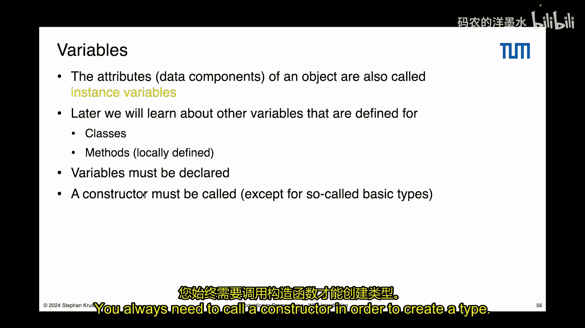

You cannot instantiate an object without calling it。Its instructor。So at some point。

 it's always the case that the instructor is called might be hidden somewhere。

 but you always call the instructor。 Otherwise you cannot create a new object。

 This is quite important to understand。 And if I would like to create a second object。

 I could do that here， but I cannot give it the same name， your names need to be unique。

 otherwise I don't know how to refer to。 So if I create a second book HSE， I would do it like that。

 And then I can access the object with the name and provide the author。

And if I'm remembered correctly， this what eat was Tita Rammba。

And now I have a second object and provide value to the instance variable or attribute of this second object。

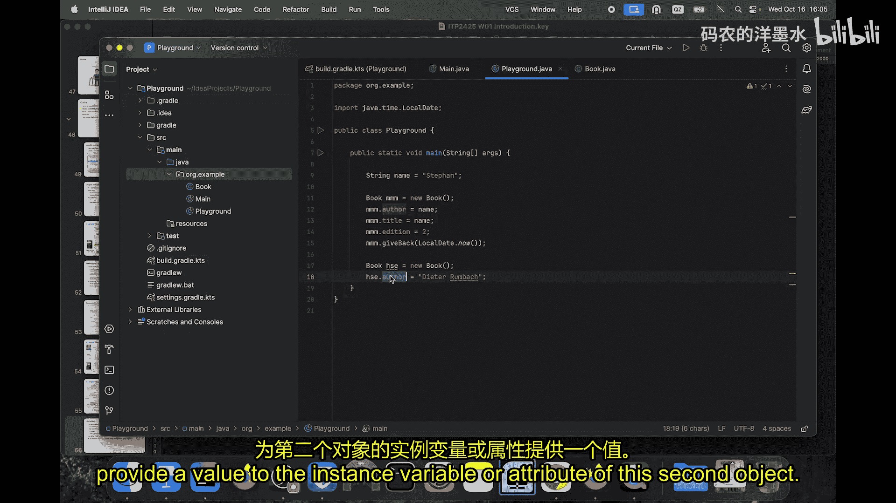

That's basically how we cooked very simple example， but I know if you've never seen that before。

 it's already a bit confusing。Let's take another example where we would like to talk about rationale numbers。

 Let me。

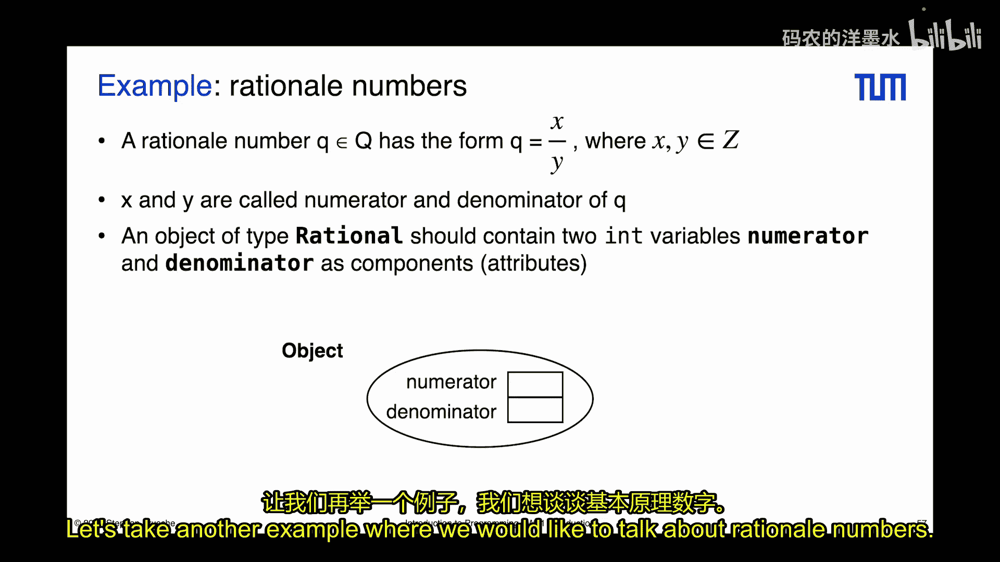

Fixedist rationale in English is without an E in the end yeah so it's a rational number rationale numbers are numbers that have a numerator and a denominator remember from school yeah3 divided by 4 is a rationale number and then would be 0。

75 and here Q would be 0。75 x would be3 Y would be4 and x is called the numerator y is called the Dnominator。

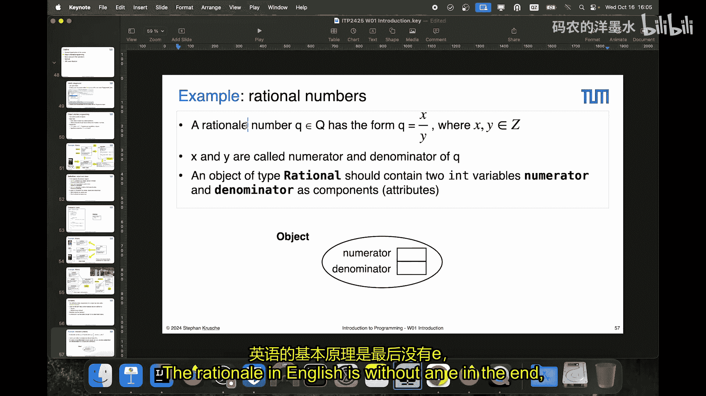

No。If you would like to use that in our program， we can create an object of K rationale and basically those numbers X and y need to be integers。

 need to be diits could be negative， but also positive， but not those are not floating point numbers。

 and those would then be the attributes of the object。

 So the object would have a numerator and a denominator。 This is how it would look like in code。

 you say class rationale in numerator in denominator relatively simple a class definition with two attributes。

 and we could provide additional constructors and nothing。And again。

 you can copy and paste this into your playground to try it out。Now。

 if we declare an object using rational name， we declare that we would like to use a variable。

 a local variable for objects of the class rationale。And if we now do new rationale。

 we instantiate the object or create the object using the constructor and while you typically write this on the same line。

 you can also write this on separate lines you can say first rationale R， the name semi me colon。

And then R equals new Russian now， but most of the times you write this into the same line of code in order to immediately initialize variable。

 the variable in order to avoid that it is not defined。And if we do that。

 we create the object R and the object R in Javava and in programming is nothing else than a reference to a specific place in the memory of our computer where those two integers3 and 4 are stored。

 This is how it works at a computer reserves memory stores those values and the object points to this particular place。

And the memory has two elements。 If we have two attributes like before or has 5，1020 elements。

 If we have 5，1020 attributes， as in our class definition。

So the amount of memory that we need to reserve depends on the definition of the class。

Constructors are then special methods that allow us to reserve this memory。

And are always invoked using the new keyboard。Constructors always carry the method， sorry。

 the name of the class， the class name and upper case。

 the default constructor do not has any parameters。

 but you can also define other constructors and they can have arguments。

If you add a custom constructor， the default one that is always available will disappear and will not be automatically available anymore。

 This is something that you have to understand。So。When we create a rationale S as a second object。

And we assign R the previous rationale number to it。

 then in this particular example we do not copy the whole object， we only copy the reference。

AndSo initially we have R pointing to this。Space in memory。 And after this copy operation。

 where we copy the reference， we have a second object S。

 which basically points to the same location in memory。This means whenever I change attributes。

Values of A of R， I also change the values of S。And this is quite important to understand in our object oriented world。

 we work with references。And we can have multiple local variabless that reference the same object in our memory。

And if we change one of them， we also change the other。

This is a very important concept called reference types in programming。

 and this is a big difference to the simple data types where this works differently。

Now when we would like to access the attributes we can use the point operator here。

 our dot numerator would then return the value that is currently stored in memory。

 so if I assign the R dot numerator to B another integer variable， then B would get the value 3。Now。

 B is a simple data type as an integer。And here， the number  three is actually copyied and insert it here。

So if I now change r de numerator to5。B still has to value 3。Because it's a simple data type。

 It's a copy of the actual value。 It's not a reference。And this is important to understand。

 This is important to distinguish primitive data types like int。Are based on a copy。 Yeah。

 So if I assign them to another variable， they are copied。And I do not have the reference semantics。

 objects use the reference semantics， and I can have multiple variables point to the actual instance。

Here's another example。 you see， we have many examples because you need to get to use to it。

 we would like to。Visualized points in the two dimensional space。And in the two dimensional space。

 we have also floating point numbers。 And those points could be， for example。

Moodeeled based on the x and Y coordinate in the coordinate system。

But it could also be modeled based on the。Anger， fee and distance from the zero coordinates。

So those are the two ways how we can represent points， so either x and y or distance and the angle。

Now let's start with the simple part， which I at least understand better。

 which is the x and y coordinates， so here we have a class point。And now we do not use intes anymore。

 We use double double are basically floating point numbers。

 and we can also represent something like 0。5 or a pi or anything that you would like to realize double is a very precise data point and for most operations if you don't have very specific mathematical accuracy。

 you can use double already quite good。Remember， the construct will exist automatically。

 and we can implement a couple of methods here。Now we can create points。

 We can say point P equals new point。 point Q equals new point。 Now we have two different points。

And P and Q are basically then the names of the references to those two distinct objects based on the last point。

But a point can have multiple identifier， so we can also say point r equals p and now R and P would reference the same object。

So we still have two objects because we only used new two times the third variable that we have here is basically a second reference to P。

Yeah， again， reference semantics。And why do we need references well。

 references allow us to use those objects in multiple places throughout our program。

 you can pass those references around。Put them into methods， manipulate the values of the attributes。

 and then again， pass them around in our program。Now， if we have a complex data type。

 a class point and an integer N， we need to first of all。

 initialize both using the constructor for the class and for the integer。

 we can directly assign Dit5 here。And now， point uses the reference semantics and。

And the integer uses the simple copy。Semantics， right？

And now what happens if we create a second or if we not create a second point。

 but if we declare a second point Q and assign it to P， well， we still have one object in memory。

 but we have two references to it。However， if we assign n to k， because it's a simple data type。

 we suddenly have two integers now。Reference semantics。Copy semantic。

 So P and Q refer to one of the same object。While the primitive values do not have any relations to each other。

 we simply have n and K both having the value of5。Now， when we talk about。

Points in the two dimensional space。 you can also model lines。A line has a starting point。

And then end point。P1 is the starting point， and P2 is the end point。

And this can be done by nesting class types into each other now。 So we create another class line。

 and this class line has two attributes of the other class point。Similar like a library has books。

 but in this case， one line has exactly two points， P1 and P2。

 and we can also create a constructor with the name line。

 it's always the class name and pass two points， P and Q and immediately assign them to P1 and P2。

Now， when we would like to create a couple of objects， we can do it like that。

 as you see in slide 70。We can create a point， P1。Assigned the x and y value to it， for example， 2。

0 and 2。7。And we can create another point P2， assign x to 5。8 and assign y to 16。0。

 and then we can use both point objectss。And pass them in as input parameters into the construct of line and create a new line。

That's basically the idea here。You can also further improve this with a constructor for point。

 make it easier instead of creating those。Additional lines。

 we could also have a constructor in point where we basically pass X and y directly to the attribute or instance variables of the cloud。

And here we use a new keyboard called this。This refers to the current object that we are dealing with。

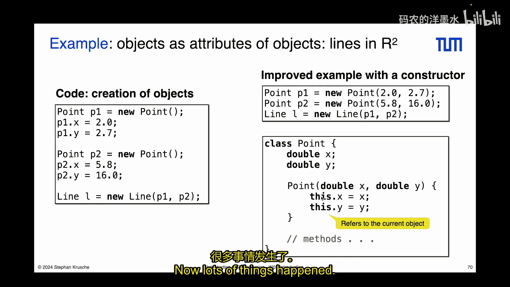

Now， lots of things happened。 Let's put that into code to see what's going on。

So we have our class point， which we can copy and paste。 Now。

 I show you a little trick if you copy a class from the slides and you。

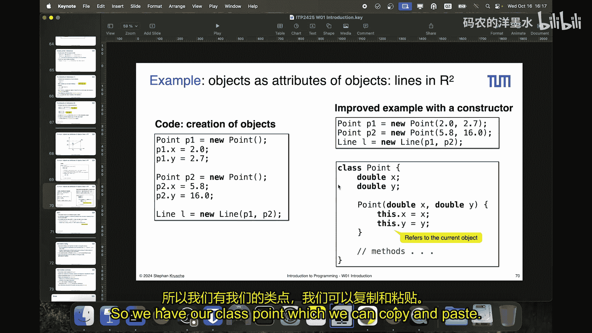

Select the package。 You can simply paste it。So I can simply say paste or on Mac command V。

And then InH automatically create the new file for me and insert the code so that I can directly use it。

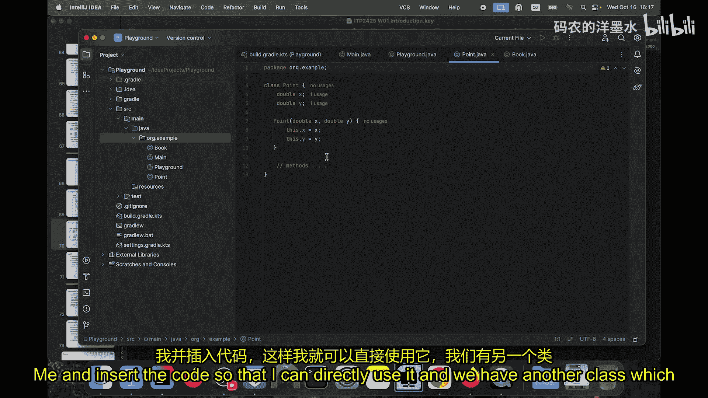

And we have another class， which was on the previous line。On a previous slide called line。

 I can also do this here。 And now I have a class line and a class point。

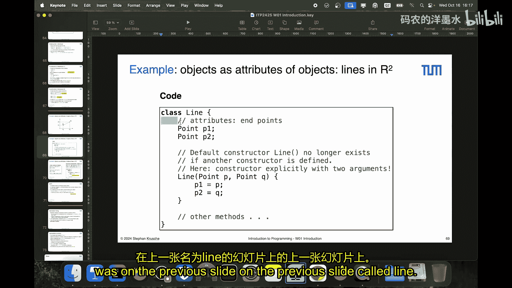

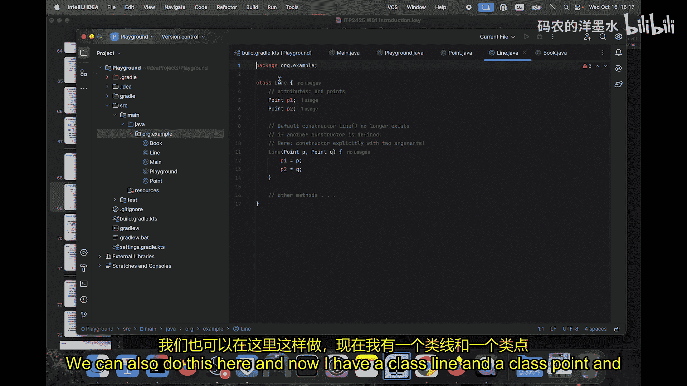

And as you have seen， we also have the example of how to create objects out of it。

 So let's copy and paste this as well。

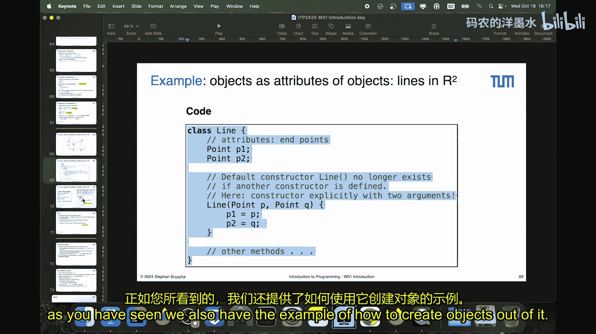

And put it into the playground。 I get rid of the old code。 I don't need it anymore。And except。

 I have another。Bad character。 This is how it works。 Yeah， So another example， two classes。

 Let's go through it quickly。 again。 We have line。A class。The open curly braces。

 we have two attributes， the starting and the endpoint P1 and P2。

 and a constructor to initialize both。And here you see we use different names， P and Q。

 so the assignment can go directly。Now when we go to the point and you can also navigate an intelligence by clicking command or control on the name here。

But you can also select it on the left。Then we have another class definition two attributes here。

 double X and double Y。And again。Constructor， where we pass double x and double by input parameters or arguments。

And here we have the exact same name as a above， so we must use this in order to distinguish whether we refer to the x as a parameter of the method or of the constructor in this case。

 or whether we refer to x as the attribute of the class。

And we used this by invoking or creating objects for those two classes。 First， we create the points。

 P1 and P2， using the new operator passing double values。

And then we create a new line and pass the two point objects into the construct。Now。

 what you also could do in Intelliche and in any other I is you can run the code and see what's going on using so calledled breakpoint So I can now click on this little triangle here and say debug。

And when I do that， I get an error。 Okay， So apparently something is not configured correctly here。

Okay， I'll figure that out。 Yeah， I don't know what。Ex issues if you have a similar issue。

 I hope the tutors know how to solve it， but theoretically we could now inspect what's going on here and we will fix that at the break and then we can continue with the example Any questions regarding this example regarding classes。

 attributes， methods and how to instantiate options so the question is are the codes upload it later no we assume that you can copy and paste them from the slides so for those simple examples that put into the playground we don't upload them to any place if we have more complex code。

 we will consider to upload them to make it easier to copy it into your playground。

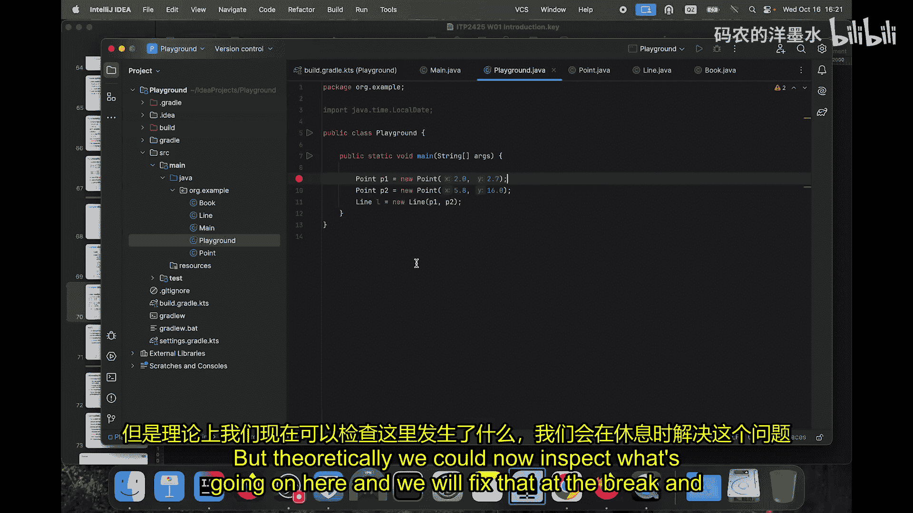

Any other questions regarding。What we just covered is concept here。Okay， nowadays。

Few more slides before we have another break。 so please bear with me。

 one important aspect is that we have something， a very weird concept for the reality。

 and this is called null。 null is the default value for reference type。

 So if you do not initialize a variable of a reference type of a class。

 you do not initialize an object that corresponding variable is null and null is quite nasty because it leads to exceptions。

If I just would write point P， then P would be null。

 if I then access the attributes or methods of this particular object。

 I would get a so-called null pointer exception。 You don't need to perfectly understand what a null point exception is right now。

 You just need to know that you did something wrong。 And we will tell you later on more about that。

 Just keep in mind whenever you declare variable of a class。 It's null。

 and you need to initialize it Otherwise， you might end up with a null point exception。

 And this is why it's best practice to always put this into one line。 Yeah。

 I could also write it like that。

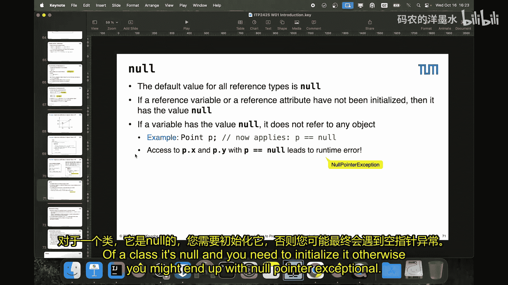

Point P1， but in line 9， this would be null and then in line 10 I initialize it and of course it's much easier much。

 much harder to understand because now I need to read two lines instead of one line and I could accidentally end up dealing with this null pointer exception so I can avoid this by always putting the declaration and the initialization into the same line。

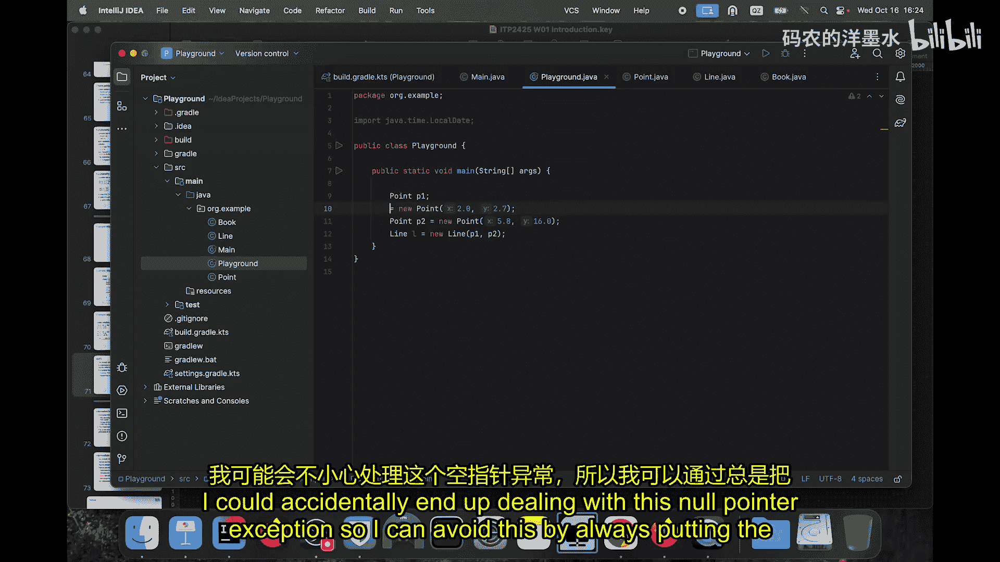

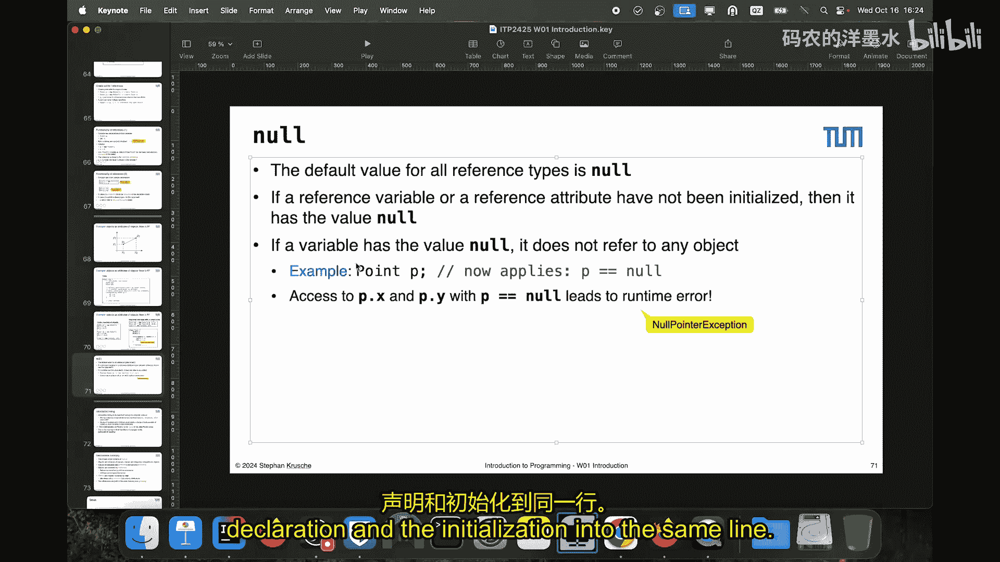

Another important concept is in computer science that that I would like you to be aware of is information hiding。

Now I could basically put all the coordinates in the line class I could say a line consists of x1。

 x2， y1， y2。But。This would be not a good solution。 Yeah And the reason is， first of all。

 we would like to reuse things in。Programming， and secondly， it's about information hiding。

 If I model a point。And reuse the point class in the line。

 I could actually hide certain aspects of the point， certain internals。

Maybe the line is not really interested how the point is constructed internally。

 Maybe the point has internal methods that allow us to shift points or to move points around or to delete points or something like that。

 And the line is not really interested in that。 And that's basically information writing So in。

Programming， we tried to。Decompose our program， not to have one big class with lots of lots of different statements and lines。

 Now we try to decompose it into small objects or small classes where we can then later on reuse the code more easily。

Now， if you change the implementationer， this would require a change of the implementation of line because line depends on the point。

However， later on， he will also see that we can hide information and if we hide the information with private。

 then it would not lead to a change in another class。And this is an important concept。

So we try to have the principle of locality and limit the effects of changes and if we need to change something fine。

 but then we like to change it in as few places as possible and not throughout the whole program。

 this is the idea of information hiding and object oriented programming。

So a quick intermediate summary before we go into the 30 minute break。

 the virtual world in our computer consists of objects。

 those objects are instances of classes and a class can be seen as a blueprint or a template of an object。

Remember， with one class， you can instantate multiple objects。

Those objects encapsulate data with attributes。And behavior with methods。

We can access those using so-called references that use a different mechanism than for simple data types。

 remember， multiple references can point to the same object。

 while this is not possible for simple data types like integers。

And an object is always created or initialized with the new keyword and new always calls the instructor。

 and the instructor does the basic initialization to make sure that the attributes have some initial meaningful values。

And when two references point to the same memory area to the same object。

 we also call this aliaizing， so this is just a name， if you see an alias。

 this is just a second reference to the same object。And with that， I'll leave you into the break。

 You're a little bit guide schedule， but that's fine。 You'll start again at7 or five， sorry。

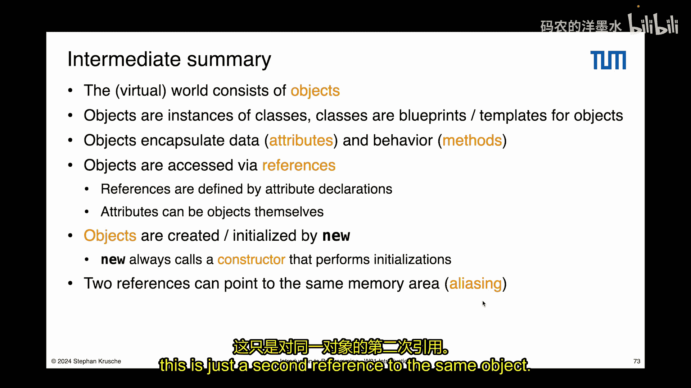

4，55。 So we have 28 minutes of a break， and then we'll continue with。

Basic types and their operations。 So enjoy it， break and CO you in。27 minutes。

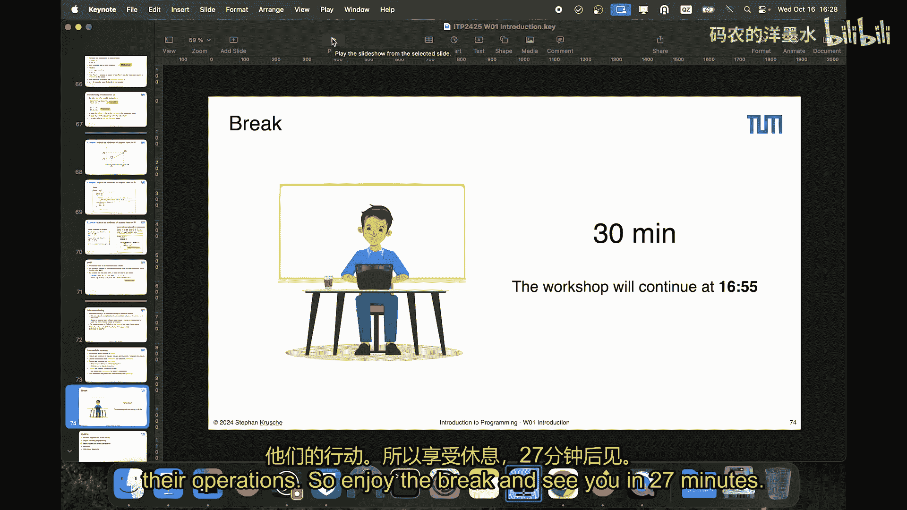